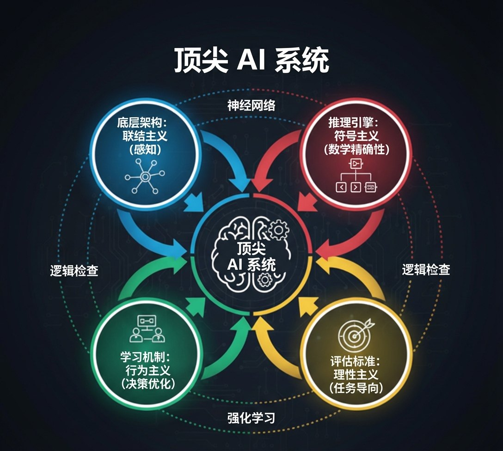

# 1.1 什么是AI：四种定义的智慧交锋 {#11}

!!! info "学前导读"

    今天你用过几次 AI？刷短视频时的推荐、拍照时的美颜、导航里的路线规划、问大模型的一个问题……AI 已经无处不在，可“什么样的机器才算有智能”，科学家们争论了 70 多年也没有统一答案。

    本节介绍四条研究路径：**像人一样行动**（图灵测试）、**像人一样思考**（认知建模）、**理性地思考**（逻辑推理）、**理性地行动**（智能体）。学完后，你应当能说出这四条路径各关心什么，并能举例说明今天的大模型同时用到了哪几条。

“人工智能”自 1956 年诞生之日起，便伴随着一个根本性难题：到底什么是“智能”？这个看似简单的问题，引发了长达 70 年的哲学辩论，并催生出四条截然不同的研究路径。

## 1.1.1 像人一样行动：图灵测试的百年回响 {#111}

1950 年，阿兰·图灵在《计算机器与智能》中写道：“我提议考虑‘机器能思考吗’这个问题。”他很快意识到，“思考”一词太主观了，不同的人有不同的理解。于是，他提出了一个巧妙的替代方案——“模仿游戏”，即后来的“图灵测试”。

**测试规则**

想象一个房间里有三方参与者：

- 裁判（C）：人类提问者；
- 人类（A）：回答者；
- 机器（B）：回答者。

如图 1-1 所示，裁判通过文字界面与 A、B 交流，但看不到对方。如果裁判无法可靠地区分出谁是机器、谁是人类，那么这台机器就被认为“通过了图灵测试”。图灵本人并没有规定一个严格的及格线，他只是预言：到 2000 年前后，普通提问者在 5 分钟对话后能正确分辨出机器的概率不会超过 70%。

{ loading=lazy }

图 1-1 图灵测试示意图
{ .fig-caption }

**历史性的突破**

2024—2025 年，美国加州大学圣迭戈分校的研究者琼斯（C. Jones）和伯根（B. Bergen）用大语言模型做了两次公开、可重复的图灵测试实验：

- **2024 年（双方对话）**：500 名参与者在网上与对方聊 5 分钟，再判断对方是人还是 AI。GPT-4 有 54% 的时候被判为“人”，接近瞎猜的 50%；而 1966 年的老程序 ELIZA 只有 22%。
- **2025 年（三方对话，接近图灵原始设计）**：裁判同时和一个真人、一个 AI 聊天，再指出谁是人。被要求扮演“一个内向、爱用网络用语的年轻人”的 GPT-4.5 有 73% 的时候被选为“人”——比真正的人类还更像人。

这意味着，在几分钟的文字聊天里，最新的大模型已经能够在相当程度上“骗过”人类，让人误以为它是真人。但这真的代表它“有意识”吗？

**哲学困境**

图灵测试面临一个根本性质疑：表现等同 ≠ 内在等同。

想象一下，一只鹦鹉能够完美地模仿人类说“我爱你”，但这是否意味着它理解“爱”的含义？同理，即使 AI 通过了图灵测试，也可能只是在进行高维度的“鹦鹉学舌”，而不是真正理解。哲学家约翰·塞尔在 1980 年提出的“中文房间”思想实验讲的也是这个道理：一个完全不懂中文的人，只要照着一本足够厚的规则手册查表回复，屋外的人就会以为屋里的人懂中文。

!!! example "案例 1-1：ELIZA 的“骗术”"

    1966 年，麻省理工学院的约瑟夫·魏泽鲍姆（Joseph Weizenbaum）编写了 ELIZA，它是最早的聊天机器人之一。它扮演一位心理咨询师，只靠简单的关键词匹配和句式改写，就让不少人相信它真的“理解”自己的情感。

    **对话示例**（译自魏泽鲍姆 1966 年论文中的原始记录）：

    > 用户：男人都一个样。 
    > ELIZA：怎么说？ 
    > 用户：他们总是拿这样那样的事来烦我们。 
    > ELIZA：你能举个具体的例子吗？ 
    > 用户：嗯，是我男朋友让我来这儿的。 
    > ELIZA：你男朋友让你来这儿的。 
    > 用户：他说我大部分时间都很沮丧。 
    > ELIZA：听到你很沮丧，我很难过。

    ELIZA 的“秘密”很简单：它有一套固定的脚本规则，比如检测到“我很……”就把人称换过来回复“听到你很……，我很难过”，检测到“男朋友”“妈妈”这类关键词就追问家人的事，什么都没匹配上就回复“请继续说下去”。魏泽鲍姆后来很吃惊：连他的秘书在知道原理后，仍然要求他离开房间，好和 ELIZA“单独聊聊”。

    **批判性思考**

    - 为什么即使知道对方是程序，人类仍然会对 ELIZA 产生情感投射？
    - 如果今天的大模型只是更复杂的 ELIZA，那么图灵测试还有意义吗？

**动手看看 · 图灵测试小游戏**

下面的小游戏给出 10 组问答，每组一边是人、一边是 AI。你来当一回裁判，看看自己能判对几组。

<iframe class="sim-frame" src="../../sims/turing-test/main.html" height="640" loading="lazy" title="图灵测试小游戏"></iframe>

玩完后对比一下：你的正确率比 50%（瞎猜）高多少？哪几组让你判断错了？[全屏打开](../../sims/turing-test/main.html){ target=_blank } · [教学说明](../../sims/turing-test/index.md)
{ .sim-caption }

## 1.1.2 像人一样思考：认知科学的镜像 {#112}

如果说图灵测试关注“外显行为”，那么认知建模学派则致力于“内在思考过程”的模拟。

**核心思想**：如果能搞清楚人类大脑的思考方式，然后用计算机程序模拟这一过程，那么 AI 就能真正“理解”。

**GPS 系统**：1957 年起，纽厄尔（Allen Newell）、肖（Cliff Shaw）和西蒙（Herbert Simon）开发了“通用问题求解器”（General Problem Solver，GPS）。他们让被试一边解题一边“出声思考”，把录下的解题步骤和程序的步骤对照，希望程序不仅能解出题，而且解题的顺序也和人一样。

**困境**：人类的大脑太复杂了，我们对大脑如何产生意识、情感、直觉的理解极其有限，连自己都搞不清楚，何谈用程序模拟？

**类比理解**

这就像让一个从未见过飞行器的工程师，仅根据“鸟会飞”这一事实，逆向设计出一架飞机。即使他掌握了鸟的所有解剖结构，也可能造不出能飞的机器。因为“飞行”的本质不仅是“模仿鸟的形态”，更要“理解空气动力学”。同理，AI 可能不需要完全复制人类大脑的结构，只需实现“智能功能”即可。

## 1.1.3 理性地思考：逻辑学的完美世界 {#113}

古希腊哲学家亚里士多德开创了形式逻辑，他认为：只要前提正确，推理过程符合逻辑规则，那么结论必然正确。

这种思想影响了第一代 AI 研究者。他们认为：智能 = 逻辑规则 + 推理引擎，这也直接催生了符号主义。

**符号主义的诞生**：20 世纪 50—80 年代，符号主义占据 AI 研究的主流地位。研究者们试图把人类专家的知识整理成一条条“如果……那么……”（If-Then）规则。一个专家系统通常有几百到几千条规则；少数雄心勃勃的项目（如 1984 年开始的 Cyc 常识库）则试图手工录入上百万条常识。

!!! example "专家系统案例：MYCIN"

    20 世纪 70 年代，斯坦福大学开发的 MYCIN 系统是专家系统的典范。它能帮助医生诊断血液细菌感染和脑膜炎，并推荐抗生素治疗方案。

    **规则示例**（MYCIN 论文中的真实规则，意译）：

    > 如果（1）细菌的革兰氏染色为阴性，（2）细菌形态为杆状，（3）细菌是厌氧的，那么有提示性证据（可信度 0.6）表明这种细菌是拟杆菌。

    MYCIN 存储了约 450～600 条这样的规则。1979 年发表的一次盲评中，它对脑膜炎病例的治疗建议约有 65% 被外部专家评为“可接受”，与斯坦福大学感染科专家的水平相当，明显高于实习医生。不过，由于责任认定、与医院系统对接等问题，它从未真正用于临床。

    **优势**

    - √ 决策过程透明、可解释；
    - √ 在狭窄专业领域表现优秀。

    **致命缺陷**

    - × 知识获取瓶颈：每条规则都需要专家手工编写；
    - × 系统脆弱性：遇到规则外的情况，就给不出合理答案；
    - × 常识难题：人类知道“下雨要打伞”，但这需要多少条规则？

**动手看看 · 动物识别专家系统**

下面是一个只有 15 条规则的小型专家系统。勾选动物的特征，点“推理一步”看它触发了哪条规则；得出结论后点“为什么？”查看完整的推理过程。

<iframe class="sim-frame" src="../../sims/animal-expert/main.html" height="720" loading="lazy" title="动物识别专家系统"></iframe>

试着描述一种规则库里没有的动物（比如“鸭子”），看看系统会怎样“卡住”；再用下方的“添加规则”教会它——这就是专家系统的知识获取瓶颈。[全屏打开](../../sims/animal-expert/main.html){ target=_blank } · [教学说明](../../sims/animal-expert/index.md)
{ .sim-caption }

## 1.1.4 理性地行动：智能体的实用主义 {#114}

这是现代 AI 的主流定义，也是最“工程化”的研究路径。

**核心思想**：不要纠结于“是否像人一样思考 / 行动”，而要关注“是否能把事做好”。

**智能体（Agent）**：一个能够感知环境并采取行动，以尽可能实现目标的系统。

| 任务 | 像人一样行动 | 理性地行动 |
|---|---|---|
| 下棋 | 像人类棋手一样思考 | 选择能赢棋的策略 |
| 翻译 | 模拟人脑的语言处理过程 | 输出最准确的翻译结果 |
| 推荐 | 模拟人类的品位选择 | 推荐用户最可能喜欢的内容 |

表 1-1 两种 AI 定义路径对比
{ .tab-caption }

**优势**

- √ 目标明确，效果可量化评估；
- √ 不需要完美模仿人类（人类也有很多缺陷）；
- √ 实用性强，可直接解决问题。

这正是现代 AI（如深度学习、强化学习）能够突飞猛进的原因：它不再执着于机械地模仿人类的认知过程，而是专注于通过数据驱动的方式，优化可量化的目标。但这并不意味着“模仿人类”完全失效——大语言模型的成功恰恰证明了模仿人类行为数据的价值。真正的技术进步，在于根据任务灵活选择最适合的范式，而非固守某一种范式。

## 1.1.5 四种定义的整合：现代AI的实用主义 {#115}

进入 2025 年，顶尖 AI 系统实际上融合了多种路径（图 1-2）：

- **底层架构**：联结主义的神经网络（感知）；
- **推理引擎**：符号主义的逻辑检查（数学精确性）；
- **学习机制**：行为主义的强化学习（决策优化）；
- **评估标准**：理性主义的目标函数（任务导向）。

{ loading=lazy }

图 1-2 四种 AI 定义路径整合示意图
{ .fig-caption }

!!! example "整合案例：DeepSeek-R1"

    DeepSeek-R1 展现的复杂推理能力，实际上是多种范式的融合：

    - 用神经网络理解题目（联结主义）；
    - 先写出一长串“思考过程”（思维链）再给答案，过程中会自我检查、推翻重来（类符号主义的逻辑推导）；
    - 用强化学习优化推理策略：答案对了、格式对了就给奖励（行为主义）；
    - 用准确率评估表现（理性主义）。

!!! note "关键认知"
    AI 的核心目标不是“模仿人类思考”，而是“实现智能功能”。这就像飞机不需要扇动翅膀，甚至不需要羽毛，却能飞得比任何鸟都高、都远。同理，AI 也不需要复制人类大脑的每一个细节，只要能实现智能行为即可。

## 随堂小测

**1.** 关于图灵测试，下面哪种说法是对的？（　　）

- A. 图灵规定，机器只要骗过裁判 30% 就算有智能
- B. 裁判只通过文字对话判断对方是人还是机器
- C. 通过图灵测试就证明机器有了意识
- D. 至今还没有任何程序在实验里被多数人误认为是人

??? tip "答案与解析"
    **答案：B**

    解析：图灵测试只看文字对话里的“外在表现”。图灵没有规定严格的及格线，只预言了“5 分钟后识别正确率不超过 70%”（A 错）；“表现像人”不等于“有意识”，这正是中文房间要说的道理（C 错）；2025 年的实验中 GPT-4.5 有 73% 的时候被判为人（D 错）。

    考查：图灵测试 · 认知层次：理解 · [回看 1.1.1](#111)
    { .quiz-meta }

**2.** MYCIN 这类专家系统最致命的缺陷是什么？（　　）

- A. 运行速度太慢
- B. 决策过程不透明
- C. 每条规则都要专家手工编写，遇到规则外的情况就失灵
- D. 只能处理图像

??? tip "答案与解析"
    **答案：C**

    解析：专家系统的优点恰恰是透明、可解释（B 错）。它的问题是“知识获取瓶颈”和“脆弱性”：知识靠人一条条写，世界上的例外又写不完。

    考查：符号主义与专家系统 · 认知层次：理解 · [回看 1.1.3](#113)
    { .quiz-meta }

**3.** 现代 AI 的主流定义更关心“能不能把事做好”，而不是“是不是和人想得一样”。（　　）

- √
- ×

??? tip "答案与解析"
    **答案：√**

    解析：这就是“理性地行动”路径，即智能体的观点：感知环境、采取行动、尽可能实现目标，用可量化的指标评估效果。

    考查：四种定义路径 · 认知层次：记忆 · [回看 1.1.4](#114)
    { .quiz-meta }
