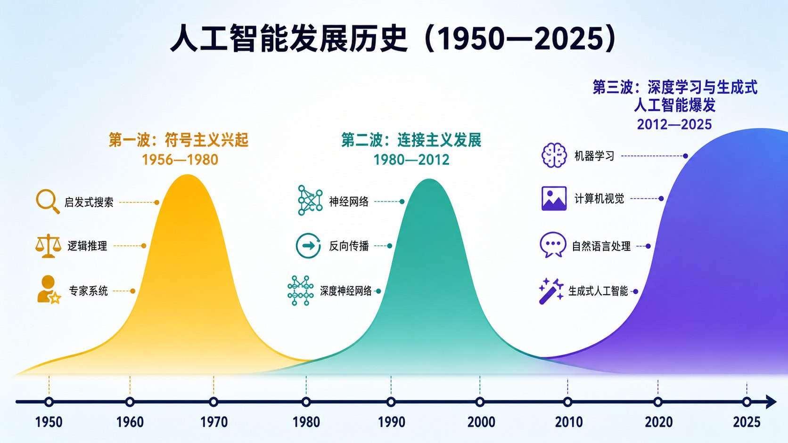
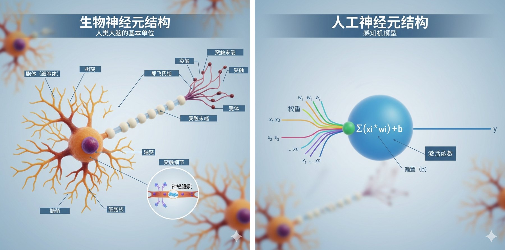
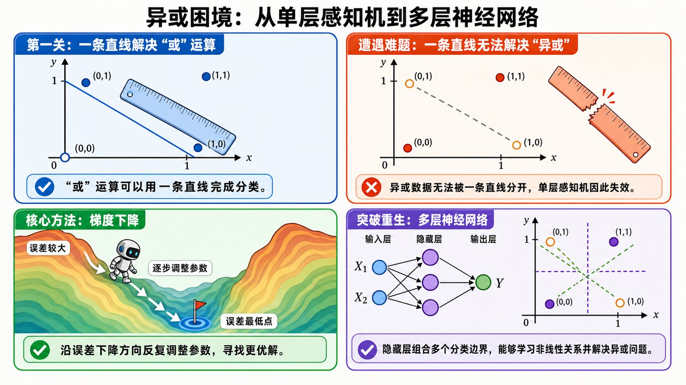

# 1.2 AI进化史：三次浪潮与三大流派 {#12}

!!! info "学前导读"

    AI 的历史像过山车：三次热潮，两次寒冬。每一次热潮背后，都有一个流派站在台前——**符号主义**（靠规则）、**联结主义**（靠神经网络从数据里学）、**行为主义**（靠试错和奖励）。

    本节内容较多，建议分两次学完：先读 1.2.1～1.2.2，玩一玩“异或难题”和“梯度下降”两个动画；再读 1.2.3～1.2.4。学完后，你应当能说出三次浪潮各自的代表事件，以及每次寒冬是因为什么。

AI 的历史不是一条平滑上升的曲线，而是一段由希望、狂热、失望与冰封交织而成的波浪史。每一次浪潮的巅峰，都站着一个试图解释“智能本质”的主流学派。

{ loading=lazy }

图 1-3 AI 发展历史波浪图（1950—2025）
{ .fig-caption }

人工智能的发展史通常以双重里程碑为起点：1950 年，阿兰·图灵提出“图灵测试”，为机器智能奠定了深厚的思想与理论基础；而 1956 年召开的达特茅斯会议，则让“人工智能”这一术语正式登场，标志着该领域作为一门独立学科的诞生。

历史学家对三次浪潮的划分略有不同，本书采用最常见的一种：

| 阶段 | 时间 | 主角 | 结局 |
|---|---|---|---|
| 第一次浪潮 | 1956—1974 年 | 符号主义：逻辑推理、搜索 | 第一次寒冬（1974—1980 年） |
| 第二次浪潮 | 1980—1987 年 | 专家系统；反向传播让神经网络复兴 | 第二次寒冬（1987—1993 年） |
| 第三次浪潮 | 2006 年起，2012 年全面爆发 | 深度学习、大模型 | 至今 |

**动手看看 · AI 发展时间轴**

<iframe class="sim-frame" src="../../../sims/ai-timeline/main.html" height="660" loading="lazy" title="AI 发展时间轴"></iframe>

点击时间轴上的事件看详情，留意每次“寒冬”之前发生了什么。[全屏打开](../../sims/ai-timeline/main.html){ target=_blank } · [教学说明](../../sims/ai-timeline/index.md)
{ .sim-caption }

## 1.2.1 第一次浪潮：符号主义的黄金时代（1956—1974） {#121}

**核心逻辑**：智能 = 逻辑规则 + 知识库

**历史起点：1956 年的达特茅斯会议**

1955 年，约翰·麦卡锡、马文·明斯基、纳撒尼尔·罗切斯特、克劳德·香农四位学者联名写了一份研究提案，第一次使用了“人工智能”（artificial intelligence）这个词。1956 年夏天，十来位学者在达特茅斯学院进行了为期约两个月的研讨。当时的研究者普遍乐观，认为只要把人类的逻辑规则清晰地编码进计算机，就能在不长的时间内解决 AI 的主要问题。

!!! quote "历史原声"
    “我们认为，如果精心挑选一组科学家一起工作一个夏天，就能在其中一个或多个问题上取得重大进展。”——麦卡锡等，《达特茅斯人工智能夏季研究计划》（1955）

    事后看，这个“一个夏天”的估计乐观得惊人。

**符号主义的做法：手动编写智能**

符号主义又称“逻辑主义”或“符号 AI”，其核心假设是：思维的本质就是对符号的操作。就像人类通过语言符号交流，计算机也可以通过操作符号来“思考”。

!!! example "案例 1-2：通用问题求解器（GPS）"

    1957—1959 年，纽厄尔和西蒙等人开发的 GPS 系统试图用同一套推理方法解决各种问题。

    **问题示例**：汉诺塔——把一摞从大到小叠放的圆盘从 A 柱移到 C 柱，每次只能移一个，大盘不能压在小盘上。

    **GPS 的思考过程**（叫作“手段—目的分析”）：

    1. 分析当前状态与目标状态的差异；
    2. 选择能够缩小差异的操作；
    3. 执行操作，更新当前状态；
    4. 重复前三步，直到达到目标。

    GPS 在逻辑证明、汉诺塔这类规则清楚的谜题上表现不错，但遇到现实世界的复杂问题时就束手无策了。

**第一次 AI 寒冬（1974—1980）**

然而，符号主义很快撞上了南墙，陷入发展困境：

- **组合爆炸**：现实世界太复杂，需要考虑的可能性呈指数级增长；
- **常识壁垒**：人类知道“鸟会飞”，但“企鹅”“鸵鸟”是例外；
- **系统脆弱性**：遇到规则外的情况就会失灵。

1973 年，英国数学家詹姆斯·莱特希尔（James Lighthill）受英国政府委托发表了一份评估报告，认为 AI 研究远没有兑现早期的承诺，在现实问题上进展有限。英国随即大幅削减了 AI 经费；同一时期，美国国防部高级研究计划局（DARPA）也收紧了对 AI 基础研究的资助。资金冻结期到来——这就是第一次 AI 寒冬。

!!! question "反思时间：为什么符号主义失败了？"
    核心问题：世界不是用规则定义的。

    - **语言充满歧义**：同一个字在不同语境下含义完全不同，如“意思”“有意思”“意见”；
    - **常识难以形式化**：人类知道“下雨要打伞”，但这需要多少条规则？
    - **例外无处不在**：任何规则都有例外，例外又有例外，规则永远写不完。

## 1.2.2 第二次浪潮：专家系统与联结主义的逆袭（1980—2012） {#122}

**专家系统的辉煌时期（1980 年代）**

第一次寒冬之后，研究者不再追求“通用”的智能，转而把某个狭窄领域专家的知识写成规则。1980 年代，专家系统把符号主义推向了应用巅峰，迎来了第二次浪潮。典型案例：

- **DENDRAL**（1965 年起）：根据质谱数据推断化学分子结构，是最早的专家系统；
- **MYCIN**（1970 年代）：诊断血液细菌感染和脑膜炎并推荐抗生素，在盲评中与专家水平相当（见 1.1.3）；
- **XCON**（1980 年）：DEC 公司的计算机配置系统，据公司估计每年节省数千万美元。

这些系统在各自的狭窄领域表现优异。但规则越积越多、维护越来越难，加上专用 LISP 计算机的市场在 1987 年崩溃，专家系统的热潮在 1987—1993 年间迅速退去，这就是**第二次 AI 寒冬**。

与此同时，另一条道路正在悄悄复兴。

**核心逻辑**：智能 = 神经网络 + 数据训练

**历史转折：从规则到学习**

联结主义拒绝“教机器查字典”式的规则编写思路，提出观点：智能应该诞生于底层的联结，而不是顶层的规则。

受加拿大心理学家唐纳德·赫布 1949 年在《行为的组织》一书中关于神经元学习的设想启发，科学家们开始在计算机中模拟大脑的工作原理。

{ loading=lazy }

图 1-4 生物神经元结构与人工神经元结构对比
{ .fig-caption }

**生物神经元工作流程**：树突接收信号 → 细胞体整合信号 → 轴突传递信号 → 突触连接下一个神经元。

生物神经元通过电化学信号（动作电位）进行通信。当树突接收到足够的兴奋性信号时，细胞体内的电位会达到阈值，产生动作电位并沿轴突传播。在轴突末梢，电信号会转化为化学信号（神经递质），通过突触间隙传递给下一个神经元。这个过程是并行的，具有高度的适应性和可塑性。

**人工神经元工作流程**：输入（x）乘以权重（w）后求和 → 激活函数（f）→ 输出（y）。

人工神经元首先计算所有输入的加权和，加上偏置项，再通过激活函数进行处理，最终产生输出。这个过程是基于数学运算的。通过调整权重和偏置，人工神经元可以学习从输入到输出的复杂映射关系。

**核心学习机制（赫布法则）**：“一起被激发的神经元会连接在一起。”在人工神经网络中，这意味着：如果两个神经元经常同时被激活，它们之间的连接权重就会增大。

**感知机：第一个能学习的神经网络模型**

1957 年，美国心理学家弗兰克·罗森布拉特（Frank Rosenblatt）发明了“感知机”。它可以类比为一个刚接触 AI 的初学者，手里只拿着一把“直尺”，只能处理简单的线性问题。

感知机的学习逻辑是“盲人摸象 + 知错就改”：

1. **瞎蒙**：刚开始闭着眼睛随便定一个规则（随机初始化权重）；
2. **做题**：看着练习题和标准答案（给定训练样本）；
3. **交卷**：给出自己的答案（计算输出）；
4. **纠错**：如果跟标准答案对不上，就微调自己的规则（调整权重）；
5. **迭代**：重复很多遍，直到全部做对。

{ loading=lazy }

图 1-5 异或困境：从单层感知机到多层神经网络
{ .fig-caption }

!!! example "案例 1-3：初试锋芒——搞定“或（OR）”运算"

    请看图 1-5（a）。我们来看看这个拿着直尺的 AI 是怎么做“或”运算的。

    “或”的规则很简单：两个输入里只要有一个是 1（黑点），结果就是 1；两个都是 0（白点），结果才是 0。

    **画面重现**：坐标系中有一个白点和三个黑点。这个 AI 拿着手里的直尺，非常轻松地在中间“咔嚓”一刀切开：白点在左下，黑点全在右上。

    **通俗结论**：感知机通过训练调整参数（例如把一开始随机的权重 0.5 调到 0.8），就能学会用“一条直线”把两类点分开。这类问题叫作“线性可分”问题。

**异或困境：遭遇滑铁卢**

请看图 1-5（b）。“异或”（XOR）的规则是：两个输入相同为 0，不同为 1。

**画面重现**：这次图中的黑点和白点呈对角线交叉分布。拿着直尺的 AI 傻眼了：无论怎么下刀，都没法用一条直线把黑白两类点完全分开。

异或本身并不是什么新题，但 1969 年，明斯基和派珀特（Seymour Papert）在《感知机》一书中用数学严格证明了：单层感知机解决不了异或这类线性不可分问题。很多人由此对神经网络失去了信心，相关经费被大幅削减，神经网络研究陷入了十余年的低谷。

**动手看看 · 感知机与“异或”难题**

<iframe class="sim-frame" src="../../../sims/xor-perceptron/main.html" height="640" loading="lazy" title="感知机与异或难题"></iframe>

先选“或”，拖动直线把黑白点分开；再换成“异或”，试试还能不能做到。最后打开“两条直线（隐藏层）”，看多一层神经元怎样解决问题。[全屏打开](../../sims/xor-perceptron/main.html){ target=_blank } · [教学说明](../../sims/xor-perceptron/index.md)
{ .sim-caption }

**类比理解梯度下降（下山法）**

请看图 1-5（c）。上面说的“调整权重”，具体是如何实现的呢？看图中的探险机器人！

**画面重现**：想象 AI 就是这个机器人，被扔在了四周漆黑的山谷里。坡越高代表误差越大，谷底插着红旗的地方是误差最小、最准确的位置。

机器人看不见全貌，但能感觉到脚下的坡度（即梯度）。它的策略极其简单：每次用脚探一探，哪边往下最陡，就往那个方向迈一小步。

**通俗结论**：一步一步“摸黑”往下走，误差就会越来越小。不过，机器人也可能走进一个“小坑”（局部最低点）就停下了，而真正的最低点在别处；步子太大还可能来回跳、下不去。研究者为此发明了很多改进方法。这就是 AI 通过不断微调参数，让错误率越来越低的学习过程。

**动手看看 · 梯度下降下山**

<iframe class="sim-frame" src="../../../sims/gradient-descent/main.html" height="700" loading="lazy" title="梯度下降下山"></iframe>

调大、调小“学习率”（步长），看小球是稳稳走到谷底、来回震荡，还是停在半山腰的小坑里。[全屏打开](../../sims/gradient-descent/main.html){ target=_blank } · [教学说明](../../sims/gradient-descent/index.md)
{ .sim-caption }

**反向传播：寒冬中的火种与破局重生**

请看图 1-5（d）。既然一把直尺（单层）切不开，那多拿几把尺子折起来不就行了吗？原本死板的直尺，变成了多把折尺，就可以绕着弯把 XOR 的点切开——这就是多层神经网络。

但是，尺子（层数）多了，该如何训练呢？1986 年，鲁梅尔哈特（David Rumelhart）、辛顿（Geoffrey Hinton）和威廉姆斯（Ronald Williams）在《自然》杂志上发表论文，用“反向传播算法”成功训练了多层神经网络（这一方法的数学思想更早已有人提出，这篇论文让它广为人知）。

它的核心思想就像是老师批改试卷：

1. **前向传播**：学生先把整张卷子做完（计算输出结果）；
2. **计算误差**：老师批改打分，算出离满分差多少；
3. **反向传播**：把误差从最后一层往前倒推，找出每一步、每一个神经元对错误“负多少责任”；
4. **梯度下降**：让每个环节按自己的责任大小调整思考方式（即权重）。

**20 世纪 90 年代的低谷**

虽然有了“多把折尺”和“下山寻宝法”，但 20 世纪 90 年代到 21 世纪初，神经网络依然处境艰难：

- **下山太慢**：当时的电脑算力太弱，模型训练速度极慢；
- **死记硬背**：模型容易出现“过拟合”，就像死背题库，一遇到新题就束手无策；
- **数据匮乏**：互联网尚未普及，没有足够的数据来学习；
- **强敌环伺**：当时流行的支持向量机（SVM）等方法，在小数据上比神经网络好用得多。

当然，神经网络并没有完全沉寂：1989 年起，杨立昆（Yann LeCun）用反向传播训练的卷积神经网络识别手写邮政编码，后来被用于美国银行的支票识别。但在主流学术界，大多数人都把目光转向了别处。正是辛顿、杨立昆、本吉奥（Yoshua Bengio）等少数“守夜人”的坚持，才熬到了算力爆发的时代。三人因此获得了 2018 年图灵奖。

## 1.2.3 第三次浪潮：深度学习的爆发（2012— ） {#123}

**核心逻辑**：智能 = 深层神经网络 + 大数据 + GPU 算力

**历史转折点：2012 年的 ImageNet 奇迹**

2012 年，在 ImageNet 大规模视觉识别挑战赛上，亚历克斯·克里热夫斯基（Alex Krizhevsky）、伊利亚·苏茨克维（Ilya Sutskever）和辛顿开发的 AlexNet 横空出世。

| 年份 | 冠军方法 | 前 5 错误率 | 技术突破 |
|---|---|---|---|
| 2010 | 传统方法（NEC 等） | 28.2% | 手工特征 + 分类器 |
| 2011 | 传统方法（XRCE） | 25.8% | 稳步优化 |
| 2012 | AlexNet | 15.3% | 深度学习 + GPU + ReLU |
| 2013 | Clarifai（ZFNet 的改进版） | 11.7% | 可视化理解网络 |
| 2014 | GoogLeNet | 6.7% | Inception 结构 |
| 2015 | ResNet | 3.57% | 残差连接，已低于人类水平（约 5.1%） |
| 2017 | SENet | 2.25% | 通道注意力；比赛于本年停办 |

表 1-2 ImageNet 视觉识别大赛历史成绩（2010—2017）
{ .tab-caption }

**AlexNet 的意义**：它的错误率比第二名（26.2%）低了将近 11 个百分点！这一战向全世界证明：深度学习不再是空想，而是实实在在的“屠龙宝刀”。

**三大要素的汇聚**

- **算法**：反向传播 + ReLU 激活函数 + Dropout（随机丢弃，防止过拟合）；
- **数据**：ImageNet 比赛用的约 120 万张标注图片；
- **算力**：两块 NVIDIA GeForce GTX 580 显卡。

**为什么是 GPU？** 图形处理器（GPU）原本是为游戏画面设计的，擅长同时处理大量简单计算（如像素渲染）。而神经网络的训练，恰恰就是这种“大规模并行计算”：神经网络训练 = 海量的矩阵乘法，因此 GPU 成了训练模型的天然硬件。

**深度学习的黄金时代（2012—2022）**

AlexNet 之后，深度学习在各个领域全面开花：

- 计算机视觉：人脸识别、自动驾驶；
- 自然语言处理：机器翻译、文本生成；
- 语音识别：Siri、小爱同学等语音助手；
- 游戏 AI：AlphaGo、AlphaStar、OpenAI Five；
- 推荐系统：抖音、淘宝、网飞（Netflix）。

!!! example "案例 1-4：AlphaGo 的震撼"

    2016 年 3 月，谷歌 DeepMind 的 AlphaGo 以 4∶1 击败韩国围棋世界冠军李世石，这是 AI 历史上的里程碑事件。

    **技术细节**

    - 策略网络（Policy Network）：决定下一步走哪里；
    - 价值网络（Value Network）：评估当前局面的优劣；
    - 蒙特卡洛树搜索（MCTS）：向前模拟未来的走法；
    - 强化学习：通过自我对弈不断进化。

    **AlphaGo 第 37 手**：在第二局比赛中，AlphaGo 下出了著名的“第 37 手”（五路肩冲）。现场解说的职业棋手一开始以为是失误，但随着棋局推进，这步棋被证明极富远见，后来被不少棋手称为“神之一手”。

    **深刻意义**：AI 下出了人类棋手很少会考虑的走法，而且这步棋并不是谁教给它的，是它从大量自我对弈中“摸索”出来的。

## 1.2.4 行为主义：强化学习的崛起 {#124}

**核心逻辑**：智能 = 感知环境 + 试错学习 + 奖励优化

| 学习类型 | 定义 | 类比 | 代表应用 |
|---|---|---|---|
| 监督学习 | 有标准答案的学习 | 老师教学生，有批改 | 图像分类、机器翻译 |
| 无监督学习 | 无标准答案，自行发现模式 | 自主阅读，自己总结 | 顾客分群、异常检测 |
| 强化学习 | 通过奖惩学习最优策略 | 训练小狗，做对给零食 | 游戏、机器人控制 |

表 1-3 三种机器学习范式对比
{ .tab-caption }

**强化学习的核心要素**

- 智能体（Agent）：学习的主体；
- 环境（Environment）：与智能体互动的外部世界；
- 状态（State）：环境的当前情况；
- 动作（Action）：智能体可以采取的行动；
- 奖励（Reward）：环境给出的反馈信号。

!!! example "案例 1-5：训练 AI 玩闯关游戏（教学示意）"

    - **智能体**：游戏里的小人；
    - **环境**：游戏世界；
    - **状态**：屏幕画面（当前位置、敌人、金币等）；
    - **动作**：上、下、左、右、跳跃；
    - **奖励机制**：吃金币 +1 分，被敌人碰到 −1 分，过关 +100 分。

    **训练过程**

    1. 随机乱跑，死亡频繁，奖励很低；
    2. 逐渐发现吃到金币会有奖励；
    3. 逐渐发现跳跃能躲避敌人；
    4. 逐渐发现终点有大奖；
    5. 经过成千上万次尝试，学会稳定通关。

**强化学习的成功案例**

- **AlphaGo**（2016）：击败围棋世界冠军；
- **OpenAI Five**（2019）：在《刀塔 2》（Dota 2）比赛中击败世界冠军战队；
- **MuZero**（2020）：在不被告知规则的情况下，同时掌握围棋、国际象棋、日本将棋和几十款雅达利游戏；
- **ChatGPT 的 RLHF**（2022）：用人类反馈做强化学习，让模型的回答更符合人的期望（见 3.3 节）。

**流派的融合：AI 的大集成时代**

进入 2025 年，顶尖模型已经不再纠结于单一流派：

- 利用联结主义（神经网络）进行强大的语境感知；
- 利用强化学习（行为主义）优化推理链；
- 利用符号 / 逻辑检查（符号主义）确保数学计算和代码的正确。

许多研究者认为，这种多流派融合的思路，是走向更通用的人工智能（AGI）的重要方向。

## 随堂小测

**1.** 按本书采用的分期，专家系统的繁荣属于哪一次浪潮？（　　）

- A. 第一次浪潮（1956—1974）
- B. 第一次寒冬（1974—1980）
- C. 第二次浪潮（1980—1987）
- D. 第三次浪潮（2012— ）

??? tip "答案与解析"
    **答案：C**

    解析：第一次寒冬后，研究者转向“狭窄领域的专家知识”，专家系统在 1980 年代迎来商业应用高峰；随后因维护难、LISP 机市场崩溃，在 1987—1993 年进入第二次寒冬。

    考查：三次浪潮 · 认知层次：记忆 · [回看 1.2.2](#122)
    { .quiz-meta }

**2.** 单层感知机为什么解决不了“异或”问题？（　　）

- A. 异或问题的数据太多
- B. 异或的两类点无法用一条直线分开
- C. 感知机没有学习能力
- D. 当时的计算机内存不够

??? tip "答案与解析"
    **答案：B**

    解析：单层感知机只能画一条直线（线性分界），而异或的黑白点呈对角交叉，属于线性不可分问题。加一层隐藏神经元（多层网络）就能解决，这需要反向传播来训练。

    考查：感知机与异或 · 认知层次：理解 · [回看 1.2.2](#122)
    { .quiz-meta }

**3.** 梯度下降只要一直往下走，就一定能找到误差最小的最优解。（　　）

- √
- ×

??? tip "答案与解析"
    **答案：×**

    解析：梯度下降每次只看脚下的坡度，可能停在局部最低点（小坑）里，学习率太大还可能来回震荡。它能让误差不断变小，但不保证找到全局最优。

    考查：梯度下降 · 认知层次：理解 · [回看 1.2.2](#122)
    { .quiz-meta }
