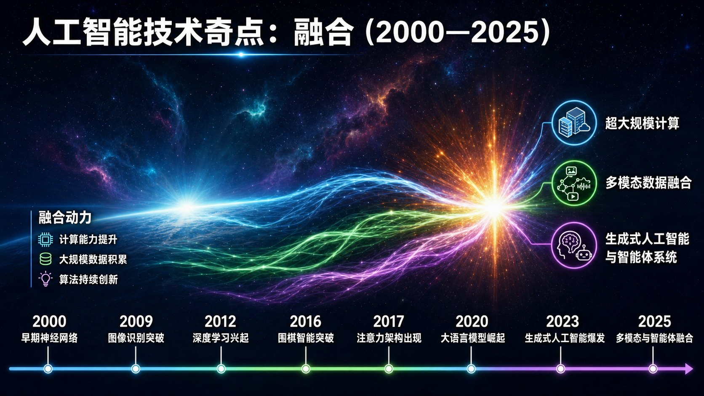
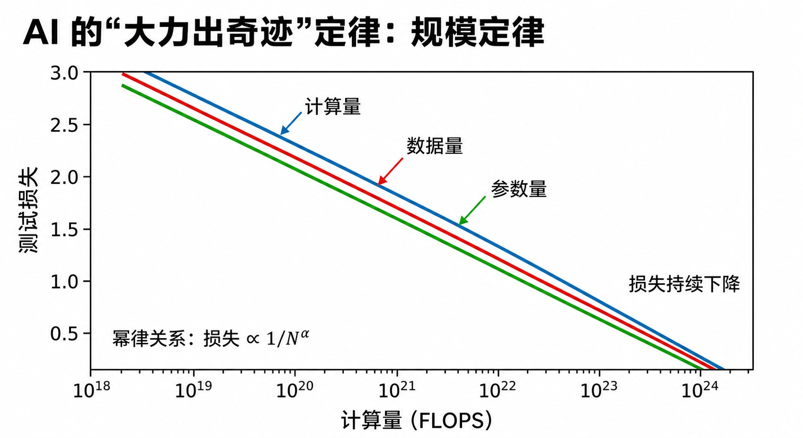

# 1.3 AI的进化路线：从慢跑到奇点爆炸 {#13}

!!! info "学前导读"

    为什么 AI 在 2023 年前后突然“火出圈”？本节给出三个关键词：**生成式**（AI 从“做选择题”变成“写作文”）、**缩放法则**（模型越大、数据越多、算力越强，效果就按规律变好）、**涌现**（规模大到一定程度后，模型好像突然学会了新本领——这一点在学界还有争论）。

    学完后，你应当能说出判别式 AI 和生成式 AI 的区别，并能用自己的话解释缩放法则和涌现。

如果将 AI 的发展比作一场马拉松，那么在 2023 年之前，人类更像是在进行漫长的热身和慢跑；而从 2023 年前后开始，算法、算力、数据三个维度的能量在同一时间点交汇，整个领域突然加速，有人把这形容为技术的“奇点”时刻。本节将从历史与现象的视角，梳理 AI 走到今天的进化路线。

{ loading=lazy }

图 1-6 AI 技术奇点三要素交汇示意图（2000—2025）
{ .fig-caption }

## 1.3.1 范式转移：从判别式 AI（判官）到生成式 AI（创作者） {#131}

这是人机交互历史上的一次重大转折。

**第一阶段：判别式 AI（Discriminative AI）——精准的判官**

在旧时代，AI 更像是一个高级的过滤器。它的角色是：

- 在万千人脸中识别出特定的人；
- 在海量语音中提取出文字；
- 在股价波动中寻找趋势。

**核心动作**：分类（Classification）。它是在既有的世界里做选择题。

| 应用领域 | 技术方法 | 输入 | 输出 | 局限 |
|---|---|---|---|---|
| 图像识别 | CNN | 图片 | 标签（猫 / 狗） | 只能识别训练过的类别 |
| 垃圾邮件过滤 | 朴素贝叶斯 | 邮件内容 | 垃圾 / 正常 | 可能误判重要邮件 |
| 推荐系统 | 协同过滤 | 用户行为 | 推荐列表 | 新用户、新商品难推荐（冷启动） |

表 1-4 判别式 AI 在典型应用中的特点
{ .tab-caption }

**第二阶段：生成式 AI（Generative AI）——狂热的创作者**

当 AI 开始拥有“生成”能力，它就不再局限于“A 或 B”的选择题。它的角色变成了画家、诗人、程序员，甚至是物理世界的模拟者。

**核心技术**：文本生成的主力是基于 Transformer 架构的大语言模型，它用“注意力机制”根据上下文给每个词分配不同的权重（2.3 节详细介绍）；图片和视频生成则多用扩散模型（4.2 节）。

**生成式 AI 创作时间线**

| 年份 | 代表模型 | 意义 |
|---|---|---|
| 2018 | GPT-1 | 初步文本生成 |
| 2019 | GPT-2 | 文本已足够逼真，OpenAI 因担心被滥用而分阶段公开 |
| 2020 | GPT-3 | 只给几个例子就能完成新任务（少样本学习） |
| 2021 | DALL·E | 文字生成图片 |
| 2022 | Midjourney、Stable Diffusion、ChatGPT | 文生图走向大众；对话式 AI 爆红 |
| 2023 | GPT-4 | 能理解图片的多模态大模型 |
| 2024 | Sora | 高逼真视频生成（2 月发布预览） |
| 2025 | DeepSeek-R1 | 开源推理模型，训练和使用成本大幅降低 |

**关键转折：从“分析”到“创造”**

- 判别式 AI：像评委，只给作品打分；
- 生成式 AI：像创作者，生成作品本身。

这个转变的意义，好比一个人从“会阅读”到“会写作”的跃迁。

## 1.3.2 Scaling Law 的迷信与奇迹：只要增加规模，错误率就下降 {#132}

2020 年，OpenAI 发表了一篇影响深远的论文 *Scaling Laws for Neural Language Models*（《神经语言模型的缩放法则》）。

**缩放法则（Scaling Law）的预言**

这篇论文从大量实验中总结出一条经验规律：只要同步增加模型参数、训练数据量与计算量，模型在预测下一个词时的误差（损失）就会按照“幂律”平稳下降——画在横纵轴都取对数的图上，几乎是一条直线（图 1-7）。

{ loading=lazy }

图 1-7 神经网络缩放法则（Scaling Law）曲线
{ .fig-caption }

**核心含义**：规模即能力——参数越多、数据越多、算力越大，模型能力越强，而且提升的幅度可以提前估算。

这条曲线的发现，让业界从对模型效果的“质疑”转向了“规模赌局”——OpenAI、谷歌、Meta 等纷纷押注在堆规模上。不过要注意：缩放法则是经验规律而不是自然定律，规模每翻一番，进步就更小一些；高质量数据也有用完的一天。2024 年以后，业界开始把更多力气花在“让模型多想一会儿”（推理时计算，见 2.2 节）和提高数据质量上。

## 1.3.3 涌现时刻：量变引起质变，AI 突然学会了推理 {#133}

**涌现：质变的瞬间？**

研究者观察到：当模型规模大到一定程度（常被提到的是几百亿参数以上）时，原本只被训练用于“预测下一个词”的模型，在一些任务上的表现会突然大幅提高，仿佛凭空学会了新本领。

| 模型规模 | 参数量范围 | 常见能力（示意） | 示例任务 |
|---|---|---|---|
| 小型 | 10 亿以下 | 基础文本生成 | 续写句子、简单问答 |
| 中型 | 10 亿～100 亿 | 上下文理解 | 段落总结、多轮对话 |
| 大型 | 100 亿～1 000 亿 | 推理能力 | 数学应用题、代码生成 |
| 超大型 | 1 000 亿以上 | 复杂任务规划 | 长篇创作、多步骤推理 |

表 1-5 不同规模模型的能力对比（示意，不同模型差异很大）
{ .tab-caption }

**典型例子**

- **逻辑推理能力**：开始能解多步骤的数学题；
- **理解意图**：开始能猜测对话者话里的意图和情绪；
- **代码编写与纠错**：不仅能写代码，还能指出代码里的逻辑错误。

这种能力并非由程序员逐行写入，而是当系统规模超过某个程度后，在测试中“冒”了出来——这就是所谓的“涌现”。

!!! question "涌现是真的吗？"
    2023 年，斯坦福大学的研究者发表了一篇引起广泛讨论的论文《大语言模型的涌现能力是海市蜃楼吗？》。他们发现，很多“突然出现”的能力，换一种更细致的评分方法（比如不只看“全对 / 全错”，而是看答对了几成）后，曲线就变成了平滑上升。也就是说，“突变”可能部分来自我们的测量方式。今天，模型能力随规模增长是确定的事实，但“涌现”到底是真正的质变，还是测量造成的错觉，学界仍有争论。

**类比理解涌现**

- **水的涌现**：单个 H₂O 分子没有“湿”的属性；大量 H₂O 聚集在一起，才有了“湿”“流动性”“表面张力”；
- **蚁群的涌现**：单只蚂蚁只会执行简单规则；蚁群却能筑巢、分工、觅食，表现出集体智能；
- **AI 的涌现**：单个神经元只能做简单的加权求和；千亿参数的网络却表现出推理、创作、规划等能力。

!!! note "深度思考"
    为什么增加参数会带来新能力？一种解释是：更大的模型拥有更大的“容量”，能压缩和表征世界的更多规律，就像更大的大脑能处理更复杂的问题。但这仍是一个开放的研究问题。

## 1.3.4 为什么是2023—2025年爆发？三大支柱在同一时刻交汇 {#134}

2023 年 3 月 GPT-4 发布，2024 年 2 月 Sora 展示了高逼真的视频生成，2025 年 1 月 DeepSeek-R1 以开源方式大幅降低了推理模型的门槛。文字、图片、视频、代码都能由 AI 生成，人们真切地感受到了一个新时代的到来。

这并非偶然。2023—2025 年的爆发，是算法（Transformer + 缩放法则）、算力（GPU 集群）、数据（互联网海量语料）三大支柱历经数十年的各自积累后，在同一时间节点发生的“核聚变”。

| 时间 | 代表模型 / 系统 | 核心突破 | 对社会的影响 |
|---|---|---|---|
| 2023 年 | GPT-4 | 多模态理解、复杂推理 | AI 进入生产力工具主流 |
| 2024 年 | Sora | 高逼真视频生成 | 影视、游戏、广告行业变革 |
| 2025 年 | DeepSeek-R1 | 低成本推理模型、开源生态 | AI 能力加速普及 |

表 1-6 2023—2025 年生成式 AI 技术突破里程碑
{ .tab-caption }

!!! note "核心认知"
    人工智能不是一个新的软件，它是一场基于算力、数据与概率统计的底层变革。今天的 AI 仍然属于“专用”或“弱”人工智能：它在很多任务上超过了人，却会在常识问题上犯低级错误。能否、何时实现通用人工智能（AGI），学界和产业界的看法差别很大，这正是我们需要保持理性判断的地方。

## 随堂小测

**1.** 下面哪个是生成式 AI 的典型任务？（　　）

- A. 根据一句话描述画出一张海报
- B. 判断一封邮件是不是垃圾邮件
- C. 从人群中认出某个人
- D. 判断一张 X 光片有没有骨折

??? tip "答案与解析"
    **答案：A**

    解析：B、C、D 都是在已有类别里“做选择题”（分类），属于判别式 AI；A 是从无到有地创造新内容，属于生成式 AI。

    考查：判别式与生成式 · 认知层次：应用 · [回看 1.3.1](#131)
    { .quiz-meta }

**2.** 关于缩放法则，下面哪种说法最准确？（　　）

- A. 模型越大，一定越聪明，没有上限
- B. 只要数据足够多，模型大小无所谓
- C. 它是被数学证明的自然定律
- D. 同步增加参数、数据和算力，模型误差会按可预测的规律下降

??? tip "答案与解析"
    **答案：D**

    解析：缩放法则是从实验中总结出的经验规律：三者同步增加，损失按幂律平稳下降。它不是自然定律（C 错），收益会递减（A 错），参数、数据、算力要相互匹配（B 错）。

    考查：缩放法则 · 认知层次：理解 · [回看 1.3.2](#132)
    { .quiz-meta }

**3.** “涌现”已经被科学界公认为大模型的真实质变，不存在任何争议。（　　）

- √
- ×

??? tip "答案与解析"
    **答案：×**

    解析：2023 年的研究指出，部分“突然出现”的能力换一种评分方式后是平滑增长的。能力随规模提升是事实，但是否存在真正的“突变”仍有争论。

    考查：涌现 · 认知层次：理解 · [回看 1.3.3](#133)
    { .quiz-meta }
