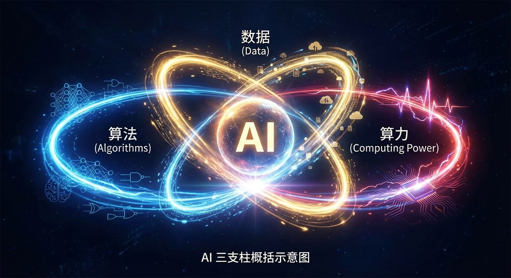
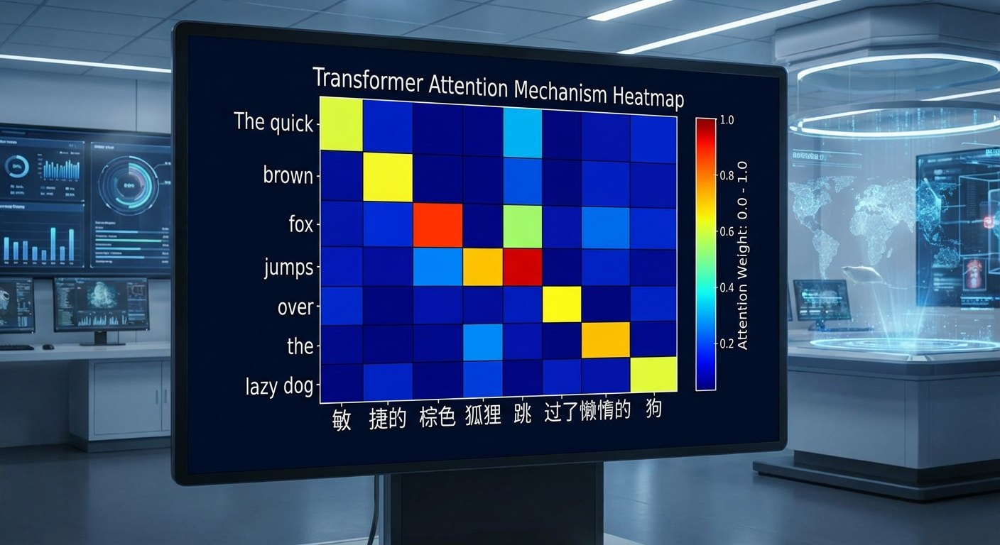
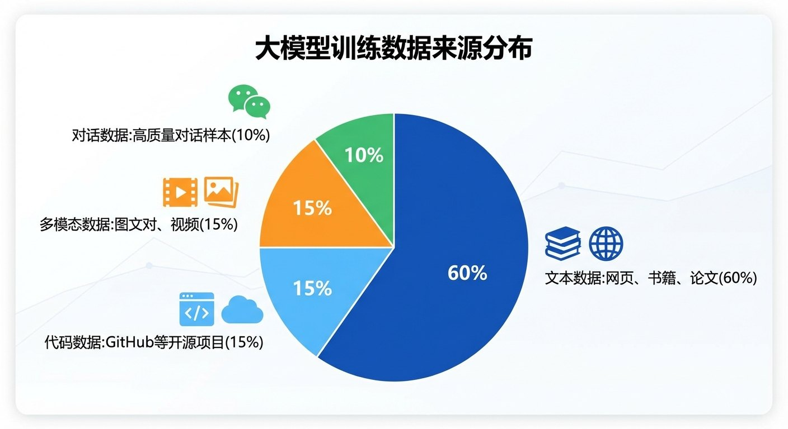
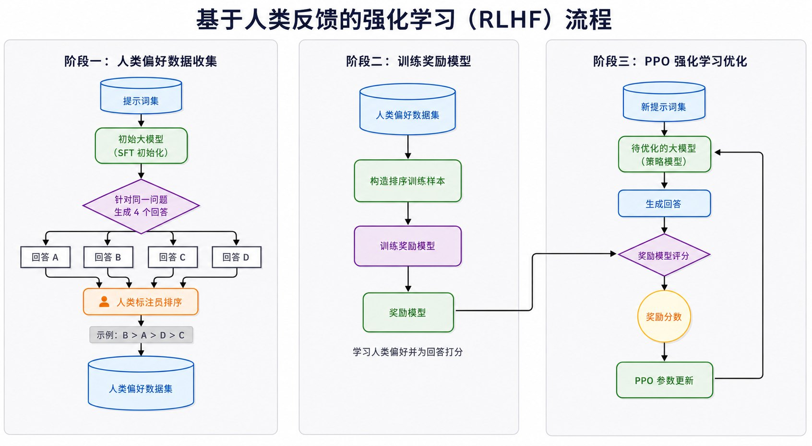

# 1.4 祛魅大模型：支撑奇点的三大底层支柱 {#14}

!!! info "学前导读"

    大模型看起来像“魔法”，但拆开来看，它只由三样东西支撑：**算法**（一套数学方法）、**算力**（大量 GPU 芯片）、**数据**（人类写下的海量文字和图片，加上人类反馈）。

    本节有几个数字表格，不需要记住具体数字，只要能看出“量级”有多大即可。公式都放在“深入一步（选学）”折叠框里，可以跳过。学完后，你应当能用“三支柱”分析任意一个 AI 产品。

当 DeepSeek-R1 展现出惊人的推理能力，或是 AI 生成一张足以乱真的照片时，我们很容易产生一种“敬畏感”。

现在，让我们来为 AI 彻底祛魅。

如果将 AI 想象成工厂产出的产品，那么它的原材料里没有任何“超自然”的成分。大模型这座“工厂”，正是由三根核心支柱支撑起来的：算法、算力、数据（图 1-8）。

{ loading=lazy }

图 1-8 AI 三支柱（算法—数据—算力）关系图
{ .fig-caption }

## 1.4.1 核心驱动：算法与数学的进化 {#141}

所有的智能过程，最终都会被拆解为三类数学基础。

**1. 线性代数（矩阵运算）**

大模型的计算过程，本质上就是海量的矩阵乘法。每一个词元（token，大致相当于一个字或半个词）都会被转化为高维空间中的一个向量（一串数字），计算过程就是对这些向量反复做变换。

!!! example "通俗理解词向量"

    想象一个三维空间：

    - “国王”的坐标是（5，3，7）；
    - “男人”的坐标是（4，2，6）；
    - “女人”的坐标是（3，5，4）。

    神奇的事情：如果用“国王”减去“男人”再加上“女人”，结果竟然接近“女王”的坐标！

    用式子写出来：向量（国王）− 向量（男人）+ 向量（女人）≈ 向量（女王）。

    这说明，机器通过阅读海量文本，自动在向量空间里形成了表示“性别”的方向。真实的词向量有几百维，上面的三维坐标只是示意。3.1 节的动画可以让你亲手试一试。

**2. 概率论与数理统计**

这是 AI 处理“不确定性”的利器。当你和大模型聊天时，它并不是像人一样“体会”你的感情，而是在计算：在当前语境下，下一个出现的词最可能是哪一个。

!!! question "互动演示：预测下一个词"
    给定句子“今天天气真”，请预测：

    1. 接下来最可能出现的 10 个词是什么？
    2. 如果给定更多信息，如“今天天气真好，我想去____”，预测会怎样变化？
    3. 为什么 AI 需要“上下文”才能做出准确预测？

    ??? tip "参考答案"
        - 无上下文时：好、棒、不错、奇怪……概率分布比较分散；
        - 有更多上下文时：公园、散步、跑步……概率集中在少数几个词上；
        - 这就是为什么 AI 需要“上下文窗口”（Context Window）：它能“看到”的前文越多，预测就越准。

**3. 微积分（梯度下降寻优）**

这是 AI “进化”的引擎。通过求导数，模型能知道自己现在的参数往哪个方向调能减少错误，并朝着正确的方向迈出一小步。

想象你在夜晚的深山中，四周一片漆黑，只能感觉到脚下的坡度。你想下山（找到最低点），怎么办？方法：每次往脚下最陡的方向迈一小步。这就是 AI 学习的过程——不断调整参数，让错误率越来越低（1.2.2 节的动画演示过）。

??? note "深入一步（选学）：梯度下降的公式"
    $$\theta_{\text{new}} = \theta_{\text{old}} - \alpha \cdot \nabla J(\theta)$$

    其中，$\theta$ 为模型参数，$\alpha$ 为学习率（步长），$\nabla J(\theta)$ 为损失函数的梯度（指向“上坡最陡”的方向，所以前面用减号，表示往下坡走）。

**架构革命：Transformer 的诞生与自注意力机制**

2017 年，谷歌的研究团队发表了论文 *Attention Is All You Need*（《注意力就是你所需要的一切》）。这篇只有 8 位作者、正文约 10 页的论文，彻底改变了 AI 的历史轨迹。

Transformer 的两大创新：

- **自注意力（Self-Attention）机制**：让模型能够同时关注整个句子（不再是逐字往下读，而是一眼看全），解决了长距离依赖问题（比如“它”到底指谁）；
- **并行计算能力**：不再需要按顺序一个字一个字地处理，大大提升了训练效率，让千亿参数的大模型训练成为可能。

!!! example "通俗理解自注意力"

    想象你在读这句话：“小明把苹果放在桌子上，然后它被吃掉了。”

    问题是：“它”指什么？是“苹果”还是“桌子”？人类很容易理解，“它”指“苹果”。

    - **传统的循环神经网络（RNN）**：一个字一个字往下读，读到“它”时，可能已经“忘了”前面的“苹果”；
    - **Transformer**：每个词都能“看到”其他所有词，并计算它们之间的关联强度。这就像你在读书时，用笔在纸上画出词与词之间的连线（图 1-9）。

{ loading=lazy }

图 1-9 Transformer 自注意力机制热力图
{ .fig-caption }

Transformer 的完整结构、位置编码等原理在 2.3 节详细讲解，第 3 章还会用一个例句完整走一遍。

## 1.4.2 动力源泉：算力时代的暴力美学 {#142}

**CPU 的局限与 GPU 的崛起——教授与小学生的类比**

很多人并不知道，让 AI 实现飞跃的硬件 GPU，最初是为电脑游戏的图形渲染而设计的处理器。

- **CPU 像一位知识渊博的大学教授**：能处理极其复杂的逻辑，但核心数量少，同一时间能做的事不多（擅长串行）；
- **GPU 像一万个小学生**：每个人的数学水平一般，但能同时做一万道简单的加法和乘法（擅长并行）。

!!! example "并行计算对比"

    **任务**：计算 100 万个数字之和。

    - **CPU 方式（串行处理）**：从第一个数开始，依次累加，执行 100 万次加法。
    - **GPU 方式（并行处理）**：把 100 万个数分成 1 000 组，每组 1 000 个；用 1 000 个核同时计算每组之和，最后把 1 000 个结果相加。

    这个例子只是帮助理解“分组同时算”的思路。实际加速多少倍，取决于任务能不能拆开、数据搬运快不快。神经网络里最多的运算是矩阵乘法，它能被拆成成千上万个互不相干的乘加运算，正好最适合 GPU，常常能比 CPU 快几十到上百倍。

| 特性 | CPU | GPU |
|---|---|---|
| 核心数量 | 少（几个到几十个） | 多（数千个） |
| 单核性能 | 强（擅长复杂逻辑） | 弱（适合简单计算） |
| 适用任务 | 串行处理 | 并行处理 |
| AI 训练 | 速度慢 | 速度快几十到上百倍 |

表 1-7 CPU 与 GPU 在 AI 训练中的特性对比
{ .tab-caption }

**CUDA 的蝴蝶效应**

2006 年，英伟达（NVIDIA）推出了 CUDA 平台，让 GPU 突破了只能渲染游戏画面的限制，程序员可以用它做通用计算。这一变革为 2012 年 AlexNet 的成功铺平了道路，也让英伟达在此后十年里成为 AI 算力芯片市场的主要供应商。

| 年份 | 代表硬件 | 单卡峰值算力（约） | 单卡训练 GPT-3 理论上需要（按峰值算） |
|---|---|---|---|
| 2010 | GTX 580 | 1.6 TFLOPS（FP32） | 约 6 000 年 |
| 2016 | Tesla P100 | 21 TFLOPS（FP16） | 约 470 年 |
| 2020 | A100 | 312 TFLOPS（FP16） | 约 32 年 |
| 2022 | H100 | 990 TFLOPS（FP16） | 约 10 年 |
| 2024 | B200 | 2 250 TFLOPS（FP16） | 约 4.5 年 |

表 1-8 GPU 硬件算力发展历程
{ .tab-caption }

注：TFLOPS 表示每秒万亿次浮点运算。GPT-3 训练一次约需 3.14×10²³ 次浮点运算；表中按显卡理论峰值估算，实际利用率通常只有 30%～50%，所以真实耗时更长。FP32、FP16 是两种数字精度，FP16 精度低一些但算得更快，大模型训练主要用 FP16 一类的低精度。正因为单卡要算几年到几千年，大模型必须由成千上万张卡一起训练。

**今天的集群奇观**

如今的大模型训练，早已不再依赖单台机器，而是由成千上万张 GPU 组成的“算力森林”协同完成。

| 模型 | 参数量 | 训练数据量 | 估算算力消耗 | 估算成本 | 来源 |
|---|---|---|---|---|---|
| GPT-2（2019） | 15 亿 | 约 40 GB 文本 | 未公开 | 未公开 | 官方论文 |
| GPT-3（2020） | 1 750 亿 | 约 3 000 亿词元（从 45 TB 原始网页过滤出约 570 GB） | 约 3 640 PF-day | 约 460 万美元（第三方估算） | 官方论文、第三方估算 |
| GPT-4（2023） | 未公开（坊间传闻约 1.8 万亿） | 未公开 | 未公开 | 超过 1 亿美元（奥尔特曼口头表示） | 媒体报道 |
| DeepSeek-V3（2024） | 6 710 亿（每个词元只激活 370 亿） | 14.8 万亿词元 | 约 279 万 H800 GPU 小时 | 约 558 万美元（仅最后一次正式训练的租卡费用） | 官方技术报告 |

表 1-9 大语言模型训练成本与规模对比
{ .tab-caption }

注：PF-day 表示以每秒 10¹⁵ 次浮点运算的速度连续算一天，GPT-3 约 3 640 PF-day，即约 3.14×10²³ 次运算。GPT-4 的细节 OpenAI 没有公开，表中只能列出传闻和口头说法，引用时要注明。

!!! question "算力代价与环境议题——一次课堂辩论"
    - **数据①**：据谷歌研究者 2021 年估算，训练一次 GPT-3 约消耗 1 287 兆瓦时（约 1.3 GWh）电力，大约相当于 120 个美国家庭一年的用电量，排放约 550 吨二氧化碳。
    - **数据②**：常被引用的“训练一个 AI 模型的碳排放相当于 5 辆汽车全生命周期排放”，出自 2019 年的另一项研究，针对的是一个需要反复搜索网络结构的 Transformer 模型，并不是 GPT-3。引用数据时要看清对象。

    **辩论题目**：AI 发展的环境代价是否值得？我们应如何在技术进步和可持续性之间实现平衡？

    - **正方**：AI 带来的效率提升（如优化电网、设计新材料）最终会降低整体能源消耗；
    - **反方**：模型越做越大、使用者越来越多，资源消耗模式不具备可持续性。
    - **你的观点**：____________

## 1.4.3 知识血肉：从数据狂欢到人类对齐（Alignment） {#143}

**数据爆发——互联网为 AI 提供了初始“干粮”**

20 世纪 80 年代，AI 研究者面临的最大问题是数据匮乏。训练一个模型需要人工标注每一个样本，成本极高。

**互联网带来的数据革命**：20 世纪 90 年代互联网兴起，21 世纪初宽带普及，2010 年前后移动互联网和社交媒体爆发，人类产生的数据量呈指数级增长。

| 年份 | 全球数据总量（约） | 主要来源 |
|---|---|---|
| 2010 | 2 ZB | 传统互联网 |
| 2015 | 12 ZB | 移动互联网、视频 |
| 2020 | 64 ZB | 社交媒体、物联网 |
| 2025 | 约 180 ZB（预测值） | 视频、物联网、AI 生成内容 |

表 1-10 全球数据总量增长趋势（2010—2025，数据来自国际数据公司 IDC）
{ .tab-caption }

注：1 ZB = 1 万亿 GB。

**大模型训练数据的构成**

不同模型的数据配比差别很大，而且大多不公开。图 1-10 只是一个示意：网页、书籍、论文等文本通常占大头，其次是代码、对话数据和图文、视频等多模态数据。

{ loading=lazy }

图 1-10 大模型训练数据来源分布饼图（示意）
{ .fig-caption }

大模型之所以“博学”，是因为它“读”过互联网上公开的海量文本——网页、百科、书籍、论文、开源代码、论坛对话。但这远不是人类知识的全部：没有数字化的、不公开的、小语种的内容，它就知之甚少。

**从生肉到熟食：人类反馈强化学习（RLHF）**

很少有人关注到，这些数据并不是直接“喂”给 AI 就完事了。成千上万的数据标注员对信息进行了清洗、打标签，并提供人类偏好反馈，这才让 AI 拥有了“得体的言谈”。RLHF 的意义远不止数据标注：它是让 AI 的行为与人类期望“对齐”的一套方法。

!!! example "案例 1-6：RLHF——让 AI 学会“礼貌”与“价值观”"

    **背景**：只经过预训练的模型，可能会生成有害、有偏见或不得体的内容。

    人类反馈强化学习（RLHF）通过以下 4 步改善这个问题（图 1-11）：

    1. **采样**：让模型针对同一个问题生成几个不同的回答（比如 4 个）；
    2. **打分**：人类标注员根据“有用性、真实性、无害性”给这几个回答排名；
    3. **训练奖励模型（Reward Model）**：训练一个“打分模型”，学会模仿人类标注员的评分标准；
    4. **强化学习优化**：让大模型不断生成回答，由奖励模型打分，再按分数调整参数，争取拿到更高的分（常用的算法叫 PPO）。

    **批判性思考**

    - 由“人类偏好”训练出的 AI，是否会放大人类的偏见？
    - 谁来定义什么是“好的回答”？这一标准是否存在文化差异？

    RLHF 的更多细节见 3.3 节。

{ loading=lazy }

图 1-11 人类反馈强化学习（RLHF）流程示意图
{ .fig-caption }

!!! note "本节结语"
    AI 是人类数学智慧与工程能力的结晶。它不是“新神”，而是“新火”。正如火带给了原始人熟食与温暖，AI 正在为现代文明带来效率与创造。但火也会烧伤人，关键在于学会如何安全地使用它。

## 随堂小测

**1.** 一款手机里的“AI 修图”功能，下面哪一项属于它的“算力”支柱？（　　）

- A. 训练时用到的上百万张照片
- B. 判断哪里是人脸的神经网络
- C. 手机里的 AI 芯片和训练时用的 GPU 集群
- D. 用户对修图效果的点赞

??? tip "答案与解析"
    **答案：C**

    解析：A 是数据，B 是算法，C 是算力；D 是用户反馈，也属于数据（可用于改进模型）。

    考查：AI 三支柱 · 认知层次：应用 · [回看 1.4](#14)
    { .quiz-meta }

**2.** 为什么 GPU 特别适合训练神经网络？（　　）

- A. GPU 的单个核心比 CPU 更强
- B. 神经网络主要是能拆成大量小运算同时算的矩阵乘法
- C. GPU 比 CPU 更省电
- D. GPU 是专门为 AI 发明的

??? tip "答案与解析"
    **答案：B**

    解析：GPU 单核较弱（A 错），最初是为游戏图形设计的（D 错）。它的优势是数千个核心并行计算，正好匹配神经网络里大量可以同时进行的乘加运算。

    考查：算力 · 认知层次：理解 · [回看 1.4.2](#142)
    { .quiz-meta }

**3.** 在 RLHF 中，大模型是通过和自己下棋一样的“自我博弈”来提高分数的。（　　）

- √
- ×

??? tip "答案与解析"
    **答案：×**

    解析：RLHF 的最后一步是：大模型生成回答，由“奖励模型”（模仿人类评分标准的打分模型）打分，再按分数调整参数。它不是 AlphaGo 那样的自我对弈。

    考查：RLHF · 认知层次：理解 · [回看 1.4.3](#143)
    { .quiz-meta }
