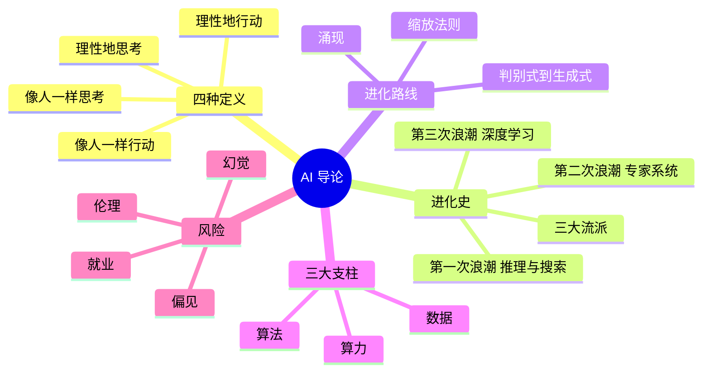

# 第 1 章 本章小结与练习

## 本章小结

本章我们完成了一次从历史到现实、从原理到应用的穿越。

- **历史维度**：我们看到 AI 如何在 70 年间，从符号主义的规则系统，经过联结主义的神经网络和行为主义的强化学习，最终在 2022—2025 年迎来生成式 AI 的爆发。
- **技术维度**：我们理解了 AI 的三支柱——算法（数学）、算力（硬件）、数据，以及它们如何交织成今天的大模型。
- **工具维度**：我们认识了文本、图像视频、语音音乐三类生成式 AI 工具，知道了提示词和智能体是人与 AI 协作的新方式，也认识了幻觉、偏见等风险。

当你学会用自然语言给 AI 布置任务，就相当于拥有了一个 24 小时待命的助手。请善用这份力量，不仅是为了提升效率，更是为了释放你作为人类独有的创造力；同时记住：结果要核实，责任在自己。

把本章压缩成 6 句话：

1. AI 有四种定义路径：像人一样行动（图灵测试）、像人一样思考、理性地思考、理性地行动；现代 AI 以“理性地行动”为主，并融合了多条路径。
2. AI 经历了三次浪潮、两次寒冬：1956—1974 年的推理与搜索、1980—1987 年的专家系统、2012 年起的深度学习。
3. 三大流派：**符号主义**靠规则，**联结主义**靠神经网络从数据中学习，**行为主义**靠试错和奖励。
4. 生成式 AI 的爆发来自 Transformer、缩放法则和三大支柱（算法、算力、数据）的交汇；“涌现”是否是真正的突变仍有争论。
5. 大模型的本质是“按概率预测下一个词”，并通过人类反馈强化学习（RLHF）对齐人类期望。
6. AI 有幻觉、提示词注入、偏见、就业冲击和伦理困境等风险，使用时要保持批判性思维。

**下一章预告**：第 2 章打开大模型的“发动机舱”，看神经网络怎样从错误中学习，推理模型怎样“慢思考”，以及 Transformer 为什么改变了 AI 的游戏规则。

## 课后练习

**一、单项选择题**

**1.** 图灵测试的核心思想是（　　）

- A. 测试机器的计算速度
- B. 看机器能否在文字对话中让人分不清它是人还是机器
- C. 测试机器的存储容量
- D. 测试机器是否有意识

??? tip "答案与解析"
    **答案：B**

    解析：图灵用“能否在对话中表现得像人”替代了说不清的“能否思考”。测试只看外在表现，不能证明意识（D 错）。

**2.** 符号主义的核心假设是（　　）

- A. 智能源于神经网络的连接
- B. 智能源于对符号和逻辑规则的操作
- C. 智能源于试错学习
- D. 智能源于大数据统计

??? tip "答案与解析"
    **答案：B**

    解析：A 是联结主义，C 是行为主义，D 是现代机器学习的特点。

**3.** 1969 年明斯基和派珀特的《感知机》一书对神经网络研究造成重大打击，主要是因为它证明了（　　）

- A. 神经网络无法用计算机实现
- B. 反向传播算法是错误的
- C. 单层感知机无法解决“异或”这类线性不可分问题
- D. 神经网络需要的数据太多

??? tip "答案与解析"
    **答案：C**

    解析：单层感知机只能画一条直线分界，异或问题需要多层网络。反向传播直到 1986 年才因鲁梅尔哈特、辛顿等人的论文而广为人知。

**4.** 2012 年 AlexNet 在 ImageNet 比赛中的突破性意义在于（　　）

- A. 首次发明了卷积神经网络
- B. 错误率大幅领先，证明了深度学习的实用价值
- C. 实现了通用人工智能
- D. 首次超过了人类的识别水平

??? tip "答案与解析"
    **答案：B**

    解析：AlexNet 错误率 15.3%，比第二名低近 11 个百分点。卷积神经网络 1989 年就有了（A 错）；ImageNet 上低于人类水平（约 5.1%）是 2015 年（D 错）。

**5.** 下面属于强化学习的是（　　）

- A. 用标注好的猫狗图片训练分类器
- B. 把顾客按购物习惯自动分成几群
- C. 根据前文预测下一个词
- D. 让机器人在不断摔倒中学会走路，走得稳就给奖励

??? tip "答案与解析"
    **答案：D**

    解析：A 是监督学习，B 是无监督学习（聚类），C 是语言模型的预训练方式（一种自监督学习）。D 通过奖惩信号试错学习，是强化学习。

**6.** “缩放法则”揭示的规律是（　　）

- A. 模型性能与参数量成正比
- B. 同步增加参数、数据和算力，模型误差会可预测地下降
- C. 更大的模型总是更好的
- D. 数据越多，模型效果越好，与参数无关

??? tip "答案与解析"
    **答案：B**

    解析：缩放法则是幂律关系而不是正比（A 错），收益递减且三者要匹配（C、D 错）。

**7.** 某大模型对“鲁迅和周树人是什么关系”回答“他们是两位同时代的作家”。这属于（　　）

- A. 提示词注入
- B. 算法偏见
- C. AI 幻觉
- D. 数据泄露

??? tip "答案与解析"
    **答案：C**

    解析：鲁迅就是周树人。模型自信地给出了错误信息，属于幻觉。

**8.** 检索增强生成（RAG）的主要作用是（　　）

- A. 先检索可靠资料再回答，以减少幻觉
- B. 提高 AI 的生成速度
- C. 降低模型训练成本
- D. 增加模型参数量

??? tip "答案与解析"
    **答案：A**

    解析：RAG 让模型“开卷答题”，能明显减少幻觉，但不能完全消除。

**二、判断题**

**9.** AI 发展的三大流派分别是符号主义、联结主义、行为主义。（　　）

- √
- ×

??? tip "答案与解析"
    **答案：√**

**10.** 一个 AI 通过了图灵测试，就证明它真正拥有了意识。（　　）

- √
- ×

??? tip "答案与解析"
    **答案：×**

    解析：图灵测试只检验外在表现；“表现等同 ≠ 内在等同”，见中文房间思想实验。

**11.** 大语言模型生成文字的基本方式，是根据上下文预测下一个词的概率。（　　）

- √
- ×

??? tip "答案与解析"
    **答案：√**

**12.** GPU 最初就是为了训练神经网络而发明的。（　　）

- √
- ×

??? tip "答案与解析"
    **答案：×**

    解析：GPU 最初是为游戏等图形渲染设计的；2006 年 CUDA 推出后才被广泛用于通用计算和深度学习。

**三、简答题**

**13.** 请简述 AI 四种定义路径的核心区别。

??? tip "参考答案"
    四种路径按“像人还是理性”“思考还是行动”两个维度划分：像人一样行动关注外在表现能否以假乱真（图灵测试）；像人一样思考关注能否模拟人的内在思维过程（认知建模）；理性地思考关注推理是否符合逻辑规则（符号主义）；理性地行动关注能否感知环境并采取行动把事做好（智能体）。现代 AI 以理性地行动为主，同时融合了其他路径。

**14.** 什么是 AI 三支柱？请以一款你常用的 AI 应用为例说明它们如何共同起作用。

??? tip "参考答案"
    三支柱是算法、算力和数据。以短视频推荐为例：数据是用户的观看、点赞、停留时长等行为记录；算法是根据这些数据预测“你可能喜欢什么”的推荐模型；算力是训练和实时运行推荐模型的服务器与 GPU。三者缺一不可：没有数据，算法学不到偏好；没有算力，模型训练不出来，也无法在你刷视频的瞬间给出结果。

**15.** 什么是“涌现”？为什么说它还有争议？

??? tip "参考答案"
    涌现指模型规模增大到一定程度后，在某些任务上的能力突然大幅提升，仿佛出现了没有被专门训练的新本领。争议在于：2023 年的研究发现，很多“突然出现”的能力换成更细致的评分方式后是平滑增长的，“突变”可能部分源于测量方法。能力随规模提升是事实，是否存在真正的质变仍在讨论。

## 实训活动：规划你的 AI 学习路径

**1. 实训目标**

- 浏览本书后续章节目录；
- 结合自身专业，制定 AI 技能学习计划。

**2. 任务描述**

请翻阅本书目录，找出你最感兴趣的 3 个实战内容（如 3.7 节的提示词实战、5.2 节的零代码智能体、4.6 节的 AI 绘画）。结合你的专业，写一份 300 字左右的学习计划，回答三个问题：

1. 我的专业里，哪些工作已经在用 AI？（可以上网查，也可以问老师或学长学姐）
2. 本课程学完后，我希望能用 AI 完成哪 3 件具体的事？
3. 我打算每周花多少时间、用什么方式练习？

**3. 提交要求**

学习计划提交到课程平台，期末回看自己完成了多少。

## 拓展阅读

**经典论文**

1. TURING A M. Computing machinery and intelligence[J]. Mind, 1950, 59(236): 433-460. 图灵测试的起源，对应 1.1.1 节。
2. JONES C R, BERGEN B K. Large language models pass the Turing test[EB/OL]. arXiv:2503.23674, 2025. 2025 年三方图灵测试实验，GPT-4.5 被判为人的比例为 73%，对应 1.1.1 节。
3. VASWANI A, SHAZEER N, PARMAR N, et al. Attention is all you need[C]//Advances in Neural Information Processing Systems 30. 2017. Transformer 的奠基之作，对应 1.4.1 节和 2.3 节。
4. KAPLAN J, MCCANDLISH S, HENIGHAN T, et al. Scaling laws for neural language models[EB/OL]. arXiv:2001.08361, 2020. 缩放法则的发现，对应 1.3.2 节。
5. SCHAEFFER R, MIRANDA B, KOYEJO S. Are emergent abilities of large language models a mirage?[C]//Advances in Neural Information Processing Systems 36. 2023. 对“涌现”的质疑，对应 1.3.3 节。

**推荐书籍**

6. 罗素，诺维格. 人工智能：现代方法[M]. 第 4 版. 张博雅，等译. 北京：人民邮电出版社，2022. AI 领域最权威的教科书，四种定义路径即出自此书，适合想系统学习的读者。
7. 泰格马克. 生命 3.0[M]. 汪婕舒，译. 杭州：浙江教育出版社，2018. 探讨 AI 的未来与人类命运。
8. 李开复，陈楸帆. AI 未来进行式[M]. 杭州：浙江人民出版社，2022. 科幻故事 + 技术分析，通俗易懂（英文版名为 AI 2041）。

**在线资源与纪录片**

9. 吴恩达. AI for Everyone（人人都能懂的 AI）[EB/OL]. Coursera / 网易云课堂. 面向非技术背景的 AI 入门课，不需要编程。
10. 纪录片《阿尔法狗》（AlphaGo，2017）. 记录 AlphaGo 与李世石之战的全过程，对应案例 1-4。
