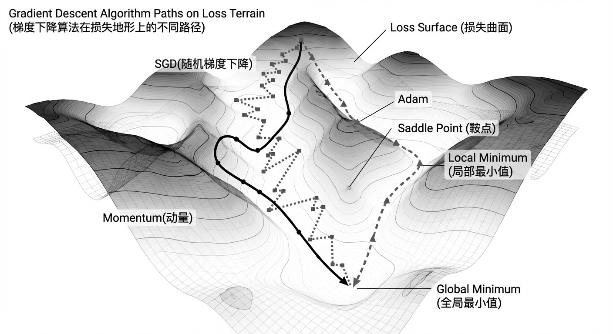

# 2.1 神经网络：非生物的“大脑” {#21}

!!! info "学前导读"

    本节回答三个问题：神经网络怎样“看”图片（**卷积**）？它怎样从错误中学习（**反向传播**）？为什么它有时会“死记硬背”（**过拟合**）？

    本节是全书最“硬核”的一节，建议分两次学：先学 2.1.1～2.1.2，玩一玩“神经元”和“手写数字识别”两个动画；再学 2.1.3～2.1.4。公式都在折叠框里，不看也不影响理解。

当我们说神经网络“模仿人脑”时，这并非完全准确。神经网络的灵感确实来自生物神经元，但它本质上是一个数学函数的嵌套组合——只不过这个函数复杂到连设计者都难以完全解释它为什么能工作。

**动手看看 · 神经元与激活函数**

<iframe class="sim-frame" src="../../sims/neuron-activation/main.html" height="760" loading="lazy" title="神经元与激活函数"></iframe>

拖动输入和权重滑块，看一个神经元怎样“加权求和 → 激活 → 输出”；切换不同的激活函数，比较它们的形状。[全屏打开](../../sims/neuron-activation/main.html){ target=_blank } · [教学说明](../../sims/neuron-activation/index.md)
{ .sim-caption }

## 2.1.1 深度特稿：ImageNet与AlexNet的技术突破 {#211}

2012 年，AlexNet 在 ImageNet 竞赛中的胜利，标志着深度学习时代的到来。除了了解其历史意义外，我们还要理解它的技术核心：为什么是卷积神经网络（CNN）？

在 AlexNet 之前，计算机视觉主要依赖人工设计的特征（如 SIFT、HOG）。由于人类设计的特征很难覆盖所有复杂场景，识别率一直难有突破。AlexNet 证明了：通过多层神经网络，机器可以自动从原始像素中学到从边缘到纹理再到物体的层级特征。AlexNet 的核心创新有三个。

**1. 卷积层：滑动窗口侦探**

想象你是一名侦探，要在一张照片里找猫。你不会盯着整张图看，而是用一个小窗口扫描每个区域。这就是卷积的思想。

每个卷积核就像一个“特征检测器”：

- 第一层检测边缘（水平线、竖线、斜线）；
- 第二层检测纹理（条纹、斑点）；
- 第三层检测部件（猫耳朵、狗鼻子）；
- 更高层检测整体（“这是一只坐着的猫”）。

关键是：这些检测器不是人设计的，而是模型从数据中自动学习得到的！

> 原始图像（28×28 像素）→ 用 3×3 卷积核扫描 → 特征图（26×26，检测边缘）→ 再用 3×3 卷积核扫描 → 特征图（24×24，检测形状）→ 堆叠更多层 → 最终识别：“这是一只猫”

**2. ReLU 激活函数：关掉“负能量”神经元**

在 AlexNet 之前，神经网络常用 sigmoid 或 tanh 激活函数，但它们有个问题：梯度消失。当网络很深时，反向传播的“错误信号”会越传越弱，最后前几层几乎学不到东西。

线性整流函数（Rectified Linear Unit，ReLU）的定义非常简单：输入是正数就原样输出，是负数就输出 0。它却异常有效：

- **不饱和**：正数部分的梯度恒为 1，错误信号不会越传越弱；
- **稀疏激活**：每次只有一部分神经元输出非 0 的值，计算更省；
- **计算快**：只需要比较一下大小，比 sigmoid 里的指数运算快得多。

**3. Dropout：随机让神经元“请假”**

过拟合是深度学习的大敌（2.1.3 节详谈）。辛顿团队的解决方案极其直接：训练时，每一步都随机让一部分神经元（AlexNet 中是全连接层里的 50%）暂时“请假”不参与计算。

这个方法为什么有效？

- **强制冗余**：网络不能依赖某几个“天才”神经元，每个神经元都得学会独立工作；
- **模型集成**：每次训练相当于训练一个不同的子网络，测试时所有神经元一起上岗，相当于把很多子网络的意见取了平均。

{ loading=lazy }

图 2-1 AlexNet 架构与第一层卷积核可视化
{ .fig-caption }

图 2-1 右侧是 AlexNet 第一层学到的 96 个卷积核。这些纹理很像人类设计的边缘检测器，说明网络自己学会了观察世界的基本“笔画”。

**动手看看 · 手写数字识别**

<iframe class="sim-frame" src="../../sims/digit-recognition/main.html" height="680" loading="lazy" title="手写数字识别"></iframe>

在方框里写一个数字，看神经网络给出的 10 个概率；故意写得歪一点、潦草一点，看它什么时候会认错。[全屏打开](../../sims/digit-recognition/main.html){ target=_blank } · [教学说明](../../sims/digit-recognition/index.md)
{ .sim-caption }

!!! example "中国注脚：百度的 GPU 押注"
    2012 年的 ImageNet 结果在中国 AI 界同样引起了震动。据《深度学习革命》等书记载，2012 年 12 月，百度曾参与竞购辛顿团队刚成立的公司 DNNresearch，最终谷歌胜出。2013 年 1 月，百度成立深度学习研究院（IDL），由余凯等人推动，开始把深度学习用于语音识别和图像搜索；2014 年，吴恩达加盟百度担任首席科学家。这些布局让百度较早建立起深度学习能力。今天，百度的飞桨（PaddlePaddle）已成为国内使用最广泛的深度学习框架之一（2.1.4 节）。

## 2.1.2 反向传播：深度学习的“追责风暴” {#212}

如果说神经网络是一家公司，那么反向传播就是它的“绩效考核系统”。

**历史谜题：为什么等了 20 多年才大放异彩？**

反向传播（Back Propagation）在 1986 年就因鲁梅尔哈特、辛顿等人的论文广为人知。它并没有被遗忘：1989 年起，杨立昆用它训练卷积神经网络识别手写邮编，20 世纪 90 年代还用于银行支票识别。但在之后的 20 年里，它一直没能训练出很深的网络，原因如下：

- **计算力不足**：20 世纪 90 年代的电脑训练一个几层的网络就要好几天，更深的网络根本跑不动；
- **梯度消失**：sigmoid 激活函数让深层网络的错误信号越传越弱；
- **数据匮乏**：没有 ImageNet 这样的大规模数据集；
- **对手更强**：支持向量机等方法在小数据上效果更好，理论也更漂亮。

2006 年，辛顿提出“深度信念网络”的逐层预训练方法，证明深层网络是可以训练的。到 2012 年，AlexNet 用“GPU + ReLU + Dropout + 大数据”的组合拳解决了一系列工程问题，反向传播才真正迎来了春天。

**直觉理解：CEO 的愤怒传导**

想象一家有 5 层管理结构的公司，要回答“这张照片是在哪个城市拍的”：

**前向传播：信息自下而上汇总**

1. **员工（输入层）**：看到原始数据（图片的像素）；
2. **主管（第 2 层）**：汇总局部信息（“这片区域有竖线”）；
3. **经理（第 3 层）**：综合部门信息（“竖线组成了柱子”）；
4. **副总裁（第 4 层）**：提炼高层特征（由于之前权重没学好，它把这些特征错误地组合成了“这好像是大本钟的尖顶”）；
5. **CEO（输出层）**：作最终决策（“根据副总裁的汇报，我裁定这是伦敦！”——预测错误）。

**反向传播：自上而下层层追责**

1. **CEO 拿到标准答案**：照片其实是巴黎！CEO 算出这次错得有多离谱（损失函数）；
2. **副总裁被问责**：“你把特征组合成大本钟了，误导了我！”副总裁调整自己的判断方式；
3. **副总裁反思**：“这不全怪我！是经理汇报的柱子形状有偏差。”于是它调整对经理汇报的“信任程度”（权重）；
4. **层层传导**：问责沿着管理链一路向下，经理找主管，主管找员工，每一层都按自己“该负多少责任”微调权重；
5. **循环往复**：经过成千上万次“预测—追责—调整”的循环，这家公司终于被“调教”成了能准确识别城市的专家。

**核心机制：误差传递的链式法则**

抛开厚重的微积分课本不谈，反向传播中的核心数学原理——链式法则，其实就是一种精确的“归因与追责机制”。

想象你正在驾驶一艘巨轮，发现船偏离了航线（产生了误差）。要纠正它，你需要转动方向盘；方向盘通过齿轮 A 带动齿轮 B，最终带动水下的螺旋桨。链式法则要回答的就是：要让船回到航线，螺旋桨要转多少？齿轮 B、齿轮 A 要转几圈？方向盘应该打几度？

它把最终的误差沿着整个传动链条一层一层地倒推回去，精确计算出每个“齿轮”（参数）应该为这个偏差承担多少责任，以及应该向哪个方向微调多大幅度。每一次微调都微不足道，但经过成千上万次循环后，成千上万的“参数齿轮”就会磨合得越来越精确。

??? note "深入一步（选学）：链式法则的式子"
    用 $L$ 表示损失（错得多离谱），损失对副总裁输出的影响，等于“损失对 CEO 输出的影响”乘以“CEO 输出对副总裁输出的影响”：

    $$\frac{\partial L}{\partial \text{VP}} = \frac{\partial L}{\partial \text{CEO}} \times \frac{\partial \text{CEO}}{\partial \text{VP}}$$

    再往下一层，就再乘一个因子：

    $$\frac{\partial L}{\partial \text{经理}} = \frac{\partial L}{\partial \text{VP}} \times \frac{\partial \text{VP}}{\partial \text{经理}}$$

    这就是“链式”二字的由来：每往下一层，就在链条上多乘一环。

**优化算法：从 SGD 到 Adam**

反向传播告诉我们“朝哪个方向调整”，但每次迈多大的步子（学习率）、怎样走得又快又稳，也有大学问。研究者为此发明了一系列“优化算法”（图 2-2）。

{ loading=lazy }

图 2-2 梯度下降算法在损失地形上的不同路径
{ .fig-caption }

??? note "深入一步（选学）：常见优化算法对比"
    | 算法 | 核心思想 | 优点 | 缺点 |
    |---|---|---|---|
    | SGD（随机梯度下降） | 每次只用一小批样本估计方向 | 简单、省内存 | 收敛慢、容易来回震荡 |
    | Momentum（动量） | 像球滚下山坡，带有惯性 | 加速收敛、减少震荡 | 可能冲过最低点 |
    | Adam | 自动为每个参数调整步长 | 收敛快、对设置不敏感，常作默认选择 | 有时泛化效果不如精调过的 SGD |
    | AdamW | Adam + 改进的权重衰减 | 更好地防止过拟合 | 需要多设一个参数 |

    表 2-1 梯度下降算法家族
    { .tab-caption }

    今天，Adam 和 AdamW 是最常用的选择，大语言模型的训练普遍用 AdamW。它们的数学原理复杂，但核心思想是：为每个参数量身定制步长，并且参考过去几步的趋势，而不只是当前这一步。

## 2.1.3 过拟合陷阱：当AI变成“复读机” {#213}

2021 年，谷歌等机构的研究者发表论文，从 GPT-2 中“套”出了几百段一字不差的训练数据，其中包括真实的姓名、电话号码和电子邮件地址。这说明，大模型有时会把训练数据“背”下来，而不只是学到规律。

这背后是深度学习的一个大敌：过拟合（Overfitting）。

**场景再现：会背答案的“学霸”**

想象考试前，你拿到了一本“十年真题”。

- **正常学习路径**：做 2010 年的题，理解“二次函数”的本质；做 2015 年的题，发现“虽然数字变了，但解题思路一样”；考试遇到新题，依然能解（泛化能力强）。
- **过拟合路径**：死记硬背题目和答案，模拟考遇到原题，满分！正式考试题目稍微变一下，瞬间懵了（泛化能力差）。

神经网络也会犯同样的错：当它“背”训练集而非“理解”规律时，就发生了过拟合。

**诊断工具：训练曲线的“死亡交叉”**

{ loading=lazy }

图 2-3 过拟合曲线
{ .fig-caption }

如图 2-3 所示，训练曲线出现以下情况时，说明模型开始过拟合（下面的轮数只是举例）：

- **第 1～20 轮**：模型在学习真正的规律，训练损失和验证损失都下降；
- **第 20 轮左右**：拐点！模型开始记忆训练集中的噪声；
- **第 20 轮以后**：训练损失继续降低（记得更牢），但验证损失上升（在新数据上表现变差）。

**防御武器库：正则化大全**

1. **L2 正则化（权重衰减）**：在损失函数里加上“权重大小”的惩罚项，不允许任何一个权重变得太大，逼迫模型“分散风险”，不过度依赖某几个特征；
2. **Dropout**：训练时随机让部分神经元“请假”，测试时全部上岗（见 2.1.1 节）；
3. **早停（Early Stopping）**：监控模型在验证集上的表现，在过拟合发生前停止训练；
4. **数据增广（Data Augmentation）**：对图片做翻转、旋转、裁剪等变换，告诉模型“猫不会因为左右翻转就变成狗”。

**偏差—方差权衡：机器学习的核心矛盾**

- **偏差（Bias）**：模型“想得太简单”，学不到规律（欠拟合），如用直线去拟合弯弯曲曲的数据；
- **方差（Variance）**：模型“想得太复杂”，把噪声也当规律（过拟合），如用一条扭来扭去的曲线硬穿过每一个点；
- **不可约误差**：数据本身的噪声，再好的模型也消除不了。

| 模型复杂度 | 偏差 | 方差 | 总误差 |
|---|---|---|---|
| 太简单 | 高 | 低 | 高 |
| 刚刚好 | 中 | 中 | 低 √ |
| 太复杂 | 低 | 高 | 高 |

表 2-2 模型复杂度与偏差、方差的关系
{ .tab-caption }

现代深度学习的做法是：先让模型足够大（降低偏差），再用正则化和海量数据压制方差。大语言模型参数动辄上千亿却不严重过拟合，一个重要原因是训练数据量极大，大多数数据只被模型看过一两遍，模型很难把它们全部“背”下来；但正如开头的例子所示，重复出现多次的内容仍可能被记住。

## 2.1.4 中国力量：百度飞桨的开源征程 {#214}

2016 年前后，中国 AI 开发者主要使用 TensorFlow 和 PyTorch 等由美国公司主导开发的深度学习框架。百度决定改变这一局面。

**飞桨的诞生**

2016 年 9 月，百度正式开源深度学习平台 PaddlePaddle（中文名“飞桨”）。它是国内首个开源开放、功能完备的产业级深度学习平台。

**核心特点**

- **端到端产业化**：从训练到部署的全流程工具链，能部署到服务器、手机和各种国产芯片上；
- **丰富的组件库**：PaddleOCR（文字识别，支持 80 多种语言）、PaddleDetection（目标检测）、PaddleNLP（自然语言处理，集成了文心 ERNIE 等中文预训练模型）；
- **中文生态友好**：中文文档和课程丰富，学习门槛低；提供大量中文预训练模型。

**产业落地案例**（据百度公布）：电力行业用飞桨做输电线路巡检中的缺陷识别；通信运营商用飞桨做网络运维优化；银行用飞桨做智能客服与票据识别。

| 维度 | PyTorch | TensorFlow | PaddlePaddle（飞桨） |
|---|---|---|---|
| 主导开发 | Meta（现由 Linux 基金会旗下 PyTorch 基金会管理） | 谷歌 | 百度 |
| 编程风格 | 动态图为主，灵活易调试 | 早期静态图，2.0 起默认动态图 | 动态图与静态图兼顾 |
| 部署工具 | TorchScript、ExecuTorch 等 | TF Serving、TF Lite | Paddle Inference、Paddle Lite |
| 中文资料 | 较多 | 较多 | 丰富 |
| 学术界使用 | 最广泛 | 较多 | 较少 |
| 国产芯片适配 | 依赖各芯片厂商提供插件 | 依赖芯片厂商 | 官方适配较多国产芯片 |

表 2-3 三大深度学习框架对比
{ .tab-caption }

!!! example "开发者故事：从 PyTorch 转向飞桨（情景模拟）"
    张工是某 AI 创业公司的算法工程师。他的团队要做一个中文文档理解系统。起初用 PyTorch 训练很顺利，但要部署到客户现场的 ARM 芯片设备上时，推理速度达不到要求，文字识别模块也要自己从头写。

    转向飞桨后，团队直接使用 PaddleOCR 等现成模块搭出了原型，再用 Paddle Lite 部署到 ARM 设备上，满足了实时要求。

    他的体会是：“学术研究我们还用 PyTorch，要在国产硬件上落地，飞桨的工具链更省事。”框架没有绝对的好坏，要根据团队习惯、部署环境和生态来选。

## 随堂小测

**1.** 卷积神经网络为什么擅长处理图片？（　　）

- A. 它把整张图片当成一个数字来处理
- B. 它用小窗口扫描局部区域，逐层从边缘、纹理组合出整体
- C. 它的规则是人工逐条编写的
- D. 它只能识别黑白图片

??? tip "答案与解析"
    **答案：B**

    解析：卷积核像小窗口一样扫描图片的局部区域，低层检测边缘，高层组合出部件和整体；这些检测器是从数据中自动学到的（C 错）。

    考查：卷积 · 认知层次：理解 · [回看 2.1.1](#211)
    { .quiz-meta }

**2.** 反向传播算法最主要的作用是（　　）

- A. 把图片从后往前逐行读入
- B. 增加网络的层数
- C. 让训练数据变多
- D. 把误差从输出层逐层往回传，算出每个参数该怎样调整

??? tip "答案与解析"
    **答案：D**

    解析：反向传播借助链式法则，把输出端的误差一层层分摊回去，确定每个参数的“责任”和调整方向，再由梯度下降去调整。

    考查：反向传播 · 认知层次：理解 · [回看 2.1.2](#212)
    { .quiz-meta }

**3.** 一个模型在训练集上准确率 99%，在新数据上只有 60%，说明它学得非常好。（　　）

- √
- ×

??? tip "答案与解析"
    **答案：×**

    解析：训练集上好、新数据上差，是典型的过拟合：模型把训练数据“背”了下来，没有学到可推广的规律。

    考查：过拟合 · 认知层次：应用 · [回看 2.1.3](#213)
    { .quiz-meta }
