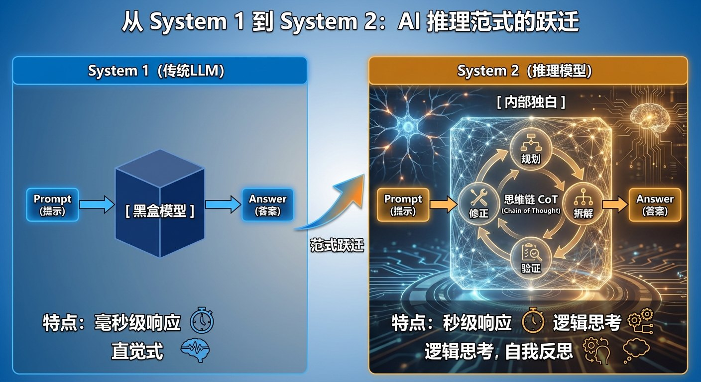
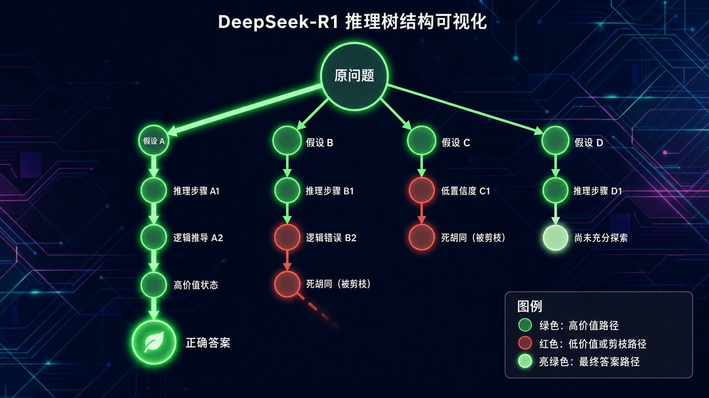
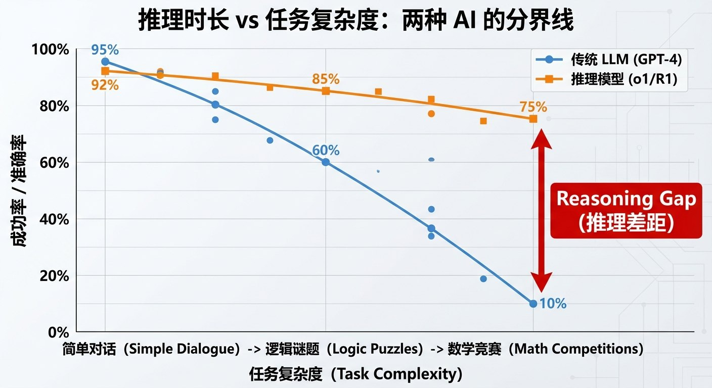

# 2.2 深度推理：AI的“灵魂觉醒”时刻 {#22}

!!! info "学前导读"

    你问一个普通大模型“9.11 和 9.9 哪个大”，它可能脱口而出“9.11 大”；而推理模型会先在“草稿纸”上写一段思考过程，再给出答案。这就是“快思考”和“慢思考”的区别。

    本节先用心理学家卡尼曼的“双系统”理论解释这种区别，再看 DeepSeek-R1 是怎样训练出“慢思考”能力的。标题里的“灵魂觉醒”只是比喻，本节末尾会讨论：推理模型真的在“思考”吗？

2024 年 9 月，OpenAI 发布了 o1 推理模型的预览版（正式版于 12 月发布）。它在回答问题前，会先经历一个“推理过程”，就像人类解数学题时先在草稿纸上演算。

2025 年 1 月 20 日，中国公司深度求索（DeepSeek）发布了 R1 模型。它在数学、编程等推理测试上达到了与 o1 相当的水平，而且以开源方式公开了模型权重和训练方法，使用价格也远低于同类产品，引起全球关注。Meta 首席 AI 科学家杨立昆评论说，DeepSeek 的成功说明“开源模型正在超越闭源模型”。

这标志着大模型从“快思考”走向了“慢思考”。

## 2.2.1 Kahneman框架：System 1 vs System 2 {#221}

2002 年诺贝尔经济学奖得主丹尼尔·卡尼曼在其著作《思考，快与慢》中提出，人类有两种思维模式。

**系统 1：快思考（直觉系统）**

- **特点**：自动、无意识、瞬间完成；
- **优势**：速度快、省力；
- **缺陷**：容易被误导、依赖刻板印象；
- **例子**：看到“2 + 2 = ？”，大脑瞬间弹出答案“4”；看到一张愤怒的脸，立刻感受到情绪；听到“医生”这个词，脑海里浮现的可能是穿白大褂的男性（性别刻板印象）。

**系统 2：慢思考（理性系统）**

- **特点**：有意识、需要努力、耗费精力；
- **优势**：逻辑严密、能处理复杂问题；
- **缺陷**：慢、累、容易放弃；
- **例子**：计算“17×24”（需要在脑中列竖式或分步计算）；规划一次跨国旅行（考虑签证、预算、行程）；写一篇课程论文（查文献、构思逻辑、反复修改）。

**传统大模型：更像系统 1**

GPT-4 等传统大模型本质上都是“自回归语言模型”，核心逻辑是“根据前文预测下一个词”：

> 输入：“法国的首都是” 
> 模型内部：P（巴黎 | 法国的首都是）= 99.8%，P（伦敦 | ……）= 0.1%，P（马赛 | ……）= 0.05% 
> 输出：“巴黎”

这是典型的系统 1 模式：快速，直觉化，基于统计模式。对于简单问题，这套逻辑高效好用；但遇到需要多步推导的问题时，就容易“想当然”。

!!! example "反例：9.11 和 9.9 哪个大？"
    2024 年夏天，网友发现，问不少主流大模型“9.11 和 9.9 哪个大”，它们会回答“9.11 更大”，有的还煞有介事地解释“因为 11 大于 9”。

    原因之一是：在训练文本里，“9.11”经常以日期、软件版本号的形式出现（9.11 版比 9.9 版更新），模型凭“直觉”套用了这种模式，而没有按小数的规则一位一位地比较。

    让模型“一步一步地想”（先把两个数写成 9.11 和 9.90，再逐位比较），它通常就能答对。

**推理模型：迈向系统 2**

o1 和 R1 的突破，在于它们学会了在回答之前先“想一会儿”。

**问题**：“所有的玫瑰都是花，有些花很快就会凋谢。能否推出‘有些玫瑰很快就会凋谢’？”

- **凭直觉回答**：“能。”×（被表面的相似性误导）
- **推理模型的思考过程**：

    > 前提 1：所有玫瑰都属于“花”。 
    > 前提 2：存在一些花，很快会凋谢。 
    > 问题：是否存在一些玫瑰，很快会凋谢？ 
    > 前提 2 只说“有些花”会很快凋谢，并没有说这些花里一定有玫瑰。 
    > 如果很快凋谢的恰好全是别的花呢？ 
    > 结论：不能推出。

    **最终回答**：“不能。前提只说‘有些花’很快凋谢，但没有信息表明其中包括玫瑰。”√

这正是系统 2 的力量：通过自我质疑、逻辑推演，主动纠正直觉判断（图 2-4）。

{ loading=lazy }

图 2-4 从 System 1 到 System 2：AI 推理范式的跃迁
{ .fig-caption }

**动手看看 · 快思考与慢思考**

<iframe class="sim-frame" src="../../../sims/fast-slow-thinking/main.html" height="640" loading="lazy" title="快思考与慢思考"></iframe>

选一道题，先看“快思考”的回答，再点“展开思考过程”，一步步看“慢思考”怎样发现直觉里的错误。[全屏打开](../../sims/fast-slow-thinking/main.html){ target=_blank } · [教学说明](../../sims/fast-slow-thinking/index.md)
{ .sim-caption }

## 2.2.2 深度剖析：DeepSeek-R1的三大技术突破 {#222}

**突破一：“顿悟时刻”（Aha Moment）的自然出现**

DeepSeek 团队在论文中报告了一个有趣的现象：在纯强化学习训练的版本（R1-Zero）中，模型逐渐学会了在思考中途停下来，推翻自己的初步思路，重新计算。

论文中的例子是一道方程题：已知 a > 1，求方程 $\sqrt{a-\sqrt{a+x}}=x$ 的实数解之和。模型先按常规思路两边平方、整理，写到一半时停下来说：

> “等等，等等。等一下。这是一个可以标记的‘顿悟时刻’。让我们一步一步重新检查……”

然后它回到前面的式子，换了一种思路重新推导。

**关键点**：DeepSeek 并没有在训练中专门教模型“请质疑自己”，这种自我检查的行为，是在大规模强化学习过程中逐渐出现的。模型的思考过程也随着训练越来越长。

**突破二：GRPO 算法——用规则自动打分的强化学习**

1.4.3 节介绍过的 RLHF，需要大量人工标注来训练奖励模型，成本很高。DeepSeek 采用的组相对策略优化（Group Relative Policy Optimization，GRPO）有两个特点：

1. **用规则自动打分**：数学题、编程题有标准答案，可以直接用程序判断“最终答案对不对”（准确性奖励），再检查“有没有按要求把思考过程写在指定标签里”（格式奖励），不需要人工逐条打分，也不评价中间步骤；
2. **组内比较**：对同一道题，让模型一次生成一组（比如 4 个）回答，用这组回答的平均分作为基准，比平均分高的回答得到正向激励，比平均分低的得到负向激励。这样就不需要再训练一个额外的“价值模型”来估计基准，省下了大量算力。

| 回答 | 最终答案 | 格式 | 得分 | 相对组平均（0.5） |
|---|---|---|---|---|
| 回答 1 | 正确 | 规范 | 1 | 高于平均，强化 |
| 回答 2 | 错误 | 规范 | 0 | 低于平均，削弱 |
| 回答 3 | 正确 | 规范 | 1 | 高于平均，强化 |
| 回答 4 | 错误 | 不规范 | 0 | 低于平均，削弱 |

表 2-4 GRPO 组内比较示意（同一道题生成 4 个回答）
{ .tab-caption }

??? note "深入一步（选学）：R1 的完整训练流程"
    DeepSeek-R1 的论文实际训练了两个模型：

    - **R1-Zero**：直接在 DeepSeek-V3 基础模型上做纯强化学习，推理能力很强，但会出现语言混杂、可读性差等问题；
    - **R1**：先用几千条高质量的长思维链数据做一轮监督微调（“冷启动”），再做推理强化学习，然后筛选出好的回答做第二轮监督微调，最后再做一轮兼顾有用性和无害性的强化学习。

    论文还写明，他们尝试过“过程奖励模型”（给每个中间步骤打分）和蒙特卡洛树搜索（MCTS），都没有取得理想效果，最终没有采用。

**突破三：蒸馏——把大模型的推理能力“教”给小模型**

DeepSeek 用 R1 生成了约 80 万条带完整思考过程的训练样本，再用这些样本去微调通义千问（Qwen）、Llama 等开源小模型，得到了参数从 15 亿到 700 亿不等的一系列“蒸馏版”推理模型。实验表明，小模型通过学习大模型的“解题过程”，推理能力明显提升，有的甚至能在笔记本电脑上运行。

**推理时间与质量：多想一会儿，答得更好**

OpenAI 在发布 o1 时公布了一条规律：允许模型在回答前“思考”得越久（推理时消耗的算力越多），在数学竞赛题上的准确率就越高。这被称为“推理时计算缩放”（test-time compute scaling），它和 1.3.2 节的缩放法则一起，成为提升模型能力的两条路：一条是训练时“读更多书”，一条是答题时“想更久”。

{ loading=lazy }

图 2-5 推理模型在思维链中尝试多种思路（示意）
{ .fig-caption }

图 2-5 用树状图示意推理模型的思考过程：它会尝试不同的思路，发现走不通就退回来换一条路。要注意的是，R1 并不是在模型外面真的搭一棵搜索树，这些尝试和回退都写在它那一长串思维链文字里。

**成本革命：只花几百万美元的奇迹？**

R1 引起轰动的另一个原因是“便宜”。数字要看清楚口径：

- R1 的基础模型 DeepSeek-V3 的技术报告写明，最后一次正式训练用了约 279 万个 H800 GPU 小时，按每小时 2 美元的租价折算约 558 万美元。这**不包括**此前的研究、试验和人员成本；
- 2025 年 9 月，DeepSeek 在《自然》杂志发表的论文中补充说明，在 V3 基础上训练 R1 的强化学习阶段约花费 29.4 万美元；
- OpenAI 没有公布 o1 的训练成本，网上流传的数字都只是猜测。

低成本主要来自技术和工程优化：

- **混合专家（MoE）架构**：模型总共 6 710 亿参数，但处理每个词元只激活约 370 亿，计算量大幅减少；
- **多头潜在注意力（MLA）**：压缩注意力计算中要保存的中间数据，节省显存；
- **FP8 低精度训练**：用更短的数字格式计算，速度更快、显存更省；
- **通信与流水线优化**：让成千上万张卡之间的数据传输和计算相互重叠，减少等待。

这说明：在算力受限（美国对华高端芯片出口管制）的条件下，算法和工程创新同样能大幅降低成本。

## 2.2.3 未来范式：从 Chatbot 到 Problem Solver {#223}

推理模型的出现，正在重新定义 AI 的应用边界。

!!! example "案例 2-1：数学奥赛——从“答题”到“解题”"
    - **2024 年国际数学奥林匹克竞赛（IMO）**：谷歌 DeepMind 的 AlphaProof 和 AlphaGeometry 2 联手解出 6 道题中的 4 道，得分相当于银牌水平。不过，题目要先由人翻译成形式化的数学语言，有的题计算了好几天。
    - **2025 年 IMO**：谷歌的 Gemini Deep Think 和 OpenAI 的一个实验性推理模型都在比赛规定的时间内、直接用自然语言解出了 6 道题中的 5 道，达到金牌分数线。

    这意味着，AI 在需要创造性证明的数学竞赛中，已经达到了顶尖中学生的水平。

!!! example "案例 2-2：蛋白质折叠——从“检索”到“发现”"
    AlphaFold 不是大语言模型，但它体现了 AI 在科学推理中的威力。

    **问题**：给定一个氨基酸序列，预测它会折叠成什么三维结构？

    - **传统方法**：用 X 射线晶体学、冷冻电镜等实验测定，一个结构往往要花几个月到几年；用计算机暴力模拟所有可能的折叠方式，计算量又是天文数字。
    - **AlphaFold 2 的做法**：利用注意力机制，学习氨基酸之间的远程相互作用，并反复迭代修正预测结果。
    - **结果**：在 2020 年的国际蛋白质结构预测竞赛（CASP14）中，它的预测精度中位数达到 92.4 分（满分 100），多数情况下可与实验测定相媲美。

    **影响**：AlphaFold 数据库已公开 2 亿多个蛋白质的预测结构，极大地加速了生物学和药物研发。2024 年，开发 AlphaFold 的德米斯·哈萨比斯和约翰·江珀，与用计算方法设计全新蛋白质的大卫·贝克，共同获得诺贝尔化学奖。更多 AI 助力科学的案例见 6.2 节。

!!! example "案例 2-3：编程竞赛——Codeforces"
    Codeforces 是全球知名的算法编程竞赛平台。

    - **GPT-4（2023）**：OpenAI 技术报告中的 Codeforces 评分为 392 分，排在参赛者的后 5% 左右；
    - **AlphaCode 2（2023，基于 Gemini Pro）**：先生成大量候选程序，再用测试用例筛选，估计水平超过约 85% 的参赛者；
    - **DeepSeek-R1（2025）**：论文报告评分 2 029 分，超过约 96% 的人类参赛者。

    **启示**：推理模型在有明确对错标准的编程题上进步极快，正在改变程序员的工作方式。

{ loading=lazy }

图 2-6 推理时长 vs 任务复杂度：两种 AI 的分界线（示意）
{ .fig-caption }

**哲学拷问：思考得更久 = 思考得更深？**

推理模型引发了一个有趣的问题：AI 真的在“思考”吗？

- **怀疑派**：“它只是在生成更长的文字，用概率把各种可能性都写一遍，这不是真正的思考。”“AlphaGo 也能下围棋，但没有人认为它‘理解’围棋的美学。”
- **乐观派**：“人类的思考，本质上不也是神经元的电化学反应吗？形式不重要，结果才是关键。”“如果一个 AI 能自我纠错、承认‘我不知道’、给出推理过程，这和人的思考有本质区别吗？”
- **中间派（本书立场）**：当前的推理模型仍处于“窄推理”阶段——
    - √ 在数学、代码、逻辑题这类有明确标准答案的任务上表现十分出色；
    - × 在需要常识、价值判断、创造力的任务上仍然不稳定；而且它写出的“思考过程”不一定就是它得出答案的真实原因。

真正的通用人工智能需要的不只是“慢思考”，还需要：

- **元认知**：清楚地知道自己“不知道什么”；
- **迁移能力**：把数学推理能力迁移到全新的领域；
- **价值对齐**：理解人类模糊的、有时相互矛盾的道德标准。

不过，DeepSeek-R1 和 o1 已经打开了一扇门：到 2026 年，“深度思考”已经成为主流大模型的标配功能。

## 随堂小测

**1.** 推理模型和传统大模型最主要的区别是（　　）

- A. 推理模型在给出答案前，会先生成一段思考过程并自我检查
- B. 推理模型的参数一定更多
- C. 推理模型不再预测下一个词
- D. 推理模型只能做数学题

??? tip "答案与解析"
    **答案：A**

    解析：推理模型仍然是逐词生成的语言模型（C 错），它的特点是先写出长长的思维链再作答，用“多想一会儿”换取更高的准确率。DeepSeek 的蒸馏版只有 15 亿参数也具备一定推理能力（B 错）。

    考查：推理模型 · 认知层次：理解 · [回看 2.2.1](#221)
    { .quiz-meta }

**2.** DeepSeek-R1 训练中使用的 GRPO 算法，奖励主要来自（　　）

- A. 大量人工逐条为中间步骤打分
- B. 和人类棋手对弈的胜负
- C. 用规则自动判断最终答案是否正确、格式是否规范，并在同组回答之间比较
- D. 用户的点赞数

??? tip "答案与解析"
    **答案：C**

    解析：R1 的推理训练用规则奖励（答案准确性 + 格式），并用同一组回答的平均分作基准；论文明确说没有采用给中间步骤打分的过程奖励模型。

    考查：GRPO · 认知层次：理解 · [回看 2.2.2](#222)
    { .quiz-meta }

**3.** 新闻里“DeepSeek 只花了 600 万美元”指的是从零开始研发 R1 的全部费用。（　　）

- √
- ×

??? tip "答案与解析"
    **答案：×**

    解析：约 558 万美元是 DeepSeek-V3 最后一次正式训练的 GPU 租用折算费用，不含前期研究、试验和人员成本；R1 的强化学习阶段另花约 29.4 万美元。引用数字要看清口径。

    考查：训练成本 · 认知层次：分析 · [回看 2.2.2](#222)
    { .quiz-meta }
