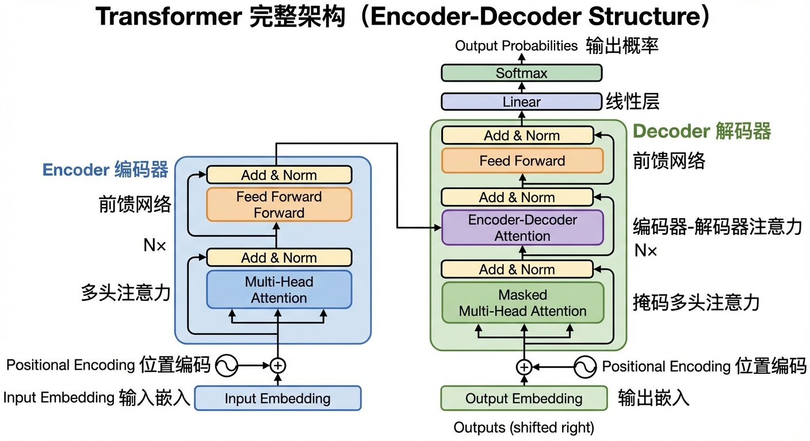
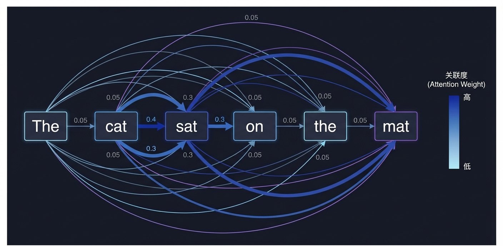

# 2.3 Transformer：开启大模型时代的架构变革 {#23}

!!! info "学前导读"

    今天几乎所有大模型的“骨架”都是 Transformer。本节是全书讲 Transformer 的主要位置（1.4 节只做了简介，3.2 节会用一个例句再走一遍）。

    抓住一个核心就够了：**注意力机制让每个词都能“看到”句子里所有其他词，并决定该重点关注谁**。Q、K、V 的公式放在折叠框里。学完后，你应当能说出 Transformer 比 RNN 好在哪里，以及 BERT 和 GPT 有什么不同。

2017 年 6 月 12 日，预印本网站 arXiv 上发布了一篇论文——*Attention Is All You Need*（《注意力就是你所需要的一切》）。

这篇论文的标题像一句流行歌词，却彻底改写了 AI 的发展轨迹。截至 2025 年，它的引用量已超过 17 万次，是 21 世纪被引用最多的论文之一。如今我们接触到的绝大多数大模型（GPT、Claude、Gemini、DeepSeek、通义千问、文心一言等），都以 Transformer 为基础架构。

## 2.3.1 起源故事：8 位 Google 研究员如何“终结”RNN {#231}

**2017 年前的困境：RNN 与 LSTM**

在 Transformer 出现之前，处理序列数据（如文本、语音）的主流方法是循环神经网络（RNN）。RNN 读取句子和人一样：读完第一个词，记下来，再读第二个词，不能跳过任何一步。

> 输入句子：“猫坐在垫子上” 
> 第 1 步：读“猫”→ 记忆 h1 = f（猫） 
> 第 2 步：读“坐在”→ 记忆 h2 = f（h1，坐在） 
> 第 3 步：读“垫子”→ 记忆 h3 = f（h2，垫子） 
> 第 4 步：读“上”→ 记忆 h4 = f（h3，上）

这带来了两个核心问题：

- **无法并行计算**：读第 100 个词之前，必须等前 99 个全部处理完，GPU 成千上万个核心只能干等着，训练速度极慢；
- **遗忘问题**：句子很长时，开头词语的信息传到末尾会严重衰减。如果“猫”和“抓老鼠”中间隔了 50 个词，RNN 很难记住它们之间的关系。长短期记忆网络（LSTM）缓解了这个问题，但没有从根源上解决。

**一个大胆的想法**

当时，“注意力机制”已经在机器翻译中作为 RNN 的“辅助工具”使用了几年。谷歌的研究员雅各布·乌斯科雷特（Jakob Uszkoreit）提出：能不能干脆去掉循环结构，只用注意力来处理整个序列？阿希什·瓦斯瓦尼（Ashish Vaswani）、诺姆·沙泽尔（Noam Shazeer）等 8 位研究者合作实现了这个想法，论文作者按“贡献相同、顺序随机”的方式署名。

他们的设计：

- 用**自注意力**（Self-Attention）取代 RNN；
- 用**位置编码**（Positional Encoding）解决词序问题；
- 用**多头注意力**（Multi-Head Attention）增强模型的表达能力。

**结果**：在英德、英法机器翻译任务上，Transformer 的翻译质量超过了当时所有已发表的模型；大号模型用 8 块 GPU 训练 3.5 天就达到了这一水平，训练成本只有此前最好模型的一小部分。论文于 2017 年 12 月在长滩举行的 NIPS 会议（今 NeurIPS）上正式发表。

**颠覆的开始**

- 2018 年 6 月，OpenAI 发布基于 Transformer 的 GPT-1，展示了“预训练 + 微调”的潜力；
- 2018 年 10 月，谷歌发布同样基于 Transformer 的 BERT，在 11 项自然语言处理任务上刷新纪录；
- 2019 年 2 月，OpenAI 发布 GPT-2（15 亿参数），生成的文章几乎能以假乱真；
- 2020 年 5 月，OpenAI 发布 GPT-3（1 750 亿参数），展示了强大的少样本学习能力。

| 年份 | 模型 | 参数量 | 引爆点 |
|---|---|---|---|
| 2017 | Transformer 原论文（基础版） | 6 500 万 | 机器翻译 |
| 2018 | BERT（大号） | 3.4 亿 | 自然语言理解任务刷榜 |
| 2019 | GPT-2 | 15 亿 | 能写连贯文章 |
| 2020 | GPT-3 | 1 750 亿 | 少样本学习 |
| 2023 | GPT-4 | 未公开 | 多模态 + 推理能力 |
| 2024 | Llama 3.1 | 4 050 亿 | 当时最大的开源权重模型之一 |
| 2024 | DeepSeek-V3 | 6 710 亿（混合专家） | 低成本训练的开源模型 |

表 2-5 主流 Transformer 模型参数量演进
{ .tab-caption }

在几年时间里，Transformer 就在自然语言处理领域基本取代了 RNN、LSTM，随后又扩展到图像、语音、视频和蛋白质结构预测等领域，成为 AI 的“通用架构”。

## 2.3.2 Transformer架构详解：Encoder-Decoder的艺术 {#232}

Transformer 抛弃了循环结构，完全基于注意力机制运行。原论文的标准架构包含两部分（图 2-8）：

- **编码器（Encoder）**：负责“读”，把输入的文本转化成包含语义信息的向量；
- **解码器（Decoder）**：负责“写”，根据编码器的理解，一个词一个词地生成输出。

| 模型类型 | 结构 | 擅长 | 类似于 | 代表作 |
|---|---|---|---|---|
| BERT 类 | 只用编码器 | 理解文本、完形填空 | 阅读理解高手 | BERT、RoBERTa、ERNIE |
| GPT 类 | 只用解码器 | 生成文本、续写下文 | 写作高手 | GPT 系列、DeepSeek、通义千问 |
| T5 / BART 类 | 编码器 + 解码器 | 翻译、摘要 | 翻译官 | T5、BART |

表 2-6 Transformer 的三种使用方式
{ .tab-caption }

**位置编码：给每个词发一枚“座位号”**

既然 Transformer 一次性看到所有词（并行处理），它是如何区分“猫追狗”和“狗追猫”的呢？如果不做处理，这两个句子在它眼里只是同一堆词。

解决办法是给每个词的向量额外加上一个“位置标记”。想象有一排士兵（单词），给第 1 个士兵发红色徽章，给第 2 个士兵发绿色徽章……这样即使打乱顺序，模型也能通过徽章判断每个士兵原来站在哪里。原论文用不同频率的正弦、余弦波来生成这些“徽章”，便于模型理解“A 在 B 后面第 3 个位置”这样的相对关系；今天的大模型多采用改进的位置编码方法。

{ loading=lazy }

图 2-8 Transformer 完整架构（Encoder-Decoder 结构）
{ .fig-caption }

## 2.3.3 技术解密：Attention 的数学魔法 {#233}

**核心直觉：查询（Query）、键（Key）、值（Value）**

自注意力的设计灵感来自信息检索。用“图书馆查书”来类比：

- **查询（Query）**：你想找什么书？例如“关于深度学习的入门书”；
- **键（Key）**：每本书的标签。书 A 的标签是“机器学习、神经网络、Python”，书 B 的标签是“烹饪、川菜、食谱”；
- **值（Value）**：书的实际内容。

注意力的计算过程：

1. 计算你的查询与每本书标签的匹配度：与书 A 匹配度高（0.9），与书 B 匹配度低（0.05）；
2. 按匹配度把各本书的内容“加权混合”，匹配度高的书贡献大，最终得到你最需要的信息。

在自注意力中，句子里的**每个词都同时扮演三个角色**：用自己的“查询”去问别人，用自己的“键”被别人匹配，用自己的“值”贡献内容。于是每个词都能从整句话里收集与自己最相关的信息。

**“The cat sat on the mat”分步演示**

1. **词嵌入**：每个词先变成一串数字（向量），比如 512 个数；
2. **计算 Q、K、V**：每个词的向量分别乘以三个“权重矩阵”（训练出来的），得到它的查询、键、值向量；
3. **计算注意力权重**：以“cat”为例，用它的查询向量和每个词的键向量算匹配度，再换算成加起来等于 1 的权重；
4. **加权聚合**：按权重把各个词的值向量混合起来，得到“cat”的新表示。

| 词 | 匹配度（原始分） | 注意力权重 |
|---|---|---|
| The | 0.5 | 0.05 |
| cat | 8.2 | 0.45 |
| sat | 6.1 | 0.30 |
| on | 1.2 | 0.08 |
| the | 0.6 | 0.06 |
| mat | 1.8 | 0.06 |

表 2-7 “cat”与各词的注意力权重（数值为示意）
{ .tab-caption }

结果：“cat”的新表示里融入了“sat”（主语和谓语）等词的信息（图 2-7）。

{ loading=lazy }

图 2-7 自注意力机制让 AI“看到”词与词之间的关系
{ .fig-caption }

**动手看看 · 自注意力连线**

<iframe class="sim-frame" src="../../../sims/self-attention/main.html" height="720" loading="lazy" title="自注意力连线"></iframe>

点句子里的任意一个词，看它把“注意力”分给了哪些词；试试含“它”的句子，看“它”最关注谁。[全屏打开](../../sims/self-attention/main.html){ target=_blank } · [教学说明](../../sims/self-attention/index.md)
{ .sim-caption }

??? note "深入一步（选学）：注意力的计算公式"
    $$\text{Attention}(Q,K,V)=\text{softmax}\left(\frac{QK^{\mathsf T}}{\sqrt{d_k}}\right)V$$

    可以拆成 4 步：

    1. **算关系**（$QK^{\mathsf T}$）：用每个词的查询和每个词的键做点积，得到一张 $N\times N$ 的“关系表”（$N$ 是句子长度），第 $i$ 行第 $j$ 列表示第 $i$ 个词对第 $j$ 个词的关注程度；
    2. **控大小**（除以 $\sqrt{d_k}$）：$d_k$ 是键向量的长度（常为 64 或 128）。向量越长，点积数值越大，会让下一步的 softmax 变得“非 0 即 1”，训练困难，所以要缩小一下；
    3. **变概率**（softmax）：把每一行换算成 0 到 1 之间、加起来等于 1 的权重；
    4. **聚信息**（乘以 $V$）：用这些权重对值向量加权求和，得到每个词融合了上下文的新表示。

    整个过程本质上就是几次大规模矩阵乘法，正是 GPU 最擅长的工作，所以 Transformer 能扩展到超大规模。

**多头注意力：多个“视角”同时看**

单个注意力“头”可能只学到一种关联方式，多头注意力让模型从多个角度同时看同一句话。原论文的基础模型用了 8 个头，每个头各自算一遍注意力，最后把 8 个结果拼起来，再融合成一个输出。

研究者训练完模型后去观察，发现不同的头确实各有侧重：有的头关注相邻的词，有的头关注主语和谓语，有的头关注代词指向谁。但这种分工是模型在训练中自己形成的，并不是人事先指定的。论文还比较过 1、4、8、16、32 个头（总计算量不变）：只用 1 个头效果明显变差，头太多效果也会下降。

## 2.3.4 分裂的帝国：BERT vs GPT {#234}

原论文使用的是“编码器 + 解码器”结构（适合翻译）。在后续的应用中，逐渐分化出了两大流派。

**BERT 流派：完形填空高手**

- **核心思想**：遮住句子中的部分词，让模型根据上下文猜出被遮住的内容。例如输入“巴黎是 [MASK] 的首都”，模型输出“法国”；
- **训练方式**（掩码语言模型，MLM）：随机遮住约 15% 的词让模型去猜。这是**双向**的：模型能同时看到前文和后文；
- **适用场景**：文本分类（情感分析、垃圾邮件检测）、命名实体识别、阅读理解问答；
- **代表模型**：BERT（谷歌，2018）、RoBERTa（Facebook，2019）、ERNIE（百度，2019）。

**GPT 流派：续写高手**

- **核心思想**：给定前文，预测下一个词。例如输入“巴黎是”，模型续写“法国的首都”；
- **训练方式**（因果语言模型，CLM）：从左到右逐词预测，预测第 N 个词时只能看到前 N−1 个词（**单向**），不能“偷看”后文；
- **适用场景**：写文章、写代码、对话、翻译，几乎所有生成任务；
- **代表模型**：GPT 系列（OpenAI）、ChatGLM 系列（清华大学与智谱 AI）、DeepSeek、通义千问等今天的主流大模型。

| 维度 | BERT | GPT |
|---|---|---|
| 注意力方向 | 双向（能看前后文） | 单向（只能看前文） |
| 训练目标 | 预测被遮住的词 | 预测下一个词 |
| 擅长任务 | 理解型（分类、实体识别） | 生成型（写作、对话） |
| 少样本能力 | 弱，通常需要针对任务微调 | 强（GPT-3 起展现） |
| 推理成本 | 低（一次算完） | 较高（逐词生成） |
| 开源情况 | 开源 | GPT 系列闭源，但 Llama、Qwen、DeepSeek 等同类开源权重模型众多 |

表 2-8 BERT 与 GPT 对比
{ .tab-caption }

一个比喻：BERT 像考古学家，挖掘文本中的隐藏信息；GPT 像作家，根据开头续写故事。

**中国模型的崛起**

1. **百度 ERNIE（文心）**：BERT 只遮住单个的字或词。ERNIE 1.0（2019）的改进是：在训练时整体遮住**实体和短语**。例如把“哈尔滨是黑龙江的省会”中的“哈尔滨”整个遮住，模型就必须借助“黑龙江”“省会”这些知识来猜，从而学到更多实体之间的关系。ERNIE 在多项中文任务上超过了 BERT，后续版本又加入了知识图谱等更多知识。
2. **GLM（清华大学与智谱 AI）**：BERT 和 GPT 各有优劣，能否统一？GLM（通用语言模型）在训练时采用“自回归空白填充”：既像 BERT 那样填空，又像 GPT 那样按顺序生成。2023 年 10 月开源的 ChatGLM3 支持 3.2 万词元的上下文，可以一次读入几万字的长文档。
3. **阿里巴巴 M6：多模态 Transformer**：2021 年发布，用统一的 Transformer 同时处理文本和图像，把图像也切成“词元”输入。例如输入“一只穿西装的猫在开会”，就能生成对应的图像，是国内多模态大模型的早期代表。

## 2.3.5 Scaling Law：bigger 真的 better 吗？ {#235}

1.3.2 节介绍了缩放法则的核心逻辑：持续增加算力、参数和数据，模型的性能就会稳步提升。然而，bigger 真的总能带来 better 吗？

随着大模型竞赛的深入，业界发现盲目扩大参数规模会造成巨大的资源浪费。2022 年，DeepMind 提出了一个重要修正——Chinchilla 定律：**参数和数据要同步增加，在算力一定时，与其把模型做得很大而“读书太少”，不如做小一点、多读些书**。

- **不划算的做法**：用超大参数的模型，只训练相对很少的数据——模型“没吃饱”；
- **划算的做法**：Chinchilla 模型只有 700 亿参数（不到 GPT-3 的一半），但训练数据有 1.4 万亿词元（约为 GPT-3 的 4.7 倍），结果在各项测试中全面超过了参数多得多的 Gopher（2 800 亿）和 GPT-3。

这告诉我们：“大力”要出奇迹，必须辅以“巧力”的配合。

**涌现能力：真有一道坎吗？**

1.3.3 节讲过，人们观察到模型超过某个规模后，三位数加法、多步推理、写代码、翻译少见的语言等能力似乎会突然出现，但这是否是真正的“突变”仍有争论。

一个常被误用的例子是“strawberry 里有几个 r”。很多大模型都曾答错（说 2 个），而且这和模型大小关系不大：模型看到的不是一个个字母，而是被切成几段的“词元”（如 str、aw、berry），它看不清每段里有哪些字母。让模型把单词逐个字母拆开再数，或者使用推理模型，通常就能答对。这提醒我们：大模型不擅长的事，往往和它的工作方式有关，并不只是“规模不够大”。

## 随堂小测

**1.** Transformer 相比 RNN 最大的优势是（　　）

- A. 参数更少
- B. 能同时处理整个句子，便于并行计算，也更容易捕捉远距离的关系
- C. 不需要训练数据
- D. 只能用于翻译

??? tip "答案与解析"
    **答案：B**

    解析：RNN 必须逐词处理，无法并行，长句子还会“遗忘”；Transformer 的自注意力让每个词直接看到所有词，且计算可以并行。

    考查：Transformer · 认知层次：理解 · [回看 2.3.1](#231)
    { .quiz-meta }

**2.** 用 AI 写一篇演讲稿，最适合用哪类模型？（　　）

- A. 只用编码器的 BERT 类模型
- B. 卷积神经网络
- C. 只用解码器的 GPT 类模型
- D. 专家系统

??? tip "答案与解析"
    **答案：C**

    解析：GPT 类模型按“预测下一个词”的方式训练，擅长生成长文本；BERT 类擅长理解和分类。

    考查：BERT 与 GPT · 认知层次：应用 · [回看 2.3.4](#234)
    { .quiz-meta }

**3.** 大模型数不清“strawberry”里有几个 r，是因为它的参数还不够多。（　　）

- √
- ×

??? tip "答案与解析"
    **答案：×**

    解析：主要原因是分词：模型看到的是几个“词元”而不是一个个字母。很多大模型也会答错，让它逐字母拆开或使用推理模型通常就能答对。

    考查：大模型的局限 · 认知层次：理解 · [回看 2.3.5](#235)
    { .quiz-meta }
