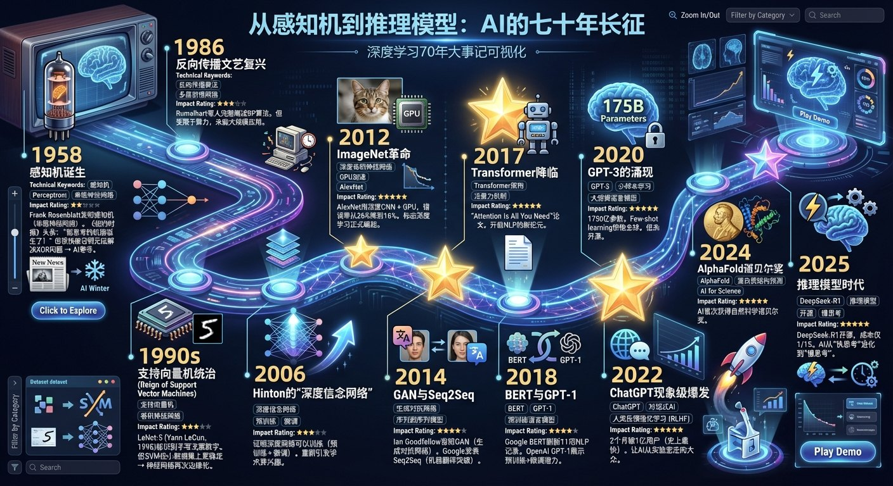
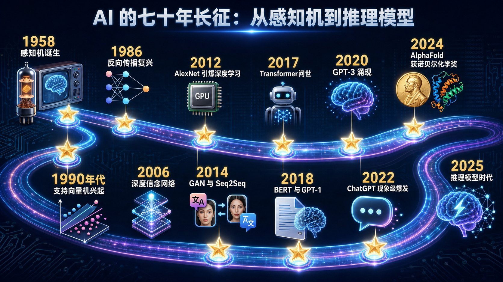

# 2.5 深度学习简史：1958—2025 {#25}

最后，让我们回顾这段旅程的全景（图 2-9、图 2-10）。

| 年份 | 事件 | 意义 |
|---|---|---|
| 1958 | 罗森布拉特公开展示感知机，《纽约时报》以“海军新装置边做边学”为题报道 | 第一个能学习的神经网络；1969 年被证明解决不了异或问题，研究陷入低谷 |
| 1986 | 鲁梅尔哈特、辛顿等发表反向传播论文 | 多层网络可以训练了，但受限于算力，规模很小 |
| 1989—1998 | 杨立昆提出卷积网络 LeNet，用于手写邮编和支票识别 | 神经网络第一次大规模商用；但 20 世纪 90 年代支持向量机等方法更受青睐 |
| 2006 | 辛顿提出深度信念网络与逐层预训练 | 证明深层网络可以训练，“深度学习”一词流行起来 |
| 2012 ★ | AlexNet 赢得 ImageNet 比赛，错误率 15.3% | 深度学习正式崛起 |
| 2014 | 古德费洛提出生成对抗网络（GAN）；谷歌提出序列到序列（Seq2Seq）模型 | 生成式模型和神经机器翻译起步 |
| 2016 | AlphaGo 战胜李世石 | 深度学习 + 强化学习的里程碑 |
| 2017 ★ | 《注意力就是你所需要的一切》发表 | Transformer 登场 |
| 2018 | 谷歌 BERT、OpenAI GPT-1 | “预训练 + 微调”成为主流 |
| 2020 | GPT-3（1 750 亿参数） | 少样本学习惊艳全球 |
| 2022 ★ | ChatGPT 上线，约 2 个月月活用户破 1 亿 | AI 从实验室走向大众 |
| 2023 | GPT-4 | 能同时理解图像和文字；OpenAI 称其在模拟律师资格考试中约排前 10%（后有研究认为与首次参考的考生相比约处于中游） |
| 2024 | 辛顿与霍普菲尔德获诺贝尔物理学奖；哈萨比斯、江珀与贝克获诺贝尔化学奖 | AI 研究首次获得诺贝尔奖 |
| 2025 ★ | DeepSeek-R1 开源 | 推理模型走向普及，AI 从“快思考”走向“慢思考” |

表 2-10 深度学习 70 年大事记
{ .tab-caption }

{ loading=lazy }

图 2-9 深度学习 70 年进化史时间线
{ .fig-caption }

{ loading=lazy }

图 2-10 AI 的 70 年长征：从感知机到推理模型
{ .fig-caption }

**三次范式转移**

1. **2012：深度学习崛起**——让机器自己从数据中学特征，胜过人工设计特征；
2. **2017：Transformer 一统天下**——注意力机制取代 RNN，成为通用架构；
3. **2024—2025：推理时代开启**——除了把模型做大，还可以让模型“多想一会儿”。

## 随堂小测

**1.** 下面事件按时间先后排列，正确的是（　　）

- A. ChatGPT → AlexNet → Transformer → 感知机
- B. 感知机 → Transformer → AlexNet → ChatGPT
- C. AlexNet → 感知机 → ChatGPT → Transformer
- D. 感知机 → AlexNet → Transformer → ChatGPT

??? tip "答案与解析"
    **答案：D**

    解析：感知机 1958 年，AlexNet 2012 年，Transformer 2017 年，ChatGPT 2022 年。

    考查：深度学习简史 · 认知层次：记忆 · [回看 2.5](#25)
    { .quiz-meta }
