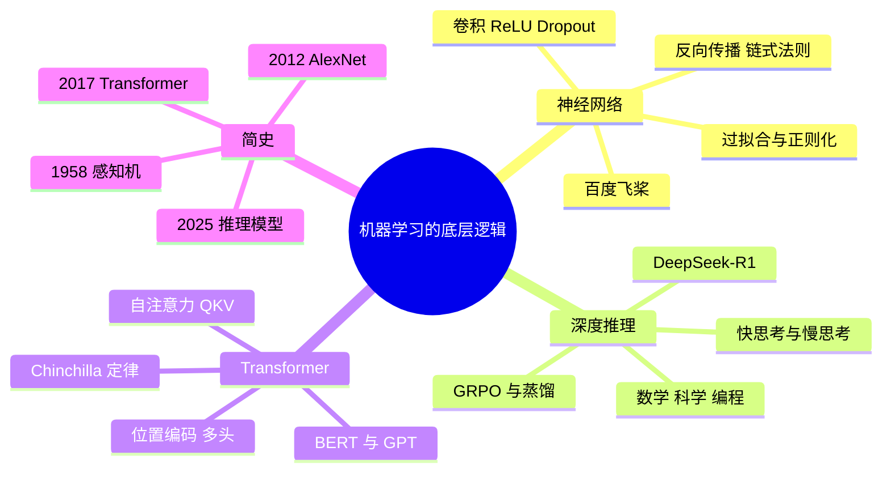

# 第 2 章 本章小结与练习

## 本章小结

我们从 2012 年的 AlexNet 出发，经历了反向传播的“追责风暴”，见证了 DeepSeek-R1 的“慢思考”，理解了 Transformer 如何成为 AI 的通用架构，并初步领略了算法在现实世界中的变革力量。

**核心收获**

- **神经网络的本质**：多层函数嵌套 + 反向传播 + 梯度下降优化；卷积、ReLU、Dropout 让深层网络训练成为可能。
- **过拟合**：模型“背题”而不是学规律；用正则化、Dropout、早停、数据增广来防御。
- **深度推理的突破**：从系统 1 到系统 2，推理模型学会了先写思考过程、自我检查再作答；DeepSeek-R1 用规则奖励的强化学习和蒸馏，以较低成本实现了这一点。
- **Transformer 的统治**：注意力机制让每个词都能看到所有词，取代 RNN 成为 AI 的通用架构；分化出 BERT（理解）和 GPT（生成）两大流派。
- **缩放法则**：大力（数据 + 算力）确实能出奇迹，但参数和数据要匹配（Chinchilla 定律），还可以让模型“多想一会儿”。

**未来方向**

- **多模态融合**：文本、图像、音频、视频的统一处理；
- **小型化**：通过蒸馏、量化、剪枝，让模型能跑在手机和电脑上；
- **可解释性**：打开“黑箱”，让 AI 能告诉我们“为什么这么预测”；
- **节能 AI**：用更少的电力训练更强的模型，DeepSeek 等国产模型已经展示了这方面的潜力。

**哲学反思**：当 AI 学会了“思考”，它是否真的“理解”了世界，还是只是在更大的空间里寻找答案？这个问题目前没有定论，但可以确定的是：能驾驭 AI 的人，将在各行各业更有竞争力。

**下一章预告**：第 3 章聚焦语言智能，看大模型怎样从“文盲”被培养成“博士”，学会写好提示词，并动手搭一个能“开卷考试”的知识库问答。

## 课后练习

**一、单项选择题**

**1.** 反向传播算法的核心数学基础是（　　）

- A. 勾股定理
- B. 链式法则
- C. 矩阵转置
- D. 欧几里得距离

??? tip "答案与解析"
    **答案：B**

    解析：链式法则把输出端的误差一层层分摊到前面各层的参数上。

**2.** 模型在训练集上表现优异，在新数据上效果很差，这种现象叫作（　　）

- A. 欠拟合
- B. 涌现
- C. 过拟合
- D. 梯度消失

??? tip "答案与解析"
    **答案：C**

**3.** 按照卡尼曼的双系统理论，先写出思考过程、再自我检查作答的推理模型更接近（　　）

- A. 系统 1（快思考）
- B. 系统 2（慢思考）
- C. 视觉感知系统
- D. 记忆存储系统

??? tip "答案与解析"
    **答案：B**

**4.** 下面哪一项**不是** AlexNet 的关键技术？（　　）

- A. 自注意力机制
- B. 卷积层
- C. ReLU 激活函数
- D. Dropout

??? tip "答案与解析"
    **答案：A**

    解析：自注意力是 2017 年 Transformer 的核心，AlexNet 是 2012 年的卷积神经网络。

**5.** 关于 Dropout，下面说法正确的是（　　）

- A. 它会永久删除一半的神经元
- B. 它让模型训练得更快，但更容易过拟合
- C. 它只在测试时使用
- D. 训练时随机让部分神经元暂停工作，迫使网络不依赖少数神经元

??? tip "答案与解析"
    **答案：D**

    解析：Dropout 只在训练时随机“请假”，测试时所有神经元都参与，是一种防止过拟合的方法。

**6.** Chinchilla 定律告诉我们（　　）

- A. 参数越多越好，数据量无所谓
- B. 模型越小越好
- C. 在算力一定时，参数量和训练数据量要按比例同步增加
- D. 大模型不需要训练数据

??? tip "答案与解析"
    **答案：C**

    解析：700 亿参数的 Chinchilla 用 1.4 万亿词元训练，胜过了参数大得多但“读书少”的模型。

**7.** 在自注意力的“图书馆”类比中，“值”（Value）对应的是（　　）

- A. 你想找什么书
- B. 书的实际内容
- C. 书的标签
- D. 图书馆的地址

??? tip "答案与解析"
    **答案：B**

    解析：查询（Query）是你想找什么，键（Key）是标签，值（Value）是内容。

**8.** 关于 DeepSeek-R1，下面说法正确的是（　　）

- A. 它的推理强化学习主要用规则自动判断答案对错来给奖励
- B. 它在模型外部搭建了一棵蒙特卡洛搜索树来推理
- C. 从零研发的全部成本只有 600 万美元
- D. 它没有公开模型权重

??? tip "答案与解析"
    **答案：A**

    解析：R1 论文说明尝试过 MCTS 但未采用（B 错）；“约 558 万美元”只是 V3 最后一次训练的租卡折算（C 错）；R1 公开了模型权重（D 错）。

**二、判断题**

**9.** 只要无限增加模型的参数量，就一定能解决大模型的所有幻觉问题。（　　）

- √
- ×

??? tip "答案与解析"
    **答案：×**

**10.** BERT 在训练时能同时看到被遮住词的前文和后文。（　　）

- √
- ×

??? tip "答案与解析"
    **答案：√**

**11.** 多头注意力中每个头负责什么（语法、指代等），是工程师事先规定好的。（　　）

- √
- ×

??? tip "答案与解析"
    **答案：×**

    解析：各个头的分工是训练中自己形成的，研究者是事后观察才发现它们各有侧重。

**12.** 反向传播在 1986 年就已广为人知，但直到 2012 年前后有了大数据和 GPU，才能训练出很深的网络。（　　）

- √
- ×

??? tip "答案与解析"
    **答案：√**

**三、简答题**

**13.** 用“公司追责”的比喻，说明反向传播是怎样让神经网络从错误中学习的。

??? tip "参考答案"
    前向传播时，信息从员工（输入层）逐层汇报到 CEO（输出层），CEO 做出判断；拿到标准答案后，CEO 算出错误有多大，再沿着汇报链自上而下层层问责，每一层按自己“该负多少责任”调整对下级汇报的信任程度（权重）。经过成千上万次“预测—追责—调整”，整个网络的判断就越来越准确。

**14.** 什么是过拟合？请列举两种防止过拟合的方法。

??? tip "参考答案"
    过拟合是模型把训练数据（包括其中的噪声）“背”了下来，在训练集上表现很好，在新数据上表现很差。防止方法有：L2 正则化（限制权重不能太大）、Dropout（训练时随机关闭部分神经元）、早停（验证集表现变差时停止训练）、数据增广（对图片做翻转、裁剪等变换增加样本多样性）等。

**15.** 推理模型在哪些任务上表现突出？在哪些任务上仍然不可靠？

??? tip "参考答案"
    推理模型在数学、编程、逻辑题等有明确标准答案、可以一步步验证的任务上表现突出，如 2025 年在 IMO 中达到金牌分数线、在 Codeforces 上超过绝大多数人类选手。在需要常识、价值判断、创造力或最新事实的任务上仍不稳定，它写出的思考过程也不一定是真实的决策原因，因此结果仍需要人来核实。

## 实践练习

**练习 1：体验深度学习（入门级）**

打开百度飞桨 AI Studio（aistudio.baidu.com）或魔搭社区（modelscope.cn）的在线体验页面，选择预训练模型完成：

- 图片分类：上传一张照片，看 AI 识别的结果；
- 文本情感分析：输入一段商品评论，看 AI 判断是正面还是负面；
- 文字识别：上传一张带文字的照片，看 OCR 的识别效果。

**提交**：截图 + 你的观察（AI 哪里做得好？哪里出错了？）。

**练习 2：理解神经网络训练（基础级）**

用本章的“手写数字识别”动画和第 1 章的“梯度下降下山”动画，观察并回答：

- 字写得歪、写得小、写得潦草时，识别结果怎样变化？
- 学习率太大或太小，小球的路径有什么不同？

**提交**：截图 + 你的发现（200 字左右）。

**练习 3：AI 案例分析（进阶级）**

选择一个你感兴趣的 AI 应用进行调研：智能客服（如电商客服机器人）、智能推荐（如短视频推荐）、智能翻译（如 DeepL、百度翻译）、智能作图（如即梦、文心一格）。回答：

- 这个应用解决了什么问题？
- 它可能运用了本章的哪些技术？（合理推测即可）
- 它有什么局限或问题？

**提交**：PPT（5～8 页）或报告（800～1 000 字）。

**练习 4：数据与偏见（思辨级）**

调研一个真实的 AI 偏见案例，例如亚马逊招聘 AI 的性别歧视问题、人脸识别系统对不同肤色人群的准确率差异、AI 生成图片中的职业刻板印象。简述案例背景，分析偏见产生的原因（数据问题还是算法问题），提出你的改进建议。

**提交**：1 000 字以内的分析报告。

## 拓展阅读

**科普读物**

1. 尼克. 人工智能简史[M]. 第 2 版. 北京：人民邮电出版社，2021. 中文写作的 AI 史，人物和事件脉络清晰，对应 2.5 节。
2. 梅茨. 深度学习革命[M]. 桂曙光，译. 北京：中信出版社，2023. 辛顿、杨立昆、本吉奥等人的故事，包括 2012 年竞购 DNNresearch 的经过，对应 2.1 节。
3. 3Blue1Brown. 深度学习系列动画（B 站有中文字幕版）. 用动画讲清神经网络、反向传播和 Transformer，强烈推荐。

**论文与报告**

4. KRIZHEVSKY A, SUTSKEVER I, HINTON G E. ImageNet classification with deep convolutional neural networks[C]//Advances in Neural Information Processing Systems 25. 2012. AlexNet 原论文，对应 2.1.1 节。
5. DeepSeek-AI. DeepSeek-R1: incentivizing reasoning capability in LLMs via reinforcement learning[J]. Nature, 2025, 645: 633-638. R1 的正式论文，“顿悟时刻”、GRPO、训练成本均出自此文，对应 2.2.2 节。
6. HOFFMANN J, BORGEAUD S, MENSCH A, et al. Training compute-optimal large language models[C]//Advances in Neural Information Processing Systems 35. 2022. Chinchilla 定律，对应 2.3.5 节。

**在线课程与网站**

7. 李沐. 动手学深度学习[EB/OL]. https://zh.d2l.ai/. 有一定编程基础后可以继续学习的经典中文教程。
8. 百度飞桨 AI Studio[EB/OL]. https://aistudio.baidu.com/. 免费的中文在线课程和算力，练习 1 可用。
