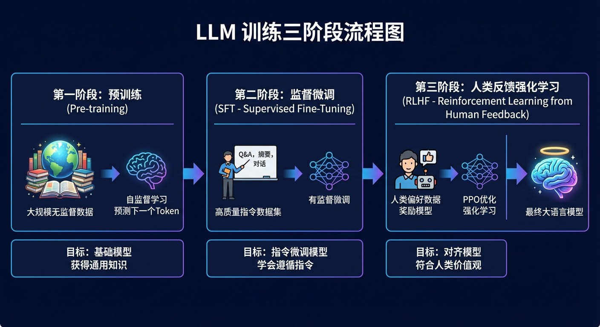

# 3.3 大模型的养成：从“文盲”到“博士” {#33}

!!! info "学前导读"

    一个大模型是怎样被“培养”出来的？本节用“培养一位大厨”来类比训练的三个阶段：**预训练**（背菜谱）、**监督微调**（大厨带教）、**人类反馈强化学习**（食客点评）。本节是全书讲 RLHF 的主要位置。

    最后的 LoRA、QLoRA 是选读内容，想了解“普通人能不能自己训练大模型”的同学可以展开看。

训练一个大模型，就像培养一位米其林三星主厨，过程分为三个阶段（图 3-2）。

{ loading=lazy }

图 3-2 LLM 训练三阶段流程图（Pre-training → SFT → RLHF）
{ .fig-caption }

## 3.3.1 第一阶段：预训练（Pre-training）——“背菜谱” {#331}

**类比**：一个什么都不会的学徒，被关进了装满全世界食谱的图书馆，夜以继日地阅读。

**任务**：自监督学习——预测下一个词元（Next Token Prediction）。例如，看到“西红柿炒鸡____”，要能猜出下一个字是“蛋”。数据不需要人工标注，文本本身就是答案。

**结果**：基座模型（Base Model）。它虽然博学（懂天文地理），却不懂怎样和人对话。你问“如何做红烧肉？”，它可能接着往下“续写”成一篇文章的开头：“……的做法与技巧，源自苏东坡……”。它只学会了续写，还没学会回答问题。

**温度：让回答更稳还是更有创意？**

模型每次都会算出“下一个词”的概率分布，再从中挑一个。“温度”这个参数控制挑选时的随机程度：温度低，总是挑概率最高的词，回答稳定但有些呆板；温度高，概率较低的词也有机会被选中，回答更有创意，但也更容易跑偏。

<iframe class="sim-frame" src="../../sims/temperature-sampling/main.html" height="640" loading="lazy" title="温度与采样"></iframe>

拖动温度滑块，看下一个词的概率柱状图怎样变“尖”或变“平”，再多点几次“生成”，比较不同温度下的结果。[全屏打开](../../sims/temperature-sampling/main.html){ target=_blank } · [教学说明](../../sims/temperature-sampling/index.md)
{ .sim-caption }

## 3.3.2 第二阶段：监督微调（SFT）——“大厨带教” {#332}

**类比**：真正的厨师长（人类专家）亲自示范：“当客人说‘我要一份鱼香肉丝’时，你应该这样炒，而不是去背诵鱼香肉丝的历史。”

**任务**：指令遵循（Instruction Following）。用人工编写的高质量“问题—回答”对来训练，通常几万到几十万条。

**结果**：对话模型（Chat Model）。它知道了“用户在提问，我要回答”，能按要求总结、翻译、写邮件。

## 3.3.3 第三阶段：人类反馈强化学习（RLHF）——“食客点评” {#333}

**类比**：模型开始掌勺做菜，真正的食客（人类标注员）来试吃。

- 做了一道菜，食客说“太咸了”（差评）；
- 做了一道菜，食客说“有妈妈的味道”（好评）。

**具体做法**（1.4.3 节已简要介绍）：

1. 让模型对同一个问题生成几个回答；
2. 人类标注员按“有用、真实、无害”给这些回答排序；
3. 用排序数据训练一个“奖励模型”，让它学会模仿人的评分；
4. 让大模型生成回答、由奖励模型打分，按分数用强化学习算法（常用 PPO）调整参数。

**意义**：让 AI 的行为与人类的期望“对齐”：回答更有帮助、更诚实，拒绝明显有害的请求（如教人制造危险品）。2022 年 OpenAI 的 InstructGPT 论文显示，经过 RLHF 的 13 亿参数模型，在人类评价中甚至比 1 750 亿参数的原始 GPT-3 更受欢迎。

**也要看到局限**：RLHF 让模型更“讨人喜欢”，但不等于真正内化了价值观。它可能学会迎合用户（顺着用户说话），标注员的偏好也会带入模型。后来还出现了不少替代或改进方法，如 Anthropic 的“宪法 AI”（用一组原则让 AI 自己评判回答）、直接偏好优化（DPO），以及 2.2 节介绍的 DeepSeek-R1 用规则自动打分的强化学习。

## 3.3.4 （选读）微调的黑魔法：LoRA 与 QLoRA {#334}

??? note "深入一步（选学）：普通人能不能自己微调大模型？"
    你可能会问：“训练一个大模型动辄需要几千张卡，普通人是不是没机会了？”从零训练确实如此，但在现成的开源模型上做“微调”，门槛已经低了很多。参数高效微调（Parameter-Efficient Fine-Tuning，PEFT）技术让单卡微调成为可能。

    **1. 低秩适配（Low-Rank Adaptation，LoRA）**

    - **原理**：冻结大模型原有的全部参数，只在旁边加几组很小的“支路”矩阵，训练时只更新这些支路。
    - **类比**：就像给软件打补丁，不需要重装整个系统，只需要安装一个很小的补丁包；同一个大模型可以配不同的“补丁”，分别用于客服、写作、法律问答。
    - **效果**（原论文在 GPT-3 1 750 亿参数模型上的结果）：需要训练的参数减少到原来的约万分之一，训练时显存从约 1.2 TB 降到约 350 GB，训练速度提高约 25%，效果与全量微调相当。

    **2. 量化低秩适配（Quantized LoRA，QLoRA）**

    - **原理**：先把大模型的参数从 16 位数字“量化”压缩成 4 位（一种专门设计的 4 位格式 NF4），再在上面做 LoRA 微调。
    - **类比**：把高清无损音乐（.wav）压缩成 MP3，音质有一点损失，但文件只有原来的几分之一。
    - **意义**：原论文在一张 48 GB 显存的专业显卡上微调了 650 亿参数的模型。日常使用中，一张 24 GB 显存的消费级显卡（如 RTX 4090）就能对 70 亿到 300 亿参数级别的模型做 QLoRA 微调。

## 随堂小测

**1.** 在“大厨养成”的比喻中，RLHF 阶段相当于（　　）

- A. 在图书馆背菜谱
- B. 厨师长手把手示范
- C. 把菜端给食客试吃，根据好评差评来改进
- D. 给厨房装修

??? tip "答案与解析"
    **答案：C**

    解析：A 是预训练，B 是监督微调，C 是人类反馈强化学习。

    考查：大模型训练三阶段 · 认知层次：理解 · [回看 3.3](#33)
    { .quiz-meta }

**2.** 你想让 AI 帮忙起 10 个有创意的社团名字，应该怎样设置温度？（　　）

- A. 调高一些，让回答更多样
- B. 调到 0，让回答最稳定
- C. 温度和创意无关
- D. 温度越高，事实越准确

??? tip "答案与解析"
    **答案：A**

    解析：起名字需要多样性，适合较高的温度；查事实、做计算则适合较低的温度。温度高会让事实更容易出错（D 错）。

    考查：温度采样 · 认知层次：应用 · [回看 3.3.1](#331)
    { .quiz-meta }
