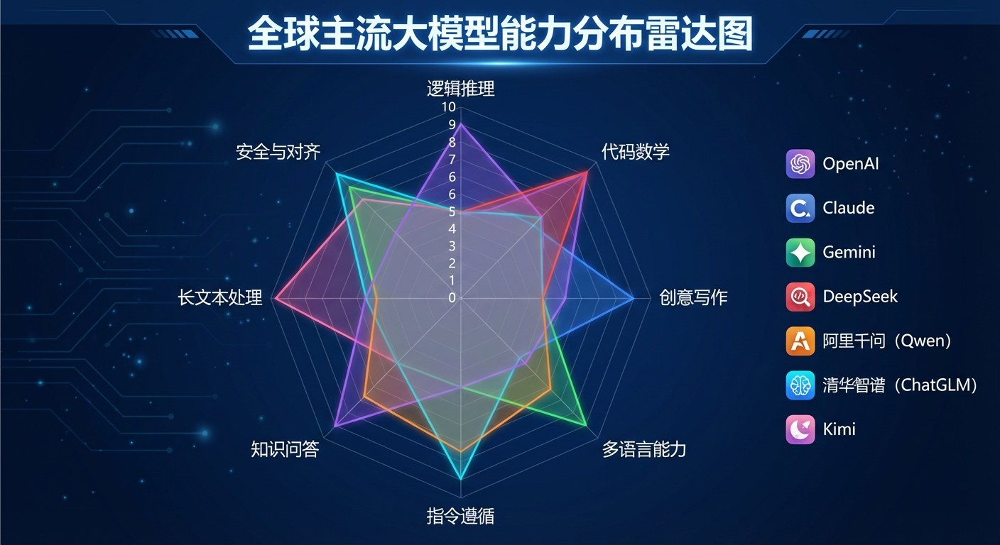
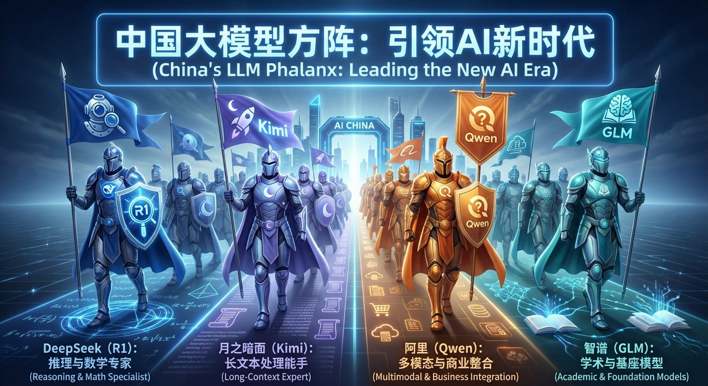

# 3.4 群星闪耀：全球大模型竞技场 {#34}

!!! info "学前导读"

    大模型几乎每个月都有新版本，今天的“最强”过几个月可能就被超越。所以本节不追具体版本号，而是介绍几家主要厂商各自的特点，讲清三个关键概念（**混合专家、长上下文、开源**），最后教你一套“怎么比、怎么选”的方法。

    具体的模型版本、价格和免费额度，请看[工具快照（截至 2026 年 11 月）](../../tool-snapshot.md)。

图 3-3 用雷达图比较了大模型常见的几项能力：逻辑推理、代码与数学、创意写作、多语言、指令遵循、知识问答、长文本处理、安全与对齐。不同模型各有所长，没有哪一个在所有维度上都遥遥领先。

{ loading=lazy }

图 3-3 大模型能力分布雷达图（示意：分值为编者假设，并非实测，各模型实际表现请看最新评测）
{ .fig-caption }

## 3.4.1 国际第一梯队：AI的“御三家” {#341}

{ loading=lazy }

图 3-4 国际大模型竞技场：OpenAI（全能 / 推理）、Anthropic（交互 / 代码）、Google（长窗口 / 多模态）
{ .fig-caption }

**OpenAI（GPT 系列，产品名 ChatGPT）**

ChatGPT 的推出（2022 年 11 月）引爆了这一轮大模型热潮。GPT 系列以综合能力强著称；2024 年起推出 o 系列推理模型，2025 年发布 GPT-5，此后持续迭代，产品形态从聊天机器人逐步扩展到能自主操作电脑、执行多步任务的智能体。通常按“旗舰版 / 推理增强版 / 轻量版”划分不同档次，满足从科研分析到高频简单任务的不同需求。

**Anthropic（Claude 系列）**

由 OpenAI 前员工于 2021 年创立，以“宪法 AI”等安全对齐方法闻名。Claude 系列按规模分为 Opus（最强）、Sonnet（均衡）、Haiku（轻快）三档，在编程、长文档分析和智能体任务上口碑较好，在程序员群体中使用广泛。

**谷歌（Gemini 系列）**

Gemini 从设计之初就是“原生多模态”：同一个模型能直接理解文字、图片、音频和视频，而不是靠外挂组件拼凑。它支持百万词元级别的超长上下文，可以一次读入几十篇论文或一段长视频。2025 年，其“深度思考”版本在国际数学奥林匹克竞赛中达到金牌分数线（见 2.2.3 节）。

!!! warning "关于境外模型"
    上述境外模型在国内大多无法直接注册使用。本书正文介绍它们是为了让你了解全球格局；所有在线体验都使用国内可以直接访问的工具。

## 3.4.2 中国力量：开源与闭源齐飞 {#342}

{ loading=lazy }

图 3-6 中国大模型方阵：深度求索（R1）、月之暗面（Kimi）、阿里（Qwen）、智谱（GLM）
{ .fig-caption }

**DeepSeek（深度求索）**

- **特点**：以低成本、开源著称。2024 年底的 DeepSeek-V3 和 2025 年 1 月的 R1 引起全球关注。
- **技术**：R1 在 V3 基础模型上，用“冷启动微调 + 多阶段强化学习”训练出强大的推理能力，水平与同期的 OpenAI o1 相当（详见 2.2.2 节）；V3 和 R1 都采用了混合专家（MoE）架构。

!!! note "深度解析：什么是混合专家（MoE）架构？"

    - **核心逻辑**：MoE（Mixture of Experts）把模型中的一部分网络层拆成很多个“专家”小网络（DeepSeek-V3 每层有 256 个专家），再配一个“路由器”。
    - **动态路由**：处理**每一个词元**时，路由器挑出最合适的少数几个专家（V3 中是 8 个）来计算，其余专家不参与。同一句话里，不同的词可能交给不同的专家处理。
    - **类比**：像一家大医院的分诊台：每位病人进门，分诊台根据症状把他分到几个最对口的科室，其他科室照常接诊别的病人。不过要注意，模型里的“专家”并不像医院科室那样按“数学、语文”这样人能看懂的学科分工，而是训练中自己形成的、很难解释的分工。
    - **核心优势**：模型总参数很多（V3 共 6 710 亿），知识容量大；但每个词元只激活约 370 亿参数，计算量小，回答又快又便宜。
    - **代价**：所有专家都要装进显卡显存里，所以 MoE 省的是计算量，并不省显存。

{ loading=lazy }

图 3-5 MoE 架构
{ .fig-caption }

**Kimi（月之暗面）**

- **特点**：较早主打“长文本”。2023 年 10 月推出时支持约 20 万汉字的上下文，2024 年 3 月宣布开放约 200 万字的长上下文内测，很适合一次性读入多份财报、合同、论文。

!!! note "深度解析：为什么“长文本”如此重要？"

    - **类比**：如果把大模型的参数比作计算机的“硬盘”（存储长期知识），那么上下文长度就像“内存”（这次对话里能同时摆在桌面上的信息）。内存越大，一次能参考的资料就越多。
    - **应用价值**：让大模型不只靠“记忆”回答，而是能像“开卷考试”一样，读完你给的整本材料再回答。
    - **提醒**：上下文窗口大，不等于每个细节都记得住。测试表明，很多模型对长文本中间部分的信息更容易遗漏；关键数据仍要核对原文。

**通义千问（Qwen，阿里巴巴）**

- **特点**：全球最活跃的开源模型系列之一。阿里以宽松的开源协议公开了从几亿到数千亿参数的一系列模型，以及视觉、语音、代码等专用版本，任何企业和个人都可以下载权重，部署在自己的服务器上。

!!! note "深度解析：为什么开源对 AI 如此重要？"

    - **类比**：如果说闭源模型像只能在官方应用里使用的服务，开源权重模型就像可以自己安装、自己改造的软件。
    - **全尺寸覆盖**：小模型能跑在手机和笔记本电脑上，大模型能支撑企业级应用。
    - **数据不出门**：企业可以在自己的服务器上部署，用内部资料做微调或知识库，不必把敏感数据上传到第三方。
    - **生态影响**：在国际开源社区，基于 Qwen 二次开发的模型数量在 2024—2025 年已位居前列，国产开源模型在这一领域实现了从追随到并跑、局部领跑。

**智谱 AI（GLM 系列）**

- **背景**：源自清华大学知识工程实验室（KEG），2.3.4 节介绍的 GLM 架构就出自这个团队。
- **贡献**：2023 年 3 月开源的 ChatGLM-6B，经过量化后只需 6 GB 左右显存就能运行，让普通开发者用一张家用显卡也能在本地部署对话模型，带动了国内第一波“大模型本地化”热潮。此后推出 GLM-4 等系列，持续开源。

除上面几家外，百度文心、字节跳动豆包、腾讯混元、科大讯飞星火、MiniMax、阶跃星辰等也都推出了各具特色的大模型。

## 3.4.3 怎么比、怎么选 {#343}

原书在这里给出了一张“按身份推荐模型”的选型表。由于模型更新太快、个人体验差异也大，网络版改为教你一套自己比较和选择的方法。

**第一步：看排行榜，了解大致格局**

- **盲测投票类**：如国际上的 LMArena（原 Chatbot Arena），用户同时看两个匿名模型的回答，投票选更好的，再按大量投票计算排名；
- **考试测评类**：如上海人工智能实验室的司南（OpenCompass）、中文测评基准 SuperCLUE，用一套题目考各个模型，分数学、代码、写作等维度给分。

排行榜只能反映“平均水平”，不一定代表在你的任务上谁更好。

**第二步：用你自己的任务试一试**

| 你的任务 | 试用时重点看什么 |
|---|---|
| 写作文案 | 是否符合语气要求、有没有空话套话（“AI 味”） |
| 理科解题 | 打开深度思考，看步骤是否正确，答案是否经得起验算 |
| 读长文档 | 让它回答文档中间部分的细节，再对照原文核实 |
| 编程 | 代码能否直接运行，出错后能否根据报错改正 |
| 查资料 | 是否给出可点开核实的来源，来源是否真实 |

**第三步：综合考虑其他因素**：价格和免费额度、是否需要联网、数据隐私（敏感资料优先考虑能本地部署的开源模型）、所在单位的规定。

体验 3-3 会带你做一次“两个模型盲评”。

## 随堂小测

**1.** 关于混合专家（MoE）架构，下面说法正确的是（　　）

- A. 整个问题只交给一位“专家”处理
- B. 路由器根据题目属于数学还是语文来选专家
- C. 它既省计算量，又省显存
- D. 每个词元只激活少数几个专家，总参数多但计算量小

??? tip "答案与解析"
    **答案：D**

    解析：MoE 按词元路由，每个词元选几个专家（A、B 错）；所有专家都要放在显存里，所以不省显存（C 错）。

    考查：MoE · 认知层次：理解 · [回看 3.4.2](#342)
    { .quiz-meta }

**2.** 一家医院想用大模型分析病历，但病历不能上传到外部服务器。最合适的选择是（　　）

- A. 选排行榜第一的境外闭源模型
- B. 选开源模型，部署在医院自己的服务器上
- C. 随便选一个免费的网页版
- D. 不用考虑数据问题

??? tip "答案与解析"
    **答案：B**

    解析：开源权重模型可以本地部署，数据不出医院，满足隐私和合规要求。

    考查：开源与选型 · 认知层次：应用 · [回看 3.4.3](#343)
    { .quiz-meta }
