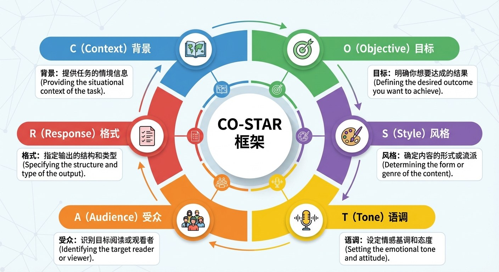

# 3.5 提示词工程：自然语言编程 {#35}

!!! info "学前导读"

    同一个 AI，有人用得得心应手，有人觉得“答非所问”，差别往往在提示词。本节先学一个好记的框架 **CO-STAR**，再学两个最实用的技巧：**给例子**（少样本）和**让它一步步想**（思维链）。

    本节是全书最“马上能用”的一节，建议边学边打开一个大模型试一试。

## 3.5.1 核心框架：CO-STAR 法则 {#351}

CO-STAR 框架由新加坡政府科技局（GovTech）的数据科学家希拉·特奥（Sheila Teo）总结，她用这个方法赢得了 2023 年新加坡首届 GPT-4 提示词工程大赛。它把一个好提示词拆成六个要素（图 3-7）：

| 字母 | 要素 | 要回答的问题 |
|---|---|---|
| C | Context（背景） | 这是什么情况？我是谁？ |
| O | Objective（目标） | 我要 AI 完成什么任务？ |
| S | Style（风格） | 用什么写作风格？（如商务、学术、某位作家的风格） |
| T | Tone（语调） | 用什么情感态度？（如亲切、严肃、幽默） |
| A | Audience（受众） | 写给谁看？ |
| R | Response（回复格式） | 输出成什么样？（如邮件、表格、300 字以内） |

{ loading=lazy }

图 3-7 CO-STAR 框架六要素图解
{ .fig-caption }

!!! example "案例 3-2：催款邮件大变身"

    **场景**：你是财务经理，客户拖欠货款 3 个月，需要写一封催款邮件。

    **× 小白写法**：“帮我写个催款邮件，对方欠钱很久了，让他快点还。”

    AI 输出的结果可能过于生硬，甚至带有威胁语气，容易破坏商业关系。

    **√ CO-STAR 写法**：

    - **C（背景）**：我是一家设计公司的财务经理。对方是合作了 5 年的老客户，最近可能资金周转困难，拖欠了 3 个月服务费。
    - **O（目标）**：提醒对方尽快付款，但不能破坏长期合作关系，要表达理解。
    - **S（风格）**：商务、专业、共情。
    - **T（语调）**：柔中带刚，委婉但坚定。
    - **A（受众）**：对方公司的总经理（要给对方留面子）。
    - **R（格式）**：一封标准的商务邮件，包含问候语、事实陈述、付款方式和期限。

    **AI 输出结果（节选）**：“尊敬的张总：您好！首先祝贺贵司上季度取得的佳绩……我们非常珍惜过去五年的携手合作……也理解贵司近期可能面临的资金安排压力……烦请安排财务部门查收附件中的账单，并于本月 30 日前完成支付……期待与您继续携手……”

    **点评**：你给出的背景越丰富，AI 的“情商”就越高。

**动手看看 · 提示词改写前后**

<iframe class="sim-frame" src="../../../sims/prompt-rewrite/main.html" height="680" loading="lazy" title="提示词改写前后"></iframe>

选一个场景，先看“小白写法”的输出，再逐个勾选 C、O、S、T、A、R 六个要素，看提示词和输出怎样一步步变好。[全屏打开](../../sims/prompt-rewrite/main.html){ target=_blank } · [教学说明](../../sims/prompt-rewrite/index.md)
{ .sim-caption }

## 3.5.2 锦囊二：少样本提示（Few-Shot）——举一反三 {#352}

光靠描述规则，有时很难让 AI 明白你要的效果，最好的办法是直接给它看例子。

- **痛点**：你让 AI “把这句话改成某种特别的风格”，光用文字描述，它往往抓不准。
- **方法**：上下文学习（In-Context Learning）。不需要重新训练模型，只需在提示词里提供 1～3 个“输入—输出”的范例，它就能照猫画虎。

!!! example "案例：让 AI 学会模仿文风"

    **用户**：请模仿鲁迅的语气评论以下事件。

    > 例子 1 
    > 事件：今天下雨了，没带伞。 
    > 评论：天色是沉重的铅灰，雨丝像受了委屈似的斜织着。我没有伞，正如我没有那个可以依靠的旧时代。
    >
    > 例子 2 
    > 事件：食堂的饭很难吃。 
    > 评论：这也是饭么？大约是喂给不愿呐喊的麻木灵魂罢。
    >
    > 正式提问 
    > 事件：周一又要上课了。

    **AI（学会了风格）**：又是周一。我向来是不惮以最坏的恶意来推测这日子的，然而它毕竟还是把那惨淡的白光洒在了我的课桌上。

    **提醒**：模仿文风用于学习和娱乐没有问题；如果用于发表作品，要注意不要大段照搬原作者的文字。

## 3.5.3 进阶魔法：让AI学会像高手一样思考 {#353}

如果 CO-STAR 是基础招式，那么以下就是更高级的技巧。

**1. 零样本思维链（Zero-shot CoT）**

- **做法**：在问题后面加一句“请一步步思考”（Let's think step by step）。
- **效果**：让 AI 先把推理过程写出来，而不是急着猜答案。2022 年日本东京大学和谷歌的研究者发现，在一个小学数学应用题数据集（MultiArith）上，加上这句话后，当时的 GPT-3 系列模型准确率从约 18% 提高到约 79%。
- **提醒**：今天的推理模型（2.2 节）会自动“一步步思考”，对它们再加这句话效果就不明显了；但对普通模型仍然有用。

**2. 自一致性（Self-Consistency）**

- **原理**：面对难题，让 AI 独立回答几次（比如 5 次），取出现次数最多的那个答案。
- **直觉**：就像做选择题，每个人都可能蒙错，但如果五个学霸里有四个都选 C，那么 C 大概率是对的。
- **适用**：有标准答案的推理题、计算题。

**3. 思维树（Tree of Thoughts，ToT）**

- **原理**：不是只走一条思路，而是同时探索多条：AI 先提出几种可能的解题思路，自己评估哪种最有希望，放弃走不通的，顺着最优思路继续。
- **类比**：就像下棋，高手不仅想下一步，还会预演多种可能的变化。

**4. 元认知提示（Metacognitive Prompting）**

- **做法**：“在回答之前，请先说明你对这个问题有多大把握。如果不确定，请直接告诉我，并说明需要查阅什么资料。”
- **效果**：能让 AI 更愿意承认“不知道”，在一定程度上减少瞎编。但研究表明，模型自己报告的把握程度常常不准，它“很有把握”的答案也可能是错的，所以这不能代替你亲自核实。

!!! tip "提示词速查卡"
    1. **说清楚**：背景、目标、受众、格式（CO-STAR）；
    2. **给例子**：想要特定格式或风格，给 1～3 个范例；
    3. **拆步骤**：复杂任务分几步问，或者让它“一步步思考”；
    4. **给材料**：需要准确事实时，把资料直接贴给它（3.6 节的 RAG 思路）；
    5. **多追问**：不满意就具体指出哪里不好，让它改；
    6. **要核实**：数字、引用、法律医疗建议，一律亲自核对。

## 随堂小测

**1.** 在 CO-STAR 框架中，“请用表格列出，每行不超过 20 字”属于哪个要素？（　　）

- A. C（背景）
- B. T（语调）
- C. R（回复格式）
- D. A（受众）

??? tip "答案与解析"
    **答案：C**

    解析：R（Response）规定输出的形式，如表格、邮件、字数限制。

    考查：CO-STAR · 认知层次：应用 · [回看 3.5.1](#351)
    { .quiz-meta }

**2.** 你想让 AI 按照固定格式整理 50 条客户反馈，例如“【类别】问题描述（情绪：正面 / 负面）”。最有效的做法是（　　）

- A. 只说“帮我整理一下”
- B. 先给它 2 条按这个格式整理好的例子，再让它照着处理
- C. 把温度调到最高
- D. 让它一步步思考

??? tip "答案与解析"
    **答案：B**

    解析：这正是少样本提示的用武之地：给出范例，AI 就能照着格式输出。

    考查：少样本提示 · 认知层次：应用 · [回看 3.5.2](#352)
    { .quiz-meta }

**3.** 只要在提示词里要求 AI 说明自己的把握程度，就可以完全避免它胡编乱造。（　　）

- √
- ×

??? tip "答案与解析"
    **答案：×**

    解析：元认知提示有一定帮助，但模型自报的信心常常不准，仍然要亲自核实。

    考查：元认知提示 · 认知层次：理解 · [回看 3.5.3](#353)
    { .quiz-meta }
