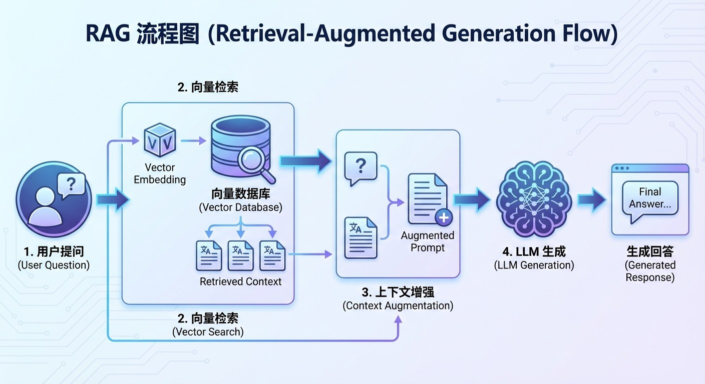
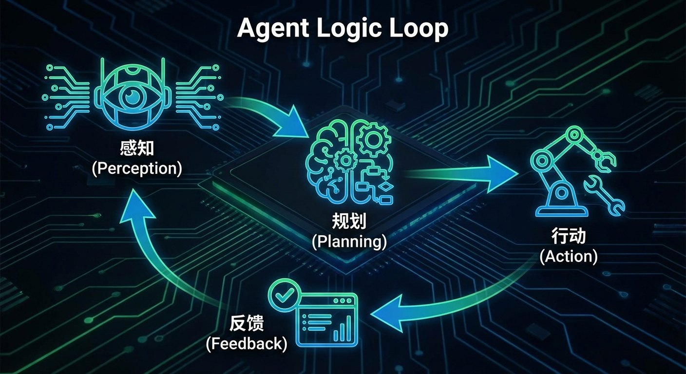

# 3.6 进阶架构：从聊天到行动 {#36}

!!! info "学前导读"

    大模型有两个天生的短板：知识会过时，还会“编”。本节介绍两种“外挂”：**RAG** 让 AI 先查资料再回答（开卷考试），**智能体** 让 AI 不只会说、还会动手调用工具。

    RAG 是你在学习、工作中最可能直接用上的技术——很多大模型产品的“上传文件后提问”“联网搜索”就是它。

如果说提示词工程是在教 AI 说话，那么 RAG 和 Agent 就是给 AI 装上“外挂资料库”和“手脚”。

## 3.6.1 外挂大脑：检索增强生成（RAG）——“开卷考试” {#361}

大模型最大的两个缺陷是：**知识过时**（训练数据有截止时间）和**事实错误**（幻觉）。

解决方法之一：检索增强生成（Retrieval-Augmented Generation，RAG）。

**通俗类比：闭卷 vs 开卷**

- **传统大模型（闭卷考试）**：你问它“今晚北京的天气怎么样？”它被关在“训练数据”的小黑屋里，没法查最新信息，只能凭印象猜（容易产生幻觉），或者老实说“我不知道”。
- **RAG（开卷考试）**：
    1. **检索**（Retrieve）：先去翻最新的“参考书”（如天气预报接口、企业内部文档、网页搜索结果）；
    2. **增强**（Augment）：把找到的资料（“今晚北京多云转晴”）和你的问题一起交给模型；
    3. **生成**（Generate）：模型看着资料回答：“根据最新预报，今晚多云转晴。”

**核心价值**：RAG 让 AI 的回答“有凭有据”，可以附上来源让你核对，还能用上训练时没有的最新信息和私有资料。但要注意：如果检索到的资料本身有错，或者没检索到关键内容，AI 仍然可能答错，所以 RAG 能**减少**幻觉，但不能**消除**幻觉。

**动手看看 · RAG“开卷考试”**

<iframe class="sim-frame" src="../../../sims/rag-open-book/main.html" height="700" loading="lazy" title="RAG 开卷考试"></iframe>

选一个问题，先看“闭卷”回答，再打开“开卷”：看系统从资料库里检索出哪几段、按相似度怎么排序，最后的回答又是怎样引用这些资料的。试试把关键资料从库里删掉，看看会发生什么。[全屏打开](../../sims/rag-open-book/main.html){ target=_blank } · [教学说明](../../sims/rag-open-book/index.md)
{ .sim-caption }

{ loading=lazy }

图 3-8 RAG 流程图：用户提问 → 向量检索 → 上下文增强 → LLM 生成
{ .fig-caption }

## 3.6.2 （选读）核心技术揭秘：从向量到图谱 {#362}

??? note "深入一步（选学）：RAG 是怎样“找资料”的？"
    **1. 向量数据库与余弦相似度**

    - **原理**：机器不读字，只读数字。任何一段话（如“苹果好吃”）都可以用一个“嵌入模型”转换成一个几百到几千维的向量（3.1 节的词向量思想）。资料库里的每一段文字也都事先转成向量存好。
    - **计算**：查找资料时，不是查关键词，而是比较问题的向量和资料的向量在空间中的夹角，夹角越小（余弦值越接近 1），意思越接近。
    - **神奇之处**：即使你不用“苹果”这个词，搜“红彤彤的脆甜水果”，向量检索也能找到讲苹果的段落。

    **2. 重排序（Re-ranking）——“二次筛选”**

    - **痛点**：向量检索有时找得太宽，会把不太相关的内容也抓进来。
    - **方案**：先用向量检索粗选几十段，再用一个更精细的“重排序模型”把这些段落逐一和问题比对，挑出最相关的几段交给大模型。这样通常能明显提高回答的准确率。

    **3. 图谱增强（GraphRAG）——“连点成线”**

    - **新趋势**：微软在 2024 年开源的方法。
    - **超越向量**：先从资料中抽取实体和关系，建成知识图谱（如“苹果 → 属于 → 蔷薇科 → 属于 → 植物”），再结合图谱检索。这样 AI 能回答“这些资料总体讲了哪些主题”“这类水果有什么共同特征”这类需要通览全局的问题。

## 3.6.3 硅基生命：AI Agent（智能体）——“从动嘴到动手” {#363}

如果说聊天机器人只是一个能陪你聊天的“大脑”，那么智能体（Agent）就是给它装上了手脚。本节只做简介，第 5 章将专门展开。

**核心公式**：智能体 = 大模型（大脑）+ 规划 + 记忆 + 工具

!!! example "场景故事：一句话搞定出差（情景模拟）"

    **老板的需求**：“帮我订明天早上去上海的高铁票，顺便订个静安寺附近的酒店。”

    **普通大模型**：只能列出车次建议，让你自己去 App 上订。

    **智能体的工作过程**：

    1. **感知**：识别出地点“上海”、时间“明天早上”、偏好“静安寺附近”；
    2. **规划**：第一步，调用购票工具查询车次；第二步，按出发时间和价格挑选；第三步，查询酒店，筛选距离静安寺 2 千米以内的；第四步，把方案发给老板确认后再下单；
    3. **行动**：通过应用程序编程接口（API）真正去查询、下单；
    4. **反馈**：收到出票通知后，自动把行程加到老板的日历里。

    **结论**：传统的 AI 是被动的，智能体是主动的：它不只生成文字，还能直接执行操作。也正因如此，付款、发送邮件这类不可撤销的操作，必须设置“人来确认”的环节（第 5、7 章会讨论智能体的安全问题）。

{ loading=lazy }

图 3-9 Agent 做事的逻辑：感知 → 规划 → 行动 → 反馈
{ .fig-caption }

## 随堂小测

**1.** 公司想让员工能向 AI 询问内部的报销制度，且答案要以公司最新文件为准。最合适的技术是（　　）

- A. 检索增强生成（RAG）：把制度文件做成知识库，先检索再回答
- B. 把温度调高
- C. 重新从零训练一个大模型
- D. 只用少样本提示

??? tip "答案与解析"
    **答案：A**

    解析：RAG 不需要重新训练模型，文件更新后知识库随之更新，回答还能附上出处。

    考查：RAG · 认知层次：应用 · [回看 3.6.1](#361)
    { .quiz-meta }

**2.** 用了 RAG 之后，AI 就再也不会产生幻觉了。（　　）

- √
- ×

??? tip "答案与解析"
    **答案：×**

    解析：如果资料有错、没检索到关键内容，或者模型误读了资料，仍然会答错。RAG 能减少但不能消除幻觉。

    考查：RAG 的局限 · 认知层次：理解 · [回看 3.6.1](#361)
    { .quiz-meta }
