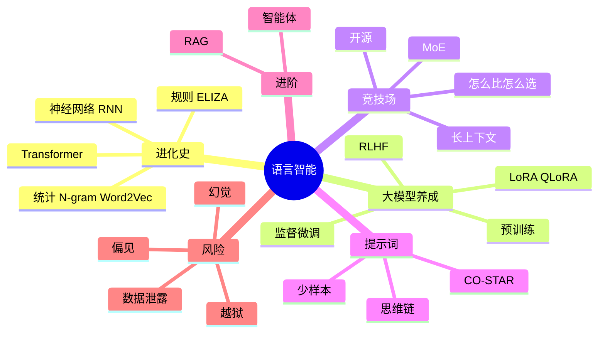

# 第 3 章 本章小结与练习

## 本章小结

本章我们完成了一次从“规则”到“概率”、从“聊天”到“行动”的穿越。

- **历史维度**：从 ELIZA 的规则脚本，到 N-gram 和 Word2Vec 的统计方法，再到 RNN 和 Transformer 的神经网络时代。
- **技术维度**：理解了注意力机制怎样处理上下文，大模型怎样经过预训练、监督微调和人类反馈强化学习被“培养”出来，以及 RAG 和智能体的基本原理。
- **工具维度**：掌握了 CO-STAR 提示词框架、少样本提示和思维链，学会了用排行榜加亲自试用来比较、选择大模型。
- **实战维度**：体验了论文阅读、长篇创作和网页小游戏开发中的人机协作。
- **风险维度**：认识了幻觉、越狱、偏见和数据泄露四类风险。

**下一章预告**：第 4 章从“语言”走向“视听”：看机器怎样看懂图片、怎样从一团噪声里“画”出图像，怎样听懂和说出人话，以及 AI 生成的图片和视频带来了哪些真假难辨的新问题。

## 课后练习

**一、单项选择题**

**1.** 相较于 RNN，Transformer 架构最大的突破在于（　　）

- A. 引入了卷积层
- B. 能并行处理整段文字，并让任意两个词直接建立关联
- C. 模拟了人脑的遗忘机制
- D. 参数更少

??? tip "答案与解析"
    **答案：B**

**2.** 基座模型（只经过预训练）收到“如何做红烧肉？”时，最可能的表现是（　　）

- A. 拒绝回答
- B. 给出一份格式规范的菜谱
- C. 把它当成一段文字的开头接着往下续写
- D. 反问用户口味偏好

??? tip "答案与解析"
    **答案：C**

    解析：基座模型只学会了续写，经过监督微调后才学会按指令回答问题。

**3.** 发现 AI 一本正经地胡说八道时，最有效的修正方法是（　　）

- A. 调高温度参数
- B. 用 RAG 或联网搜索为模型提供可靠资料，并亲自核对来源
- C. 换一种语气再问一次
- D. 让它回答得更长一些

??? tip "答案与解析"
    **答案：B**

**4.** “King − Man + Woman ≈ Queen”这个例子说明了（　　）

- A. 机器会做四则运算
- B. 国王和女王是夫妻
- C. 机器已经像人一样完全理解了词义
- D. 词向量空间中形成了表示“性别”等含义的方向

??? tip "答案与解析"
    **答案：D**

    解析：词向量通过统计上下文形成了语义方向，但这不等于机器像人一样“理解”（C 错）。

**5.** 在提示词末尾加上“请一步步思考”，主要作用是（　　）

- A. 让模型先写出推理过程，提高多步骤问题的准确率
- B. 减少词元消耗
- C. 让回答更幽默
- D. 让模型联网搜索

??? tip "答案与解析"
    **答案：A**

**6.** DeepSeek-R1 的训练方式是（　　）

- A. 完全不用强化学习
- B. 只用纯强化学习，没有任何监督微调
- C. 在 V3 基础模型上先做少量冷启动微调，再做多阶段强化学习
- D. 只靠人类逐条打分

??? tip "答案与解析"
    **答案：C**

    解析：只用纯强化学习的是 R1-Zero；正式的 R1 先做冷启动微调，再做多阶段强化学习和微调。

**7.** 在 CO-STAR 框架中，“写给对方公司的总经理看”属于（　　）

- A. Style（风格）
- B. Audience（受众）
- C. Objective（目标）
- D. Tone（语调）

??? tip "答案与解析"
    **答案：B**

**8.** 关于智能体（Agent），下面说法正确的是（　　）

- A. 智能体就是会聊天的大模型
- B. 智能体不需要大模型
- C. 智能体执行付款等操作时不需要人确认
- D. 智能体 = 大模型 + 规划 + 记忆 + 工具，能主动执行操作

??? tip "答案与解析"
    **答案：D**

    解析：不可撤销的操作应设置人工确认环节（C 错）。

**二、判断题**

**9.** 混合专家（MoE）模型处理每个词元时只激活少数几个专家。（　　）

- √
- ×

??? tip "答案与解析"
    **答案：√**

**10.** 上下文窗口越大，模型就一定能记住长文档中的每一个细节。（　　）

- √
- ×

??? tip "答案与解析"
    **答案：×**

    解析：很多模型对长文本中间部分的信息容易遗漏，关键内容要核对原文。

**11.** RLHF 中的“奖励模型”是用人类对回答的排序数据训练出来的。（　　）

- √
- ×

??? tip "答案与解析"
    **答案：√**

**12.** 只要是公司内部的代码，就可以放心粘贴到任何公共 AI 服务里查错。（　　）

- √
- ×

??? tip "答案与解析"
    **答案：×**

**三、简答题**

**13.** 用“大厨养成”的比喻，说明大模型训练的三个阶段各自解决什么问题。

??? tip "参考答案"
    预训练相当于“背菜谱”：让模型在海量文本上学习预测下一个词，获得广博的知识和语言能力，但只会续写；监督微调相当于“大厨带教”：用人工编写的问答示范，让模型学会按指令回答；人类反馈强化学习相当于“食客点评”：让人对模型的多个回答排序，训练奖励模型，再引导模型生成更有帮助、更真实、更无害的回答。

**14.** 用 CO-STAR 框架，为“向学院申请举办一次 AI 主题讲座”写一个提示词。

??? tip "参考答案"
    示例：C（背景）：我是计算机协会会长，想在下月邀请一位企业工程师来学院做一场“AI 在职场中的应用”讲座。O（目标）：写一份申请书，说明讲座目的、时间地点、预计人数和所需支持（场地、经费 500 元）。S（风格）：正式、简洁的公文风格。T（语调）：诚恳、积极。A（受众）：学院团委老师。R（格式）：标准申请书格式，含标题、正文、落款，600 字以内。

**15.** RAG 为什么能减少幻觉？它有哪些局限？

??? tip "参考答案"
    RAG 让模型先从可靠的资料库检索相关内容，再“看着资料”回答，回答有据可查，还能使用训练后新增的信息和私有资料，因此减少了凭空编造。局限在于：资料本身可能有错或过时；检索可能漏掉关键内容或找来不相关的内容；模型也可能误读资料。所以 RAG 只能减少而不能消除幻觉，重要信息仍需人工核对。

**四、思考题**

1. **“中文房间”的现代回响**：哲学家塞尔曾提出“中文房间”思想实验。今天的大模型到底是在“理解”语言，还是仅在进行极高维度的“统计概率预测”？请谈谈你的看法。
2. **数字鸿沟**：“会提问”的人和“不会提问”的人，使用同一个 AI 得到的结果天差地别。这是否会造成新的社会不公？学校和社会可以做些什么？

## 拓展阅读

1. VASWANI A, et al. Attention is all you need[C]//NIPS 2017. Transformer 的诞生，对应 3.2 节和 2.3 节。
2. MIKOLOV T, CHEN K, CORRADO G, et al. Efficient estimation of word representations in vector space[EB/OL]. arXiv:1301.3781, 2013. Word2Vec 原理，对应 3.1.2 节。
3. OUYANG L, WU J, JIANG X, et al. Training language models to follow instructions with human feedback[C]//Advances in Neural Information Processing Systems 35. 2022. InstructGPT 论文，RLHF 的基石，对应 3.3.3 节。
4. KOJIMA T, GU S S, REID M, et al. Large language models are zero-shot reasoners[C]//Advances in Neural Information Processing Systems 35. 2022. “请一步步思考”的出处，对应 3.5.3 节。
5. LEWIS P, PEREZ E, PIKTUS A, et al. Retrieval-augmented generation for knowledge-intensive NLP tasks[C]//Advances in Neural Information Processing Systems 33. 2020. RAG 的原始论文，对应 3.6.1 节。
6. 国家互联网信息办公室等. 生成式人工智能服务管理暂行办法[Z]. 2023. 我国生成式 AI 服务的基本规范，附录 A 有节选。
7. DAIR.AI. 提示工程指南（Prompt Engineering Guide）中文版[EB/OL]. https://www.promptingguide.ai/zh. 开源的提示词教程，覆盖本章所有技巧。
