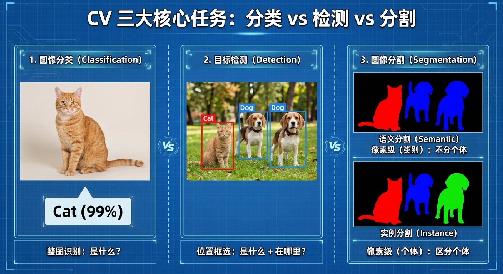
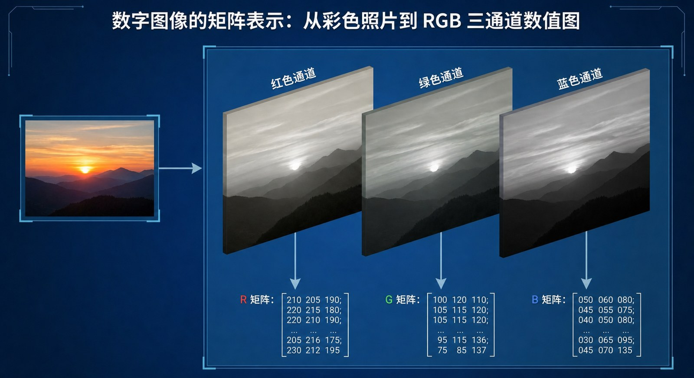
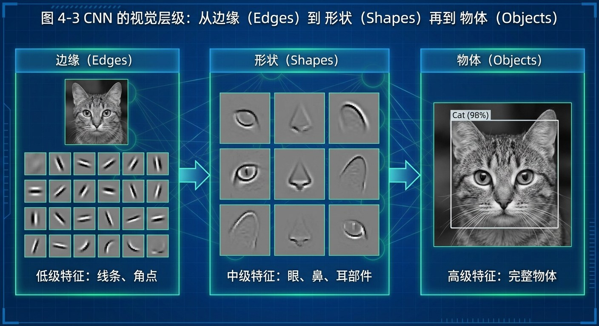
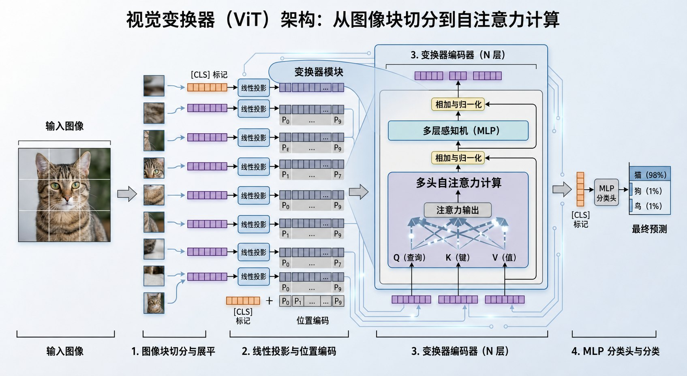
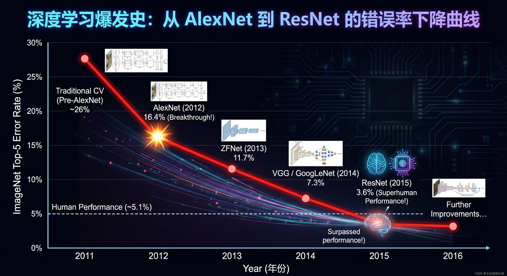

# 4.1 机器之眼：计算机视觉的进化 {#41}

!!! info "学前导读"

    在计算机眼里，一张照片只是一大堆数字。本节回答一个问题：机器是怎样从这堆数字里“看出”一只猫的？

    你会看到两种思路：CNN 像拿着手电筒一小块一小块地看，ViT 则把图片切成小块、让每一块都和其他块“对话”。

让计算机“看见”，不仅仅是连接摄像头，更是要让它理解像素背后的含义。计算机视觉（Computer Vision，CV）最基本的任务有三类：

- **分类**（Classification）：图中是什么？（是猫还是狗？）
- **检测**（Detection）：物体在哪里？（用方框标出猫的位置）
- **分割**（Segmentation）：物体的轮廓是什么？（把属于猫的像素完整抠出来，手机人像模式的“背景虚化”就用到了它）

{ loading=lazy }

图 4-1 CV 三大核心任务：分类 vs 检测 vs 分割
{ .fig-caption }

分割又分两种：**语义分割**只区分类别（这些像素都是“狗”），**实例分割**还要区分个体（这是第一只狗，那是第二只狗）。

## 4.1.1 像素矩阵 {#411}

对计算机而言，一张精美的照片，本质上只是一个巨大的数字矩阵。黑白照片的每个像素是一个 0～255 的数（0 最黑，255 最白）；彩色照片的每个像素由红（R）、绿（G）、蓝（B）三个 0～255 的数组成，相当于三张叠在一起的数字表。

{ loading=lazy }

图 4-2 数字图像的矩阵表示：从彩色照片到 RGB 三通道数值图
{ .fig-caption }

表 4-1 人眼与机器视觉的认知差异
{ .tab-caption }

| 维度 | 人眼（生物视觉） | 机器眼（机器视觉） |
|---|---|---|
| 输入信号 | 视网膜感光细胞接收的光 | RGB 像素矩阵（数值范围 0～255） |
| 识别方式 | 整体感知，基于经验与联想 | 逐层提取特征，基于从数据中学到的统计规律 |
| 抗干扰性 | 强（光线变化、旋转一般不影响识别） | 相对弱（人眼几乎看不出的微小像素改动，可能导致识别出错，见 7.3 节“对抗样本”） |

## 4.1.2 卷积神经网络（CNN） {#412}

在很长一段时间里，CNN 都是计算机视觉的主力架构。它的灵感来自生物学：20 世纪 50～60 年代，休伯尔（Hubel）和维泽尔（Wiesel）发现，猫的视觉皮层里有些细胞只对特定方向（横、竖、斜）的线条有反应。

我们已经在 2.3 节学过卷积的基本思想。在视觉任务中，CNN 就像一条分工明确的流水线：

- **浅层**：提取边缘与纹理（如猫耳朵的轮廓、毛发的条纹）；
- **中层**：把边缘组合成基础形状（如圆形、三角形）；
- **深层**：把形状组合成物体部件（如眼睛、鼻子），最终识别出整只猫。

!!! example "深度解析：从局部到整体"
    CNN 的核心思想是“局部连接”。它不像全连接网络那样一眼看遍全图，而是像拿着手电筒一样，用一个小窗口（卷积核）一小块一小块地扫描图片，提取局部特征，再一层层拼成整体。这契合了图像的特点：相邻的像素关系最密切。

**动手看看 · 卷积滤镜**

<iframe class="sim-frame" src="../../../sims/conv-filter/main.html" height="820" loading="lazy" title="卷积滤镜"></iframe>

选一个卷积核（模糊、锐化、边缘），点图片上任意位置，看 3 × 3 窗口里的 9 个数是怎样算出一个新像素的。“竖直边缘”卷积核在什么地方结果最亮？[全屏打开](../../sims/conv-filter/main.html){ target=_blank } · [教学说明](../../sims/conv-filter/index.md)
{ .sim-caption }

{ loading=lazy }

图 4-3 CNN 的视觉层级：从边缘（Edges）到形状（Shapes）再到物体（Objects）
{ .fig-caption }

## 4.1.3 视觉变换器（ViT） {#413}

2020 年，谷歌提出视觉变换器（Vision Transformer，ViT），把原本用于处理文字的 Transformer 搬进了视觉领域。

我们在 2.3 节和第 3 章已经知道，Transformer 擅长处理序列数据（如一句话中的一个个词）。但图片是二维的矩阵，怎么“喂给” Transformer 呢？

**ViT 的关键一步：切块（Patching）**

1. **切块**：把一张 224 × 224 像素的图片切成 196 个 16 × 16 的小方块（14 × 14 = 196）；
2. **排成一排**：把这些小方块排成一个序列，每个小方块就相当于一句话里的一个“词元”（Token）；
3. **全局注意力**：每个小方块都可以直接和其他所有小方块计算关系。

打个比方：CNN 一开始只看得到眼前的一小块，要靠一层层叠加才能看到全局；ViT 从第一层起就能计算第 1 块和第 196 块之间的关系。因此，ViT 在把握整体结构（如“这张图里不仅有猫，远处还有一只狗，它们正在互动”）上有优势。不过 ViT 通常需要更多的训练数据才能发挥出这种优势；数据较少时 CNN 依然好用，今天很多模型也把两者结合起来。

{ loading=lazy }

图 4-4 视觉变换器（ViT）架构：从图像块切分到自注意力计算
{ .fig-caption }

## 4.1.4 ImageNet 与深度学习的爆发 {#414}

!!! example "案例 4-1 ImageNet 竞赛（ILSVRC）"
    ImageNet 是李飞飞团队建立的大型图像数据集。2010—2017 年举办的 ImageNet 大规模视觉识别挑战赛（ILSVRC），见证了深度学习在视觉领域的崛起（下面的错误率指“前 5 个猜测里都没有正确答案”的比例）：

    - **AlexNet（2012）**：用 GPU 训练深度 CNN，错误率约 15.3%，比第二名（约 26.2%）低了约 11 个百分点，引发了深度学习热潮。
    - **低于人类基准（2015）**：此前有研究者亲自做题，估计人类的错误率约为 5.1%。2015 年 2 月，微软研究院的一个网络（PReLU-Net）首先把错误率降到 4.94%，低于这一人类基准。
    - **ResNet（2015）**：何恺明等人提出“残差连接”，解决了很深的网络难以训练的问题，把网络加深到 152 层，以 3.57% 的错误率（多个模型组合的成绩）夺得当年冠军。
    - **YOLO（2016）**：把目标检测做到了实时，能以每秒几十帧的速度在视频里框出人、车等物体。

    注意，“超越人类”只是在这一个数据集、这一个指标上；换一个场景，机器的表现可能大打折扣。

{ loading=lazy }

图 4-5 深度学习爆发史：从 AlexNet 到 ResNet 的错误率下降曲线
{ .fig-caption }

## 随堂小测

**1.** 与“图像分类”相比，“目标检测”多做了哪件事？（　　）

- A. 识别物体属于什么类别
- B. 标出物体所在的位置（画框）
- C. 抠出物体的精确轮廓
- D. 把图片切成小方块

??? tip "答案与解析"
    **答案：B**

    解析：分类只回答“是什么”，检测还要回答“在哪里”。抠出精确轮廓是分割；切成小方块是 ViT 的处理方法。

    考查：计算机视觉三大任务 · 认知层次：理解 · [回看 4.1](#41)
    { .quiz-meta }

**2.** 机器在 ImageNet 上的错误率低于人类基准，说明机器在所有视觉任务上都已经超过了人。（　　）

- √
- ×

??? tip "答案与解析"
    **答案：×**

    解析：这一结论只限于 ImageNet 这个数据集和“前 5 个猜测”这一指标。换到光线、角度、背景不同的真实场景，或者遇到对抗样本，机器的表现可能远不如人。

    考查：ImageNet 竞赛 · 认知层次：评价 · [回看 4.1.4](#414)
    { .quiz-meta }
