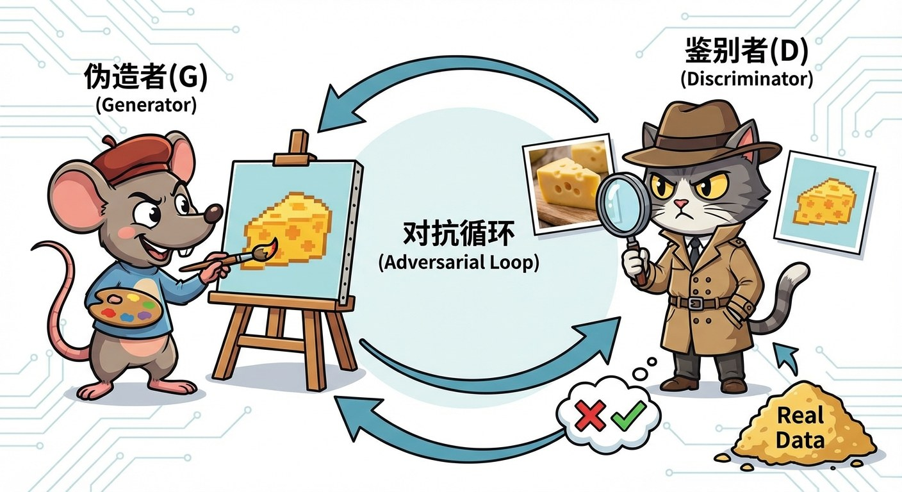
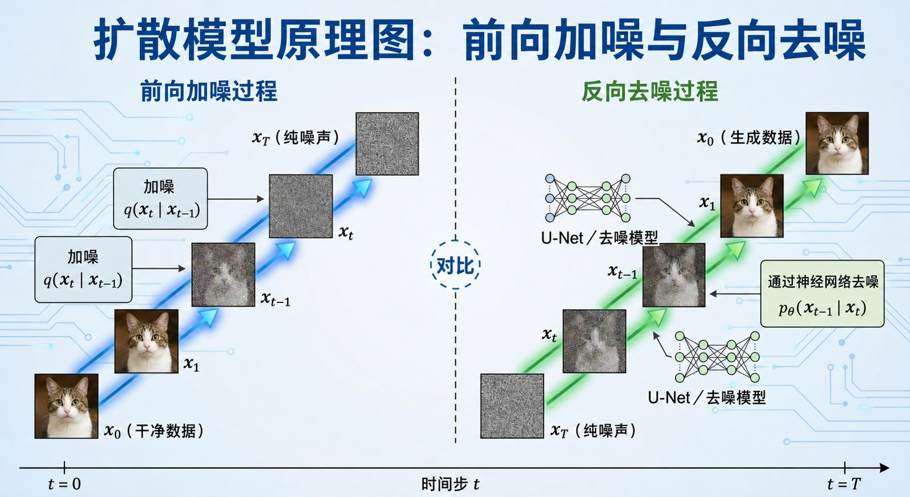

# 4.2 创世引擎：从 GAN 到扩散模型 {#42}

!!! info "学前导读"

    4.1 节的模型“看懂”图片；本节的模型“画出”图片。我们讲两种生成思路：GAN 让两个网络互相较劲，扩散模型则先学会“弄脏”一张图，再学会一步步“擦干净”。

    今天大多数 AI 绘画、AI 视频工具背后，都是扩散模型或它的变体。

## 4.2.1 生成对抗网络（GAN） {#421}

生成对抗网络（Generative Adversarial Networks，GAN）由古德费洛（Ian Goodfellow）等人在 2014 年提出，曾是 AI 生成图像的主流技术。它的灵感来自博弈：可以想象成一场“造假者”和“鉴别者”之间的猫鼠游戏。

- **生成器（Generator）——“伪造者”**：它的任务是“凭空”画出假图，尽最大努力骗过鉴别者。
- **判别器（Discriminator）——“鉴别者”**：它的任务是分辨哪些是真实图片、哪些是伪造的。

**训练过程**

- **第一回合**：伪造者画了一张很差的图，鉴别者一眼识破。伪造者被“批评”后调整参数。
- **第 N 回合**：伪造者的画技精进，鉴别者也必须提升眼力才能分辨真假。
- **理想终局**：伪造者画出的图足够逼真，鉴别者只能靠瞎猜，猜对的概率约为 50%。

{ loading=lazy }

图 4-6 GAN 的“猫鼠游戏”：伪造者（G）与鉴别者（D）的对抗循环
{ .fig-caption }

**致命弱点：模式坍塌（Mode Collapse）**

由于伪造者只想骗过鉴别者，它可能会“偷懒”。例如，它发现鉴别者觉得“黄色的猫”最像猫，就会反复生成差不多的黄猫，而忽略了白猫、黑猫。这种多样性的丧失叫作“模式坍塌”，也是 GAN 训练难度高的主要原因之一。

## 4.2.2 扩散模型（Diffusion Model） {#422}

Stable Diffusion、即梦、通义万相等 AI 绘画工具都以扩散模型为核心技术（Midjourney 没有公开技术细节，一般认为也属于扩散类模型）。和 GAN 不同，扩散模型更像一位在迷雾中雕刻的艺术家。

**打个比方：雕刻刀**

相传米开朗琪罗说过：“大卫原本就在这块大理石里，我只是把多余的部分去掉了。”扩散模型生成图像，也像是从一块“噪点石料”中，把不属于画面的部分一点点去掉。

!!! example "深度解析：从“雪花屏”到画作"
    **前向扩散（加噪）——“毁坏”**

    想象你把一张清晰的图像（如《蒙娜丽莎》）一步步盖上雪花点（高斯噪声）：

    - 加噪不多时，图像开始模糊；
    - 加到一半，几乎看不清了；
    - 加到最后（例如第 1000 步），彻底变成一张全是噪点的“雪花屏”。

    **反向扩散（去噪）——“雕刻”**

    AI 的任务是面对这张“雪花屏”，在提示词的指引下，预测其中哪些是噪声，把它一点点去掉。以提示词“一只可爱的猫”为例：

    - AI 预测哪些像素是“噪声”而不是“猫”，然后去除一部分；
    - 去除一层噪点，猫的轮廓浮现；再去除一层，猫的毛发变得清晰；
    - 经过几十步的“减法”，一只猫就从噪声中出现了。

    **训练时学什么？** 训练时，模型反复看“一张真图加了多少噪声”，学会预测噪声；生成时，就从纯噪声出发，一步步把预测出的噪声减掉。

表 4-2 扩散与去噪
{ .tab-caption }

| 过程 | 物理类比 | 目的 |
|---|---|---|
| 加噪（前向） | 滴入墨水，清水慢慢变浑浊 | 制造训练数据，教会 AI 认识“噪声” |
| 去噪（反向） | 像倒放录像，从浑水中一点点还原出清水 | 生成内容，从随机噪声中“雕刻”出图像 |

**动手看看 · 扩散：加噪与去噪**

<iframe class="sim-frame" src="../../sims/diffusion-noise/main.html" height="720" loading="lazy" title="扩散：加噪与去噪"></iframe>

拖动“步数”滑块，看一张图怎样一步步变成雪花屏；再点“去噪”，看同一片噪声在不同提示词的引导下，怎样被“雕刻”成不同的图像。[全屏打开](../../sims/diffusion-noise/main.html){ target=_blank } · [教学说明](../../sims/diffusion-noise/index.md)
{ .sim-caption }

{ loading=lazy }

图 4-7 扩散模型原理图：前向加噪与反向去噪
{ .fig-caption }

??? note "深入一步（选学）：为什么同一句提示词，每次画出来都不一样？"
    反向去噪的起点是一张**随机**生成的噪声图。起点不同，雕刻出来的画面就不同。很多工具允许你固定一个叫“种子”（Seed）的数字：种子相同，起点噪声相同，在其他设置不变时就能复现同一张图。

    另外，真正的工具并不是直接在几百万个像素上加噪去噪，而是先把图片压缩成一个小得多的“潜在表示”，在那里做扩散，最后再还原成图片。这就是 Stable Diffusion 所用的“潜在扩散模型”，它大大降低了计算量，让普通显卡也能生成图片。

## 随堂小测

**1.** 扩散模型生成一张图片时，起点是什么？（　　）

- A. 一张从网上搜来的相似图片
- B. 一张空白的白纸
- C. 一张随机的噪声图
- D. 由判别器提供的草图

??? tip "答案与解析"
    **答案：C**

    解析：反向去噪从一张随机噪声图开始，在提示词引导下一步步去掉预测出的噪声。判别器是 GAN 的组成部分。

    考查：扩散模型原理 · 认知层次：理解 · [回看 4.2.2](#422)
    { .quiz-meta }

**2.** 一个 GAN 模型生成的人脸张张都很逼真，但几乎都是同一种发型和肤色。这种现象叫作（　　）

- A. 过拟合
- B. 模式坍塌
- C. 幻觉
- D. 梯度消失

??? tip "答案与解析"
    **答案：B**

    解析：生成器发现某一类图最容易骗过判别器，就反复生成这一类，丢失了多样性，这就是模式坍塌。

    考查：GAN 的弱点 · 认知层次：应用 · [回看 4.2.1](#421)
    { .quiz-meta }
