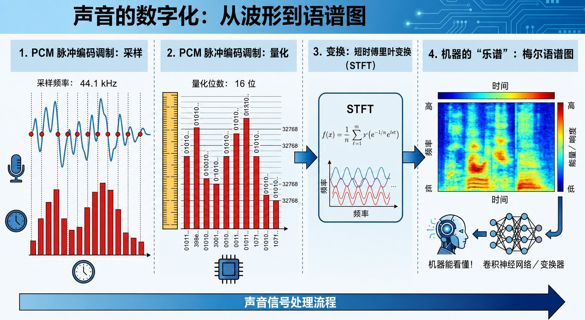
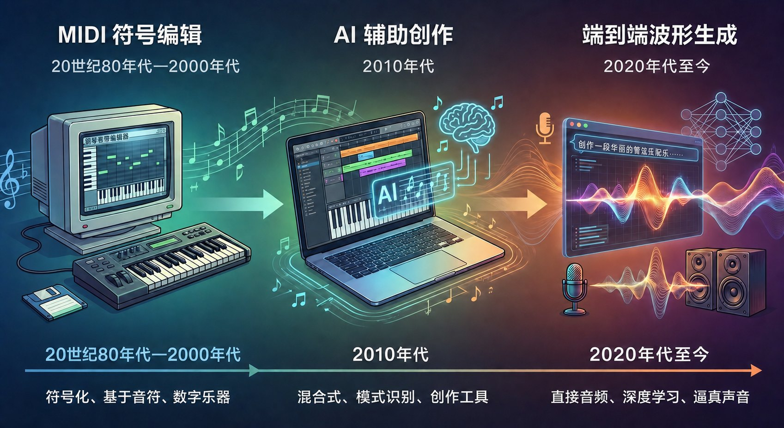

# 4.3 听觉智能：机器的耳朵与喉咙 {#43}

!!! info "学前导读"

    手机里的语音输入、导航里的播报、短视频里的 AI 配音，都离不开本节的技术。我们先看声音怎样变成数字、变成一张“图”，再看机器怎样“听”（语音识别）、怎样“说”（语音合成）、怎样“唱”（音乐生成）。

声音，本质上是空气的振动。要让机器具备“听觉”和“嗓音”，我们需要把物理振动转化为数字信号，再通过深度学习模型进行理解与生成。

## 4.3.1 声音的数字化：从波形到语谱图 {#431}

机器听不懂“哆来咪”，它只能处理数字。把声音变成数字，最常用的方法叫脉冲编码调制（PCM），分两步：

- **采样（Sampling）**：像拍电影一样，每秒对声音“拍照”成千上万次。采样率 44.1 kHz 表示每秒记录 44 100 个点。根据奈奎斯特采样定理，它能还原最高约 22 kHz 的声音，覆盖了人耳能听到的范围（约 20 Hz～20 kHz）。
- **量化（Quantization）**：把每个点的振幅转换成整数。16 位量化提供 65 536 个等级，能细致地记录从轻声到响亮的变化。

**机器的“乐谱”：梅尔语谱图（Mel-Spectrogram）**

原始的波形图（Waveform）上下起伏、杂乱无章，机器很难从中直接找到规律。工程师用短时傅里叶变换（STFT）把声音一小段一小段地从“时间域”转换到“频率域”，得到一张语谱图：

- **横轴**：时间；
- **纵轴**：频率（音高）；
- **颜色**：能量（音量）。

“梅尔”是一种频率刻度：人耳对低频的变化敏感，对高频的变化迟钝，梅尔刻度就按人耳的这种感觉来拉伸纵轴。

**关键点**：声音一旦变成了“图”，CNN、Transformer 这些视觉和语言领域的模型就可以拿来处理声音了。

**动手看看 · 声音的模样**

<iframe class="sim-frame" src="../../sims/sound-spectrum/main.html" height="900" loading="lazy" title="声音的模样：波形与频谱"></iframe>

切换纯音、口哨、元音、和弦、噪音，对比它们的波形和频谱；展开“采样与量化”，把采样率和量化位数调低，看声音被还原成什么样。[全屏打开](../../sims/sound-spectrum/main.html){ target=_blank } · [教学说明](../../sims/sound-spectrum/index.md)
{ .sim-caption }

{ loading=lazy }

图 4-8 声音的数字化：从波形到语谱图
{ .fig-caption }

## 4.3.2 机器之耳：自动语音识别（ASR） {#432}

自动语音识别（Automatic Speech Recognition，ASR）的目标是把语音转写成文字。

- **传统统计模型**（如 HMM-GMM）：把语音切成极小的片段，计算每一段属于哪个音素的概率，再像拼图一样拼成字词。多个模块分开设计，环节多，容易出错。
- **端到端模型**（End-to-End）：目前的主流方案（如 OpenAI 的 Whisper、阿里的 Paraformer）。
    - **编码器**：像耳朵一样接收语谱图特征；
    - **解码器**：像大脑一样直接输出文字序列；
    - **注意力机制**：帮助模型结合上下文“听音辨意”。例如听到“píng guǒ”，结合上下文判断说的是水果还是手机品牌；听到“shì lì”，结合上下文判断是“视力”还是“势力”。

**Whisper 的特点**：2022 年发布，用约 68 万小时从网上收集的多语言语音训练（这些语音的文字稿并非逐字人工校对，属于“弱监督”），对口音、背景噪声都比较“皮实”。

## 4.3.3 机器之喉：语音合成（TTS） {#433}

语音合成（Text-to-Speech，TTS）的进化史，就是声音从“机器味”变成“人情味”的历史。

1. **拼接合成**：早期导航里“前方、左转”那样的声音。预先录好大量语音片段，按需拼接，听起来生硬。
2. **参数合成**：用数学模型模拟发声，连贯了，但声音发闷，像机器人。
3. **神经网络合成**：分两步。
    - **声学模型**（如 Tacotron、FastSpeech）：把文字转换成梅尔语谱图；
    - **声码器**（如 WaveNet、HiFi-GAN）：把语谱图还原成真实的波形。WaveNet 逐个样本点生成，效果好但速度慢；HiFi-GAN 借助对抗训练，做到了实时、高保真。
4. **零样本克隆**（Zero-Shot Cloning）：
    - **代表作**：微软的 VALL-E（2023）、阿里通义实验室的 CosyVoice（2024）等。
    - **原理**：把语音编码成一串“声音词元”，像大模型续写文字一样续写声音。只要听几秒钟某人的声音作为“提示”，模型就能模仿出相近的音色和语调。

!!! example "案例 4-2 语音合成的正当应用"
    - **影视制作**：演员后期补录台词时，经演员授权，用 AI 依照剧本生成个别对白，减少反复进棚。
    - **无障碍**：帮助渐冻症患者在失语前录制自己的声音，日后用合成的“自己的声音”与家人交流（如 Project Revoice 项目）。
    - **跨语言**：把视频里的讲解翻译成外语，并尽量保留原讲者的音色和口型。

    这些应用都有一个共同前提：**声音主人的知情和授权**。2024 年，北京互联网法院审理了我国首例“AI 声音侵权案”，认定自然人声音权益的保护范围及于 AI 合成的、能被识别为本人的声音。未经许可克隆他人声音，可能构成侵权，更可能被用于诈骗（见 4.7 节）。

## 4.3.4 音乐生成：从符号到音频 {#434}

音乐生成经历了从“写乐谱”到“直接演奏”的转变。

- **符号生成——“作曲家”**
    - **原理**：生成 MIDI 文件。它像一个只会写五线谱的作曲家，产出的是音符、节拍、力度的指令，需要再用软件“演奏”出来。
    - **局限**：听起来像八音盒或电子琴，没有人声演唱和真实乐器的细腻质感。
- **音频生成——“全能乐队”**
    - **代表作**：Suno、Udio，国内有天工音乐、海绵音乐等。
    - **原理**：这些产品大多没有公开技术细节。一般认为，它们把声音也切成“声音词元”，再用 Transformer 或扩散模型生成，直接输出带人声和伴奏的完整音频。
    - **效果**：AI 能在副歌部分加重鼓点、在结尾淡出，甚至模仿歌手的换气声。作词、编曲、演唱、混音被合并成了一步。

{ loading=lazy }

图 4-9 音乐生成进化：从 MIDI 符号编辑到端到端波形生成
{ .fig-caption }

## 随堂小测

**1.** 决定数字音频能记录的最高频率（声音细腻度）的关键指标是（　　）

- A. 采样率
- B. 时长
- C. 音量
- D. 文件名

??? tip "答案与解析"
    **答案：A**

    解析：按照奈奎斯特采样定理，采样率至少要是最高频率的 2 倍。44.1 kHz 的采样率能记录到约 22 kHz。

    考查：采样与量化 · 认知层次：理解 · [回看 4.3.1](#431)
    { .quiz-meta }

**2.** 只要技术上能做到，用几秒钟的录音克隆明星的声音来给自己的商品配音，是没有问题的。（　　）

- √
- ×

??? tip "答案与解析"
    **答案：×**

    解析：能被识别为本人的 AI 合成声音同样受法律保护。未经授权用于商业宣传，可能侵犯他人的声音权益，还可能误导消费者。

    考查：语音克隆的伦理与法律 · 认知层次：评价 · [回看 4.3.3](#433)
    { .quiz-meta }
