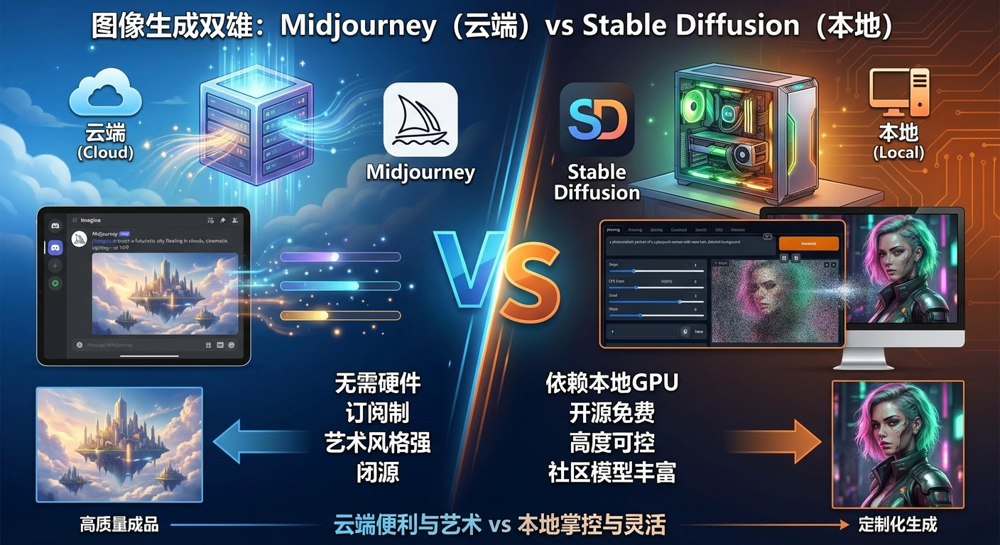
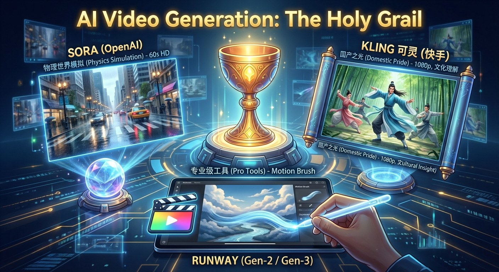
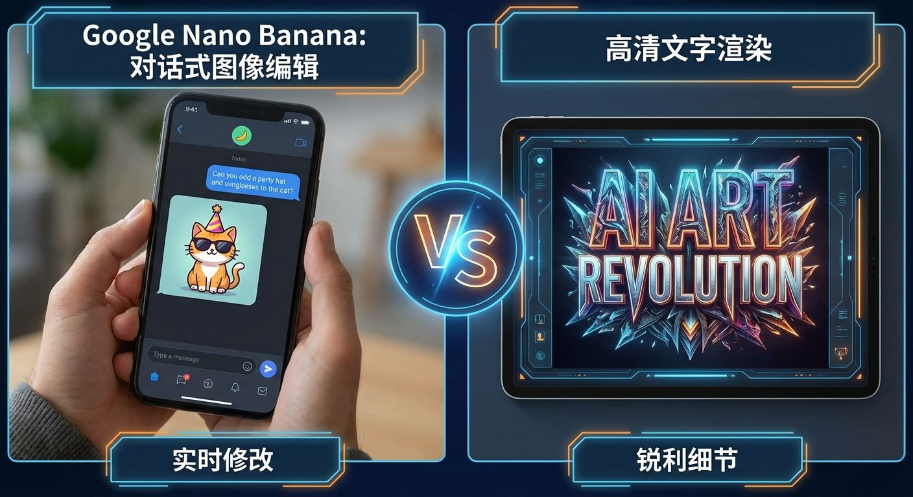

# 4.4 诸神之战：AIGC 工具全景图 {#44}

!!! info "学前导读"

    AIGC（AI 生成内容）工具更新极快，今天的“最强”几个月后就可能被超越。本节不追求列全名单，而是帮你认清几类工具各自的**定位**：云端还是本地、好上手还是好控制、擅长什么。

    具体产品的最新版本、入口和免费额度，请看[工具快照](../../tool-snapshot.md)页。本书的实操一律使用国内可以直接访问的工具。

AIGC 领域的工具迭代速度极快，呈现出“百花齐放”的竞争态势。了解不同工具的特性，是用好 AI 创作的第一步。

## 4.4.1 图像生成：云端工具与开源模型 {#441}

AI 绘画工具大致分两类，各有一位“代表人物”：

**Midjourney（MJ）——云端工具的代表**

- **定位**：以画面的艺术感见长。
- **特点**：在服务商的服务器上运行，不需要自己的显卡；早期只能在 Discord 聊天软件里使用，2024 年起有了网页版。画质精美、光影艺术感强，常用于海报、插画、概念设计。需要付费订阅，在国内不能直接使用，本书只作介绍。

**Stable Diffusion（SD）——开源模型的代表**

- **定位**：开源、可控。
- **特点**：模型公开，可以部署在自己的电脑上。社区插件丰富，例如 ControlNet 可以精确控制画面中的人物姿态、构图轮廓，常用于电商换装、建筑渲染等商业场景。上手门槛较高，需要较好的显卡，并配置 WebUI、ComfyUI 等操作界面或使用整合包。

表 4-3 云端工具与开源模型对比
{ .tab-caption }

| 维度 | 云端工具（如 Midjourney，国内的即梦、通义万相） | 开源模型（如 Stable Diffusion） |
|---|---|---|
| 部署方式 | 打开网页或 App 就能用 | 本地电脑或自己租用的云服务器 |
| 可控性 | 主要靠提示词和多次生成挑选（俗称“抽卡”），部分工具提供参考图、局部重绘 | 很强（ControlNet 控制姿态、边缘、深度等） |
| 定制风格 | 一般不能自己训练 | 可以训练 LoRA，得到专属风格或角色 |
| 适合人群 | 大多数普通用户、设计初学者 | 有技术基础的设计师、电商和游戏团队 |

**国产工具**：国内用户可以直接使用即梦（字节跳动）、通义万相（阿里巴巴）、可灵（快手，也能生成图片）、文心一格（百度）、腾讯混元等。它们大多支持中文提示词，界面上直接提供画幅比例、参考图、局部重绘等按钮，对初学者更友好。

{ loading=lazy }

图 4-10 图像生成：云端工具（以 Midjourney 为例）vs 本地开源模型（以 Stable Diffusion 为例）
{ .fig-caption }

## 4.4.2 视频生成：Sora 引领，国产突围 {#442}

视频生成要同时保证每一帧画面好看、前后帧连贯、动作符合常识，难度远高于图像生成。

**Sora（OpenAI）**

- **地位**：2024 年 2 月发布预览，能生成长达 60 秒、画面连贯的高清视频，引起轰动；2024 年 12 月正式向部分地区的用户开放，2025 年 9 月推出能同时生成画面和声音的 Sora 2。
- **能力与局限**：它能较好地表现液体流动、光影反射等现象，所以有人说它是“世界模拟器”的雏形。但 OpenAI 自己在技术报告中也承认，Sora 不能准确模拟很多基本的物理过程（比如玻璃杯摔碎），会出现“人咬了一口饼干，饼干却没有缺口”这样的错误。它是从海量视频里学到了“看起来像”的规律，并不是真正理解了物理定律。

**可灵 Kling（快手）**

- **地位**：2024 年 6 月发布，是最早向公众开放的国产视频生成模型之一，在国际评测中处于第一梯队。
- **特点**：支持 1080P 高清输出，对汉服、武侠动作等中国文化元素表现较好，国内用户可以直接使用。

**即梦 / Seedance（字节跳动）**

- **地位**：字节跳动的视频生成模型系列，在即梦等产品中提供。2026 年 2 月发布的 Seedance 2.0，据官方介绍可以同时生成画面和声音，支持文字、图片、视频、音频混合输入，能生成多个镜头的连续叙事，并在镜头切换时保持人物形象一致。

**其他**：海螺（MiniMax）、Vidu（生数科技与清华大学）、通义万相等也提供视频生成；国外的 Runway 以“运动笔刷”（用笔刷涂抹画面区域、指定其运动方向）等专业功能受到视频剪辑师欢迎，2025 年推出了 Gen-4。

{ loading=lazy }

图 4-11 视频生成：Sora、可灵（Kling）与 Runway
{ .fig-caption }

!!! warning "怎样看待“谁最强”"
    各家都会发布对自己有利的评测结果。判断一个视频生成工具，可以自己用同一段提示词在几款工具上各试一次，从**画质、动作是否合理、是否听从提示词、生成速度、费用**几个方面比较（方法同 3.4 节“怎么比、怎么选”）。

## 4.4.3 图像编辑：用说话来修图 {#443}

除了生成，编辑同样重要。2025 年 8 月，谷歌推出图像模型 Gemini 2.5 Flash Image，因测试时的代号而被称为 Nano Banana；同年 11 月又推出基于 Gemini 3 Pro 的 Nano Banana Pro。它们代表了一种新的修图方式：

- **对话式编辑**：不用像 Photoshop 那样操作复杂的图层，直接用自然语言下达指令，如“把那只猫换成狗”“让背景再暗一点”，还能多轮修改。
- **保持人物一致**：修改背景、服装时，人物的长相基本不变。
- **文字渲染**：比早期 AI 绘画更擅长在图片中写出清晰准确的文字。

国内的即梦、通义万相、豆包等也都提供了类似的“一句话改图”功能，可以直接体验。

{ loading=lazy }

图 4-12 对话式图像编辑：用自然语言修改图片
{ .fig-caption }

## 随堂小测

**1.** 某电商团队需要让模特的姿势和样片完全一致，并训练一个专属的服装风格。最合适的选择是（　　）

- A. 只用一句话提示词反复“抽卡”
- B. 用对话式编辑工具改背景
- C. 用视频生成工具
- D. 部署开源模型，配合 ControlNet 和 LoRA

??? tip "答案与解析"
    **答案：D**

    解析：ControlNet 可以按骨架控制姿势，LoRA 可以训练专属风格，这正是开源模型“可控、可定制”的优势。

    考查：云端工具与开源模型的区别 · 认知层次：应用 · [回看 4.4.1](#441)
    { .quiz-meta }

**2.** Sora 能生成画面逼真的视频，说明它已经真正理解了物理规律。（　　）

- √
- ×

??? tip "答案与解析"
    **答案：×**

    解析：OpenAI 在技术报告中承认 Sora 在玻璃破碎、物体前后变化等方面会出错。它学到的是“看起来像”的统计规律，不等于理解了物理定律。

    考查：视频生成的局限 · 认知层次：评价 · [回看 4.4.2](#442)
    { .quiz-meta }
