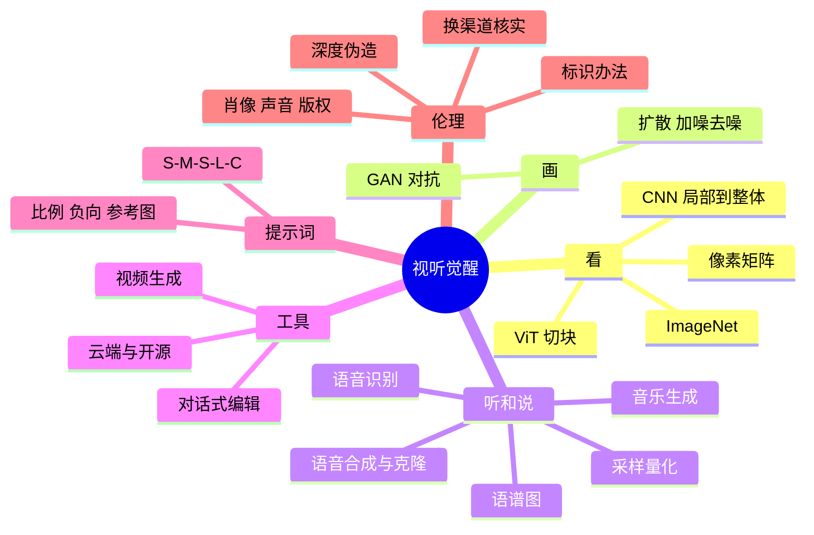

# 第 4 章 本章小结与练习

## 本章小结

第 4 章我们认识了 AI 的感知与创造能力：

- **原理层**：从 CNN 到 ViT 的视觉架构演进，从 GAN 到扩散模型的生成方法变革，以及听觉领域的语谱图和端到端模型。
- **工具层**：云端工具与开源模型各自的定位，国产图像、视频、音乐工具，以及“用说话来修图”的对话式编辑。
- **应用层**：S-M-S-L-C 五要素提示词公式，标志设计、短视频、电商、建筑四个实战流程及其合规要点。
- **伦理层**：直面深度伪造风险，掌握“换渠道核实”这一最可靠的防线，了解 AI 生成内容标识、肖像与声音权益、AI 作品版权的规定。

## 课后练习

**一、单项选择题**

**1.** 关于卷积神经网络（CNN），以下说法**错误**的是（　　）

- A. 它受生物视觉皮层的研究启发
- B. 浅层主要提取边缘、纹理等特征
- C. 它只能处理黑白图像
- D. 它用小窗口（卷积核）逐块扫描图像

??? tip "答案与解析"
    **答案：C**

    解析：彩色图像有 R、G、B 三个通道，CNN 可以同时处理。

    考查：CNN · [回看 4.1.2](4-1.md#412)
    { .quiz-meta }

**2.** 视觉变换器（ViT）处理图像的第一步通常是（　　）

- A. 转成灰度图
- B. 用卷积核提取特征
- C. 把图像切成固定大小的小方块
- D. 给图像加噪声

??? tip "答案与解析"
    **答案：C**

    解析：ViT 把图像切成小方块，当作一个个“词元”交给 Transformer。

    考查：ViT · [回看 4.1.3](4-1.md#413)
    { .quiz-meta }

**3.** 扩散模型的核心生成过程是（　　）

- A. 把多张图片拼接起来
- B. 从随机噪声出发逐步去噪
- C. 把像素随机重新排列
- D. 由判别器挑选最逼真的图片

??? tip "答案与解析"
    **答案：B**

    解析：生成时从噪声图开始，在提示词引导下一步步去掉预测出的噪声。

    考查：扩散模型 · [回看 4.2.2](4-2.md#422)
    { .quiz-meta }

**4.** 生成对抗网络（GAN）的核心是哪两个部分的博弈？（　　）

- A. 编码器与解码器
- B. 生成器与判别器
- C. 卷积核与池化层
- D. 声学模型与声码器

??? tip "答案与解析"
    **答案：B**

    解析：生成器负责造假，判别器负责鉴别，二者在对抗中共同进步。

    考查：GAN · [回看 4.2.1](4-2.md#421)
    { .quiz-meta }

**5.** 语音合成中，“声码器”（如 HiFi-GAN）的作用是（　　）

- A. 把语音转成文字
- B. 把文字转成梅尔语谱图
- C. 把梅尔语谱图还原成声音波形
- D. 给声音加上背景音乐

??? tip "答案与解析"
    **答案：C**

    解析：声学模型把文字变成语谱图，声码器再把语谱图变成能播放的波形。

    考查：语音合成 · [回看 4.3.3](4-3.md#433)
    { .quiz-meta }

**6.** 下列哪一项**不是**云端 AI 绘画工具（如即梦、Midjourney）相对开源模型的优势？（　　）

- A. 可以训练 LoRA 得到专属风格
- B. 不需要自己的显卡
- C. 打开网页或 App 就能用
- D. 对初学者更友好

??? tip "答案与解析"
    **答案：A**

    解析：训练 LoRA 是开源模型（如 Stable Diffusion）的长处，云端工具一般不支持。

    考查：云端与开源 · [回看 4.4.1](4-4.md#441)
    { .quiz-meta }

**7.** 提示词“一座水墨风格的江南古镇，航拍视角，清晨薄雾”中，“航拍视角”属于（　　）

- A. 主体
- B. 媒介
- C. 光影
- D. 构图

??? tip "答案与解析"
    **答案：D**

    解析：航拍是拍摄角度，属于构图（Composition）。

    考查：S-M-S-L-C · [回看 4.5.1](4-5.md#451)
    { .quiz-meta }

**8.** 按照《人工智能生成合成内容标识办法》，下列说法正确的是（　　）

- A. 只有文字内容需要标识
- B. 标识分为显式标识和隐式标识
- C. 用户可以随意删除隐式标识
- D. 只要不收费，就不需要标识

??? tip "答案与解析"
    **答案：B**

    解析：办法把标识分为用户能直接感知的显式标识和写在元数据中的隐式标识，并禁止恶意删除、篡改。

    考查：AI 生成内容标识 · [回看 4.7.2](4-7.md#472)
    { .quiz-meta }

**二、判断题**

**9.** ViT 在任何情况下都比 CNN 更好。（　　）

- √
- ×

??? tip "答案与解析"
    **答案：×**

    解析：ViT 通常需要更多训练数据；数据较少时 CNN 依然好用，很多模型也把两者结合。

    考查：ViT 与 CNN · [回看 4.1.3](4-1.md#413)
    { .quiz-meta }

**10.** 采样率为 44.1 kHz 的音频，每秒记录 44 100 个点。（　　）

- √
- ×

??? tip "答案与解析"
    **答案：√**

    解析：kHz 是千赫兹，44.1 kHz 即每秒 44 100 次采样。

    考查：采样 · [回看 4.3.1](4-3.md#431)
    { .quiz-meta }

**11.** AI 伪造的视频一定会有眨眼不自然、边缘模糊等破绽，仔细看总能发现。（　　）

- √
- ×

??? tip "答案与解析"
    **答案：×**

    解析：这些破绽会随技术进步越来越少。涉及钱和隐私，要换渠道核实。

    考查：深度伪造鉴别 · [回看 4.7.1](4-7.md#471)
    { .quiz-meta }

**12.** 我国法律明文规定，凡是用 AI 生成的图片一律不受著作权保护。（　　）

- √
- ×

??? tip "答案与解析"
    **答案：×**

    解析：我国没有这样的明文规定。北京互联网法院 2023 年的判例认定，体现了人的独创性投入的 AI 生成图片可以构成作品。

    考查：AI 作品版权 · [回看 4.7.2](4-7.md#472)
    { .quiz-meta }

**三、简答题**

**13.** 用“雕刻”的比喻，说明扩散模型的前向加噪和反向去噪各起什么作用。

??? tip "参考答案"
    前向加噪是“把雕像风化成沙砾”：把真实图片一步步加噪声，直到变成纯噪声，用来制造训练数据，让模型学会识别“噪声长什么样”。反向去噪是“雕刻”：生成时从一张随机噪声图出发，模型在提示词的引导下预测并去掉噪声，几十步之后，图像逐渐从噪声中显现出来。

**14.** 用 S-M-S-L-C 公式，为学校运动会写一个宣传海报的图像提示词，并标出每个要素。

??? tip "参考答案"
    示例：S（主体）：一名正在冲过终点线的大学生运动员；M（媒介）：数字插画；S（风格）：充满活力的扁平国潮风格；L（光影）：明亮的午后阳光，逆光勾勒轮廓；C（构图）：低角度仰拍，人物位于画面三分线处，竖版 3:4。负向提示：文字、水印、多余的手指。

**15.** 如果你的朋友收到一段“妈妈”发来的语音，说手机丢了、急需转账，你会建议他怎么做？请结合本章知识说明理由。

??? tip "参考答案"
    建议先不要转账，挂断后用自己通讯录里保存的号码给妈妈打电话，或者联系其他家人核实，也可以问只有家人才知道的问题。理由：现在几秒钟的录音就可能克隆出相近的声音，仅凭“声音很像”无法判断真假；凡是涉及转账，都应换一个自己掌握的渠道核实。如确认被骗，要立即拨打 110 或 96110 反诈专线。

**四、实训任务**

1. **人像摄影大师**：用一款国产 AI 绘画工具，生成一张“2050 年的宇航员，伦勃朗光”的人像照片。记录你的最终提示词，并标出 S-M-S-L-C 各要素；再去掉“伦勃朗光”重新生成一次，比较两张图的差别。
2. **真假鉴定**：找一段公开标注为 AI 生成的视频（如平台上带“AI 生成”标识的短视频），找出其中的 3 处破绽（如物理规律、手指、文字、前后不一致），截图标注后提交。再想一想：如果它没有标识，你还能认出来吗？

## 拓展阅读

1. ROMBACH R, BLATTMANN A, LORENZ D, et al. High-resolution image synthesis with latent diffusion models[C]//CVPR 2022. Stable Diffusion 的核心原理（潜在扩散模型），对应 4.2.2 节。
2. DOSOVITSKIY A, BEYER L, KOLESNIKOV A, et al. An image is worth 16x16 words: Transformers for image recognition at scale[C]//ICLR 2021. ViT 的开山之作，对应 4.1.3 节。
3. OpenAI. Video generation models as world simulators[EB/OL]. 2024. Sora 技术报告，注意报告最后一节列出的局限，对应 4.4.2 节。
4. RADFORD A, KIM J W, XU T, et al. Robust speech recognition via large-scale weak supervision[C]//ICML 2023. Whisper 论文，对应 4.3.2 节。
5. ZHANG L, RAO A, AGRAWALA M. Adding conditional control to text-to-image diffusion models[C]//ICCV 2023. ControlNet 原理，对应 4.4.1 节和 4.6.3 节。
6. 国家互联网信息办公室等. 人工智能生成合成内容标识办法[Z]. 2025. AI 生成内容显式标识和隐式标识的具体要求，附录 A 有节选。
7. 北京互联网法院. 李某诉刘某侵害作品署名权、信息网络传播权纠纷案判决书（2023）京 0491 民初 11279 号[Z]. 2023. 我国首例“AI 文生图”著作权案，对应 4.7.2 节。
