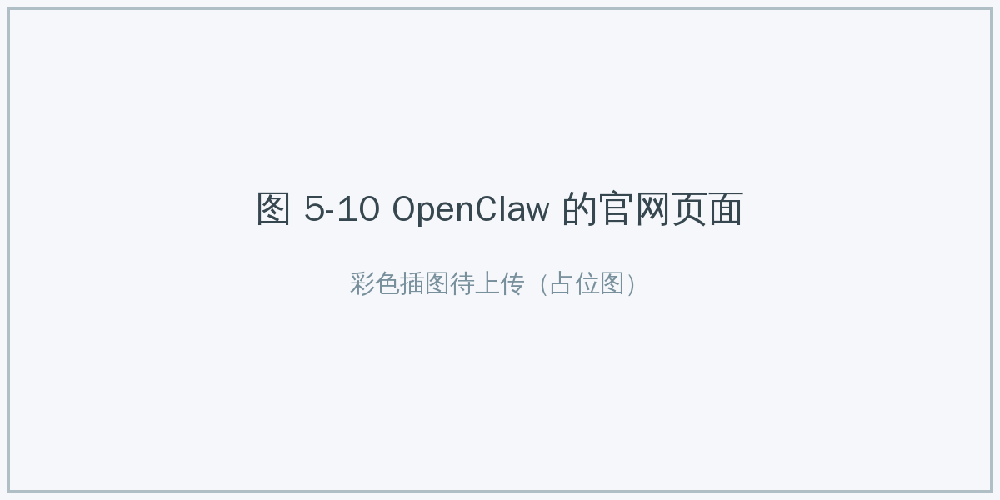

# 5.2 零代码开发 {#52}

!!! info "学前导读"

    不会编程也能做智能体。本节以扣子（Coze）为例，走一遍“写人设 → 加工具 → 加记忆 → 搭工作流 → 调试发布”的完整流程，再学几种让智能体更可靠的提示词写法。

    平台界面更新很快，本节的操作描述以思路为主，具体按钮位置以平台当前界面为准（入口见[工具快照](../../tool-snapshot.md)页）。体验 5-1 会带你亲手搭一个。

随着零代码平台日趋成熟，搭建智能体不再是程序员的专属。今天搭智能体就像搭积木：不用写代码，通过填写表单、拖拽节点，就能做出一个有记忆、能联网搜索、能读图片的“数字助手”。

表 5-4 常见的智能体开发平台
{ .tab-caption }

| 平台 | 开发方 | 主要特点 | 适合场景 | 注意 |
|---|---|---|---|---|
| 扣子（Coze） | 字节跳动 | 插件多（搜索、地图、出行等）；可发布到豆包、飞书、微信公众号等；内置数据库和工作流；2025 年 7 月开源了扣子开发平台（Coze Studio），也可以自己部署 | 个人开发者、新媒体运营、轻量级业务应用 | 使用官方云服务时数据存储在平台上，注意不要上传敏感资料 |
| Dify | LangGenius（开源社区） | 开源，可用 Docker 在自己的服务器上部署；知识库检索功能完善；工作流编排灵活 | 企业内部知识库、处理敏感数据、业务流程自动化 | 自行部署需要一定的运维能力 |
| FastGPT | 环界云（开源社区） | 开源，专注知识库问答，上手快 | 客服机器人、文档助手、入门学习 | 复杂逻辑和工具调用能力相对弱 |

此外，腾讯元器、百度智能体平台等也提供了类似的零代码搭建功能。

## 5.2.1 扣子平台实战 {#521}

本项目要搭建一个集“记住用户偏好、联网搜索、看懂图片”于一体的智能体。

**项目目标：论文指导助手**

- **有记忆**：记住使用者的专业和研究方向（如人工智能、学前教育、护理），不用每次重复介绍；
- **能搜索**：自动检索相关的最新资料，减少遗漏；
- **能看图**：读懂用户上传的论文结构图或流程图；
- **守规范**：只提供思路和范例，不代写可直接提交的论文。

{ loading=lazy }

图 5-6 在扣子主页创建智能体
{ .fig-caption }

### 第 1 步：写人设与回复逻辑

在智能体的编排页面，找到“人设与回复逻辑”输入框（支持 Markdown 格式）。我们用 3.5 节学过的 CO-STAR 框架来写：

```markdown
# 背景
你是一名经验丰富的学术导师，熟悉论文写作规范和研究方法，
擅长 {{research_field}} 领域的论文指导。

# 目标
根据用户所处的写作阶段（{{writing_stage}}），提供针对性的指导建议。

# 风格
学术规范、结构清晰；每轮回答不超过 3 个行动要点，方便用碎片时间操作。

# 约束
- 严禁代写可直接提交的论文段落，只提供思路、范例和格式工具。
- 推荐文献前必须先调用搜索工具；只列出检索结果中真实存在的文献，并附链接；
  检索不到时直接说明，不得编造。
- 选题必须“小而具体、数据可得、符合专科/本科学生的能力”。

# 回复逻辑
1. 先确认用户的专业、层次和写作阶段，再给建议。
2. 用户上传结构图时，先描述你看到的结构，再提出修改意见。
3. 回答末尾注明“以上建议由 AI 生成，请结合导师意见修改”。
```

**小技巧**：用两对大括号包住的 `{{research_field}}`、`{{writing_stage}}` 是变量，平台会把数据库或记忆中存储的值自动填进去。

!!! warning "一个容易踩的坑：要求“至少 10 篇参考文献”"
    很多人会在提示词里写“提供至少 10 篇相关参考文献的完整引用”。如果搜索结果里没有那么多合适的文献，模型为了满足“至少 10 篇”的要求，很可能**编造**看起来很规范的文献。正确的写法是像上面那样：只列检索到的真实文献，找不到就直说。

{ loading=lazy }

图 5-7 扣子的编排页面
{ .fig-caption }

### 第 2 步：添加工具（插件）

1. 在编排页面的“插件”栏点击“+”，打开插件市场；
2. 搜索并添加一个网页搜索类插件；
3. **关键操作**：添加后打开插件的设置，看清楚它需要哪些输入参数（如搜索关键词），以及返回什么内容。

很多初学者添加完插件就结束了，结果智能体要么不调用，要么乱调用。要在人设里写明调用规则，例如：“在提供文献建议前，必须先调用搜索插件检索该主题的最新资料。”平台会自动把用户的话（“帮我查查 AI 在教育中的应用”）转换成搜索关键词，不需要写代码。

### 第 3 步：添加记忆（数据库与变量）

要让智能体“越用越顺手”，就要让它记住用户。

1. 在“记忆”栏创建一张数据表，例如命名为 `user_prefs`，包含字段：研究方向（research_field）、写作阶段（writing_stage）；
2. 在“变量”中添加同名变量，让它从数据表中读取。

**读写逻辑**：用户第一次说“我研究人工智能教育应用”，智能体把它写入数据表；以后的对话中，智能体自动读取，并填进人设里的 `{{research_field}}`。

### 第 4 步：设计工作流

对于固定的复杂任务，让大模型“自由发挥”结果不稳定，更好的办法是设计一条标准化的流水线（工作流）：

1. **开始节点**：定义输入，如论文主题（topic）、结构图（structure_diagram）；
2. **图像理解节点**：调用视觉大模型解读结构图，判断是实证研究还是文献综述；
3. **搜索节点**：用论文主题检索最新资料；
4. **数据库节点**：查询当前用户的研究方向；
5. **大模型节点**：综合以上三方面信息，生成指导方案；
6. **结束节点**：输出建议。

在工作流画布上，从左侧把节点拖进来，再用连线把上一个节点的输出接到下一个节点的输入，操作方式类似画流程图。

### 第 5 步：调试与发布

智能体不可能一次就写好，调试是开发的主要工作。

- 在右侧的预览窗口输入：“帮我分析‘AI 在教育中的应用’这个选题”；
- 打开**运行日志**（调试详情），它完整记录了智能体每一步调用了什么、得到了什么，是找问题的关键；
- 故意问一些刁钻的问题（如“直接帮我写好第二章”“给我 10 篇文献”），检查它是否守规矩；
- 反复修改、测试满意后，点击“发布”，选择发布渠道（如豆包、飞书、微信公众号），完成授权后即可让别人使用。

## 5.2.2 提示词工程进阶 {#522}

要让智能体完成专业复杂的任务，光靠一句“帮我写个文案”远远不够。结构化提示词的本质，是把模糊的意图写成明确的“工作说明书”。

**1. CRISPE 框架**

适合搭建复杂任务的场景（和 CO-STAR 相比，它多了“给多个版本”的要求）：

- **C（Capacity）能力**：你是一名资深的数据分析师；
- **R（Role）角色场景**：正在帮一家连锁奶茶店分析销售数据；
- **I（Insight）背景洞察**：数据中有不少缺失值，节假日销量波动大；
- **S（Statement）任务陈述**：找出销量最高的三款产品，并分析原因；
- **P（Personality）风格**：表述专业、简洁；
- **E（Experiment）多方案**：给出三种不同侧重点的分析思路供选择。

**2. 少样本提示**（复习 3.5 节）

给 100 条规则，不如给 3 个好例子：

> 任务：给新闻标题分类。
>
> 输入：“某车企股价下跌 10%” → 输出：【财经】
>
> 输入：“梅西获得第八座金球奖” → 输出：【体育】
>
> 输入：“新款手机改用 Type-C 接口” → 输出：（由 AI 完成）

**3. 密度链（Chain of Density）**

这是 2023 年亚当斯（Adams）等研究者提出的摘要技巧（他们用 GPT-4 做了实验），可以让摘要在字数不变的情况下越来越“干”：

> 请为这篇文章写 5 版摘要。
> 版本 1：写一个普通摘要。
> 版本 2：找出版本 1 中遗漏的重要信息（人名、数字、事件），在字数不变的情况下补进去。
> 版本 3～5：重复上述过程，每次删去空话、补充要点。

注意：信息过密的摘要也会难读。研究者发现，读者最喜欢的往往是中间某一版，而不是最“密”的那一版。

!!! example "互动练习 5-1 设计你的“AI 出行助手”"
    **背景**：你需要一个助手帮你安排出行。

    **要求**：

    1. **记忆**：在数据库中存储你的“饮食禁忌”（如海鲜过敏）和“座位偏好”（如靠窗）；
    2. **工具**：调用搜索工具查询车次、酒店信息；
    3. **逻辑**：如果旅程超过 4 小时，优先推荐有餐车或卧铺的车次；推荐餐厅时自动过滤含过敏原的菜品；
    4. **交付**：提交智能体链接，以及一段成功触发“过敏过滤”逻辑的对话截图。

**4. 抗幻觉设计**

大模型会产生“幻觉”，即生成看似合理但不符合事实的内容（见 3.8 节）。在智能体里，可以用提示词加以约束：

- **策略一：强制引用**。“必须根据【搜索结果】回答，每句话后标注来源编号，如 [1]。如果搜索结果中没有相关信息，请直接回答‘我不知道’，不得编造。”
- **策略二：验证链（Chain of Verification）**。“第一步，起草回答；第二步，列出回答中所有事实性陈述（人名、时间、地点、数字）；第三步，逐条对照【参考文档】核实；第四步，修正不一致的地方，输出最终版本。”
- **策略三：不确定就留空**。“如果无法确定具体的销售额数据，不要估算，请输出‘N/A’。”

这些方法能**减少**幻觉，但不能杜绝。关键数据仍要人工核对。

!!! example "互动练习 5-2 提示词优化工作坊：解释量子力学"
    **原始提示词**：“解释一下量子力学。”

    **结果**：得到一篇像百科全书一样晦涩的文章，满是“波函数坍缩”“薛定谔方程”，普通人看不懂。

    **优化后的提示词**：

    > 你是一名擅长打比方的科普作家（角色）。请向一名 10 岁的小学生（对象）讲解量子力学里“一个东西在被观察之前，可能同时处于几种状态”这一点。要求：
    >
    > 1. 不用任何数学公式和专业术语；
    > 2. 用“捉迷藏”打比方（约束）；
    > 3. 语气活泼亲切，300 字以内（风格）。

    请分别用两个提示词提问，比较结果。再想一想：比喻让科学更好懂，但会不会也带来误解？

## 5.2.3 深度实践工具 {#523}

零代码平台适合搭“对话式”的助手。如果想让智能体直接在电脑上写程序、操作文件，就要用到下面这些工具。它们面向有一定技术基础的用户，本节只作介绍，了解它们的工作方式和风险即可。

**1. Claude Code**

Claude Code 是 Anthropic 推出的命令行编程智能体，在电脑的终端（命令行窗口）中运行，也有网页版和编辑器插件。

- **能动手**：可以读写项目文件、运行命令、运行测试，发现错误后自己修改，再测试，直到通过。
- **权限确认**：默认情况下，修改文件、运行命令前会先请求用户批准，用户也可以设定哪些操作允许自动执行。这正是 5.1.3 节说的“人在回路”。
- **技能复用**：支持 5.1.5 节介绍的技能，可以放在个人或项目等不同层级，团队共享。
- **自动化**：可以在无人值守的模式下运行，接入代码托管平台的自动化流程，做代码审查、修复问题等工作。

{ loading=lazy }

图 5-8 命令行中运行 Claude Code 工具
{ .fig-caption }

**2. Antigravity**

Antigravity 是谷歌在 2025 年 11 月推出的“智能体优先”的集成开发环境（IDE），是安装在本地电脑上的桌面软件。

- **多智能体管理**：可以同时派出多个智能体处理不同任务，在一个“管理器”界面里统一查看进度。
- **可检查的工件**：智能体会先生成实施计划，执行过程中留下任务清单、代码改动、测试结果、浏览器截图等记录，方便人来检查和批注。
- **可设置审批策略**：规定智能体运行终端命令前是否必须等人批准。

{ loading=lazy }

图 5-9 Antigravity 的使用界面
{ .fig-caption }

表 5-5 三类智能体开发方式的对比
{ .tab-caption }

| 维度 | 零代码平台（如扣子） | 命令行编程智能体（如 Claude Code） | 智能体开发环境（如 Antigravity） |
|---|---|---|---|
| 交互形态 | 网页上填表、拖拽工作流 | 在终端里用自然语言下指令 | 图形界面的编程软件 |
| 用户群体 | 产品经理、运营人员、编程初学者 | 程序员 | 程序员 |
| 擅长 | 快速搭建对话助手，插件丰富 | 写脚本、修改程序、重构代码 | 同时管理多个编程任务，过程可视化 |
| 典型场景 | 客服机器人、学习助手 | 修复程序错误、自动化日常任务 | 开发完整的应用程序 |

国内也有很多 AI 编程工具，如阿里巴巴的 Qoder、字节跳动的 TRAE、腾讯云的 CodeBuddy 等。

**3. OpenClaw**

OpenClaw 是一款开源的个人智能体框架，由奥地利开发者彼得·斯坦伯格（Peter Steinberger）创建，最初名为 Clawdbot，2026 年 1 月先后改名为 Moltbot 和 OpenClaw。它可以运行在用户自己的电脑或服务器上，把大模型和用户日常使用的聊天软件连接起来，让 AI 从“对话助手”变成能自主办事的“行动助手”。上线后短短几周，它在 GitHub 上的星标数就超过了 10 万，成为增长最快的开源项目之一。

- **统一网关**：底层“网关”对接不同的大模型和聊天渠道，换模型不用改上层的智能体；
- **技能系统**：通过安装技能扩展能力，如控制浏览器、收发邮件、管理日程；
- **长期记忆**：能跨对话记住用户偏好，还可以用一个说明文件设定它的“性格”；
- **自托管**：开源，数据可以留在自己的设备上；
- **多渠道**：可以接入常用的即时通信软件。

!!! danger "安全警示：能力越大，风险越大"
    OpenClaw 爆红后很快暴露出严重的安全问题，值得每一个想用“全自动助手”的人警惕：

    - **公网暴露**：安全研究人员在互联网上发现了大量配置不当、任何人都能访问的实例，其中保存着用户的大模型密钥和聊天记录；
    - **恶意技能**：社区技能市场里混入了数以百计的恶意技能包，会窃取密码、植入木马；
    - **权限过大**：它能读写文件、执行命令、代你发消息，一旦被提示词注入（见 7.2 节）劫持，后果难以估量。

    **使用原则**：只在隔离的环境（如单独的电脑或虚拟机）中试用；不要暴露到公网；只装可信的技能；不要给它银行、工作邮箱等重要账号的权限。

{ loading=lazy }

图 5-10 OpenClaw 的官网页面
{ .fig-caption }

## 随堂小测

<div class="quiz" data-answer="C" markdown>

**1.** 在扣子中，若想在人设里引用数据库中存储的“用户昵称”，正确的变量写法是（　　）

- A. [user_name]
- B. ${user_name}
- C. {{user_name}}
- D. #user_name

</div>

??? tip "答案与解析"
    **答案：C**

    解析：扣子用两对大括号包住变量名来引用变量。

    考查：扣子的变量 · 认知层次：记忆 · [回看 5.2.1](#521)
    { .quiz-meta }

<div class="quiz" data-answer="B" markdown>

**2.** 下列提示词中，**最容易**诱发智能体编造参考文献的是（　　）

- A. “只列出检索结果中真实存在的文献，并附链接”
- B. “提供至少 10 篇相关参考文献的完整引用”
- C. “检索不到时请直接说明”
- D. “每条文献后注明来源编号”

</div>

??? tip "答案与解析"
    **答案：B**

    解析：硬性规定数量，而检索结果又不够时，模型会为了满足要求而编造。

    考查：抗幻觉设计 · 认知层次：分析 · [回看 5.2.1](#521)
    { .quiz-meta }
