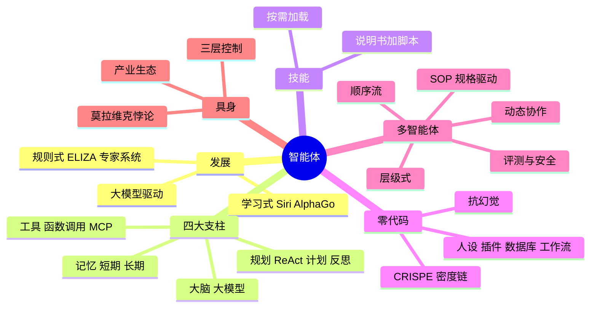

# 第 5 章 本章小结与练习

## 本章小结

本章梳理了智能体从“只会说”到“能动手”、从虚拟世界到物理世界的发展脉络。

- **架构层面**：智能体经历了规则式、学习式、大模型驱动三个阶段，形成了“大脑 + 规划 + 记忆 + 工具”的基本组成。ReAct 让推理和行动交替进行；记忆让智能体记住用户和任务进度；函数调用和 MCP 让工具接入有了统一的方式；技能则把领域经验打包成可复用的说明书。
- **应用层面**：扣子、Dify 等零代码平台让非技术人员也能搭建智能体；结构化提示词和抗幻觉设计提高了可靠性；多智能体系统通过分工和标准作业程序完成复杂任务；上线后要持续评测效果、防范提示词注入等攻击。
- **实体层面**：具身智能尝试破解莫拉维克悖论，用分层控制兼顾“想”和“动”。我国企业在人形机器人领域十分活跃，但从仿真到现实、能耗与算力等难题仍待解决。
- **贯穿始终的一条线**：智能体越能干，越需要“人在回路”。付款、删除、发送等不可撤销的操作要由人确认；权限要给到“刚好够用”；结果要由人负责。

## 课后练习

**一、单项选择题**

**1.** 翁荔（Lilian Weng）对大模型智能体组成的经典概括是（　　）

- A. 智能体 = 大模型 + 数据 + 算法
- B. 智能体 = 大模型 + 规划 + 记忆 + 工具使用
- C. 智能体 = 感知 + 决策 + 行动
- D. 智能体 = 神经网络 + 强化学习

??? tip "答案与解析"
    **答案：B**

    解析：翁荔在 2023 年的博客中把大模型智能体概括为大模型加上规划、记忆、工具使用几个部分。

    考查：四大支柱 · [回看 5.1.3](5-1.md#513)
    { .quiz-meta }

**2.** 20 世纪 60 年代的 ELIZA 只靠关键词脚本，却让用户以为它有情感。这种现象被称为（　　）

- A. 图灵效应
- B. ELIZA 效应
- C. 恐怖谷效应
- D. 安慰剂效应

??? tip "答案与解析"
    **答案：B**

    解析：人们倾向于把简单程序的行为过度解读为具有智能和情感，称为 ELIZA 效应。

    考查：ELIZA 效应 · [回看 5.1.1](5-1.md#511)
    { .quiz-meta }

**3.** 下列关于模型上下文协议（MCP）的说法，正确的是（　　）

- A. 它让工具按统一标准接入，支持 MCP 的各种 AI 应用都能使用
- B. 它是一种新的大模型训练方法
- C. 它只能用于 Anthropic 公司的模型
- D. 它能彻底消除大模型的幻觉

??? tip "答案与解析"
    **答案：A**

    解析：MCP 相当于 AI 时代的“USB 接口”，2025 年起 OpenAI、谷歌等也相继支持，并已捐给 Linux 基金会旗下的基金会。

    考查：MCP · [回看 5.1.3](5-1.md#513)
    { .quiz-meta }

**4.** 智能体的“短期记忆”通常指的是（　　）

- A. 向量数据库
- B. 硬盘上的文件
- C. 用户的通讯录
- D. 大模型的上下文窗口

??? tip "答案与解析"
    **答案：D**

    解析：短期记忆就是当前对话的上下文，新开对话就没有了；长期记忆存放在外部数据库中。

    考查：记忆 · [回看 5.1.3](5-1.md#513)
    { .quiz-meta }

**5.** 在扣子中搭建智能体时，用“工作流”的主要目的是（　　）

- A. 让智能体回答得更有个性
- B. 节省注册费用
- C. 把固定的复杂任务做成稳定的标准化流水线
- D. 代替知识库

??? tip "答案与解析"
    **答案：C**

    解析：大模型自由发挥时结果不稳定，工作流把步骤固定下来，结果更可控。

    考查：工作流 · [回看 5.2.1](5-2.md#521)
    { .quiz-meta }

**6.** 下列哪一种做法最能体现“人在回路”原则？（　　）

- A. 让智能体自动完成所有操作，事后发邮件通知
- B. 给智能体开通所有账号的最高权限
- C. 智能体在付款、删除文件前暂停，等用户确认后再执行
- D. 关闭智能体的运行日志以提高速度

??? tip "答案与解析"
    **答案：C**

    解析：不可撤销的操作由人确认，是控制智能体风险最基本的手段。

    考查：人在回路 · [回看 5.1.3](5-1.md#513)
    { .quiz-meta }

**7.** 安全研究人员发现，Moltbook 上 150 万个“智能体”背后只有约 1.7 万名真人用户，数据库还泄露了大量密钥。这个案例最能说明（　　）

- A. 看到“AI 自发形成社会”之类的新闻，要先核实数据来源和是否有人操控
- B. AI 已经产生了自我意识
- C. 多智能体系统一定比单一智能体好
- D. 开源软件都不安全

??? tip "答案与解析"
    **答案：A**

    解析：案例的启示在于：耸动的 AI 新闻要先核实；智能体平台同样需要身份验证和安全防护。

    考查：Moltbook 案例 · [回看 5.3.2](5-3.md#532)
    { .quiz-meta }

**8.** 智元机器人开源 AgiBot World 数据集，主要是为了缓解具身智能的哪个瓶颈？（　　）

- A. 电池续航不足
- B. 真实机器人操作数据匮乏
- C. 机械臂精度不够
- D. 大模型推理延迟太高

??? tip "答案与解析"
    **答案：B**

    解析：机器人学习需要大量真实操作数据，这类数据采集成本高，是具身智能的主要瓶颈之一。

    考查：具身智能产业生态 · [回看 5.4.3](5-4.md#543)
    { .quiz-meta }

**二、判断题**

**9.** 大语言模型就是智能体，两者没有区别。（　　）

- √
- ×

??? tip "答案与解析"
    **答案：×**

    解析：大模型是智能体的“大脑”，智能体还要有规划、记忆和调用工具的能力。

    考查：大模型与智能体 · [回看 5.1.2](5-1.md#512)
    { .quiz-meta }

**10.** 视觉—语言—动作（VLA）模型可以根据画面和语言指令直接输出机器人的动作，不再完全依赖人工编写的运动方程。（　　）

- √
- ×

??? tip "答案与解析"
    **答案：√**

    解析：VLA 模型从数据中学习，把感知、理解和动作打通。

    考查：VLA · [回看 5.4.1](5-4.md#541)
    { .quiz-meta }

**11.** 智能体运维只需要监控服务器的 CPU 和内存利用率，确保系统不宕机。（　　）

- √
- ×

??? tip "答案与解析"
    **答案：×**

    解析：还要评测回答的忠实度、相关性等，并防范提示词注入等攻击。

    考查：智能体运维 · [回看 5.3.4](5-3.md#534)
    { .quiz-meta }

**12.** 从网上下载的技能包都经过了审核，可以放心安装。（　　）

- √
- ×

??? tip "答案与解析"
    **答案：×**

    解析：社区技能市场曾混入大量恶意技能包。只安装可信来源的技能，安装前查看说明和脚本。

    考查：技能的安全 · [回看 5.1.5](5-1.md#515)
    { .quiz-meta }

**三、简答题**

**13.** 什么是 ReAct 模式？请结合“查询明天天气并推荐穿搭”的例子，说明它的工作过程。

??? tip "参考答案"
    ReAct 是“推理 + 行动”交替进行的工作方式：只要任务没完成，就重复“思考 → 行动 → 观察”。例子：思考“需要明天的天气，自己不知道，应调用天气工具”→ 行动：调用天气查询（城市、日期）→ 观察：返回“中雨，15～20 ℃”→ 再思考“有雨、偏凉，信息已够”→ 给出回答：带伞、穿薄外套。

**14.** 在扣子中搭建智能体时，为什么要设置“数据库”？它和“知识库”有什么不同？

??? tip "参考答案"
    数据库用来保存用户和任务的状态，比如用户的研究方向、写作阶段、饮食禁忌，让智能体“记住你”，不用每次重复介绍，是一种长期记忆。知识库存放的是供检索的资料（如课程讲义、规章制度），用来回答专业问题。前者记“你是谁、做到哪了”，后者存“要查的知识”；前者是结构化的字段，便于精确读写，后者是大段文本，靠检索找到相关片段，所以不宜混用。

**15.** 什么是莫拉维克悖论？它对具身智能的发展有什么启示？

??? tip "参考答案"
    莫拉维克悖论指：对计算机来说，下棋、计算等“高级”智力任务相对容易，而走路、抓握等幼儿都会的感知运动能力却极难实现。原因在于感知运动能力经过漫长进化，人做起来毫不费力却说不清诀窍，难以写成程序。启示：具身智能不能只靠人工编写规则，要让机器人从大量真实交互数据中学习（如 VLA 模型），同时采用分层控制，把高层理解和底层精确控制结合起来；数据和从仿真到现实的迁移是关键难题。

**四、深度思考题**

**场景**：你用一个“求职智能体”海投简历。由于效率极高，它在一分钟内向全网投递了 1000 份针对不同岗位微调过的“完美简历”。

1. 如果每个人都使用这样的智能体，招聘市场会怎样？
2. 招聘方是否也会用“筛选智能体”来应对？这会不会演变成 AI 对 AI 的无意义内卷？
3. 在这个过程中，人类求职者真正的竞争力变成了什么？

**五、实训：开发“个人学习助理”智能体**

大学生活丰富多彩，但也容易忙乱。请用扣子（或其他零代码平台）搭建一个个人学习助理，实现“知识管理 + 日程管理”的双重功能，综合运用知识库、数据库、工作流和定时任务。

**提交内容**：

1. **智能体链接**；
2. **场景设计**：说明你设计的特色功能（如喝水提醒、记账、背单词打卡）；
3. **功能截图**：① 一次根据知识库（如你上传的课程讲义）回答复习重点的对话；② 一次定时任务自动推送的“早报”；③ 一次调用工作流生成复习计划的对话；
4. **架构思考**：知识库和数据库分别承担了什么记忆角色？
5. **安全自查**：你的助理能访问哪些个人信息？你做了哪些限制？
6. **心得体会**：和手机自带的闹钟、备忘录相比，智能体助理有哪些优势和劣势？

## 拓展阅读

1. WENG L. LLM powered autonomous agents[EB/OL]. (2023-06-23). https://lilianweng.github.io/posts/2023-06-23-agent/. “规划、记忆、工具”框架的出处，对应 5.1.3 节。
2. YAO S, ZHAO J, YU D, et al. ReAct: Synergizing reasoning and acting in language models[C]//ICLR 2023. ReAct 的原始论文，对应 5.1.3 节。
3. PARK J S, O'BRIEN J C, CAI C J, et al. Generative agents: Interactive simulacra of human behavior[C]//UIST 2023. 斯坦福“AI 小镇”，对应 5.3.2 节。
4. HONG S, ZHUGE M, CHEN J, et al. MetaGPT: Meta programming for a multi-agent collaborative framework[C]//ICLR 2024. 用 SOP 组织多智能体，对应案例 5-4。
5. ADAMS G, FABBRI A, LADHAK F, et al. From sparse to dense: GPT-4 summarization with chain of density prompting[C]//Proceedings of the 4th New Frontiers in Summarization Workshop. 2023. 密度链的出处，对应 5.2.2 节。
6. Datawhale. Hello-Agents：从零开始构建智能体[EB/OL]. https://github.com/datawhalechina/hello-agents. 中文开源的智能体入门教程。
7. 模型上下文协议（MCP）官方文档[EB/OL]. https://modelcontextprotocol.io. MCP 的介绍和规范，对应 5.1.3 节。
8. Wiz Research. Hacking Moltbook: The AI social network any human can control[EB/OL]. 2026. Moltbook 安全事件的调查报告，对应案例 5-5。
