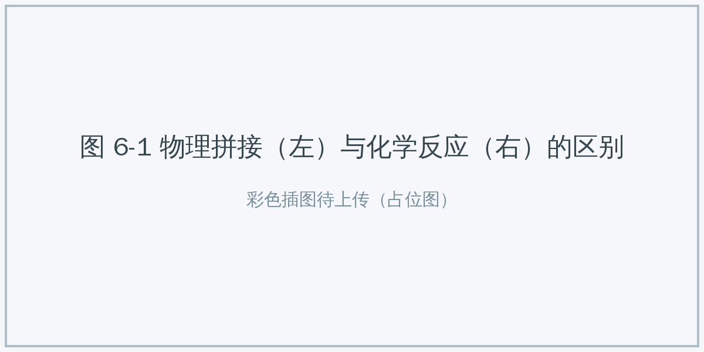
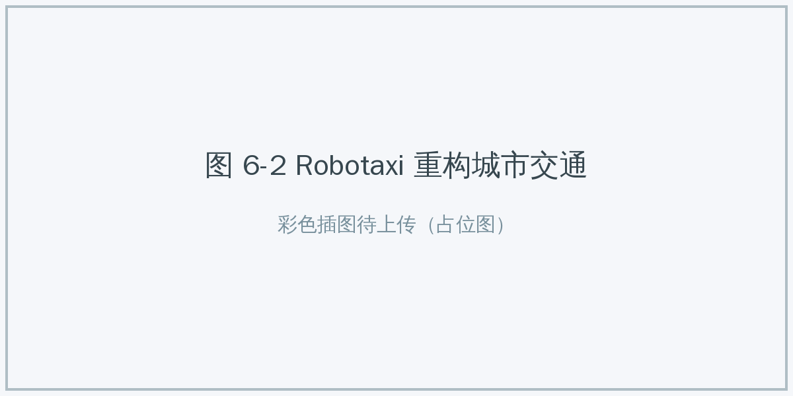
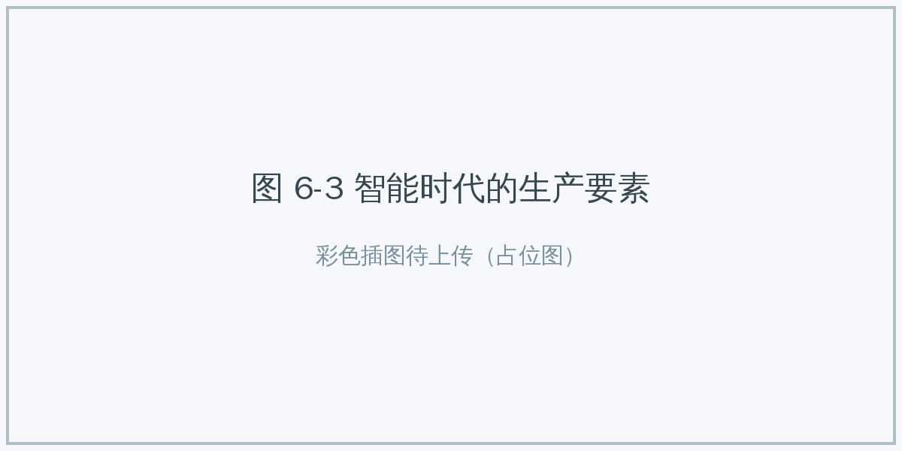

# 6.1 AI+X 的融合逻辑：从“赋能”到“重构” {#61}

!!! info "学前导读"

    同样是“用了 AI”，有的只是加了个聊天机器人，有的却改变了整个行业的做法。本节给你一把“尺子”——三层融合模型，用它可以判断一个 AI 应用到底改变了多少。

    后面 6.2～6.4 节的每个案例，你都可以用这把尺子量一量。

## 6.1.1 核心观点：是化学反应，不是物理拼接 {#611}

很多人以为“AI+X”只是给传统行业套上一个“高科技外壳”：给煤矿装个摄像头监工，给银行加个聊天机器人客服。这只是最浅层的“物理拼接”。

**核心观点**：AI+X 不等于“X + AI 插件”，而是对 X 领域的工作流程、价值创造方式乃至思维模式的深度改造。它更像一场“化学反应”：把 AI 的感知、认知、决策能力注入 X 领域，可能催生出全新的产品和业态。

- **物理拼接**：为了 AI 而 AI，新系统和原有业务彼此割裂；
- **化学反应**：数据在各系统之间流动，AI 的判断直接驱动业务行动。

{ loading=lazy }

图 6-1 物理拼接（左）与化学反应（右）的区别
{ .fig-caption }

## 6.1.2 三层融合模型 {#612}

AI 进入一个行业，通常由浅入深地经历三个层次，每深入一层，对行业的改变就越彻底。

表 6-1 AI+X 融合的三层模型
{ .tab-caption }

| 层次 | 核心特征 | 比喻 | 典型案例 | 价值 |
|---|---|---|---|---|
| 第一层：工具赋能（把事情做得更好） | 原有流程不变，AI 辅助人 | 给马车换上橡胶轮胎 | AI 辅助阅片：医生是主角，AI 圈出疑似病灶，防止漏看 | 降本增效，减少重复劳动 |
| 第二层：流程重构（换一种更好的做法） | 原有流程的核心环节被 AI 改写 | 用汽车代替马车 | AI 影视制作：不再逐帧手工抠像，部分画面直接生成 | 流程再造，缩短周期 |
| 第三层：生态颠覆（做以前没有的事） | 诞生新的产品和商业模式 | 发明飞机，开启空中交通 | 无人驾驶出租车（Robotaxi）：出行变成一种服务 | 创造新市场 |

**第一层：工具赋能**

- **定义**：AI 是效率工具，行业的主体流程不变，AI 只在某些环节辅助人。
- **场景**：在医学影像科，医生每天要看大量 CT 片子，容易疲劳。AI 系统（如腾讯觅影）先扫描一遍，用红框标出“疑似结节”等可疑区域，医生重点复核这些区域。
- **特点**：能减少漏诊、节省时间，但最终签字诊断的仍然是医生。流程没变，只是效率更高了。

**第二层：流程重构**

- **定义**：AI 接管核心环节，原有的人工流水线被新流程取代。
- **场景**：传统影视特效要经过“绿幕拍摄 → 人工抠像 → 三维建模 → 材质渲染”等环节。AI 正从两个方向改写它：一是“AI 辅助”，如自动抠像；二是“AI 直接生成”，如用文字或图片生成视频片段。
- **案例**：据报道，电影《瞬息全宇宙》（2022）的大部分视觉特效由一支不到 10 人的小团队完成，其中部分镜头使用了 Runway 的 AI 抠像工具。随着视频生成技术的成熟，一些镜头可能不再需要繁琐的抠像和建模，工作重点转向描述需求、挑选和精修。

**第三层：生态颠覆**

- **定义**：AI 成为基础设施，催生出以前不存在的产品和业态。
- **场景**：无人驾驶出租车（Robotaxi）。它不只是“更好的出租车”，而是“出行即服务”（MaaS）：车内没有司机，车辆可能变成移动的休息室或会议室；商业模式也可能从“把车卖给个人”变成“运营车队、按里程收费”。

{ loading=lazy }

图 6-2 Robotaxi 重构城市交通
{ .fig-caption }

**动手看看 · AI+X 三层分类器**

<iframe class="sim-frame" src="../../sims/aix-layers/main.html" height="680" loading="lazy" title="AI+X 三层分类器"></iframe>

把 12 张案例卡片拖到“工具赋能”“流程重构”“生态颠覆”三层中，提交后查看解析。注意有几张卡片放在哪一层都有道理，关键是说出理由。[全屏打开](../../sims/aix-layers/main.html){ target=_blank } · [教学说明](../../sims/aix-layers/index.md)
{ .sim-caption }

## 6.1.3 融合的驱动力：燃料、齿轮与引擎 {#613}

为什么 AI 能产生这样的改造力量？因为新的“生产要素”已经到位：

**1. 数据——新“燃料”**

- 工业时代，煤炭和石油的燃烧为机器提供动力；
- 智能时代，各行各业积累的海量数据（用户行为、传感器读数、基因序列）是 AI 学习的“燃料”；
- **不同之处**：煤炭越烧越少，数据却可以反复使用、多人同时使用，复制的成本几乎为零。但数据也有“保质期”和质量问题，过时或有偏差的数据会把 AI 带偏。

**2. 算法——新“齿轮”**

- 工业时代，精密咬合的齿轮和传送带组成了流水线，实现了大规模批量生产；
- 智能时代，深度学习模型（尤其是 Transformer）成为通用的“算法齿轮”：同一类模型既能处理文字，也能处理图像、声音甚至蛋白质序列。

**3. 算力——新“引擎”**

- 工业时代，蒸汽机和发电机把燃料变成动力；
- 智能时代，云计算中心和 GPU 集群提供算力，按需使用。例如，用超级计算机模拟上亿个原子的运动，正是依靠这台“算力引擎”去探索微观世界（见 6.2.1 节）。

{ loading=lazy }

图 6-3 智能时代的生产要素
{ .fig-caption }

## 随堂小测

**1.** 下列做法中，最接近“化学反应”式深度融合的是（　　）

- A. 在原有软件里加一个 AI 聊天插件，和其他功能互不相通
- B. 用 AI 预测蛋白质结构，让生物学家先“查地图”再做实验，改变了研究方式
- C. 在宣传材料里加上“人工智能”几个字
- D. 把纸质文档扫描成电子版

??? tip "答案与解析"
    **答案：B**

    解析：AlphaFold 改变了蛋白质研究的流程和方法，是深度融合；A 是物理拼接，C、D 与 AI 关系不大。

    考查：物理拼接与化学反应 · 认知层次：应用 · [回看 6.1.1](#611)
    { .quiz-meta }

**2.** 医院引入 AI 辅助阅片后，流程不变，医生仍负责最终诊断，只是看片更快、漏诊更少。这属于三层模型中的（　　）

- A. 工具赋能
- B. 流程重构
- C. 生态颠覆
- D. 物理拼接

??? tip "答案与解析"
    **答案：A**

    解析：主体流程不变、AI 辅助人提效，是第一层“工具赋能”。

    考查：三层融合模型 · 认知层次：应用 · [回看 6.1.2](#612)
    { .quiz-meta }
