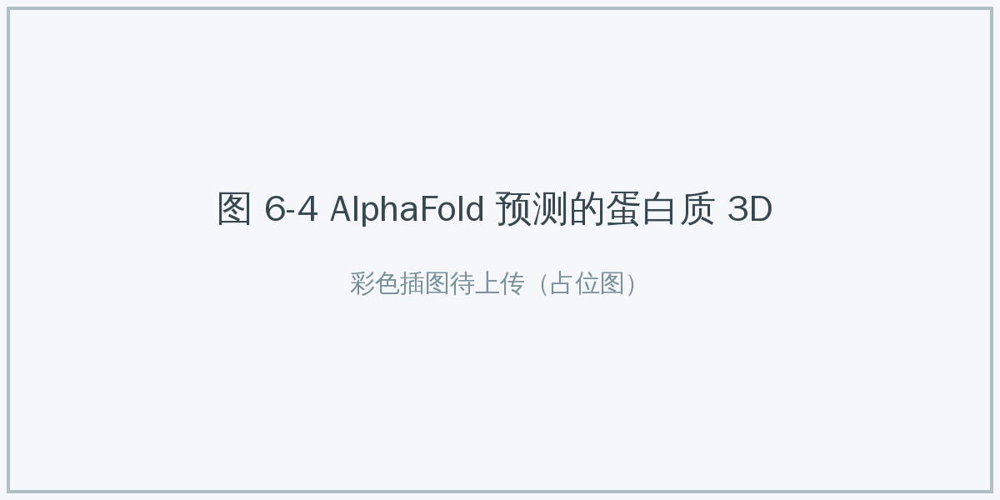

# 6.2 AI+探索与创造 {#62}

!!! info "学前导读"

    科学（向外探索世界）和艺术（向内创造精神世界）曾被认为是机器最难进入的两个领域。本节看 AI 怎样成为科学家的“探索助手”和艺术家的“创意催化剂”，也讨论它带来的新问题：AI 的预测能代替实验吗？AI 生成的歌，版权归谁？

过去我们认为，科学发现靠天才的灵光一闪，艺术创作靠人独特的情感体验，这两者都是机器难以涉足的领域。现在，AI 正同时进入这两个领域：它既是科学家手中的“显微镜”，也是艺术家手中的“画笔”。

## 6.2.1 AI+科学（AI for Science） {#621}

**核心逻辑**：AI 从海量数据中学习隐藏的规律，在一些问题上能用“快速预测”代替一部分费时费力的实验或计算，从而改变科学研究的方式。有学者把这称为科学研究的“第五范式”。

**1. 案例一：AlphaFold 绘制生物学的“地图”**

2.2 节介绍了 AlphaFold 的原理，这里关注它怎样改变了研究方式。

- **传统方式（实验）**：用 X 射线晶体学、冷冻电镜等方法测定一个蛋白质的结构，往往需要数月到数年。几十年来，人类实验测定的蛋白质结构约 17 万个（截至 2020 年前后）。
- **AI 方式（预测）**：2022 年，DeepMind 与欧洲生物信息研究所公开了 2 亿多个蛋白质的预测结构，几乎覆盖了已编目的所有蛋白质。
- **意义**：就像有了一张高精度地图，生物学家可以先“查地图”找到值得研究的目标（如设计新药、寻找能降解塑料的酶），再用实验去验证。注意，预测结构不能完全代替实验：图 6-4 中每个区域都标有置信度，置信度低的部分需要实验确认。

{ loading=lazy }

图 6-4 AlphaFold 预测的蛋白质 3D 结构置信度（颜色越深，可信度越高：≥90 极高，70～90 高，＜70 低）
{ .fig-caption }

**2. 案例二：深度势能——材料模拟的新方法（中国创新）**

- **痛点**：原子和分子的运动遵循量子力学规律。用传统的“第一性原理”方法精确计算非常昂贵，超级计算机通常也只能模拟几百到几千个原子，新材料研发很大程度上依赖经验试错。
- **思路**：我国科研人员发展了“深度势能”（Deep Potential）方法，用神经网络去学习量子力学计算的结果，再用学到的模型做大规模模拟。
- **成果**：2020 年，由我国学者主导的研究团队用这一方法，在保持接近第一性原理精度的同时，把分子动力学模拟的规模推进到 1 亿个原子，获得高性能计算领域的最高奖之一“戈登·贝尔奖”。相关开源软件 DeePMD-kit 已被广泛使用，团队部分成员创办了深势科技。
- **应用**：在锂电池、合金、催化剂等领域，帮助研究人员在原子层面理解材料的反应过程。

**3. 案例三：华为盘古气象大模型（中国创新）**

- **传统局限**：数值天气预报要在超级计算机上求解大气运动方程，计算量巨大。
- **创新**：盘古气象大模型采用专门为地球大气设计的三维神经网络，把大气按高度分成多层来学习。2023 年，相关论文发表在《自然》杂志上。
- **表现**：论文报告，它的中期预报精度在多项指标上超过了欧洲中期天气预报中心的业务模式，而速度快了一万倍以上，在单张显卡上几秒钟即可完成预报。2023 年台风“玛娃”期间，它较早预测出台风在台湾岛以东海域转向的路径。
- **注意**：AI 气象模型是从历史数据中学习的，对历史上少见的极端天气可能把握不足，目前多作为传统数值预报的补充，由气象人员综合判断。

**4. 案例四：液体活检——癌症筛查的新尝试**

- **原理**：癌细胞会把少量 DNA 释放到血液中。一些公司（如美国的 GRAIL）用机器学习分析血液中游离 DNA 的特征，尝试一次检测多种癌症的信号。
- **现状**：研究中能检测出 50 多种癌症的信号，但对早期癌症的检出率还不高，也存在假阳性，目前仍在大规模临床试验中验证，不能代替常规体检和医生诊断。

!!! example "深度解析：科学研究范式的演进"
    AI for Science 并没有抛弃物理定律。例如“物理信息神经网络”（PINN）就把物理方程作为约束，放进神经网络的训练中，让 AI 的预测符合已知规律。

    表 6-2 科学研究范式的演进
    { .tab-caption }

    | 范式 | 方法 | 代表与局限 |
    |---|---|---|
    | 第一范式 | 实验科学 | 伽利略的落体实验。局限：难以观测极端条件（如黑洞、原子核内部） |
    | 第二范式 | 理论科学 | 牛顿定律、麦克斯韦方程组。局限：复杂系统（如生物体）很难求出精确解 |
    | 第三范式 | 计算科学 | 计算机数值模拟。局限：算力昂贵，规模受限 |
    | 第四范式 | 数据密集型科学 | 基因测序数据分析。局限：善于发现相关性，不一定能解释原因 |
    | “第五范式”（提法尚未统一） | AI 驱动的科学 | AlphaFold、深度势能。把数据和物理规律结合起来，又快又较准；局限：可解释性不足，预测仍需实验检验 |

## 6.2.2 AI+艺术：视觉创作的新工具 {#622}

生成式 AI 的出现，大大降低了把想法变成图像、视频的门槛。

**核心逻辑**：生成式 AI 让创意生产从“手工作坊”式的劳动密集型模式，转向“人提出构想、AI 快速出稿、人挑选精修”的新模式。在这个过程中，AI 更像副驾驶，而不是替代者。

**技术基础**：以扩散模型为代表的图像生成技术（原理见 4.2 节）。

**1. 案例一：影视制作的工作流变化**

- **传统流程**：剧本 → 概念图 → 绿幕拍摄 → 三维建模 → 渲染 → 合成。每一步都是线性的，拍完再想改景，代价很高。
- **新流程**：
    - **虚拟制片**：在 LED 屏幕搭成的摄影棚里，用游戏引擎实时渲染背景，导演在拍摄现场就能看到接近成片的画面（如美剧《曼达洛人》）。这项技术本身主要靠实时渲染，并不是 AI，但它和 AI 生成的素材正在结合。
    - **素材生成**：小团队可以用 AI 快速生成大量概念图、材质贴图和背景素材。
- **意义**：降低了高水平特效的门槛，个人工作室也有机会尝试。

**2. 案例二：建筑设计的“发散与收敛”**

- **发散阶段**：过去建筑师手绘草图，一天只能画几张；现在输入“赛博朋克风格的苏州园林”，几分钟就能得到几十张概念图。设计师的工作有一部分从“画图”变成了“挑图”。
- **收敛阶段**：选中方案后，用 ControlNet 等工具固定建筑结构，生成更精细的效果图；但施工图、结构计算仍要由专业人员按规范完成。
- **国风案例**：通用的图像模型对“飞檐翘角”“水墨晕染”等中国元素的表现常常不到位。国内一些团队（如 Tiamat）专门收集东方建筑和国风美学的数据对模型进行微调，改善了这类画面的效果。

{ loading=lazy }

图 6-5 AI 辅助设计流程：海量发散 → 人工筛选 → 精细化落地
{ .fig-caption }

## 6.2.3 AI+音乐 {#623}

**案例一：一句话生成一首歌**

Suno、网易天音、海绵音乐等工具，让不懂乐理的人也能“写歌”：输入“一首忧伤的 R&B，关于加班的程序员”，几十秒后就能得到一首带旋律、编曲和人声演唱的完整歌曲（原理见 4.3.4 节）。

{ loading=lazy }

图 6-6 网易天音生成歌曲界面
{ .fig-caption }

**案例二：AI 辅助编曲与人声分离**

- **人声分离**：用 AI 模型（如开源的 Spleeter）可以把一首完整的歌曲分离成“伴奏”和“人声”两轨，效果已经相当不错。以前这需要专业录音师花大量功夫，而且往往拿不到原始分轨。
- **虚拟歌手**：AI 驱动的虚拟歌手可以不知疲倦地演唱各种风格的歌曲，但也带来了声音权益问题（见 4.3.3 节）。

表 6-3 传统音乐制作与 AI 音乐生成对比
{ .tab-caption }

| 维度 | 传统音乐制作 | AI 音乐生成 |
|---|---|---|
| 门槛 | 要掌握乐理、乐器、编曲软件 | 输入文字描述即可 |
| 周期 | 作词、作曲、编曲、录音、混音，数周 | 以分钟计 |
| 成本 | 录音棚、乐手费用较高 | 工具订阅费，相对较低 |
| 品质控制 | 每个细节都可以精确控制 | 细节难以精确控制，常要多次生成挑选 |
| 版权 | 归属清楚 | 存在争议：训练数据是否侵权？生成的作品归谁？ |

!!! question "辩论：AI 的作品有“灵魂”吗？"
    - **正方**：AI 只是概率的拼接，它没有经历过痛苦和爱，作品只是“精美的空壳”。
    - **反方**：人类创作同样建立在对已有经验的重组上。如果一幅 AI 画作能打动你，它的意义就是真实的，意义由欣赏者赋予。

    **另一种视角**：未来最有竞争力的创作者，可能既不是纯粹的 AI，也不是拒绝 AI 的人，而是“人 + AI”的组合：人负责构思、判断和情感表达，AI 负责快速试错和执行。

    **再想一想**：如果一个 AI 模型学习了某位歌手的上千首歌，生成了一首“风格神似”的新歌，原歌手的权益该如何保护？

## 随堂小测

**1.** 有了 AlphaFold 的预测结构，生物学家就不再需要用实验测定蛋白质结构了。（　　）

- √
- ×

??? tip "答案与解析"
    **答案：×**

    解析：预测结构有置信度高低之分，低置信度区域、蛋白质之间的相互作用等仍需实验确认。AI 改变了研究的起点，但没有取消实验。

    考查：AI for Science 的局限 · 认知层次：评价 · [回看 6.2.1](#621)
    { .quiz-meta }

**2.** 关于 AI 气象大模型，下列说法正确的是（　　）

- A. 它求解的是和传统数值预报一样的大气方程，只是换了更快的电脑
- B. 它已经完全取代了传统的数值天气预报
- C. 它从历史数据中学习规律，速度很快，但对历史上少见的极端天气可能把握不足
- D. 它不需要任何历史数据

??? tip "答案与解析"
    **答案：C**

    解析：AI 气象模型用神经网络从多年再分析数据中学习，推理极快；但它依赖历史数据，目前多作为传统预报的补充。

    考查：盘古气象大模型 · 认知层次：理解 · [回看 6.2.1](#621)
    { .quiz-meta }
