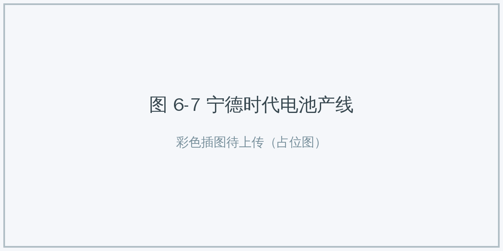
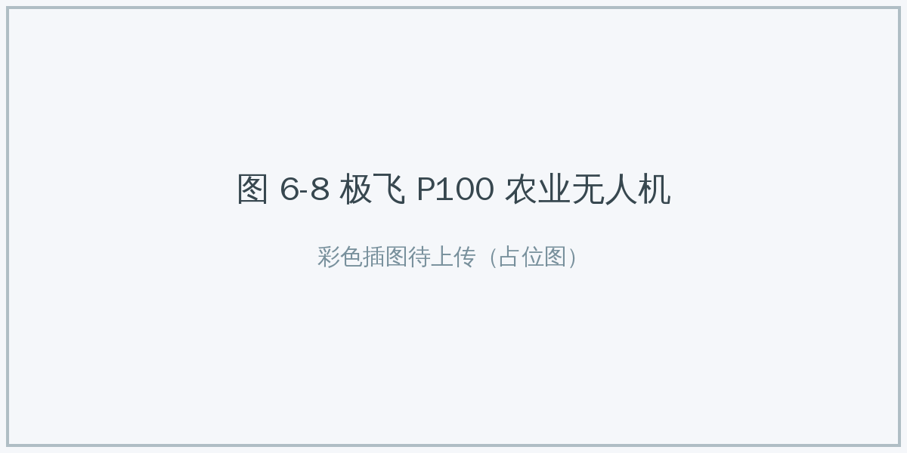
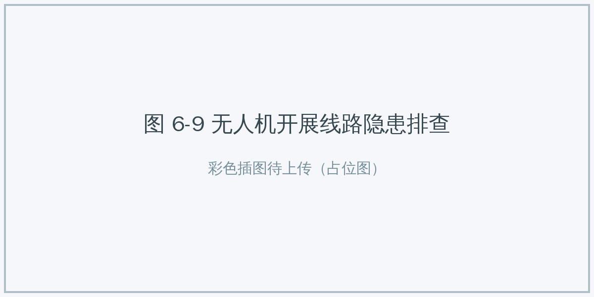
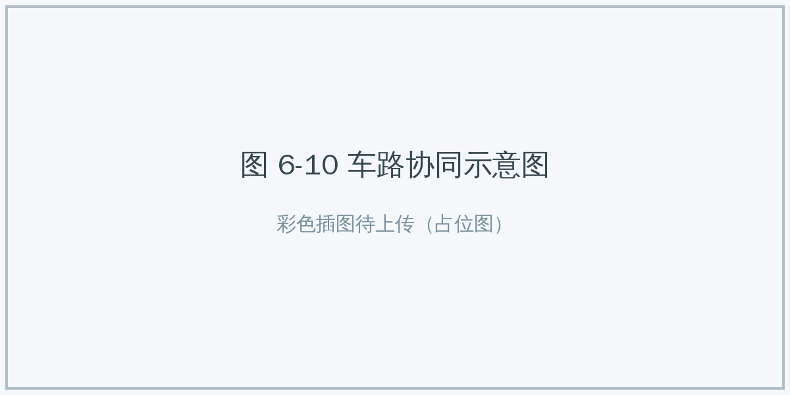

# 6.3 AI+产业与效率 {#63}

!!! info "学前导读"

    本节走进工厂、农田、电网和公路。你会反复看到同一个闭环：**感知**（摄像头、传感器、无人机）→ **决策**（AI 模型判断）→ **执行**（机器自动动作）。

    读案例时，留意哪些数字是企业自己公布的，并想一想：AI 替代的是哪些岗位的哪些工作？人在其中还负责什么？

1987 年，经济学家罗伯特·索洛（Robert Solow）说过一句著名的话：“计算机时代随处可见，唯独在生产率统计中看不见。”这被称为“索洛悖论”。今天，AI 能否真正大幅提高全社会的生产率，经济学家们还在争论；但在很多具体的工厂、农田、电网和公路上，AI 已经带来了看得见的变化。

## 6.3.1 AI+制造：从“制造”到“智造” {#631}

制造业是 AI 应用的主战场之一。我国作为制造业大国，正在推进从“制造”到“智造”的转型升级。

**核心逻辑**：构建“感知—决策—执行”的闭环，实现高精度的质量控制和高度自动化的生产。

**1. 案例一：宁德时代的极限品控（企业公布）**

- **背景**：动力电池的安全性要求极高。传统制造业常用“百万分之几”（PPM 级）的缺陷率作为高标准，宁德时代提出要把电芯的缺陷率控制到“十亿分之几”（PPB 级）。
- **AI 方案**：
    - **视觉检测**：在涂布等工序，高速相机连续拍摄，AI 实时识别微米级的颗粒、划痕、气泡；
    - **边缘计算**：数据量太大，来不及都传到云端，模型被部署在产线旁的工控机上，在几十毫秒内完成判断。
- **成效**：据企业介绍，其部分工厂已实现 PPB 级的缺陷控制，并入选世界经济论坛评选的“灯塔工厂”。

{ loading=lazy }

图 6-7 宁德时代电池产线
{ .fig-caption }

**2. 案例二：汽车超级工厂（企业公布）**

小米汽车工厂等新一代汽车工厂，体现了物理世界和数字世界的深度融合（信息物理系统，CPS）：

- **一体化压铸**：用 9100 吨级的大型压铸机把多个零件一次铸成，AI 根据实时数据微调压射速度、模具温度等工艺参数，减少气孔等缺陷；
- **X 射线智能检测**：压铸件下线后，AI 分析 X 射线图像，判断内部是否有缺陷，并把结果反馈给压铸环节调整参数，形成闭环；
- **自主物流**：自主移动机器人（AMR）靠激光雷达定位导航，在车间里自动搬运物料。

**3. 案例三：数字孪生矿山**

- **背景**：传统露天矿山安全风险高、环境压力大、效率不高。宝武等企业建设了智能矿山。
- **方案**：用无人机和激光雷达扫描矿山，在计算机里建一个和真实矿山一模一样的“数字孪生”模型；AI 在模型里规划开采和运输路线；无人驾驶矿卡按规划自动运输。

表 6-4 传统汽车厂与智能工厂对比
{ .tab-caption }

| 维度 | 传统汽车厂 | 智能工厂 |
|---|---|---|
| 物流 | 人工叉车、沿固定磁条行驶的自动导引车（AGV） | 无轨导航的自主移动机器人（AMR），能自主避障，路线灵活 |
| 质检 | 抽检，主要靠工人目视 | 关键工序全检，AI 视觉和 X 射线检测 |
| 换线 | 停产较长时间调整设备 | 软件调整参数，切换更快 |
| 决策 | 依赖班组长经验，事后复盘 | 生产数据实时汇总，提前预警、及时优化 |

## 6.3.2 AI+农业：从“看天吃饭”到“知天而作” {#632}

**核心逻辑**：天上（卫星）、空中（无人机）、地面（传感器）一体化感知，把种子、化肥、农药“用在刀刃上”。

**1. 案例一：农业无人机（企业公布）**

以极飞科技、大疆农业等企业的产品为例：

- **测绘**：无人机先飞一遍，拍摄多光谱照片，AI 分析生成“处方图”，标出哪里缺肥、哪里有病虫害；
- **作业**：植保无人机读取处方图，借助厘米级的卫星定位，在需要的地方多喷、不需要的地方少喷或不喷（变量喷洒）。
- **成效**：据企业介绍，可明显减少农药用量，减轻对环境的影响。

{ loading=lazy }

图 6-8 极飞 P100 农业无人机（图片来源：极飞科技官网）
{ .fig-caption }

**2. 更多场景**

- **智慧温室**：传感器实时监测温度、湿度、二氧化碳和作物长势，AI 判断作物是否缺水、有无病害，自动调节通风、灌溉和补光。
- **智慧渔业**：挪威的三文鱼养殖场用水下摄像头和 AI 识别鱼身上的海虱（一种寄生虫），再用激光精准清除，减少了化学药物的使用。
- **智慧养殖**：在养猪场，AI 分析摄像头、声音和环境数据，发现体温、呼吸异常或咳嗽等疫病征兆，及早预警。
- **森林防火**：无人机搭载可见光和红外相机巡检森林，AI 自动识别烟雾、明火并报告位置，帮助消防部门尽早处置。

## 6.3.3 AI+能源：安全与节能 {#633}

**核心逻辑**：让 AI 承担高危、重复的巡检工作，并优化能源的调度和使用。

**1. 案例一：电网智能巡检**

- **做法**：无人机搭载高清相机和红外相机，沿高压输电线路自动飞行巡检。AI 自动识别绝缘子破损、鸟巢异物、导线发热等隐患。
- **成效**：据报道，云南电网使用带自动机巢的无人机后，部分线路的巡检效率提高了近 5 倍，也大大减少了人工登塔的高空作业风险。

{ loading=lazy }

图 6-9 无人机开展线路隐患排查
{ .fig-caption }

**2. 案例二：数字孪生电网**

- **做法**：在计算机里建立一个与真实电网对应的虚拟模型。AI 在虚拟电网里模拟台风来袭、负荷激增等情况，测试调度方案，验证可行后再用于真实电网。
- **应用**：南方电网等单位利用这类技术，在台风来临前预判可能受灾的区域，提前调配抢修队伍和物资。

**3. 案例三：数据中心节能**

- **痛点**：数据中心耗电量巨大，其中相当一部分用于给服务器降温。
- **做法**：DeepMind 用机器学习模型分析数据中心里数千个传感器的数据，预测不同的制冷设置会带来怎样的能耗和温度变化，给出最优的调节方案；2018 年起，系统可以在安全约束下每隔几分钟自动调整制冷设备。
- **成效**：DeepMind 在 2016 年报告，这一方法使谷歌数据中心用于制冷的能耗降低了约 40%。

## 6.3.4 AI+交通：自动驾驶的中国路径 {#634}

**核心逻辑**：从辅助驾驶逐步走向无人驾驶，并可能把出行变成一种服务。

**1. 案例一：萝卜快跑——“单车智能 + 车路协同”（企业公布）**

我国在自动驾驶上探索了“单车智能”和“车路协同”并举的路线。

- **单车智能**：车顶的激光雷达和多个摄像头构成 360° 感知，预测算法预判路边行人的意图（如突然横穿马路）。
- **车路协同（V2X）**：路边设施上的传感器提供“高处视角”，能告诉车辆：“前方路口大货车后面有一辆电动车”，弥补单车的视觉盲区。
- **现状**：百度的萝卜快跑已在武汉、北京等城市开展无人驾驶出行服务。

{ loading=lazy }

图 6-10 车路协同示意图：使用 V2X 后，车辆能及时收到盲区内的信号灯信息
{ .fig-caption }

表 6-5 人类司机与无人驾驶的比较
{ .tab-caption }

| 维度 | 人类司机 | 无人驾驶系统 |
|---|---|---|
| 反应速度 | 约 0.6～1.2 秒 | 通常更快（毫秒级的系统延迟） |
| 感知范围 | 有视线盲区 | 360° 感知，但会受雨雪、强光、传感器脏污影响 |
| 状态 | 会疲劳、分心、情绪化 | 不会疲劳，但可能出现软件故障，遇到没见过的情况会“犯傻” |
| 罕见场景 | 能凭常识和经验灵活应对 | 依赖数据积累；遇到难以处理的情况，常需要停车等待或由远程人员协助 |

**2. 更多企业实践（企业公布）**

- **华为乾崑智驾（ADS）**：不依赖高精地图，依靠激光雷达和摄像头实时构建周围环境，可以在更多城市使用辅助驾驶功能。注意：目前面向个人消费者销售的汽车，提供的都是“辅助驾驶”，驾驶人必须始终监控路况、随时接管。
- **小马智行**：采用“车队学习”，一辆车遇到的罕见场景被记录上传，经过处理和验证后，改进的软件通过远程升级推送给整个车队。
- **文远知行**：在多个城市开展无安全员的无人驾驶测试和运营，车内没有安全员时，由远程中心监控，必要时远程协助。

!!! warning "辅助驾驶不等于自动驾驶"
    2025 年，国家有关部门进一步规范了智能网联汽车的宣传，要求不得夸大辅助驾驶功能，不得使用“自动驾驶”“智驾”等容易引起误解的说法描述辅助驾驶。驾驶人是行车安全的第一责任人，开启辅助驾驶时不能脱手、脱眼、睡觉。

## 随堂小测

**1.** “数字孪生”的核心作用是（　　）

- A. 让监控大屏更好看
- B. 在虚拟世界中实时映射物理对象的状态，用来仿真、预测和优化
- C. 取代所有真实的工厂和电网
- D. 给企业开设社交媒体账号

??? tip "答案与解析"
    **答案：B**

    解析：数字孪生在计算机里建立与真实对象对应的模型，先在虚拟世界里试验方案，降低在真实世界试错的风险和成本。

    考查：数字孪生 · 认知层次：理解 · [回看 6.3.3](#633)
    { .quiz-meta }

**2.** 开启了辅助驾驶功能后，驾驶人可以放心地看手机或睡觉。（　　）

- √
- ×

??? tip "答案与解析"
    **答案：×**

    解析：辅助驾驶需要驾驶人始终监控路况、随时接管，驾驶人是安全的第一责任人。

    考查：辅助驾驶与自动驾驶 · 认知层次：应用 · [回看 6.3.4](#634)
    { .quiz-meta }
