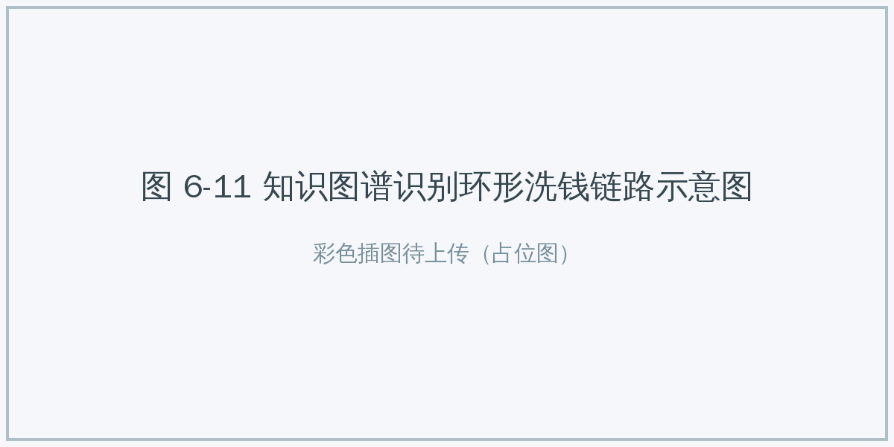

# 6.4 AI+服务与社会 {#64}

!!! info "学前导读"

    本节看 AI 怎样进入和每个人生活密切相关的公共服务：金融、医疗、教育、法律。这些领域关系到钱、健康、成长和公平，所以既要看到 AI 带来的便利，也要特别关注它的边界：**谁来做最终决定？出了错谁负责？**

科技的最终目的是服务于人。AI 不只是企业的利润引擎，也可能成为公共服务的“普惠放大器”，帮助缓解优质资源分配不均的问题。

## 6.4.1 AI+金融：数据洪流中的领航员 {#641}

**核心逻辑**：从固定的规则判断，升级为分析账户之间复杂的关联关系，更快地识别风险。

**1. 案例一：图计算反欺诈（企业公布）**

- **挑战**：洗钱和诈骗团伙常利用“环形转账”（A → B → C → … → A）或“分散转出”来逃避监管，资金链路可能涉及成百上千个账户，单看每一笔交易都正常。
- **技术**：知识图谱 + 图神经网络。把账户看作“点”、交易看作“线”，构成一张巨大的关系网。AI 在网中寻找符合洗钱、诈骗特征的“形状”。
- **成效**：据蚂蚁集团等企业介绍，这类技术能在很短时间内识别多层的复杂资金链路，明显提升了风险识别能力。

{ loading=lazy }

图 6-11 知识图谱识别环形洗钱链路示意图
{ .fig-caption }

**2. 案例二：动态定价与调度**

- **电商动态定价**：据第三方机构 2013 年的估计，亚马逊每天的价格调整次数高达约 250 万次。AI 综合库存、竞争对手价格、用户点击率等因素实时调价。
- **网约车调度**：滴滴等平台每天要处理数千万笔订单，订单量随时间波动很大。AI 实时预测各区域的供需，调度车辆，并在高峰期通过动态加价平衡供需，减少车辆空驶。

!!! warning "动态定价的边界"
    动态定价能提高效率，但也可能变成“大数据杀熟”：同一件商品，对老用户、对用苹果手机的用户报价更高。我国《个人信息保护法》规定，利用个人信息进行自动化决策，不得对个人在交易价格等交易条件上实行不合理的差别待遇。作为消费者，你可以多比较、换账号核对价格；作为未来的从业者，你要知道这条红线。

**3. 案例三：智能仓储（企业公布）**

- **挑战**：电商仓库每天要处理大量商品的入库、出库和拣选。
- **技术**：运筹优化 + 深度学习。AI 预测未来几天各地区的商品销量，提前把货备到离消费者近的仓库；为仓库里的机器人规划最优拣货路径，从“人找货”变为“货找人”。
- **成效**：据京东公布的数据，其库存周转天数在 30 天左右，处于行业较低水平。

**动手看看 · 从会员数据里找规律**

<iframe class="sim-frame" src="../../sims/knn-kmeans/main.html" height="720" loading="lazy" title="K 近邻与 K 均值"></iframe>

商家常用机器学习给用户“分群”，再推送不同的优惠。切到“K 均值聚类”，看算法怎样把 24 位奶茶店会员按到店次数和消费金额分组；再切到“K 近邻分类”，放一位新会员，看它被分到哪一类。想一想：分群用于精准营销和用于“杀熟”，区别在哪里？[全屏打开](../../sims/knn-kmeans/main.html){ target=_blank } · [教学说明](../../sims/knn-kmeans/index.md)
{ .sim-caption }

## 6.4.2 AI+医疗：可以复制的“专家经验” {#642}

**核心逻辑**：AI 可以把专家的部分经验“复制”到更多医院，帮助基层医生，让偏远地区的患者也能得到更好的诊断。

**1. 案例一：AI 辅助影像诊断**

- **痛点**：早期食管癌等病变在内镜下很隐蔽，容易被漏诊；一旦发展到晚期，治疗效果就会差很多。
- **技术**：用卷积神经网络学习大量标注过的内镜、CT 图像，实时提示可疑区域。
- **成效**：多项研究显示，AI 辅助能提高早期病变的检出率，尤其能帮助经验较少的医生。腾讯觅影等产品已在一些医院使用。
- **局限**：AI 在训练数据没覆盖的设备、人群上表现可能下降；它会给出“假阳性”，也会漏掉不典型的病变。诊断结论必须由医生作出。

**2. 案例二：手术机器人与远程手术**

- **技术**：手术机器人提供放大的三维视野，把医生手部的大动作按比例缩成器械的小动作，并过滤掉手的细微颤抖，让微创手术更精细。
- **远程手术**：依托 5G 等网络，我国医生已多次使用国产手术机器人，为几百甚至几千千米外的患者实施远程手术。
- **注意**：手术机器人的精准主要来自精密机械和控制算法，并不是“AI 自己做手术”，每一个动作都由医生操控。

{ loading=lazy }

图 6-12 手术机器人的机械臂进行精密缝合
{ .fig-caption }

**3. 案例三：AI 辅助新药发现（Halicin）**

- **传统困境**：研发一款新药通常需要十年以上、花费十亿美元以上，被称为“双十定律”。
- **AI 突破**：2020 年，麻省理工学院的团队训练了一个图神经网络，学习分子结构与杀菌能力的关系，然后用它在药物数据库中筛选。他们从约 6000 个已知分子中找到了一个原本被研究用于治疗糖尿病的分子，命名为 Halicin，实验证明它能杀灭多种耐药菌。
- **意义**：AI 大大缩短了“大海捞针”式的筛选时间；但从发现候选分子到真正上市，仍要经过多年的动物实验和临床试验。

## 6.4.3 AI+教育：更多的“因材施教” {#643}

**核心逻辑**：传统课堂是“一对多”的统一进度，AI 有可能为每个学习者提供更个性化的支持。

**1. 案例一：无障碍之桥**

5.1.4 节介绍了 AI 帮老师批改作业。在社会层面，AI 最温暖的应用之一，是帮助残障人士跨越信息的鸿沟。

- **视障人士**：微软 Seeing AI、谷歌 Lookout 以及国内的一些读屏、识物应用，能让手机摄像头“说出”眼前的景象，如“前方有一把空椅子”“这是一盒感冒药，有效期到明年 5 月”，帮助视障学生阅读普通印刷材料。
- **听障人士**：实时字幕眼镜用语音识别把老师的讲课内容转成字幕显示在镜片上；央视等媒体推出的“AI 手语主播”，能把新闻播报转成手语。
- **意义**：AI 没有治愈残疾，但它缩小了残疾带来的信息差距，让更多人能平等地学习和生活。

**2. 案例二：苏格拉底式 AI 导师（Khanmigo）**

- **理念**：好的教育不是直接给答案，而是启发学生自己思考。
- **实践**：可汗学院 2023 年推出基于 GPT-4 的 AI 导师 Khanmigo。学生问“这道题怎么做？”，它不会直接说“选 C”，而是问：“你觉得第一步应该做什么？是不是要先通分？”

**3. 案例三：多邻国——游戏化的外语陪练**

- **痛点**：背单词枯燥，难以坚持。
- **技术**：根据你对每个单词的遗忘规律安排复习时间（间隔重复），并动态调整题目难度：连对时增加挑战，受挫时适当降低难度，让学习始终处于“有点难但够得着”的状态。
- **注意**：连续打卡、排行榜等游戏化设计能提高坚持率，但也可能让人只追求“不断签”，而不是真正学会。

{ loading=lazy }

图 6-13 游戏化外语学习中的“心流”体验
{ .fig-caption }

**4. 案例四：AI 辅助阅卷**

- **技术**：手写识别 + 自然语言处理，识别学生的手写答案，标出作文中的语法错误，并按评分标准给出参考分。
- **定位**：在客观题和规范性较强的题目上，AI 已能较好地辅助评分；对于作文、开放题，AI 的分数应作为参考，由教师复核，特别是要防止 AI 偏好某种“套路化”写法。

表 6-6 传统课堂与 AI 支持的个性化学习
{ .tab-caption }

| 维度 | 传统课堂 | AI 支持的个性化学习 |
|---|---|---|
| 教学形式 | 一对多（大班授课） | 教师授课 + AI 一对一辅导 |
| 进度 | 统一进度，有人“吃不饱”，有人“吃不消” | 按个人情况调整节奏 |
| 评价 | 偏重考试结果 | 结果评价 + 过程数据 |
| 资源 | 优质资源集中在少数学校 | 线上共享，跨越地域 |
| 需警惕 | — | 过度依赖 AI、学生数据隐私、只练“会考的”而忽视全面发展 |

## 6.4.4 AI+法律：司法辅助与边界 {#644}

**核心逻辑**：AI 帮助司法流程更加数字化、透明、高效，但裁判权始终属于法官。

**1. 案例一：智慧法院（以北京互联网法院为例）**

- **立案**：自动检查起诉材料是否齐全、格式是否规范，提取案件关键信息；
- **庭审**：语音识别实时生成庭审笔录；
- **文书**：对事实简单的案件，系统可以辅助生成裁判文书的草稿，由法官审核修改；
- **存证**：用区块链技术（“天平链”）保存电子证据（如网购记录、聊天记录），确保上传后不可篡改，缓解了互联网案件取证难的问题。

2022 年，最高人民法院发布《关于规范和加强人工智能司法应用的意见》，明确了“辅助审判”原则：无论技术发展到何种水平，人工智能都不得代替法官裁判，裁判职权始终由审判人员行使，司法责任最终由裁判者承担。

**2. 案例二：智能合同审查**

- **痛点**：大企业每年要签署大量合同，法务人员人工审核效率低，容易漏掉风险条款。
- **技术**：自然语言处理，几分钟读完一份长合同，标出风险条款（如违约金比例过高、管辖法院不利）。
- **一项比赛**：2018 年，法律科技公司 LawGeex 组织了一次测试：让 20 名律师和该公司的 AI 审查 5 份保密协议。结果 AI 的平均准确率为 94%，用时 26 秒；律师平均准确率为 85%，平均用时 92 分钟。注意，这是企业自己组织的测试，题目也只是格式相对固定的保密协议。

{ loading=lazy }

图 6-14 LawGeex 人机对比测试结果（企业组织的测试）
{ .fig-caption }

**3. 案例三：类案检索**

- **场景**：律师和法官办案时，需要查阅大量过往判例。
- **技术**：语义检索。传统的关键词搜索（搜“车祸”）会漏掉只写了“交通事故”的文书；AI 理解意思，能找到法律要件相似的案例。
- **平台**：国内外的主要法律数据库都已接入 AI 检索功能。

!!! danger "AI 编造判例的教训"
    2023 年，美国有律师用 ChatGPT 查找判例，把 AI 编造的 6 个“判例”写进了提交给法院的文件，结果受到法官处罚。此后，各国又陆续发生多起类似事件。这再次提醒我们：AI 给出的法条、判例、文献，必须到权威数据库中逐条核实。

!!! question "思考与讨论：AI 法官会取代人类法官吗？"
    - **正方**：AI 不会疲劳，不会收受贿赂，对事实清楚的简单案件，AI 能做到“同案同判”，更公平。
    - **反方**：AI 会继承训练数据中的偏见（见第 8 章）；法律不只是逻辑，还要平衡情、理、法，AI 难以理解“为给病重的母亲买药而偷窃”背后的伦理困境，也难以对新情况作出创造性的解释。而且，AI 判错了，谁来负责？

    **参考共识**：AI 负责提高效率，人负责公平正义。AI 可以帮忙整理材料、检索类案、起草文书，判断和裁决必须由人作出。

## 随堂小测

**1.** 在“AI+法律”场景中，AI 目前最适合承担的工作是（　　）

- A. 替法官作出最终判决
- B. 替当事人承担法律责任
- C. 合同审查、类案检索和文书草稿起草
- D. 不经核实直接引用 AI 给出的判例

??? tip "答案与解析"
    **答案：C**

    解析：我国明确人工智能不得代替法官裁判；AI 给出的判例必须核实。AI 适合做辅助性的整理、检索和起草工作。

    考查：AI+法律的边界 · 认知层次：理解 · [回看 6.4.4](#644)
    { .quiz-meta }

**2.** 利用个人信息进行自动化决策，对不同用户在交易价格上实行不合理的差别待遇，是我国法律所禁止的。（　　）

- √
- ×

??? tip "答案与解析"
    **答案：√**

    解析：《个人信息保护法》第二十四条对此作出了规定，这就是通常说的禁止“大数据杀熟”。

    考查：动态定价的边界 · 认知层次：记忆 · [回看 6.4.1](#641)
    { .quiz-meta }
