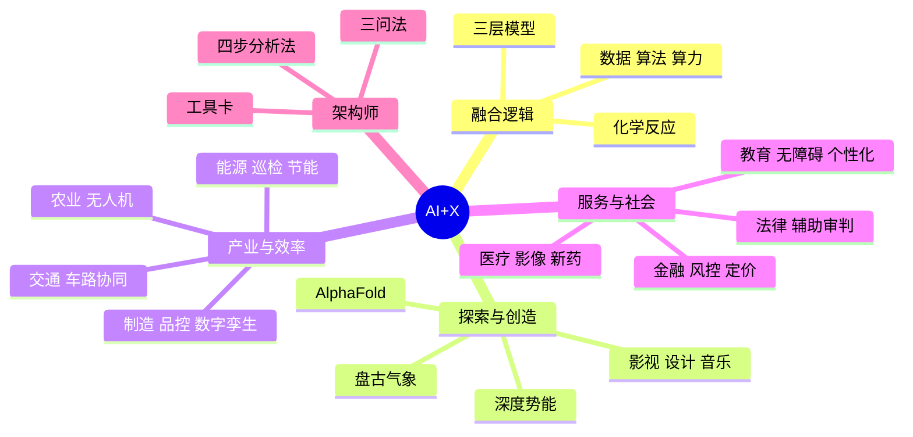

# 第 6 章 本章小结与练习

## 本章小结

本章从认知走向实践，看到了 AI 在各行各业中的多重角色：

- **融合逻辑**：AI+X 是“化学反应”而不是“物理拼接”，可以用“工具赋能—流程重构—生态颠覆”三层模型衡量它改变了多少；数据、算法、算力是新的生产要素。
- **探索外脑**：在科学领域，AlphaFold、深度势能、盘古气象大模型改变了研究方式，但预测仍需实验检验；在艺术领域，AI 降低了创作门槛，也带来了版权和“灵魂”之争。
- **效率引擎**：在制造、农业、能源、交通中，AI 构建起“感知—决策—执行”的闭环；辅助驾驶不等于自动驾驶。
- **服务放大器**：在金融、医疗、教育、法律中，AI 帮助更多人获得优质服务，但关系到钱、健康和公正的最终决定，必须由人作出、由人负责。
- **你的行动**：用三问法找痛点、四步分析法设计方案，成为懂专业又会用 AI 的“AI+X 架构师”。
- **一个习惯**：看到漂亮的数据，先问“谁说的？怎么测的？”

## 课后练习

**一、单项选择题**

**1.** AlphaFold 的出现，标志着 AI 在哪一领域取得了重大突破？（　　）

- A. 自然语言处理
- B. 自动驾驶
- C. 生命科学（蛋白质结构预测）
- D. 量子计算

??? tip "答案与解析"
    **答案：C**

    解析：AlphaFold 能根据氨基酸序列较准确地预测蛋白质的三维结构，深刻改变了结构生物学的研究方式。

    考查：AlphaFold · [回看 6.2.1](6-2.md#621)
    { .quiz-meta }

**2.** 利用无人机巡检高压输电线路，主要体现了 AI+能源的哪一核心价值？（　　）

- A. 提高电价
- B. 让 AI 承担高危、重复的巡检工作，提高效率和安全性
- C. 取消电网调度员
- D. 增加用电量

??? tip "答案与解析"
    **答案：B**

    解析：无人机加 AI 识别隐患，减少了人工登塔的高空作业风险。

    考查：AI+能源 · [回看 6.3.3](6-3.md#633)
    { .quiz-meta }

**3.** “黑灯工厂”能够在少人甚至无人值守的情况下生产，主要依靠（　　）

- A. 工人戴着夜视仪工作
- B. 把生产外包出去
- C. 智能化设备与中央调度系统协同运作
- D. 为了节省电费

??? tip "答案与解析"
    **答案：C**

    解析：自主移动机器人、机械臂、视觉检测等设备与中央调度系统协同，实现高度自动化。

    考查：智能制造 · [回看 6.3.1](6-3.md#631)
    { .quiz-meta }

**4.** 在 AI 辅助药物研发中，AI 的主要作用是（　　）

- A. 直接降低药品售价
- B. 加快候选分子的筛选，缩短早期研发周期
- C. 取代临床试验
- D. 自动生产药片

??? tip "答案与解析"
    **答案：B**

    解析：如 Halicin 案例，AI 帮助在大量分子中快速找到候选者，但后续实验和临床试验仍不可少。

    考查：AI+医疗 · [回看 6.4.2](6-4.md#642)
    { .quiz-meta }

**5.** 车路协同（V2X）主要解决了单车智能的什么问题？（　　）

- A. 车辆油耗过高
- B. 车内娱乐系统单调
- C. 视线被遮挡的盲区和超视距感知问题
- D. 停车难

??? tip "答案与解析"
    **答案：C**

    解析：路侧设备从高处感知，把被遮挡的行人、车辆和信号灯信息发给车辆。

    考查：车路协同 · [回看 6.3.4](6-3.md#634)
    { .quiz-meta }

**6.** 根据 2022 年最高人民法院的相关意见，人工智能在司法中的定位是（　　）

- A. 可以独立作出简单案件的判决
- B. 可以代替法官承担司法责任
- C. 只能用于法院的食堂管理
- D. 辅助审判，不得代替法官裁判

??? tip "答案与解析"
    **答案：D**

    解析：意见明确了辅助审判原则，裁判职权始终由审判人员行使。

    考查：AI+法律 · [回看 6.4.4](6-4.md#644)
    { .quiz-meta }

**7.** 用“三问法”寻找本专业的 AI 切入点时，“哪里最难”关注的是（　　）

- A. 最危险的工作
- B. 最耗时的重复劳动
- C. 极度依赖专家经验、新人难以上手的环节
- D. 最赚钱的业务

??? tip "答案与解析"
    **答案：C**

    解析：“难”指专家依赖，这类隐性经验适合用机器学习提炼和传承。

    考查：三问法 · [回看 6.5.2](6-5.md#652)
    { .quiz-meta }

**8.** 在选择 AI 工具解决问题时，首先应该考虑的是（　　）

- A. 这个工具是不是最新的
- B. 这个工具是不是最贵的
- C. 我要解决的真问题是什么，这个工具能否解决
- D. 别人在用什么我就用什么

??? tip "答案与解析"
    **答案：C**

    解析：先找钉子再用锤子；不要为了 AI 而 AI。

    考查：四步分析法 · [回看 6.5.2](6-5.md#652)
    { .quiz-meta }

**二、判断题**

**9.** “AI+X”意味着每个行业的人都必须学会从零开始开发大模型。（　　）

- √
- ×

??? tip "答案与解析"
    **答案：×**

    解析：架构师需要的是懂专业、懂 AI 的能力边界、会用工具，而不是从零开发大模型。

    考查：AI+X 架构师 · [回看 6.5.1](6-5.md#651)
    { .quiz-meta }

**10.** 无人机巡田、卫星遥感数据分析属于“精准农业”的应用。（　　）

- √
- ×

??? tip "答案与解析"
    **答案：√**

    解析：它们为变量施肥、喷药提供依据，是精准农业的典型手段。

    考查：AI+农业 · [回看 6.3.2](6-3.md#632)
    { .quiz-meta }

**11.** AI 生成的法律文书和引用的判例，可以不经律师核实直接提交法庭。（　　）

- √
- ×

??? tip "答案与解析"
    **答案：×**

    解析：已发生多起律师引用 AI 编造判例而受处罚的事件，必须逐条核实。

    考查：AI+法律 · [回看 6.4.4](6-4.md#644)
    { .quiz-meta }

**12.** 企业在发布会上公布的 AI 效率提升数据，经过了独立验证，可以直接当作定论引用。（　　）

- √
- ×

??? tip "答案与解析"
    **答案：×**

    解析：企业数据通常未经独立验证，引用时应注明“企业公布”，并尽量寻找第三方证据。

    考查：数据核查 · [回看 6.1](6-1.md#61)
    { .quiz-meta }

**三、简答题**

**13.** 请用一个例子说明“物理拼接”与“化学反应”在 AI 产业融合中的区别。

??? tip "参考答案"
    物理拼接是在原有业务上简单加装 AI，系统彼此割裂、流程不变，例如银行在网站上加一个只会回答常见问题的聊天机器人，和业务系统不相通。化学反应是 AI 深入业务、改变工作方式，例如用知识图谱和图神经网络分析账户之间的资金关系，实时识别洗钱链路，风控从“事后人工核查”变成“实时自动预警、人工复核”。

**14.** 举例说明 AI 在医疗影像诊断中的作用及局限。

??? tip "参考答案"
    作用：AI 学习大量标注过的影像后，能实时提示可疑病灶，减少漏诊，帮助经验较少的医生，提高效率，让基层患者也能得到较好的诊断。局限：在训练数据未覆盖的设备、人群上表现可能下降；会有假阳性和漏诊；无法综合病史等全部信息；出错时责任难以由 AI 承担。因此 AI 只能辅助，诊断结论必须由医生作出。

**15.** 结合你的专业，用“三问法”找出一个可以用 AI 改进的工作环节，并说明可能的风险。

??? tip "参考答案"
    （示例，护理专业）“哪里最烦”：护士每班要手写大量护理记录。可以用语音识别加大模型，把口述内容整理成规范的护理记录草稿，护士核对后签字。风险：识别或整理出错可能导致记录不准确，必须逐条核对；记录含患者隐私，应使用医院内部部署的系统，不得上传到公共 AI 服务；出现差错时由签字的护士负责。

**四、辩论与预测**

1. **深度辩论**：选择本章中你最感兴趣的一个应用（如 AI 法官、AI 艺术家、无人驾驶出租车），准备正反两方的论据，参加课堂辩论。
2. **未来预测**：预测 AI 在未来 5 年对你所学专业带来的最深刻的一项改变，并说明理由和依据。

**五、实训：设计你的“AI+X”转型方案**

结合你所学的专业（或感兴趣的行业），假设你刚入职这个行业，运用三问法和四步分析法，设计一份 AI 赋能方案。

1. **选定赛道，扫描痛点**（三问法）；
2. **四步分析**（解构 → 映射 → 设计 → 评估）；
3. **撰写一页纸方案书**，模板如下：

| 项目 | 内容 |
|---|---|
| 方案名称 | 例如：基于 AI 的智能审计助手 |
| 目标场景 | 具体是哪个业务环节 |
| 核心痛点 | 1～2 句话描述 |
| AI 解决方案 | 用到的 AI 能力和工具，简述流程（可附流程图） |
| 人的角色 | 哪些环节必须由人判断、负责 |
| 预期收益 | 效率、成本、体验方面的改善（写明估算依据） |
| 潜在风险 | 幻觉、偏见、隐私、版权、安全等，以及应对办法 |

## 拓展阅读

1. JUMPER J, EVANS R, PRITZEL A, et al. Highly accurate protein structure prediction with AlphaFold[J]. Nature, 2021, 596: 583-589. AlphaFold 2 论文，对应 6.2.1 节。
2. BI K, XIE L, ZHANG H, et al. Accurate medium-range global weather forecasting with 3D neural networks[J]. Nature, 2023, 619: 533-538. 盘古气象大模型论文，对应 6.2.1 节。
3. STOKES J M, YANG K, SWANSON K, et al. A deep learning approach to antibiotic discovery[J]. Cell, 2020, 180(4): 688-702. Halicin 的发现，对应 6.4.2 节。
4. 最高人民法院. 关于规范和加强人工智能司法应用的意见[Z]. 2022. 人工智能司法应用的基本原则，对应 6.4.4 节。
5. 李飞飞. 我看见的世界：李飞飞自传[M]. 北京：中信出版社，2024. ImageNet 的诞生与 AI 应用的人文思考。
6. 吴军. 浪潮之巅[M]. 4 版. 北京：人民邮电出版社，2019. 理解科技产业兴衰的规律。
7. 李开复，王咏刚. 人工智能[M]. 北京：文化发展出版社，2017. 面向大众的 AI 应用与产业解读。
