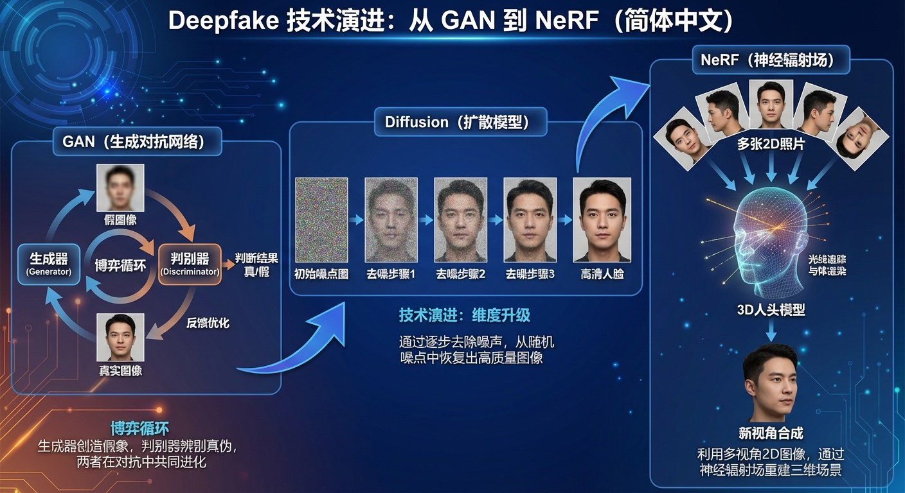
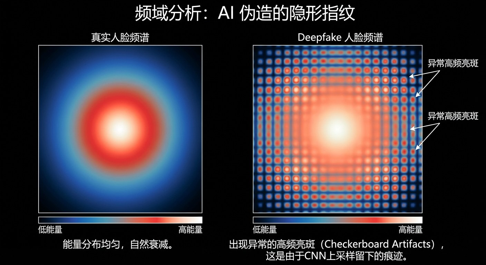
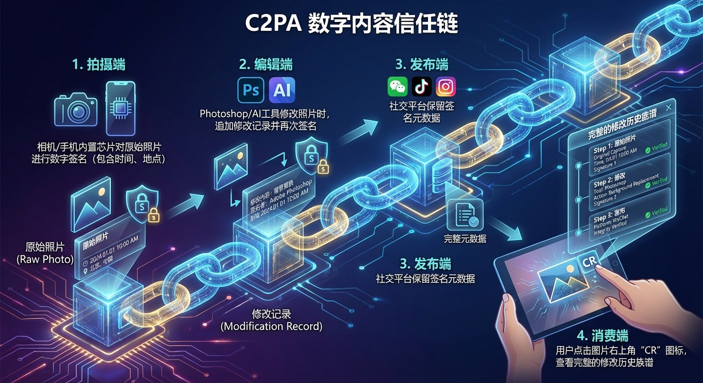

# 7.1 AIGC 与 Deepfake：输出端的风险 {#71}

!!! info "学前导读"

    4.7 节已经介绍了深度伪造的原理、香港视频会议诈骗案和 AI 生成内容的标识规定。本节从安全的角度再往前走一步：伪造技术是怎样一步步升级的？国内发生过哪些典型事件？检测和防御的技术手段有哪些，各自的局限在哪里？

## 7.1.1 伪造技术的演进：从暗房到生成模型 {#711}

篡改图像的历史，比 Photoshop 早得多。

**1. 手工修饰时代**

19 世纪 60 年代流传的一幅著名的林肯肖像，其实是把林肯的头像拼接到了政治家约翰·卡尔霍恩的身体上。进入数字时代，Photoshop 成了修图的标准工具，但它仍然依赖人一笔一笔地修改，修改视频更是要逐帧处理，工作量巨大。

**2. 生成模型时代：从“造假”到“乱真”**

第 4 章介绍了 GAN 和扩散模型的原理。从安全的角度看：

- **GAN 的博弈**：生成器和判别器反复较量，让生成的图像在统计特征上越来越接近真实照片，一些传统的检测方法（如分析图像的颜色分布）逐渐失效。
- **扩散模型的语义编辑**：扩散模型可以只修改图像中的某个“意思”，比如把“晴天”改成“雨天”、把“红灯”改成“绿灯”，而画面的其他部分看起来几乎不变。这类修改更隐蔽，也更难用传统的取证工具发现。
- **三维与实时**：新的技术能根据少量照片重建人物或场景的三维模型，实时生成的换脸视频也越来越流畅，伪造从“图片”扩展到了“实时视频通话”。

{ loading=lazy }

图 7-1 Deepfake 技术演进
{ .fig-caption }

## 7.1.2 伪造的多种形态 {#712}

深度伪造已经形成了一个覆盖图像、声音、视频的“伪造矩阵”。

表 7-1 深度伪造的主要形态
{ .tab-caption }

| 类型 | 描述 | 相关技术举例 |
|---|---|---|
| 换脸 | 把甲的面孔替换到乙的视频中 | 自动编码器、GAN |
| 面部重演 | 让目标人物的脸跟着攻击者做表情、说话 | 一阶运动模型等 |
| 声音克隆 | 用几秒到几分钟的录音合成目标人物的任意语音 | VALL-E、CosyVoice 等（见 4.3.3 节） |
| 唇形同步 | 让视频中人物的嘴型匹配一段新的音频 | Wav2Lip 等 |
| 文生视频 | 直接用文字生成并不存在的视频片段 | 扩散模型类视频生成工具（见 4.4.2 节） |

!!! example "案例 7-1 ZAO 的用户协议风波（2019）"
    2019 年 8 月底，一款名为 ZAO 的换脸 App 在社交网络上突然走红。用户只要上传一张自拍，就能把自己的脸换进经典影视剧片段中，表情动作几乎同步，一时间朋友圈里满是“AI 明星”。

    **危机爆发**：很快有人指出，它的用户协议中有这样的条款：用户同意授予 ZAO 及其关联公司“全球范围内完全免费、不可撤销、永久、可转授权和可再许可的权利”，包括对用户内容进行修改和编辑。也就是说，你上传的脸，可能被平台以几乎不受限制的方式使用。

    **社会反应**：“我的脸会不会被拿去刷脸支付？”“会不会被用来做不雅视频？”质疑铺天盖地。9 月 1 日，微信限制了 ZAO 链接的分享；9 月 3 日，工业和信息化部约谈了 ZAO 的运营方，要求其整改。ZAO 随后修改了用户协议。

    **意义**：这是我国公众较早、较直观地感受到 AI 娱乐应用背后的个人信息风险。它提醒我们：**人脸是无法更换的生物识别信息**，一旦泄露，影响终身。上传之前，先看清楚用户协议。

!!! example "案例 7-2 “10 分钟被骗 430 万元”的 AI 换脸诈骗案（2023）"
    2023 年 4 月 20 日中午，福建福州一家科技公司的法人代表郭先生，突然接到“好友”的微信视频通话。

    **第一幕：视频里的熟人**。视频中的人，面孔和声音都和好友一模一样。“好友”说自己在外地竞标，需要 430 万元保证金，想借郭先生公司的账户走一下账，还发来一张“银行转账成功”的截图，说钱已经转给了郭先生。

    **第二幕：被技术蒙蔽**。看着视频里熟悉的面孔，郭先生放下了戒心，没有核实钱是否到账，在 10 分钟内分两笔把 430 万元转了过去。

    **第三幕：真相**。郭先生给好友发微信说“钱转过去了”，对方却一脸茫然：“我没跟你视频啊！”郭先生这才发现自己被骗了。接到报警后，警方与银行迅速行动，成功止付拦截了 336 万余元，其余资金仍在追缴中。

    **复盘**：据警方通报，骗子使用了 AI 换脸和拟声技术，冒充好友进行视频通话。这类诈骗通常先盗取或仿冒受害人好友的社交账号，再用收集到的照片、视频、语音合成“数字面具”。

    **教训**：在 AI 时代，眼见不一定为实，耳听也未必为真。涉及转账，必须**换一个渠道核实**：微信视频里借钱，就打电话确认；电话里借钱，就当面或通过其他熟人确认。也可以请对方做一些不常见的动作，如用手遮住半张脸、在鼻子前比个“耶”，实时换脸在处理遮挡时容易出现破绽，但这一招也会随着技术进步而失效。

    { loading=lazy }

    图 7-2 “10 分钟 430 万”AI 诈骗全流程解析
    { .fig-caption }

4.7 节介绍的 2024 年香港“多人视频会议”诈骗案，也是同样的套路，只是规模更大：会议中除受害者以外的“高管”全部是伪造的。

## 7.1.3 AIGC 的双面性：正当的用途 {#713}

在把深度伪造“妖魔化”之前，我们也要看到，生成技术本身是中性的，就像手术刀，既能伤人，也能救人。

- **医疗影像**：生成模型可以把低分辨率的磁共振图像重建得更清晰，也能生成罕见病的合成数据，缓解医疗 AI 训练数据不足的问题。
- **影视与文化**：电影《速度与激情 7》借助数字技术，完成了已故演员保罗·沃克未拍完的戏份；博物馆里，AI 能让画像中的人物“开口”讲解历史。
- **保护匿名者**：新闻和纪录片采访中，传统做法是给受访者打马赛克。2020 年的一部纪录片用 AI 给需要保护的受访者“换上”志愿者的脸，既保护了他们的安全，又保留了表情传递的情感。
- **无障碍沟通**：渐冻症患者可以在失语前录制自己的声音，日后用合成的“自己的声音”与人交流（见 4.3.3 节）。

关键在于：**是否取得了当事人的同意，是否明确告知观众这是合成的内容**。

## 7.1.4 鉴伪与防御：魔高一尺，道高一丈 {#714}

**1. 被动检测：从内容本身找破绽**

- **生理信号**
    - **微表情、眨眼**：真人说话时会有极短暂的无意识表情变化，早期的伪造视频还常常不眨眼；
    - **脉搏信号**：心跳会让面部皮肤颜色发生肉眼看不见的微弱周期变化，研究者可以用普通摄像头捕捉这种信号（称为远程光电容积描记，rPPG）。伪造的面孔往往缺少或打乱了这种信号，一些检测工具就利用了这一点。
- **物理不一致**：两只眼睛里反射的景物是否一致；牙齿是否排列混乱；耳朵、发际线的结构是否正常。
- **频域分析**：一些生成模型在放大图像时，会留下规律性的“棋盘格”痕迹。这些痕迹在普通图像里看不出来，但用傅里叶变换转换到频率空间后，会显示为异常的亮点。

{ loading=lazy }

图 7-3 频域分析：AI 伪造的“隐形指纹”（左：真实人脸频谱，能量分布自然；右：伪造人脸频谱，出现异常的高频亮点）
{ .fig-caption }

**被动检测的局限**：这是一场“猫鼠游戏”。检测方法一公开，造假者就会有针对性地改进；在一种生成模型上训练的检测器，换一种新模型可能就失灵了。而且视频经过压缩、转发后，很多细微痕迹会被抹掉。所以检测工具的结论只能作为参考。

**2. 主动防御：在源头做文章**

- **给照片“打预防针”**：一些研究工具（如芝加哥大学的 Fawkes）可以在照片上加一层肉眼看不见的“对抗噪声”（原理见 7.2.2 节），干扰人脸识别模型提取特征。但后续研究发现，这类保护可能被新的模型绕过，不能完全依赖。
- **内容凭证（C2PA）**：由 Adobe、微软、英特尔、BBC 等发起的标准（见 4.7.2 节）。部分相机和手机在拍摄时就用内置的密钥给照片签名，记录时间、设备等信息；用编辑软件或 AI 修改时，再追加修改记录和签名。查看时，可以看到这张图的完整“履历”；签名对不上，就标记为“来源存疑”。它的局限是元数据容易在截图、转存时丢失。
- **AI 生成内容标识**：我国要求 AI 生成合成内容同时添加显式标识和隐式标识（见 4.7.2 节），平台在传播环节也要检测和提示。

{ loading=lazy }

图 7-4 C2PA 数字内容信任链
{ .fig-caption }

**3. 最可靠的防线：人的习惯**

技术检测和标识都会有漏网之鱼。对每个人来说，最可靠的防线是：**涉及钱和隐私，一律换渠道核实；不明来源的“爆炸性”图片和视频，先等权威信息再转发**。

## 随堂小测

**1.** 关于深度伪造的被动检测，下列说法正确的是（　　）

- A. 只要用了检测工具，就一定能识别出所有伪造视频
- B. 检测方法一旦发明，就永远有效
- C. 视频压缩、转发后，伪造痕迹会更加明显
- D. 检测是“猫鼠游戏”，结论只能作为参考，涉及钱的事要换渠道核实

??? tip "答案与解析"
    **答案：D**

    解析：造假者会针对公开的检测方法改进，压缩和转发会抹掉痕迹，所以检测结果只能参考。

    考查：被动检测的局限 · 认知层次：评价 · [回看 7.1.4](#714)
    { .quiz-meta }

**2.** 在纪录片中用 AI 给需要保护的受访者换上志愿者的脸，并告知观众，属于深度伪造技术的正当用途。（　　）

- √
- ×

??? tip "答案与解析"
    **答案：√**

    解析：取得了相关人员的同意，并明确告知观众，目的是保护受访者安全，属于正当用途。

    考查：AIGC 的双面性 · 认知层次：评价 · [回看 7.1.3](#713)
    { .quiz-meta }
