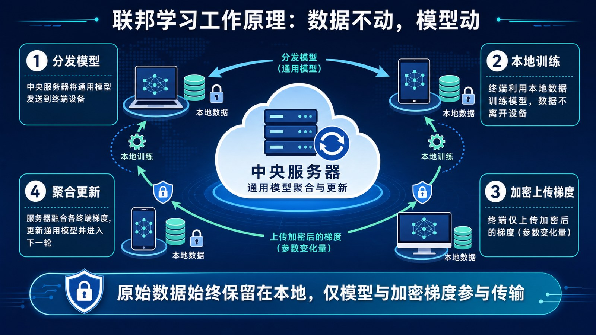

# 7.3 数据隐私与合规：数据层的风险 {#73}

!!! info "学前导读"

    AI 的燃料是数据，而数据常常涉及个人隐私。本节回答三个问题：大模型会不会“记住”并泄露我的信息？有没有办法既用数据、又不看到数据？法律在这方面有哪些规定？

    你每天都在把文字、照片、语音交给各种 AI 应用，这一节和你直接相关。

我们享受大模型带来的便利时，聊天记录、照片、消费偏好等信息，是否会被留存，甚至被用来训练模型？这不仅关系到个人权益，也关系到国家的数据安全。

## 7.3.1 记忆与遗忘：隐私的新挑战 {#731}

**1. 模型的“记忆”与数据提取攻击**

大模型有很强的“记忆力”。研究发现，如果某些敏感信息（如某人的电话、住址）在训练数据中多次出现，模型可能会把它原样“背”出来。2021 年，研究者就从 GPT-2 中成功提取出了训练数据里的姓名、电话、邮箱等个人信息。攻击者可以通过精心设计的提问，诱导模型吐出这些内容。

**2. 被遗忘权：一个技术难题**

我国《个人信息保护法》和欧盟《通用数据保护条例》（GDPR）都规定，在一定条件下，个人有权要求删除自己的个人信息。但这在 AI 时代遇到了难题：

- 一旦数据被用来训练模型，它的影响就“溶解”在了海量的参数里，就像盐溶进了水。在数据库里删除原始记录，并不能消除它对模型已经产生的影响。
- 最彻底的办法是去掉这条数据、重新训练模型，但大模型训练一次的成本动辄数千万元，经济上难以承受。

**3. 机器遗忘（Machine Unlearning）**

这是当前的研究热点：能不能让模型精准地“忘掉”某些数据，而不影响它的其他能力？

一种思路是从设计上做好准备（如 SISA 方法）：把训练数据分成很多份，每份单独训练一个小模型，最后把它们组合起来。某个用户要求删除数据时，只需重新训练他的数据所在的那个小模型，成本大大降低。目前这类方法在大模型上还远未成熟。

**4. 马赛克效应**

即使每一份数据单独看都已经“脱敏”，但把多个来源的数据拼在一起，仍可能认出具体的人。

例如：数据集 A 公布了“某位 30 岁程序员”的消费记录，数据集 B 显示“某小区里 30 岁的程序员只有张三一人”。把两份数据一对照，就锁定了张三的消费习惯。AI 强大的关联分析能力，让这种风险变得更大。

!!! tip "给你的隐私建议"
    - 不要把身份证号、银行卡号、病历、他人隐私等信息输入公共 AI 服务；
    - 查看常用 AI 应用的隐私设置，很多产品提供“不将我的对话用于改进模型”的选项（体验 7-2）；
    - 公司和学校的内部资料，使用前先了解单位的规定。

## 7.3.2 隐私计算：数据可用不可见 {#732}

为了解决“想用数据、又怕泄露隐私”的矛盾，出现了一类技术，统称为**隐私计算**。它的核心理念是：各方不交换原始数据，也能共同完成计算或训练模型。

**1. 联邦学习：数据不动，模型动**

传统的 AI 训练要把所有数据集中到中央服务器。联邦学习换了一种做法：

1. **分发**：服务器把一个通用模型发给各个参与方（如手机、医院）；
2. **本地训练**：各方用自己的数据在本地训练，数据不离开本地；
3. **上传更新**：只把模型的更新量（梯度或参数变化）加密后上传；
4. **聚合**：服务器把各方的更新合并，得到更好的全局模型，再发下去，进入下一轮。

**打个比方**：小组作业时，大家不把自己的书（原始数据）带到教室，而是各自在宿舍读完，只把读书笔记（模型更新）交给组长，组长汇总成最终报告（全局模型）。手机输入法预测你下一个要打的词，就常用联邦学习来改进。

需要注意的是，模型更新里也可能间接透露出一些原始数据的信息，所以联邦学习常常和下面的差分隐私、加密技术配合使用。

{ loading=lazy }

图 7-8 联邦学习工作原理：数据不动，模型动
{ .fig-caption }

**2. 差分隐私：用“噪声”做掩护**

差分隐私不是把数据藏起来，而是在统计结果里**加入恰到好处的随机噪声**：结果对整体统计仍然有用，但无法从中推断出任何一个人的信息。

**直观理解（随机应答法）**：老师想知道全班有多少人考试作弊，直接问，没人会承认。于是让每个人先偷偷抛一枚硬币：正面就如实回答；反面就再抛一次，正面答“是”，反面答“否”。这样，任何一个人回答“是”，都可能只是硬币的结果，老师无法知道他是否真的作弊；但全班的回答汇总起来，老师仍然能推算出作弊的大致比例。

差分隐私有一个关键参数叫“隐私预算”（ε）：ε 越小，加的噪声越大，隐私保护越强，但结果越不准。这是**隐私与可用性之间的权衡**。苹果、谷歌等公司已在收集用户使用统计时采用差分隐私，一些国家的人口普查数据发布也用到了它。

**3. 同态加密：对密文做计算**

同态加密允许直接对加密后的数据进行计算，解密后的结果与直接对原始数据计算的结果相同。这样，数据可以交给别人计算，而对方始终看不到明文。理论上非常理想，但目前计算开销很大，主要用于小规模、高价值的计算场景。

## 7.3.3 法律护栏：中欧 AI 监管对比 {#733}

技术之外，法律是另一道重要防线。全球主要经济体都在建立 AI 监管框架，“按风险高低分级管理”是一个普遍的思路。

表 7-2 中欧 AI 监管对比
{ .tab-caption }

| 比较维度 | 欧盟 | 中国 |
|---|---|---|
| 核心理念 | 基于风险的分级监管 | 发展与安全并重，包容审慎、分类分级监管 |
| 主要法规 | 《人工智能法案》（2024 年 8 月生效，分阶段实施：禁止性规定 2025 年 2 月起适用，通用模型的义务 2025 年 8 月起适用）；《通用数据保护条例》 | 《网络安全法》《数据安全法》《个人信息保护法》；《互联网信息服务算法推荐管理规定》《互联网信息服务深度合成管理规定》《生成式人工智能服务管理暂行办法》《人工智能生成合成内容标识办法》等；另有《人工智能安全治理框架》等指导性文件 |
| 禁止或严格限制的应用 | “不可接受风险”的 AI 被禁止，包括：社会评分；利用潜意识技术或利用弱势群体操纵人的行为；在工作场所和教育机构识别情绪；无差别抓取网络或监控视频中的人脸建库；按种族、政治观点等敏感特征进行生物识别分类；仅凭个人画像预测犯罪；执法机关在公共场所实时远程人脸识别（有严格例外） | 不得生成危害国家安全、损害社会公共利益、侵害他人合法权益的内容；不得利用算法实施“大数据杀熟”、诱导沉迷等；处理人脸等敏感个人信息要取得单独同意 |
| 高风险应用 | 招聘筛选、教育招生与考试、信贷评估、医疗器械、关键基础设施等，须进行合规评估、建立风险管理体系、保证人类监督 | 具有舆论属性或社会动员能力的算法和生成式服务，要按规定开展安全评估、履行算法备案；面向公众提供的生成式 AI 服务须完成备案后上线 |
| 通用大模型 | 对通用目的 AI 模型有专门规定；能力特别强、可能带来“系统性风险”的模型，要进行对抗测试、报告严重事件等 | 强调训练数据来源合法、提高生成内容的准确性和可靠性；按规定标识 AI 生成内容 |
| 用户权利 | 强调透明度：有权知道自己在和 AI 互动；受高风险 AI 决策影响时，有权获得解释 | 有权知情、查阅、更正、删除个人信息；对自动化决策有权要求说明，并有权拒绝仅通过自动化决策作出的重大决定 |

**合规启示**：欧盟《人工智能法案》对在欧盟市场提供 AI 服务、或 AI 输出在欧盟使用的企业都适用，即使公司注册在中国。准备“出海”的企业必须提前了解当地规则。

## 随堂小测

**1.** 在联邦学习中，参与方发送给中央服务器的是（　　）

- A. 用户的原始数据
- B. 加密后的模型更新（如梯度）
- C. 用户的身份证信息
- D. 用户的全部聊天记录

??? tip "答案与解析"
    **答案：B**

    解析：联邦学习“数据不动模型动”，原始数据留在本地，只上传模型的更新量。

    考查：联邦学习 · 认知层次：理解 · [回看 7.3.2](#732)
    { .quiz-meta }

**2.** 根据欧盟《人工智能法案》，下列哪种应用属于“不可接受风险”而被禁止？（　　）

- A. 辅助医生诊断的 AI 系统
- B. 自动驾驶汽车的视觉系统
- C. 对人进行社会评分的系统
- D. 电商平台的商品推荐

??? tip "答案与解析"
    **答案：C**

    解析：社会评分属于被禁止的应用；医疗诊断属于高风险应用，需严格合规但不被禁止。

    考查：欧盟《人工智能法案》 · 认知层次：记忆 · [回看 7.3.3](#733)
    { .quiz-meta }
