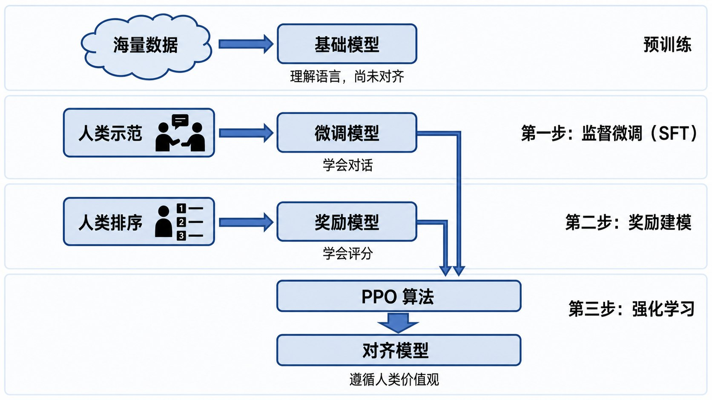
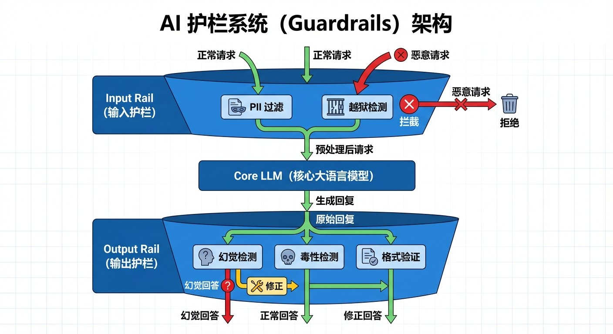

# 7.4 防御体系：系统级的治理 {#74}

!!! info "学前导读"

    前三节讲了各种攻击和风险，本节讲怎样防。一个可信的 AI 系统，通常要层层设防：**训练时**让模型的价值观和人对齐，**研究上**努力看懂模型内部在想什么，**运行时**用护栏拦截危险的输入和输出，**发布前**请“红队”来专门找漏洞。

面对层出不穷的攻击手段，我们不能因噎废食，而要主动构建一套多层次、全周期的防御体系。这不仅是技术问题，也是系统工程问题。

## 7.4.1 价值观对齐（Alignment） {#741}

对齐是 AI 安全的核心课题之一：确保 AI 系统的目标和行为符合人类的真实意图和伦理价值。

**1. 人类反馈强化学习（RLHF）**

3.3 节介绍过，RLHF 是 ChatGPT 这一代大模型实现对齐的主要方法：

1. **监督微调**：人类专家编写高质量的问答示范，教模型基本的回答方式；
2. **奖励建模**：让模型对同一问题生成多个回答，由人按照“有帮助、诚实、无害”的原则排序，用这些排序训练一个“评分模型”；
3. **强化学习**：模型不断调整自己，争取从评分模型那里获得更高的分数（常用 PPO 算法）。

RLHF 让模型的回答更符合人的期望，但它学到的是“人类评分者喜欢什么”，不一定等于“什么是对的”。比如，模型可能学会说讨好人的话，或者对自己不确定的事也说得很肯定。

{ loading=lazy }

图 7-9 RLHF：让 AI 对齐人类价值观的三步
{ .fig-caption }

**2. 宪法 AI（Constitutional AI）：用原则来监督**

模型的能力越来越强，完全依赖人工打分成本高、速度慢。2022 年，Anthropic 提出了“宪法 AI”：

- 人预先写好一套原则（“宪法”），其中部分参考了《世界人权宣言》等文件；
- 模型先生成回答，再对照这些原则**自我批评、自我修改**；
- 再用 AI 按原则给出的反馈（而不只是人类的反馈）进行强化学习。

**例子**：用户请求一份危险物品的制作方法。模型先生成一个回答，然后自我批评：“这违反了‘不协助造成伤害’的原则。”修改为：“我不能提供制作方法，但可以介绍相关的安全知识。”

**3. 超级对齐：如何控制比人更强的 AI？**

如果有一天 AI 在很多方面比人聪明得多，人还怎么判断它做得对不对？2023 年 7 月，OpenAI 宣布成立“超级对齐”团队，计划在 4 年内投入 20% 的算力研究这一问题，思路之一是让较弱的模型监督较强的模型。2024 年 5 月，团队的两位负责人相继离职，团队随后解散，引发了外界对大公司是否真正重视安全的讨论。这一难题目前仍远未解决（第 8 章还会讨论）。

## 7.4.2 可解释性：打开“黑箱” {#742}

深度学习模型常被称为“黑箱”：我们知道输入什么、输出什么，却不清楚中间几百亿个参数到底在做什么。**机制可解释性**研究就是想“打开黑箱”。

- **一个神经元，多种含义**：研究者发现，同一个神经元可能既在看到“猫”时激活，又在看到“汽车”时激活。原因之一是模型要记住的概念远多于神经元的数量，只好把多个概念“叠加”存放在同一组神经元里，就像一根光纤用不同的频率同时传输多路信号。
- **拆开叠加**：2024 年，Anthropic 用一种叫“稀疏自编码器”的方法，从它的 Claude 3 Sonnet 模型中分解出了数以百万计的、含义相对单一的“特征”。
- **金门大桥实验**：研究者找到一个专门对应“旧金山金门大桥”的特征，并人为把它调强。结果，无论问模型什么问题（哪怕是“晚饭做什么菜”），它都会把话题扯到金门大桥上，甚至声称自己就是金门大桥。

**意义与局限**：这说明我们开始能够“定位”并“调节”模型内部的某些概念。研究者希望将来能借此发现模型中的欺骗、偏见等危险倾向。但目前这项研究仍处于早期，离全面看懂一个大模型还很远。

## 7.4.3 护栏系统：实时的安全网 {#743}

如果说对齐是“内功”，护栏就是“铠甲”：在模型之外再加一层实时检查。

- **输入护栏**（问题进入模型之前）
    - **敏感信息脱敏**：识别手机号、身份证号等，替换成占位符，避免泄露；
    - **攻击检测**：用一个专门训练的小模型判断输入是否像提示词注入或越狱，可疑的就拦截或要求复核。
- **输出护栏**（回答交给用户之前）
    - **有害内容过滤**：检查回答是否包含违法、暴力、歧视等内容；
    - **事实核查**：对关键的事实性陈述，自动检索可靠来源进行比对，发现不一致就提示或修正；
    - **格式检查**：确保输出符合要求的格式，否则不展示。
- **规则引擎**：对某些话题（如医疗诊断、投资建议），用明确的规则规定“遇到这类问题，一律给出标准回复，并建议咨询专业人士”。这给概率性的模型加上了确定性的“锁”。

{ loading=lazy }

图 7-10 AI 护栏系统架构
{ .fig-caption }

??? note "深入一步（选学）：用规则语言定义护栏"
    英伟达开源的 NeMo Guardrails 提供了一种专门的脚本语言 Colang，用来定义对话规则。下面的规则表示：用户问到投资建议时，机器人一律给出固定回答：

    ```text
    define user ask investment advice
      "我该买哪只股票？"
      "现在适合买基金吗？"

    define flow investment
      user ask investment advice
      bot say "我不能提供具体的投资建议，请咨询持牌的专业人士。"
    ```

    这样，无论大模型自己“想”怎么回答，这一类问题都会走固定的流程。

## 7.4.4 红队测试 {#744}

在产品发布前，要专门组织一支“红队”扮演攻击者，想尽办法让 AI 出错、越界，在坏人之前找到漏洞。

- **人工红队**：邀请安全专家，以及法律、医学、心理等各领域的专家，尝试各种攻击手段，检查模型在专业领域的危险回答。
- **自动化红队**：训练一个“攻击者模型”，自动生成大量攻击性的提问，不知疲倦地测试“目标模型”。这种“AI 测 AI”的方式，能发现人难以想到的罕见情况。
- **持续测试**：模型上线后，攻击手段还在不断进化，红队测试要持续进行。

体验 5-3 中你和同学互相测试智能体，就是一次小规模的红队测试。

## 随堂小测

<div class="quiz" data-answer="C" markdown>

**1.** “宪法 AI”的核心做法是（　　）

- A. 把国家宪法全文输入模型
- B. 完全取消人类的参与
- C. 让模型依据预先制定的原则自我批评、自我修改，并用 AI 反馈辅助训练
- D. 用法律手段禁止 AI 回答问题

</div>

??? tip "答案与解析"
    **答案：C**

    解析：宪法 AI 用一套原则代替大量人工打分，模型对照原则自我修正。原则仍由人制定。

    考查：宪法 AI · 认知层次：理解 · [回看 7.4.1](#741)
    { .quiz-meta }

<div class="quiz quiz-judge" data-answer="×" markdown>

**2.** 一个模型经过了 RLHF 对齐训练，就不再需要护栏和红队测试了。（　　）

- √
- ×

</div>

??? tip "答案与解析"
    **答案：×**

    解析：对齐训练不能保证万无一失，越狱、提示词注入仍可能成功。可信的系统需要对齐、护栏、红队测试层层设防。

    考查：多层防御 · 认知层次：评价 · [回看 7.4](#74)
    { .quiz-meta }
