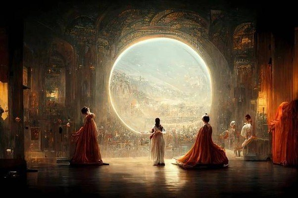
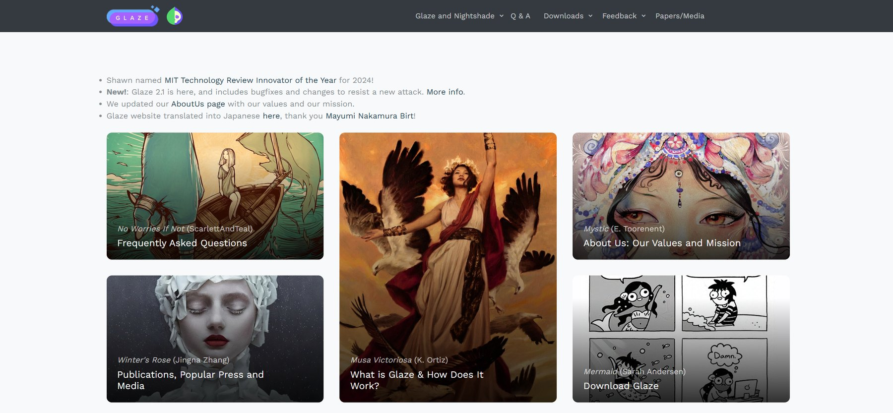

# 8.1 版权之争：谁是缪斯，谁是小偷？ {#81}

!!! info "学前导读"

    4.7 节已经简单介绍了 AI 生成内容的版权和肖像、声音权益。本节把版权问题拆成两头来看：**输入端**，AI 拿别人的作品去训练算不算侵权？**输出端**，AI 生成的东西有没有版权、归谁？

    学完本节，你在用 AI 画图、写文案、做视频时，会更清楚哪些事可以放心做，哪些事要先想一想。

生成式 AI 的爆发，引发了一场关于创作和版权的大讨论。争论的焦点有两个：一是**输入端**，用人类作品训练 AI 是否需要授权；二是**输出端**，AI 生成的作品能不能受版权保护。

## 8.1.1 两个世界的碰撞：训练数据之争 {#811}

文生图模型的能力来自海量数据的训练。以开源数据集 LAION-5B 为例，它包含约 58.5 亿对“图像—文字说明”的网址链接，很多早期的开源文生图模型都用它训练过。

- **艺术家的不满**：这些数据里有无数创作者的作品，但收集时并没有取得授权，也没有支付报酬。
- **AI 公司的辩护**：模型并没有把原图“存”下来再拼贴，而是从大量图片中学习统计规律，就像人学画画也要临摹大量作品。在美国，它们主张这属于“合理使用”（Fair Use）。

这场争论已经走进了法庭，各地的判决并不一致：

- **美国**：2025 年，有法官认为用合法购买的书训练模型属于合理使用，但从盗版网站下载书籍另当别论，Anthropic 随后与作者达成约 15 亿美元的和解；也有法官在另一起案件中认为，竞争对手用法律数据库的内容训练同类产品，不属于合理使用。
- **欧盟**：允许为文本与数据挖掘复制作品，但权利人可以用机器可读的方式声明“不许用”；《人工智能法案》还要求通用模型的提供者公布训练内容的摘要、制定版权政策。2025 年 11 月，德国慕尼黑法院在一起案件中认定，模型“记住”并能复现歌词，构成侵权。
- **中国**：2024 年，广州互联网法院在“奥特曼”案中认定，一家 AI 绘画网站生成与奥特曼形象实质性相似的图片，侵犯了著作权，网站应当采取措施防止继续生成。这是全球较早的一起判定生成式 AI 服务提供者承担侵权责任的案件。

**数据怎么用：“选择退出”还是“选择加入”？**

- **选择退出（Opt-out）**：默认可以抓取，不愿意的权利人要主动声明退出。这是目前很多 AI 公司的做法，被批评“大多数人根本不知道自己的作品被抓取了”。
- **选择加入（Opt-in）**：默认不能用，只有明确授权的作品才进入训练数据。一些公司开始走这条路，例如 Adobe 称其 Firefly 模型主要用自家图库中获得授权的图片和公有领域内容训练（企业公布）。这种做法更尊重创作者，但成本更高。

## 8.1.2 案例精讲：AI 文生图著作权案 {#812}

!!! example "案例 8-1 北京互联网法院“AI 文生图”著作权案（2023）"

    **起因**：2023 年 2 月，李某用开源的 Stable Diffusion 模型，通过输入提示词、调整参数，生成了一张人物图片，取名《春风送来了温柔》，发布在小红书上。后来，刘某在自己发布的文章中使用了这张图，并去掉了李某的署名水印。李某起诉，要求刘某赔礼道歉、赔偿 5000 元。

    **争议**：被告认为，图是 AI 生成的，原告只是输入了一些词，不能算作者。原告认为，自己设计了大量提示词、反复调整参数、从生成结果中挑选，就像摄影师按下快门前要构思、选角度一样。

    **判决**：2023 年 11 月，北京互联网法院认定涉案图片构成美术作品，李某享有著作权，判决刘某公开赔礼道歉，赔偿 500 元。

    **法院的思路**：从构思画面到最终选定图片，原告进行了一定的**智力投入**，比如设计人物的呈现方式、选择提示词、安排提示词的顺序、设置参数、选定符合预期的图片，这些体现了原告的选择和安排；在不断调整、修正的过程中，也体现了原告的审美选择和个性判断。因此，这张图体现了人的独创性智力投入。

**这个判决不等于“AI 生成的东西都有版权”**。关键在于人有没有独创性的投入，而且要拿得出证据。2025 年公开的另一起案件中，原告主张一张 AI 生成的图片是自己的作品，但拿不出原始提示词、生成过程等记录，在诉讼中用同一软件“复现”也做不出相同的图。法院认定证据不足以证明这张图有独创性，不构成作品，驳回了他的请求。

!!! tip "给创作者的建议"
    如果你用 AI 创作，并且希望将来能主张权利：保存提示词、参数、各版草稿和修改记录；在 AI 生成的基础上做足够多的人工修改；发布时按规定标注“AI 生成”。

## 8.1.3 各国怎样看 AI 生成物的版权 {#813}

表 8-1 主要国家和地区对 AI 生成物版权的态度
{ .tab-caption }

| 国家 / 地区 | 基本态度 | 代表性案例或文件 | 核心逻辑 |
|---|---|---|---|
| 中国 | 个案认定 | 北京互联网法院“AI 文生图”案（2023） | 看人在生成过程中有没有独创性的智力投入，并要有证据证明 |
| 美国 | 坚持“人类作者” | 《太空歌剧院》登记被拒（2023）；Thaler 案上诉判决（2025）；美国版权局报告（2025） | 只有人的创作才受保护。仅仅输入提示词通常不够；人对 AI 生成内容做的选择、编排和修改部分可以受保护 |
| 欧盟 | 沿用“作者自己的智力创作”标准 | 欧盟法院以往的判例；《人工智能法案》的透明度要求 | 对 AI 生成物没有专门规定，各成员国个案处理；更多关注训练数据的版权合规 |

2022 年，美国一位游戏设计师用 Midjourney 生成、再经过后期修改的《太空歌剧院》在一次州博览会的数字艺术比赛中获奖，引发争议。他申请版权登记时，美国版权局认为图中由 AI 生成的部分不能登记，只有人工修改的部分才可能受保护，并要求他声明排除 AI 生成部分；他拒绝后，登记申请被驳回。

{ loading=lazy }

图 8-1 在美国被拒绝版权登记的《太空歌剧院》
{ .fig-caption }

## 8.1.4 思想与表达：AI 模仿画风违法吗？ {#814}

版权法里有一条基本原则：**版权只保护“表达”，不保护“思想”**。

- **思想**：“画一个忧郁的少女”“用梵高那样的画风”“表现赛博朋克的感觉”，这些创意、风格、手法属于思想，是人类共享的财富，谁都可以用。
- **表达**：梵高画的那一幅具体的《星月夜》，那些具体的笔触、色彩和构图，属于表达，受著作权保护（梵高的作品早已过了保护期，这里只是举例）。

**AI 带来的新问题**：用 LoRA 等微调技术（见 3.3.4 节），模仿某位画家的风格变得非常便宜。在法律上，单纯模仿风格通常不构成侵权；但如果生成的图和某幅具体作品“实质性相似”，就可能侵权。而在伦理上，一位画家花了二十年形成的风格，被别人用 AI 一夜之间批量生成、低价出售，即使合法，也很难说是公平的。

所以，**合法不等于合乎伦理**。使用 AI 时，除了问“法律允许吗”，还要问“这样做对创作者公平吗”。

## 8.1.5 艺术家的“数字防身术” {#815}

面对 AI 的模仿，一些艺术家开始用技术保护自己。美国芝加哥大学的研究团队开发了两款免费工具：

**1. Glaze：给作品穿上“隐身衣”**

- **原理**：在画作上加一层人眼几乎看不出来的细微扰动（和 7.2.2 节的对抗样本是同一类思路）。人看到的还是原来的画，但 AI 在学习风格时会被误导，学到的是另一种风格。
- **用途**：防止别人用你的作品训练模仿你画风的模型。

{ loading=lazy }

图 8-2 Glaze 项目官网
{ .fig-caption }

**2. Nightshade：主动“投毒”**

- **原理**：不仅扰乱风格，还扰乱“含义”。比如让一张狗的图片在 AI 眼里更像猫。
- **效果**：研究者的实验显示，如果一个模型在训练时吃进足够多这样的“毒图”，它对相应概念的理解就会出错，比如让它画狗，却画出猫。这样就提高了未经授权抓取作品的成本，促使 AI 公司去获取授权。

**局限**：这类工具并非万无一失。已有研究者发现，一些简单的图片处理方法就能削弱它们的保护效果；而且它们只能保护今后发布的作品，已经被抓取的作品无能为力。技术自卫只是补充，根本上还要靠法律和行业规则。

## 随堂小测

**1.** 在北京互联网法院的“AI 文生图”著作权案中，法院认定涉案图片构成作品的关键理由是（　　）

- A. 图片是用最先进的 AI 模型生成的
- B. 图片的艺术水平很高
- C. 原告在设计提示词、调整参数、挑选结果等过程中进行了独创性的智力投入
- D. AI 公司在用户协议中把权利让给了用户

??? tip "答案与解析"
    **答案：C**

    解析：法院看的是人有没有独创性的智力投入，而不是工具多先进、画得多好看。拿不出创作过程证据的，也可能不被认定为作品。

    考查：AI 生成物的版权 · 认知层次：理解 · [回看 8.1.2](#812)
    { .quiz-meta }

**2.** 用 AI 模仿某位画家的画风生成作品，在法律上一定构成侵权。（　　）

- √
- ×

??? tip "答案与解析"
    **答案：×**

    解析：版权保护表达、不保护思想，单纯模仿风格通常不构成侵权；但如果和具体作品实质性相似就可能侵权。另外，合法不等于合乎伦理。

    考查：思想与表达二分法 · 认知层次：理解 · [回看 8.1.4](#814)
    { .quiz-meta }
