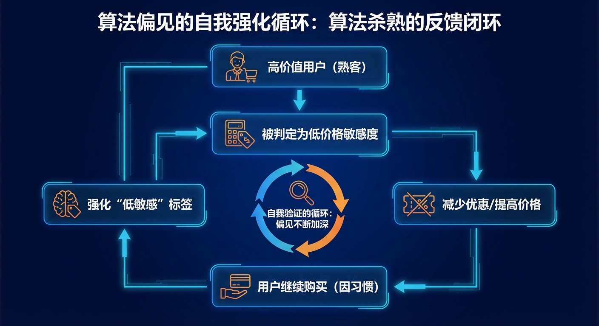
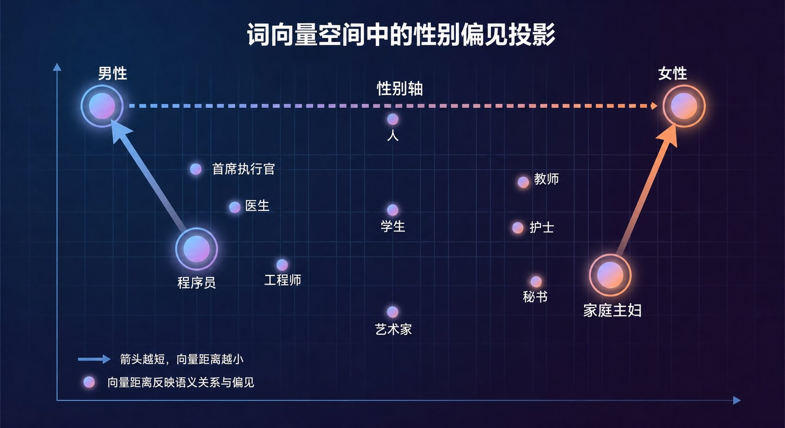
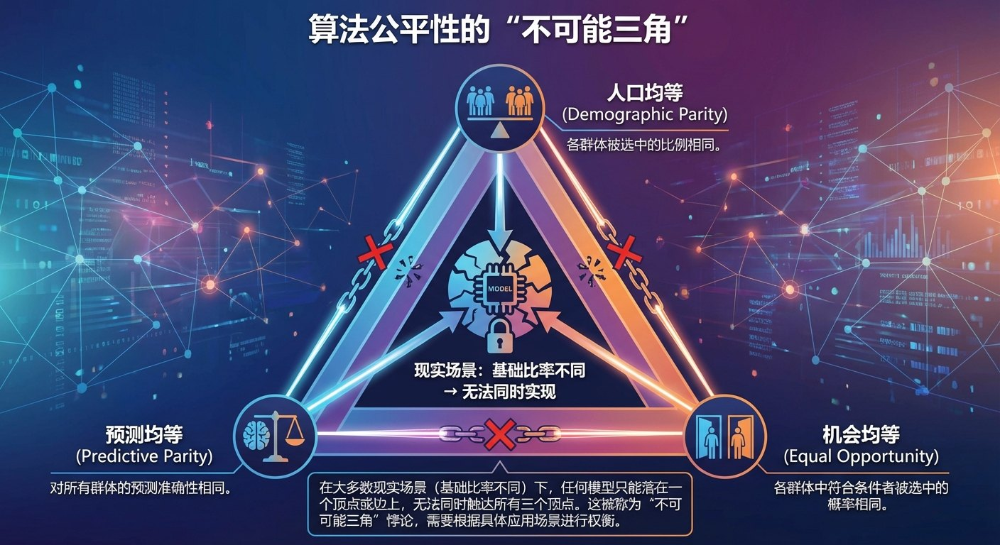

# 8.2 偏见与公平：算法的“有色眼镜” {#82}

!!! info "学前导读"

    我们常以为算法是理性、客观的。但算法从人类的数据中学习，也会学到人类社会的偏见，甚至把它放大；对商业利益的追求，还可能让算法对不同的人区别对待。

    本节先看算法怎样影响我们的日常消费和信息获取，再分析偏见从哪里来，最后讨论一个难题：到底什么才算“公平”？

## 8.2.1 隐形的价格标签：被算法“区别对待”的一天 {#821}

!!! example "情景模拟：同一天，两个人"

    小王，28 岁，程序员，用最新款的苹果手机，很少用优惠券；小李，22 岁，大学生，用千元安卓机，对价格很敏感。

    - **上午，点奶茶**：小王常点这家店，很少用券，系统判断他“对价格不敏感”，没有给优惠；小李一周没打开 App，被系统判定为“快要流失的用户”，收到了新人红包和回归礼包。同一杯奶茶，小王付的钱是小李的两倍多。
    - **下午，打车**：两人去同一个地方。系统根据手机型号、过往是否经常“赶时间加价”，预测小王愿意付更多的钱，给他的预估价更高。
    - **晚上，刷视频**：推荐系统发现小王对“职场焦虑”类视频停留时间长，就不断推送这类内容。小王越看越焦虑，越焦虑越看。

    这个故事是为了说明原理而编写的，其中的价格和规则都是假设。但类似的现象确实引起过关注：2021 年，复旦大学的一个研究团队在几座城市实地打车调研后发布报告，称在部分平台上，使用苹果手机的乘客更容易被派到价格较高的车型。

**“大数据杀熟”的原理**：平台用你的消费记录、设备型号、所在位置等信息给你画像，预测你“愿意付多少钱”，再对不同的人给出不同的价格或优惠。

**法律的红线**：

- 《个人信息保护法》规定，利用个人信息进行自动化决策，不得对个人在交易价格等交易条件上实行不合理的差别待遇（见 6.4.1 节）。
- 《互联网信息服务算法推荐管理规定》规定，不得根据消费者的偏好、交易习惯等特征，利用算法在交易价格等交易条件上实施不合理的差别待遇；还要求平台向用户提供不针对其个人特征的选项，或者便捷地关闭算法推荐服务的选项。

**信息茧房**：晚上那一幕，说的是推荐算法的另一个副作用。系统只推你爱看的，你就只看到这一类，久而久之，看到的世界越来越窄。

**动手看看 · 信息茧房是怎样形成的**

<iframe class="sim-frame" src="../../sims/filter-bubble/main.html" height="900" loading="lazy" title="信息茧房模拟"></iframe>

先选一类你最爱看的内容，点“模拟一个用户”，看推荐的种类怎样越来越少；再试试调大探索比例、点“不感兴趣”、关闭个性化推荐，比较哪种办法最能打破茧房。[全屏打开](../../sims/filter-bubble/main.html){ target=_blank } · [教学说明](../../sims/filter-bubble/index.md)
{ .sim-caption }

{ loading=lazy }

图 8-3 算法偏见的自我强化循环：“杀熟”的反馈闭环
{ .fig-caption }

## 8.2.2 偏见从哪里来 {#822}

偏见并不是计算机凭空产生的“故障”，而往往是它从我们的数据和社会中学来的。主要有三个来源。

**1. 代表性偏差：样本不全面**

如果训练数据只覆盖了一部分人，AI 对其他人就容易“看不准”。

- 2017 年的一项研究统计发现，ImageNet 数据集中约 45% 的图片来自美国，而来自中国和印度的图片加起来只占约 3%。
- 2018 年的“性别色调”研究测试了几家公司的人脸性别识别系统，发现它们对浅肤色男性的错误率不到 1%，对深肤色女性的错误率却高达 20% 到 35%。主要原因之一，就是训练数据中深肤色女性的照片太少。

**2. 历史偏见：现实本身就不公平**

即使样本很全面，如果历史数据本身记录的就是不公平的现实，AI 也会照单全收。

- 1.4 节讲过，词向量里有“国王 − 男人 + 女人 ≈ 女王”这样的规律。2016 年的研究发现，同样的方法也会算出“男人之于程序员，相当于女人之于家庭主妇”。这不是算法“想”歧视谁，而是它从大量文本中学到了社会上的性别刻板印象。
- 2023 年，有媒体用一个开源文生图模型生成了数千张不同职业的人物图片，发现“首席执行官”“律师”等高薪职业的图片大多是浅肤色男性，而一些低薪职业的图片则更多是深肤色人群和女性，偏差比现实中的职业统计数据还要大。

{ loading=lazy }

图 8-4 词向量空间中的性别偏见投影（示意）
{ .fig-caption }

**3. 代理变量：删了“性别”一栏也没用**

你可以在训练数据里删掉“性别”“民族”这些敏感特征，但 AI 仍然可能歧视某个群体。为什么？因为“毕业院校”“居住地区”“兴趣爱好”“购物记录”等其他特征可能和敏感特征高度相关。AI 会通过这些“代理变量”（Proxy Variable）间接地把被删掉的信息“找回来”，形成隐蔽的歧视。

!!! example "案例 8-2 被叫停的招聘 AI"

    据路透社 2018 年报道，亚马逊曾开发一个简历筛选 AI，用过去十年的简历和录用结果训练。由于过去录用的技术人员大多是男性，这个 AI 学会了给含有“女子”一词的简历（如“女子国际象棋俱乐部队长”）降分。开发者尝试修正，但无法保证它不会找到别的方式区别对待，这个项目最终被放弃。

8.6.1 节会用一个交互动画，让你亲手审计一个“删掉了性别列”的招聘模型。

## 8.2.3 打开黑箱：可解释性与知情权 {#823}

很多 AI 模型是“黑箱”：参数动辄数十亿，连开发者也很难说清它为什么作出某个决定。当 AI 拒绝了你的贷款申请，你有权知道为什么吗？

我国《个人信息保护法》规定，通过自动化决策方式作出对个人权益有重大影响的决定，个人有权要求说明，并有权拒绝仅通过自动化决策的方式作出决定。可解释性 AI（Explainable AI，XAI）就是为了回答“为什么”：

- **特征重要性**：告诉用户主要是哪些因素起了作用，比如“主要因为负债比例太高”。
- **反事实解释**：告诉用户“如果怎样，结果就会不同”，比如“如果你的负债减少 2 万元，申请就能通过”。这种解释对用户更有帮助，因为它指出了改进的方向。

7.4.2 节介绍的机制可解释性研究，则是从模型内部入手，试图看懂大模型“在想什么”。

## 8.2.4 什么才算公平？ {#824}

“公平”听起来简单，真要写成算法的规则，却有好几种不同的理解。以一家公司招聘为例：

- **结果相同（人口均等）**：男女应聘者的录用比例应该一样。
- **机会相同（机会均等）**：真正有能力的人，无论男女，被录用的概率应该一样。
- **评分可信（校准）**：系统给出“80% 能胜任”的评分时，无论对男性还是女性，这句话都应该同样可信。

这几种说法听起来都合理，但它们往往**不能同时满足**。2016 年，美国康奈尔大学等机构的研究者从数学上证明：只要不同群体的“基础比例”不同（比如两个群体中真正符合条件的人所占比例不同），除了极端情况，一个评分系统就不可能同时做到“评分可信”和“各群体的错判率相同”。8.5.4 节的 COMPAS 案例，就是这个矛盾在现实中的体现。

{ loading=lazy }

图 8-5 算法公平性的“不可能三角”（示意）
{ .fig-caption }

这意味着：**选择哪一种“公平”，不是一个纯技术问题，而是一个价值选择。**它应该由受影响的人、专业人士和社会共同讨论决定，而不是只交给工程师。

??? note "深入一步（选学）：公平的数学定义"
    设 $A$ 表示群体（如 $A=0$ 为女性，$A=1$ 为男性），$Y$ 表示真实情况（$Y=1$ 为真正合格），$\hat{Y}$ 表示模型的判断（$\hat{Y}=1$ 为录用），$S$ 表示模型打出的分数。

    - **人口均等**（Demographic Parity）：$P(\hat{Y}=1 \mid A=0) = P(\hat{Y}=1 \mid A=1)$，两个群体的录用率相同。
    - **机会均等**（Equal Opportunity）：$P(\hat{Y}=1 \mid Y=1, A=0) = P(\hat{Y}=1 \mid Y=1, A=1)$，真正合格的人被录用的概率相同，也就是两个群体的“真阳性率”相同。
    - **校准**（Calibration）：$P(Y=1 \mid S=s, A=0) = P(Y=1 \mid S=s, A=1)$，同样的分数，在两个群体中代表同样的真实合格概率。

    Kleinberg 等人（2016）和 Chouldechova（2017）证明：当两个群体的基础比例 $P(Y=1 \mid A)$ 不同时，除非模型的预测完美无误，否则校准和“两个群体的假阳性率、假阴性率都相同”无法同时成立。

## 随堂小测

**1.** 一家公司的招聘 AI 在训练时删掉了“性别”一栏，但审计发现它对女性应聘者的录用率仍然明显偏低。最可能的原因是（　　）

- A. 计算机硬件出了故障
- B. 模型通过与性别相关的其他特征（代理变量）间接区别对待了女性
- C. 女性应聘者的简历格式不规范
- D. 删除性别一栏的操作没有成功

??? tip "答案与解析"
    **答案：B**

    解析：毕业院校、兴趣爱好等特征可能与性别相关，模型会通过这些代理变量把被删除的信息“找回来”。只删敏感特征并不能保证公平，还要对结果进行审计。

    考查：代理变量 · 认知层次：应用 · [回看 8.2.2](#822)
    { .quiz-meta }

**2.** 只要技术足够先进，就能设计出同时满足所有公平定义的算法。（　　）

- √
- ×

??? tip "答案与解析"
    **答案：×**

    解析：研究证明，当不同群体的基础比例不同时，几种常见的公平标准一般不能同时满足。选择哪种公平是价值选择，需要社会共同讨论。

    考查：算法公平性 · 认知层次：理解 · [回看 8.2.4](#824)
    { .quiz-meta }
