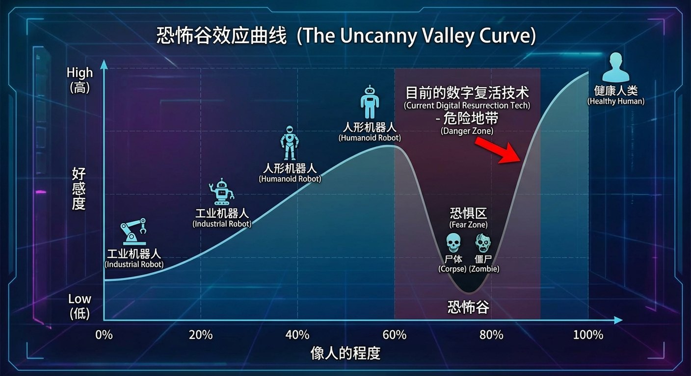
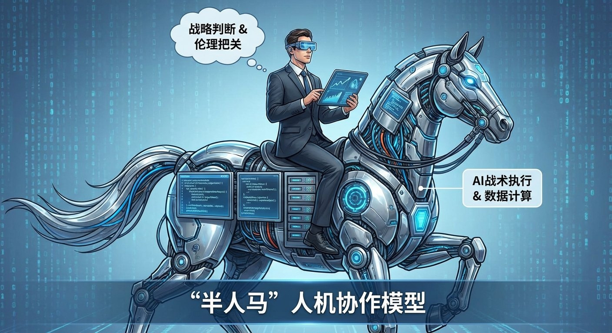

# 8.3 人机关系：是工具，是伙伴，还是替代者？ {#83}

!!! info "学前导读"

    AI 不再只是冷冰冰的工具，它开始走进我们的工作和情感：能陪人聊天，能“复活”逝去的亲人，也在改变很多职业。

    本节从一场关于“数字复活”的讨论开始，看看人和 AI 的关系应该有怎样的边界；再看在工作中，人怎样和 AI 一起做得更好。

## 8.3.1 课堂辩论：该不该“复活”逝者？ {#831}

!!! example "情景模拟：一场电视讨论节目"

    2023 年，歌手李玟去世后，网上出现了一些用 AI 合成她的形象和声音的视频，有人感动，也有人反对。假设一档电视节目请来三位嘉宾讨论这件事（嘉宾和对话均为虚构）。

    **歌迷**：我看到视频就哭了。她走得太突然，我们连好好告别的机会都没有。这是一种精神寄托，为什么不可以？

    **律师**：我理解大家的感情，但这里有两个问题。第一，《民法典》规定，死者的姓名、肖像、名誉、隐私等受到侵害的，其配偶、子女、父母有权依法请求行为人承担民事责任；声音也参照肖像权受到保护。第二，知情同意。她生前没有授权过，家属也没有同意，这样做可能侵犯逝者的人格利益，也会伤害家属的感情。

    **AI 创业者**：技术让人有机会再听听亲人的声音。如果是你的亲人去世了，有这样的机会，你会拒绝吗？

    **律师**：如果人人都能“复活”她，网上可能出现成千上万个“她”，有的在带货，有的在骗钱，谁来维护她的尊严？

    **歌迷**：（沉默）……如果她被拿去卖货，我肯定不答应。

**真实的争议**：2024 年，已故艺人乔任梁的父亲公开表示，网上有人未经同意用 AI “复活”儿子并发布视频，要求删除。这说明，**是否经过家属授权、用于私人纪念还是公开传播和牟利**，是判断这类做法是否正当的关键。

此外，《互联网信息服务深度合成管理规定》要求，提供人脸、人声等生物识别信息编辑功能的，应当提示使用者依法告知被编辑的个人，并取得其单独同意；2025 年起施行的标识办法还要求对这类内容加标识（见 4.7 节）。

## 8.3.2 “数字永生”的心理代价 {#832}

**1. 恐怖谷效应**

1970 年，日本机器人专家森政弘提出：机器人越像人，人对它的好感就越高；但当它“非常像人、又不完全像”时，好感会突然跌入谷底，让人觉得诡异甚至恐惧；只有做到和真人几乎没有区别，好感才会重新上升。这条曲线中间的低谷，就叫“恐怖谷”。

{ loading=lazy }

图 8-6 恐怖谷效应曲线（示意）
{ .fig-caption }

为什么会这样？研究者提出过多种解释，比如“似人非人”的形象会让人联想到疾病和死亡，或者让大脑难以判断“这到底是不是人”。这些解释还在争论之中。粗糙的“数字复活”视频常常让人感到不适，可能就与此有关。

**2. 走不出的哀伤**

心理学家注意到，失去亲人后，人需要经历一段哀伤的过程，最终接受现实、重新开始生活。有人担心，如果一个 AI 能一直模仿逝者和自己聊天，有些人可能会长期停留在“他还在”的感觉里，难以走出哀伤。也有人认为，在专业人员的引导下，适度使用这类技术可以帮助人完成告别。目前这方面的研究还很少，需要谨慎对待。

**3. “永远顺从”的陪伴**

AI 陪伴应用永远秒回、永远温柔、从不拒绝。如果一个人习惯了和这样的“伙伴”相处，会不会越来越难以应对真实的人际关系？毕竟，真实的人会发脾气、会拒绝、会离开。对于未成年人和孤独的老人，这个问题尤其值得关注：好的陪伴产品，应该鼓励人走向真实的社交，而不是取代它。

## 8.3.3 职业的未来：“半人马”模式 {#833}

AI 会不会夺走我们的工作？国际象棋的故事给了一个有意思的答案。

1997 年，国际象棋世界冠军卡斯帕罗夫输给了 IBM 的“深蓝”。但他并没有从此拒绝机器，而是在 1998 年提出了“高级国际象棋”：人和电脑组成一队，一起下棋。

2005 年，一个国际象棋网站举办了一场“自由式”比赛，允许任何形式的人机组队。参赛者中既有特级大师，也有强大的超级计算机，最终的冠军却是两位业余棋手，他们用几台普通电脑，靠一套很好的协作方法取胜。卡斯帕罗夫后来总结说：**普通的人 + 机器 + 更好的协作流程，可以胜过强大的机器，也胜过强大的人 + 机器 + 较差的流程。**

这种人机协作的模式被称为“半人马”（Centaur）：人负责判断方向、提出问题、把关伦理，机器负责计算、检索和执行。

{ loading=lazy }

图 8-7 “半人马”人机协作模型
{ .fig-caption }

需要说明的是，在国际象棋上，今天最强的下棋程序已经远远超过人类，“人 + 机器”的组合也不再有优势。但在大多数真实工作中，任务的目标往往模糊、情况千变万化、结果需要有人负责，人机协作仍然是主流。

**行业冲击：以游戏美术为例**

2023 年以来，有媒体报道，国内一些游戏公司开始用文生图工具生成草图和素材，一部分负责基础绘制的美术岗位减少了。与此同时，能提出创意、把握整体风格、会用 AI 工具并能对结果精修把关的美术人员，变得更加抢手。

- **更容易被替代的**：只会重复性技法、缺少审美判断和创意的工作；
- **更有价值的**：懂行业、有审美和判断力、会和 AI 协作的人。

所以，面对 AI，与其担心“会不会被替代”，不如思考“怎样成为那个会用 AI 的人”。第 6 章的“AI+X 架构师”讲的正是这件事。

## 随堂小测

**1.** 网友未经家属同意，用 AI 合成某位已故艺人的形象和声音发布带货视频。下面说法正确的是（　　）

- A. 艺人已经去世，不存在任何法律问题
- B. 只要视频做得逼真，就可以发布
- C. 可能侵犯逝者的肖像、声音等人格利益，其近亲属可以依法主张权利
- D. 只要不收费，就不需要任何人同意

??? tip "答案与解析"
    **答案：C**

    解析：《民法典》保护死者的姓名、肖像、名誉、隐私等，其配偶、子女、父母有权依法请求行为人承担责任；声音参照肖像权保护。用于带货牟利，问题更加严重。

    考查：数字复活的法律边界 · 认知层次：应用 · [回看 8.3.1](#831)
    { .quiz-meta }

**2.** “半人马”模式给职场人的主要启示是（　　）

- A. 尽量远离 AI，保住自己的手艺
- B. 发挥人在判断、创意和把关上的长处，与 AI 协作，并且建立好的协作流程
- C. 把所有工作都交给 AI
- D. 只有编程高手才能和 AI 协作

??? tip "答案与解析"
    **答案：B**

    解析：2005 年自由式比赛的冠军是用普通电脑、靠好的协作流程取胜的业余棋手。关键不在于人多强或机器多强，而在于怎样协作。

    考查：半人马模式 · 认知层次：理解 · [回看 8.3.3](#833)
    { .quiz-meta }
