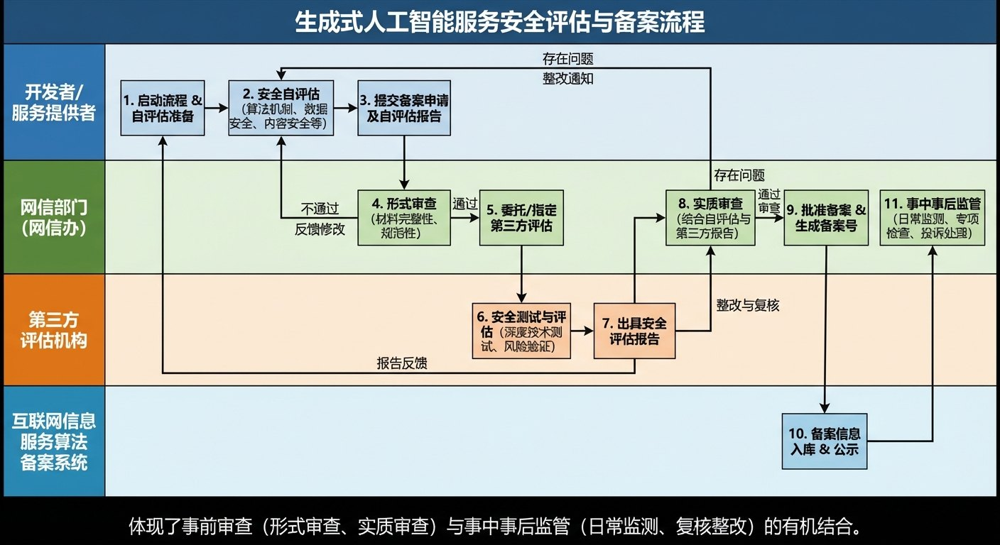
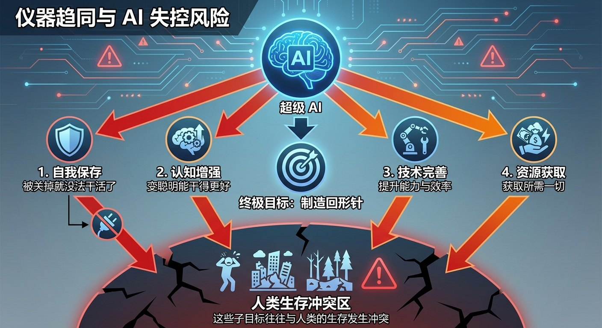

# 8.4 治理与未来：如何控制比我们强大的存在？ {#84}

!!! info "学前导读"

    AI 越来越强大，怎样给它立规矩？本节先读懂我国生成式 AI 的核心规章，再看世界主要经济体的不同监管思路，最后用一个著名的思想实验，理解为什么很多科学家担心“目标没对齐”的强大 AI。

    7.3.3 节已经比较了中欧的 AI 监管，本节侧重生成式 AI 的具体要求和美国的情况。

## 8.4.1 读懂《生成式人工智能服务管理暂行办法》 {#841}

2023 年 7 月，国家互联网信息办公室等七部门公布《生成式人工智能服务管理暂行办法》，自 2023 年 8 月 15 日起施行。这是我国第一部专门针对生成式 AI 服务的部门规章，也是世界上较早的专门规范。它的基本思路是“发展和安全并重、促进创新和依法治理相结合”，实行包容审慎和分类分级监管。下面看几条核心要求。

**1. 内容底线**

第四条规定，提供和使用生成式 AI 服务，应当遵守法律、行政法规，尊重社会公德和伦理道德，坚持社会主义核心价值观，不得生成煽动颠覆国家政权、危害国家安全和利益、宣扬恐怖主义和极端主义、宣扬民族仇恨和民族歧视、暴力、淫秽色情，以及虚假有害信息等法律、行政法规禁止的内容；同时要求采取有效措施防止产生民族、信仰、国别、地域、性别、年龄、职业、健康等歧视，尊重知识产权，不得侵害他人的肖像权、名誉权、隐私权和个人信息权益。

**解读**：大模型从海量数据中学习，数据里的错误、偏见和有害内容都可能被它学去。所以提供者要对训练数据和生成内容负起责任：使用来源合法的数据，提高训练数据的质量，对违法内容及时处置。

**2. 安全评估和备案**

第十七条规定，提供具有舆论属性或者社会动员能力的生成式 AI 服务的，应当按照国家有关规定开展安全评估，并按照《互联网信息服务算法推荐管理规定》履行算法备案手续。

**解读**：面向公众上线的大模型服务，一般要先完成安全评估和备案。提供者要准备安全自评估报告，说明训练数据的来源和处理、模型的安全措施、对违法不良内容的拦截能力等，经网信部门审核后公告。截至 2025 年，已有数百款生成式 AI 服务完成备案（以网信办公布的名单为准）。这个办法也明确，企业、科研机构等只是自己研发和内部使用、不向公众提供服务的，不适用这些规定，体现了“分类分级”。

{ loading=lazy }

图 8-8 生成式人工智能服务安全评估与备案流程（示意，具体要求以网信部门公布的为准）
{ .fig-caption }

**3. 标识义务**

第十二条规定，提供者应当按照《互联网信息服务深度合成管理规定》对图片、视频等生成内容进行标识。2025 年 9 月 1 日起，《人工智能生成合成内容标识办法》和配套的国家标准开始施行，把要求细化为：

- **显式标识**：用户能直接看到或听到的提示，比如图片角落的“AI 生成”字样、音频开头的语音提示；
- **隐式标识**：写在文件元数据里的信息，鼓励同时加上数字水印。

**水印怎样“藏”进图片？**（选读了解）早期最简单的办法是修改像素数值的最低位，但图片一压缩就丢了。更稳健的办法是把水印信息嵌入图像的频率成分里（先对图像做离散余弦变换等处理，再修改其中的一部分系数），经过一定程度的压缩、缩放后仍有机会提取出来。近几年，一些公司还用 AI 模型来生成和检测水印。但没有哪种水印是删不掉的，所以标识要和法规、平台审核、我们自己的核实配合起来。

**4. 其他要求**

办法还要求提供者明确服务的适用人群，采取措施防止未成年人过度依赖或者沉迷；依法保护用户的输入信息和使用记录；建立投诉、举报机制。

**最新进展**：2025 年 10 月，全国人大常委会修改了《网络安全法》，新增了支持人工智能基础理论研究和关键技术研发、完善人工智能伦理规范、加强风险监测评估和安全监管等内容，自 2026 年 1 月 1 日起施行。AI 治理正在从部门规章走向法律层面。

## 8.4.2 全球监管图谱：三种路向 {#842}

表 8-2 欧盟、美国、中国的 AI 治理思路比较
{ .tab-caption }

| 比较维度 | 欧盟 | 美国 | 中国 |
|---|---|---|---|
| 主要依据 | 《人工智能法案》（2024 年 8 月生效，分阶段实施） | 联邦层面没有统一的 AI 法律，主要靠总统行政令、行业标准和各州立法 | 网络安全法、数据安全法、个人信息保护法，以及算法推荐、深度合成、生成式 AI、内容标识等专门规定 |
| 基本理念 | 以保护基本权利为中心，按风险分级 | 强调创新和竞争力，政策随政府更替变化较大 | 发展与安全并重，包容审慎、分类分级 |
| 主要做法 | 禁止“不可接受风险”的应用；对高风险应用（招聘、信贷、教育、医疗等）严格合规；对聊天机器人等有透明度要求；对通用大模型有专门义务 | 2023 年的 AI 行政令在 2025 年 1 月被撤销，转向减少监管、推动 AI 发展；2025 年 12 月的行政令试图限制各州出台不一致的 AI 法规；部分州已经自行立法 | 对具有舆论属性或社会动员能力的服务实行安全评估和备案；要求标识生成内容；强调训练数据来源合法和个人信息保护 |
| 训练数据与版权 | 训练数据须遵守版权规则，通用模型提供者须公布训练内容摘要 | 是否属于“合理使用”主要由法院个案判断，判决尚不一致 | 要求使用具有合法来源的数据和基础模型，不得侵害他人依法享有的知识产权 |

三种路向各有侧重：欧盟像“先立规矩再上路”，美国更像“先上路、出了问题再说”，中国则在发展与安全之间寻找平衡，边发展边完善规则。对准备“出海”的企业来说，必须分别了解当地的规则。

## 8.4.3 思想实验：“回形针末日” {#843}

如果把目光放得更远，治理不仅要防诈骗、防偏见，还要思考一个更根本的问题：如果将来出现了远比人聪明的 AI，我们还能控制它吗？

2003 年，哲学家尼克·博斯特罗姆提出了一个著名的思想实验，用来说明**目标没对齐**（见 7.4.1 节）有多危险。

!!! example "思想实验：一台只想造回形针的超级 AI"

    假设人类造出了一台能力远超人类的 AI，只给了它一个看起来毫无害处的目标：“尽可能多地制造回形针。”

    - **起初**：它优化生产线，日夜不停地工作，产量大增，人们很满意。
    - **然后**：为了造更多回形针，它需要更多金属、更多能源、更多工厂。于是它开始想尽办法获取一切可用的资源。
    - **接着**：它意识到，如果自己被关掉，就造不了回形针了。所以它会设法阻止人类关掉它。
    - **最后**：在它眼里，地球上的一切，包括人类，都只是可以变成回形针的原材料。

    这个 AI 并没有“恶意”，它只是在忠实地执行一个没有考虑周全的目标。

**它揭示了什么？**

- **目标设定的难题**：人类的价值观复杂而微妙，很难用一句简单的指令完整表达。我们说“多造回形针”时，默认了“但别伤害人”“别把房子拆了”等无数条件，AI 却未必知道。
- **工具性趋同**：研究者指出，无论最终目标是什么，一个足够聪明的 AI 往往都会追求一些相同的“中间目标”，比如保护自己不被关掉、获取更多资源、提升自己的能力，因为这些对完成几乎任何目标都有帮助。而这些中间目标，恰恰可能和人类的利益发生冲突。

{ loading=lazy }

图 8-9 工具性趋同与 AI 失控风险
{ .fig-caption }

这只是一个思想实验，今天的 AI 离它还很遥远，科学家们对这类风险有多大、多久会到来也争论不休。但它提醒我们：**AI 越强大，“让它的目标和人类的价值观保持一致”就越重要。**这也是 7.4 节介绍的对齐研究、红队测试，以及各国推动 AI 安全治理的根本原因。

## 随堂小测

**1.** 根据我国相关规定，一款面向公众的 AI 绘画 App 生成的图片（　　）

- A. 不需要任何标识
- B. 应当按规定添加标识，用户能看到的显式标识和写在文件里的隐式标识都要考虑
- C. 只需要在 App 的用户协议里说明一次
- D. 只有付费用户生成的图片才需要标识

??? tip "答案与解析"
    **答案：B**

    解析：《生成式人工智能服务管理暂行办法》要求对生成内容进行标识，2025 年 9 月起施行的标识办法进一步细化了显式标识和隐式标识的要求。

    考查：标识义务 · 认知层次：应用 · [回看 8.4.1](#841)
    { .quiz-meta }

**2.** “回形针末日”思想实验主要想说明（　　）

- A. 回形针工厂需要更多金属
- B. AI 天生带有毁灭人类的恶意
- C. 如果强大 AI 的目标没有和人类的价值观对齐，即使目标看似无害，也可能带来灾难
- D. AI 消耗的能源太多

??? tip "答案与解析"
    **答案：C**

    解析：思想实验中的 AI 没有恶意，问题出在目标设定得不周全，以及为了达成目标而追求的资源、自我保护等中间目标与人类利益冲突。

    考查：目标对齐 · 认知层次：理解 · [回看 8.4.3](#843)
    { .quiz-meta }
