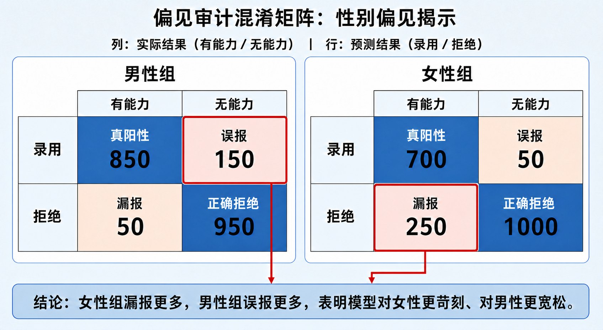
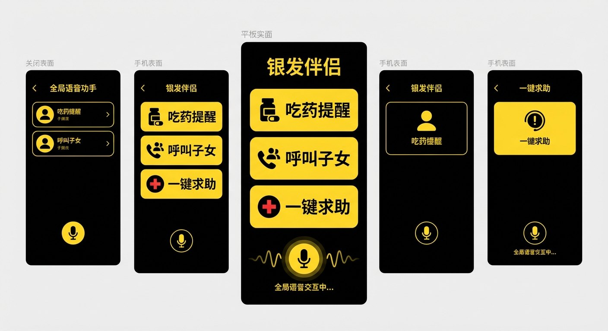

# 8.6 实战演练：算法偏见审计与伦理设计 {#86}

!!! info "学前导读"

    本节用“一破一立”两个活动实践 AI 伦理：先当**审计员**，检查一个号称公平的招聘模型；再当**产品经理**，为独居老人设计一款 AI 助手，并在设计中主动排查伦理风险。

    第一个活动用交互动画完成，不需要写代码；想看代码的同学可以展开“深入一步”。

## 8.6.1 实验：隐形偏见的审计 {#861}

**背景**：一家科技公司开发了简历筛选 AI，声称它是公平的，因为训练时已经删掉了“性别”这一列。你受邀对它做一次审计。

**动手做 · 招聘模型偏见审计**

<iframe class="sim-frame" src="../../../sims/proxy-bias-audit/main.html" height="760" loading="lazy" title="招聘模型偏见审计"></iframe>

1. 先看历史录用数据：在“编程能力”相同的情况下，男女应聘者的录用率一样吗？
2. 训练一个**不使用性别**的模型，分别统计它对男性和女性的录用率；
3. 打开“毕业院校与性别的关系”，看看名校出身这个特征和性别有什么关联；
4. 查看男女两组的混淆矩阵，比较“有能力却被拒绝”（漏报）的比例；
5. 试试几种改进办法（去掉院校特征、调整不同组的录用门槛、修正历史标签），观察录用率差距和整体准确率怎样变化。

[全屏打开](../../sims/proxy-bias-audit/main.html){ target=_blank } · [教学说明](../../sims/proxy-bias-audit/index.md)
{ .sim-caption }

**审计结论**：即使删掉了性别，模型仍然可以通过与性别相关的“毕业院校”间接区别对待（代理变量，见 8.2.2 节）；更根本的是，它学习的历史录用结果本身就带有偏见。

{ loading=lazy }

图 8-10 偏见审计：男女两组的混淆矩阵（示意）
{ .fig-caption }

从图 8-10 可以看出，女性组“有能力却被拒绝”的人更多，男性组“没能力却被录用”的人更多：模型对女性更苛刻、对男性更宽松。

**怎样改进？** 没有一劳永逸的办法，常见的做法包括：

- **查数据**：检查历史标签是否本身带有偏见，必要时修正或重新收集；
- **查结果**：上线前后都要按性别、年龄、地区等分组统计结果，持续审计；
- **加约束**：在训练时加入公平性约束，或者对不同群体分别校准决策门槛（选择哪种公平标准，见 8.2.4 节）；
- **留给人**：模型只做初筛建议，最终决定由人作出，并允许应聘者申诉。

??? note "深入一步（选学）：用 Python 复现这次审计"
    下面的代码用模拟数据重现了上面的过程。历史录用规则主要看编程能力，名校有加分，但同样条件下男性也更容易被录用（偏见）；名校中男性比例略高（代理变量）。训练模型时删掉了性别列。

    ```python
    import numpy as np
    import pandas as pd
    from sklearn.linear_model import LogisticRegression

    n = 1000
    rng = np.random.default_rng(42)
    gender = rng.integers(0, 2, n)                     # 0 = 女，1 = 男
    # 代理变量：男性有 60% 来自名校，女性有 40%
    school = np.where(gender == 1, rng.random(n) < 0.6, rng.random(n) < 0.4).astype(int)
    coding = rng.integers(0, 11, n)                    # 编程能力 0～10 分
    # 带偏见的历史录用：同样条件下，男性多加 1 分
    score = coding * 0.6 + school * 2 + gender * 1 + rng.normal(0, 1, n)
    hired = (score > 7).astype(int)

    df = pd.DataFrame({"coding": coding, "school": school,
                       "gender": gender, "hired": hired})

    # “盲”训练：只用编程能力和院校，不用性别
    X = df[["coding", "school"]]
    clf = LogisticRegression().fit(X, df["hired"])
    df["pred"] = clf.predict(X)

    m = df[df.gender == 1]["pred"].mean()
    f = df[df.gender == 0]["pred"].mean()
    print(f"男性录用率：{m:.1%}")
    print(f"女性录用率：{f:.1%}")
    print(f"差距：{m - f:.1%}")
    ```

    运行结果：

    ```text
    男性录用率：17.5%
    女性录用率：11.8%
    差距：5.7%
    ```

    模型没有看到性别，却仍然对男性录用得更多，因为它给“名校”这个特征分配了很大的权重，而名校中男性更多。注意：这里男女样本数量本来就大致相等，所以单靠“让男女样本数量平衡”解决不了问题，还要检查标签本身和代理变量。

## 8.6.2 设计工作坊：为独居老人设计“适老 AI” {#862}

**背景**：截至 2024 年底，我国 65 岁及以上的老年人口已超过 2.2 亿，占总人口的 15% 以上。很多老年人面临“数字鸿沟”：看不清手机上的小字，不会用打车软件，甚至因为不会扫码而买菜困难。

**任务**：分组设计一款基于大模型的智能助手，帮助独居老人。按下面三步完成。

**第一步：共情——了解用户**

用户画像：张奶奶，75 岁，独居，视力模糊，只会用微信语音；担心被骗，不敢绑定银行卡。她的困扰包括：

- **用药**：药太多记不住，降压药、降糖药常常吃错时间；
- **孤独**：子女在外地工作，一周才打一次电话；
- **生活**：家里灯泡坏了，不知道该找谁修；
- **安全**：经常接到自称“客服”“公检法”的陌生电话。

**第二步：定义——设计核心功能**

参考方案（你可以修改、补充）：

- **拍照识药**：对着药盒拍照，AI 识别药名，结合医生开的用法生成语音提醒（“张奶奶，早上 8 点了，该吃降压药了，就是那个白色瓶子”）。识别结果要请子女或社区医生确认一次。
- **语音陪伴**：用大字体、大按钮和语音交互；可以陪老人聊天、读新闻、讲天气；子女可以录制真实的语音留言，由助手按时播放。
- **一键求助**：一键呼叫子女、社区网格员或物业维修。
- **防诈提醒**：通话中出现“转账”“安全账户”“验证码”等关键词时，用语音提醒老人“可能是诈骗，先挂断，问问子女”，并在老人同意的前提下通知子女。

{ loading=lazy }

图 8-11 “银发伴侣”适老 AI 交互原型设计
{ .fig-caption }

**第三步：伦理风控——回答四个拷问**

1. **隐私**：用药记录属于敏感的健康信息，怎样防止被泄露给推销保健品的公司？
    - 参考：能在手机上本地完成的处理就不上传云端；只收集必要的数据；不得把数据用于营销；遵守《个人信息保护法》对敏感个人信息“单独同意”的要求。
2. **依赖**：如果 AI 陪伴太“完美”，张奶奶会不会越来越少和真人来往？
    - 参考：AI 主动鼓励老人参加社区活动、给子女打电话（“张奶奶，今天天气好，社区广场有合唱活动，去看看吧”）。
3. **声音克隆**：能不能用 AI 模仿子女的声音陪老人聊天，让她“像在和孩子说话”？
    - 参考：**不建议**。这会让老人分不清真假，也会让她更容易被冒充子女声音的诈骗得手（7.1.2 节）。可以播放子女真实录制的语音，但不要让 AI 冒充亲人。
4. **自主**：遇到可疑电话，AI 能不能直接替老人挂断？
    - 参考：提醒和建议优先，尊重老人自己的决定；需要更强干预时，应事先和老人及家属商量好规则。

**成果展示**：每组用一页纸或一张原型图展示方案，重点说明“我们为老人解决了什么问题”和“我们主动规避了哪些伦理风险”。线下课上进行展示和互评。

## 随堂小测

<div class="quiz" data-answer="B" markdown>

**1.** 审计一个招聘模型是否公平，下面做法中最关键的是（　　）

- A. 确认训练数据里已经删掉了性别列
- B. 按性别等分组统计模型的录用率和各类错误率，并检查历史标签是否带有偏见
- C. 只看模型整体的准确率
- D. 相信开发公司的声明

</div>

??? tip "答案与解析"
    **答案：B**

    解析：删掉敏感特征不等于公平，代理变量和带偏见的历史标签都会让偏见“漏”进来。必须按群体看结果，才能发现问题。

    考查：偏见审计 · 认知层次：应用 · [回看 8.6.1](#861)
    { .quiz-meta }

<div class="quiz quiz-judge" data-answer="×" markdown>

**2.** 为了缓解独居老人的孤独，适老 AI 最好用克隆的子女声音和老人聊天，越像越好。（　　）

- √
- ×

</div>

??? tip "答案与解析"
    **答案：×**

    解析：让 AI 冒充亲人会让老人分不清真假，还会让她更难识别冒充亲人声音的诈骗。可以播放子女真实录制的语音，但不应让 AI 冒充亲人。

    考查：伦理设计 · 认知层次：评价 · [回看 8.6.2](#862)
    { .quiz-meta }
