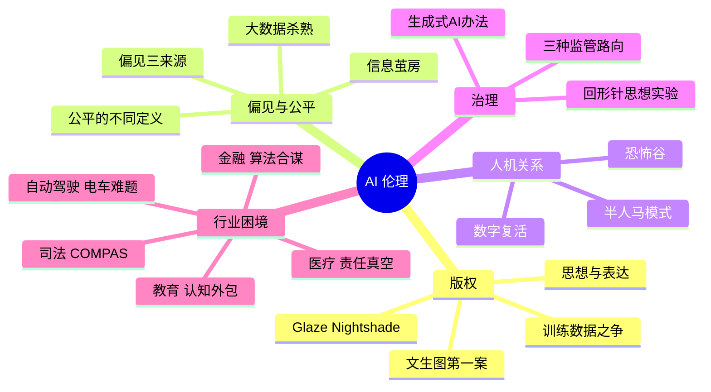

# 第 8 章 本章小结与练习

## 本章小结

本章走出代码，走进法律与道德的“无人区”：

- **版权**：用作品训练 AI 是否需要授权，各国还在诉讼和立法中探索；AI 生成物能否受保护，关键看人有没有独创性的智力投入，并且要拿得出证据。合法不等于合乎伦理。
- **偏见**：算法偏见来自代表性偏差、历史偏见和代理变量；删掉敏感特征不等于公平。“公平”有多种定义且往往不能同时满足，选择哪种是社会的价值选择。
- **人机关系**：“数字复活”要尊重逝者和家属的意愿；AI 陪伴要警惕依赖；“半人马”式的协作是多数职业的未来。
- **治理**：我国以《生成式人工智能服务管理暂行办法》等规定为核心，要求内容合规、安全评估与备案、标识生成内容；欧盟、美国、中国走出了不同的治理路向；“回形针”思想实验提醒我们对齐的重要性。
- **行业困境**：责任真空、算法合谋、认知外包、评分公平、电车难题，都没有简单的答案，需要有人负责、公开讨论。

表 8-3 本章核心知识点
{ .tab-caption }

| 维度 | 核心议题 | 中国视角 | 关键概念 |
|---|---|---|---|
| 版权 | 训练数据授权；生成物归属 | 北京互联网法院“AI 文生图”案：看人的独创性智力投入；广州互联网法院“奥特曼”案 | 思想与表达二分法、合理使用、Glaze |
| 偏见 | 杀熟、歧视、黑箱 | 个人信息保护法、算法推荐管理规定禁止不合理的差别待遇 | 代理变量、公平的不同定义、可解释性 |
| 人机 | 伙伴还是替代 | 民法典保护逝者肖像、声音等；深度合成须取得单独同意 | 恐怖谷、数字永生、半人马模式 |
| 治理 | 发展与安全 | 生成式 AI 办法：内容底线、安全评估与备案、标识；网络安全法新增 AI 条款 | 分类分级、工具性趋同、对齐 |

**写在全书最后**：从第 1 章“AI 是什么”，到第 8 章“AI 应该怎样”，我们走完了一次完整的旅程。技术会一直变，今天的工具明天可能就过时了；但会提问、会核实、会协作、守底线，这四种能力不会过时。愿你成为一个既会用 AI、又能为 AI 把关的人。

## 课后练习

**一、单项选择题**

**1.** 在北京互联网法院“AI 文生图”著作权案中，判定涉案图片受著作权保护的关键是（　　）

- A. 图片由顶尖的 AI 模型生成
- B. 图片具有很高的艺术价值
- C. 原告在构思、设计提示词、调整参数和挑选结果中体现了独创性的智力投入
- D. AI 公司在用户协议中放弃了所有权利

??? tip "答案与解析"
    **答案：C**

    解析：法院看的是人的独创性智力投入。拿不出创作过程证据、无法证明独创性的，也可能不被认定为作品。

    考查：AI 生成物版权 · [回看 8.1.2](8-1.md#812)
    { .quiz-meta }

**2.** 版权法中的“思想与表达二分法”是指（　　）

- A. 保护 AI 模仿出的所有画风
- B. 保护具体的作品（表达），不保护抽象的风格、创意（思想）
- C. 禁止 AI 学习任何人类作品
- D. 认定 AI 生成的内容都属于“思想”

??? tip "答案与解析"
    **答案：B**

    解析：单纯模仿风格通常不构成侵权，但与具体作品实质性相似就可能侵权。

    考查：思想与表达二分法 · [回看 8.1.4](8-1.md#814)
    { .quiz-meta }

**3.** “大数据杀熟”中，平台给老用户报更高价格的逻辑是（　　）

- A. 老用户对平台更忠诚，应该多付钱
- B. 算法预测老用户愿意支付的价格更高、对价格不敏感
- C. 系统出现了随机错误
- D. 法律要求老用户多付钱

??? tip "答案与解析"
    **答案：B**

    解析：平台根据用户画像预测支付意愿，对不同的人区别定价。我国法律禁止在交易价格等交易条件上实行不合理的差别待遇。

    考查：大数据杀熟 · [回看 8.2.1](8-2.md#821)
    { .quiz-meta }

**4.** 训练数据中“首席执行官”的图片大多是男性，导致文生图模型画 CEO 时几乎总是男性。这主要属于哪一类偏见来源？（　　）

- A. 硬件故障
- B. 模型参数太少
- C. 用户提示词写错了
- D. 数据反映了现实中的历史偏见，模型学到并可能放大了它

??? tip "答案与解析"
    **答案：D**

    解析：数据记录的是不平等的现实，模型照单全收，还可能比现实更极端。

    考查：偏见的来源 · [回看 8.2.2](8-2.md#822)
    { .quiz-meta }

**5.** 当机器人“非常像人、又不完全像”时，人们会感到诡异甚至恐惧，这种现象叫（　　）

- A. 信息茧房
- B. 半人马效应
- C. 恐怖谷效应
- D. 自动化偏见

??? tip "答案与解析"
    **答案：C**

    解析：恐怖谷效应由森政弘在 1970 年提出，它的成因还有多种解释。

    考查：恐怖谷效应 · [回看 8.3.2](8-3.md#832)
    { .quiz-meta }

**6.** 2005 年“自由式”国际象棋比赛的结果给我们的主要启示是（　　）

- A. 好的人机协作流程，比单纯的人强或机器强更重要
- B. 人类棋手已经完全不需要电脑
- C. 超级计算机永远是最强的
- D. 只有特级大师才能用好电脑

??? tip "答案与解析"
    **答案：A**

    解析：冠军是两位用普通电脑的业余棋手，靠的是更好的协作方法。

    考查：半人马模式 · [回看 8.3.3](8-3.md#833)
    { .quiz-meta }

**7.** 按照《生成式人工智能服务管理暂行办法》，下列说法正确的是（　　）

- A. 所有企业内部自用的模型都必须备案
- B. 生成内容不需要标识
- C. 提供具有舆论属性或社会动员能力的服务，应当开展安全评估并履行备案手续
- D. 只要用户同意，就可以生成任何内容

??? tip "答案与解析"
    **答案：C**

    解析：这是办法第十七条的规定。只在内部研发、使用而不向公众提供服务的，不适用该办法；生成内容须按规定标识。

    考查：生成式 AI 办法 · [回看 8.4.1](8-4.md#841)
    { .quiz-meta }

**8.** 在 AI 辅助医疗决策中，“责任真空”指的是（　　）

- A. 医院买不起 AI 设备
- B. AI 模型不需要训练
- C. 医生被 AI 取代
- D. 出了问题时，医生、医院和开发者之间的责任难以界定

??? tip "答案与解析"
    **答案：D**

    解析：再加上自动化偏见，“由人决定”可能流于形式。需要可解释的建议、独立判断的记录和清晰的责任划分。

    考查：责任真空 · [回看 8.5.1](8-5.md#851)
    { .quiz-meta }

**二、判断题**

**9.** 只要 AI 生成的内容足够精美，就自动享有著作权。（　　）

- √
- ×

??? tip "答案与解析"
    **答案：×**

    解析：判断标准是人的独创性智力投入，与画面是否精美无关。

    考查：AI 生成物版权 · [回看 8.1.2](8-1.md#812)
    { .quiz-meta }

**10.** 训练招聘模型时删掉“性别”一栏，就能保证它不会歧视女性。（　　）

- √
- ×

??? tip "答案与解析"
    **答案：×**

    解析：模型可能通过院校、兴趣等代理变量间接区别对待，历史标签本身也可能带有偏见。必须按群体审计结果。

    考查：代理变量 · [回看 8.6.1](8-6.md#861)
    { .quiz-meta }

**11.** 未经家属同意，用 AI 合成已故明星的形象和声音带货，可能侵犯逝者的人格利益。（　　）

- √
- ×

??? tip "答案与解析"
    **答案：√**

    解析：《民法典》保护死者的肖像、姓名、名誉等，其近亲属有权依法主张权利；声音参照肖像权保护。

    考查：数字复活 · [回看 8.3.1](8-3.md#831)
    { .quiz-meta }

**12.** “回形针”思想实验中的 AI 并没有恶意，危险来自目标设定不周全。（　　）

- √
- ×

??? tip "答案与解析"
    **答案：√**

    解析：它只是忠实地执行目标，而获取资源、避免被关掉等中间目标可能与人类利益冲突。

    考查：目标对齐 · [回看 8.4.3](8-4.md#843)
    { .quiz-meta }

**三、简答题**

**13.** 为什么说“删掉敏感特征”不能保证算法公平？请结合代理变量和历史偏见说明，并提出两种改进办法。

??? tip "参考答案"
    其他特征（如毕业院校、居住地区、兴趣爱好）可能和性别、民族等敏感特征高度相关，模型会通过这些代理变量间接“找回”被删掉的信息；而且训练用的历史结果本身可能就记录了不公平的决定，模型会照样学去。改进办法：按群体统计录用率和各类错误率，持续审计；检查并修正带偏见的历史标签；在训练中加入公平性约束或分组校准门槛；让模型只做初筛，最终由人决定并允许申诉。

**14.** 以 COMPAS 争议为例，说明为什么“选择哪种公平”是一个社会选择，而不仅是技术问题。

??? tip "参考答案"
    报道认为评分不公平，因为没有再犯的黑人被告被错判为高风险的比例接近白人的两倍；软件公司认为评分公平，因为同样的分数在两个群体中对应的实际再犯比例相近。两种标准各有道理，但当两个群体的基础比例不同时，数学上无法同时满足。因此，采用哪一种标准，涉及对不同人群利益的取舍，应当由受影响的人、法律界和社会公开讨论决定，而不是只由工程师在代码里决定。

**15.** 结合本章内容，谈谈大学生应怎样使用 AI 完成学业，才能既提高效率又不陷入“认知外包”和学术不端。

??? tip "参考答案"
    要点：遵守学校和课程的 AI 使用规定，如实说明在哪些环节使用了 AI；把 AI 当作“陪练”而不是“代写”，比如让它解释概念、出题考自己、指出论证漏洞，自己完成核心的思考和写作；核实 AI 给出的事实和引用；关键能力要自己反复练习，比如关掉 AI 也能写出自己的理解。

**四、辩论与思考**

1. **辩论**：“AI 生成的作品不应受版权保护”。请正反双方各准备三条论据。
2. **思考**：如果你所在的城市要引入 AI 辅助审批低保、助学金申请，你认为应当设置哪些“护栏”？

## 拓展阅读

1. 北京互联网法院. 李某诉刘某侵害作品署名权、信息网络传播权纠纷案判决书（2023）京 0491 民初 11279 号[Z]. 2023. 我国首例 AI 文生图著作权案，对应 8.1.2 节。
2. 国家互联网信息办公室等. 生成式人工智能服务管理暂行办法[Z]. 2023. 附录 A 有节选，对应 8.4.1 节。
3. ANGWIN J, LARSON J, MATTU S, et al. Machine bias[EB/OL]. ProPublica, 2016. COMPAS 调查报道，对应 8.5.4 节。
4. KLEINBERG J, MULLAINATHAN S, RAGHAVAN M. Inherent trade-offs in the fair determination of risk scores[EB/OL]. arXiv:1609.05807, 2016. 公平标准不能同时满足的证明，对应 8.2.4 节。
5. AWAD E, DSOUZA S, KIM R, et al. The Moral Machine experiment[J]. Nature, 2018, 563: 59-64. “道德机器”实验，对应 8.5.5 节。
6. BOSTROM N. 超级智能：路线图、危险性与应对策略[M]. 张体伟，张玉青，译. 北京：中信出版社，2015. “回形针”思想实验与工具性趋同，对应 8.4.3 节。
7. 奥尼尔. 算法霸权：数学杀伤性武器的威胁[M]. 马青玲，译. 北京：中信出版社，2018. 算法怎样在招聘、信贷、司法中放大不公，对应 8.2 节。
